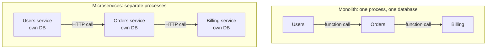
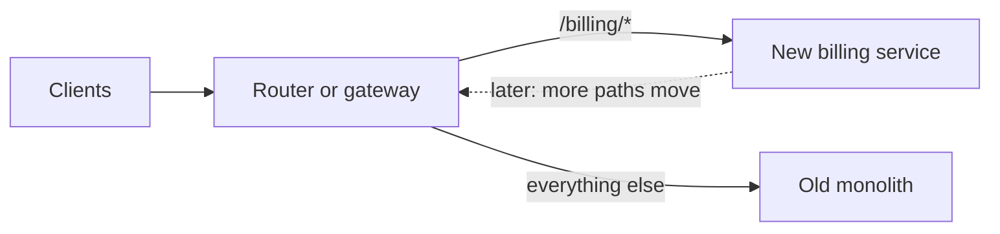

# Monoliths and microservices

After this you can describe the trade-off between a monolith and microservices, estimate what splitting costs in latency and availability, and explain why the usual advice is to start with a modular monolith.

Before this: [Layered architecture and MVC](04-layered-architecture-and-mvc.md) and [Memory hierarchy and latency numbers](../../01-how-computers-work/02-hardware/04-memory-hierarchy-and-latency-numbers.md).

## The idea

A shop has users, products, orders and payments. In version one, all of it is one program with one database, deployed as one unit. That is a **monolith**, and it is a perfectly good design. Orders call billing with a function call, and a transaction can update both together.

Later the team grows. Deployments queue behind each other, one slow report slows checkout, and every change needs the whole system re-tested. Splitting the system into separate programs, each running on its own and talking over the network, is the **microservices** answer.



In the diagram, the same three parts talk by function call (top) or by network call (bottom). That change from "call" to "request" is where most of the cost comes from.

## Key terms

A **monolith** is an application deployed as a single unit. A **modular monolith** is a monolith whose code is divided into modules with clear boundaries and small public interfaces, so the parts could be separated later.

A **microservice** is a small, independently deployable service that owns one business capability and its data. A **service boundary** is the line around what a service owns. **Observability** is the ability to understand a running system from its logs, metrics and traces.

**Conway's law** says that organizations design systems that mirror their own communication structure (Melvin Conway, 1967). Four teams tend to build four services.

## How it works

Microservices buy independent deployment and scaling, and the price is the network. Compare the two sides of the diagram:

| | Monolith | Microservices |
|---|---|---|
| Call between parts | Function call, nanoseconds | Network round trip, hundreds of microseconds or more |
| A call can fail by | An exception | Timeout, refused connection, partial failure |
| Data | One database, one transaction | One database per service, no cross-service transaction |
| Deploy | One release | Many, each with its own pipeline |
| Debugging | One stack trace | A request crosses services, so you need distributed traces |
| Scaling | Whole app | Each service on its own |

Each cost has a specific form. Network calls add latency and can fail halfway. Distributed data means that "reserve stock and charge the card" is no longer one transaction; you need patterns such as sagas, which are retried steps with compensating actions. Deployment and observability overhead means each service needs its own build, config, logging and monitoring, as in Logging, metrics and monitoring<!-- link: ../../13-devops-and-cloud/04-operations/01-logging-metrics-and-monitoring.md -->.

When to split:

1. A part needs to scale very differently from the rest (image processing against a CRUD API).
2. Separate teams keep blocking each other's releases.
3. A part has a different technical need (a different language, a different data store, or a different compliance boundary).

Good boundaries follow business capabilities (billing, catalogue, shipping), not technical layers (a "database service"). A boundary in the wrong place means every change touches two services and they need to be released together, which is a **distributed monolith**: all the costs of microservices and none of the benefits.

The usual advice is to start with a modular monolith, with modules like `billing/` that other modules reach only through a small public interface:

```text
shop/
  users/      public: get_user(id)
  orders/     public: place_order(...)
  billing/    public: charge(customer, cents)
```

If a module later needs to leave, its interface is already the contract.

To migrate gradually, the **strangler fig** pattern puts a router in front and moves one path at a time to a new service while the old monolith keeps serving the rest:



In the diagram, the monolith shrinks as paths move across, and nothing is rewritten in one go. Once nothing routes to the old code, it is deleted.

## Worked examples

<div class="example" markdown>

### Example 1: what a split costs

A checkout request touches 6 internal components in sequence. We estimate the latency and the availability for a monolith and for six services.

1. A function call is on the order of 100 ns. Six calls cost 0.6 µs.
2. A network round trip inside one data centre is about 500 µs (from the [latency table](../../01-how-computers-work/02-hardware/04-memory-hierarchy-and-latency-numbers.md)). Six cost 3 ms.
3. If each service is up 99.9% of the time and a request needs all of them, availability is the product: $0.999^n$ for $n$ services.

```python
availability = 0.999
for n in (1, 5, 10):
    chain = availability ** n
    downtime = (1 - chain) * 365 * 24 * 60
    print(f"{n:2} services in a chain: {chain * 100:.2f}% up, {downtime:,.0f} min down per year")

in_process_ns = 100
network_ns = 500_000
hops = 6
print(f"{hops} calls in-process: {hops * in_process_ns / 1000:.1f} us")
print(f"{hops} calls over network: {hops * network_ns / 1e6:.1f} ms")
```

```text
 1 services in a chain: 99.90% up, 526 min down per year
 5 services in a chain: 99.50% up, 2,623 min down per year
10 services in a chain: 99.00% up, 5,232 min down per year
6 calls in-process: 0.6 us
6 calls over network: 3.0 ms
```

Check: 0.999 to the power 5 is about 0.995, as printed. Three milliseconds is acceptable for one request but not if each hop retries or fans out to more services. Ten services in a chain, each at 99.9%, give the system about 99%: roughly 87 hours a year of downtime, against 8.8 hours for one. The estimate assumes failures are independent and every call is required; timeouts, retries and fallbacks change it.

</div>

## Common mistakes

<div class="warning" markdown>

Watch out: starting with microservices for a product with a handful of developers. The overhead arrives on day one, while the problems they solve (team size, scale) do not.

Watch out: services that share a database. Every schema change is then a cross-team change, and the "independence" is gone.

Watch out: splitting along technical layers, or so finely that one user action calls twelve services.

</div>

## Working with AI

<div class="ai" markdown>

Words to use: modular monolith, service boundary, distributed monolith, Conway's law, saga, strangler fig, observability.

Prompts to try:

- "We have a Django monolith with about 6 developers. Orders, billing and catalogue share one Postgres database. Outline how to make it a modular monolith first, with module boundaries and a rule on cross-module imports. Do not propose microservices yet."
- "Which parts of this system (describe) would justify an independent service, with a concrete reason for each, and which should stay together?"

What to check:

- Microservices proposed for a small team with no scaling or ownership problem. Ask which problem each service solves.
- Missing failure handling: timeouts, retries and what happens when a downstream service is down.
- A shared database hiding behind separate services.
- Invented numbers for latency or uptime. Check against your own measurements.

</div>

## Quiz

1\. Why does moving a function call to a network call matter beyond speed?

<details class="solution" markdown>
<summary>Answer</summary>

Network calls can fail partway, time out, or return late, and the data on both sides can no longer be updated in one transaction. The caller must handle all of that.

</details>

2\. A request needs 3 services in a chain, each at 99.9%. What is the availability, approximately?

<details class="solution" markdown>
<summary>Answer</summary>

$0.999^3 \approx 0.997$, about 99.7%.

</details>

3\. Two "microservices" must always be deployed together and read the same tables. What is this called and what would you do?

<details class="solution" markdown>
<summary>Answer</summary>

A distributed monolith. Merge them back into one service or module, or move the shared data behind one owner with an API, then decide again whether to split.

</details>

4\. How does a strangler fig migration lower the risk of leaving a monolith?

<details class="solution" markdown>
<summary>Answer</summary>

It moves one path at a time behind a router, so each step is small and reversible. The old code keeps serving traffic until nothing needs it.

</details>

## Lab

<div class="lab" markdown>

### Lab: availability of your own chain

Goal: compute how availability falls as services are added and decide a limit. Time: about 10 minutes. Runs in: any terminal with Python 3.

1. Save the Example 1 script.
2. Change the per-service availability to 99.95% and 99.5%, and run it.
3. Find the largest $n$ that still gives at least 99.5% when each service is 99.9% available.
4. Write one sentence about what you would do if the design needed more services than that (for example, make some calls optional with a fallback).

Expected result for step 3: $n = 5$.

<details class="solution" markdown>
<summary>Solution</summary>

```python
a = 0.999
n = 1
while a ** (n + 1) >= 0.995:
    n += 1
print(n)
```

```text
5
```

$0.999^5 = 0.99501$ and $0.999^6 = 0.99402$.

</details>

</div>

## Where this shows up

- Queues decouple services so a slow one does not block the others: [Queues and event-driven design](../02-system-design/06-queues-and-event-driven-design.md).
- Deployment: [Deployment strategies](../../13-devops-and-cloud/02-ci-cd/03-deployment-strategies.md).
- Next: [Coupling, cohesion and refactoring](06-coupling-cohesion-and-refactoring.md).
