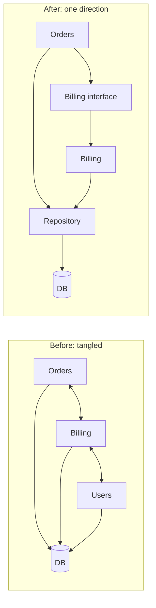
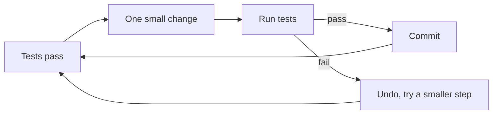

# Coupling, cohesion and refactoring

After this you can name the symptoms of tightly coupled and low-cohesion code, refactor a function in small steps with tests as a safety net, and explain technical debt to a non-engineer.

Before this: [Monoliths and microservices](05-monoliths-and-microservices.md) and [Unit testing](../../06-developer-tools-and-workflow/03-code-quality/01-unit-testing.md).

## The idea

You change the tax rate in one file, and the invoice PDF, the monthly report and a checkout test all break. Nothing in the tax file mentions them. They depended on it in ways the code did not make visible.

Two ideas explain most of this. **Coupling** is how much one part of a program depends on the details of another. **Cohesion** is how closely the things inside one part belong together. Good design aims for low coupling between parts and high cohesion within each part, and the earlier lessons (SRP, layers, interfaces) are ways to get both.



In the diagram, "before" has arrows both ways between Orders and Billing and three modules reaching into the database. In "after", arrows go one way, Billing is reached through an interface, and only the repository touches the DB.

## Key terms

**Tight coupling** means a change in one part forces changes in others. **Loose coupling** means parts talk through small, stable interfaces.

**Low cohesion** means a module mixes unrelated jobs (`utils.py` with date parsing, email and a tax table). **High cohesion** means everything in the module serves one purpose.

**Refactoring** is changing the structure of code without changing its behaviour. If behaviour changes, it is a feature change or a bug fix, and it should be a separate commit.

**Technical debt** is the future cost of shortcuts taken now, such as missing tests, duplicated code or a known-bad design. Like financial debt, it is sometimes a good deal, and it accrues interest: each later change in that area costs more.

## How it works

Signs of tight coupling:

1. A change in one module breaks tests or builds in distant modules.
2. Modules import each other (a cycle), or reach into each other's private fields.
3. A class cannot be tested without a database, network or half the app.
4. Two things must always be changed or deployed together.

Safe refactoring follows a loop, shown below. The tests are the safety net: they tell you within seconds that behaviour has not changed.



Without tests, write a **characterization test** first: call the code with typical and edge inputs, record what it returns today, and assert on that. It pins current behaviour, even if the behaviour is odd.

Common refactorings, each a name worth knowing:

- **Extract function:** move a block into a function with a clear name.
- **Rename:** make a name say what the thing is. Use the editor's rename, not find and replace.
- **Introduce parameter object:** replace a long list of parameters with one object (a dataclass).
- **Replace conditional with polymorphism:** replace an `if/elif` chain on a type with objects that each hold their own behaviour (as in strategy).

## Worked examples

<div class="example" markdown>

### Example 1: three refactorings behind one test

The `price` function takes five parameters and branches on the customer kind.

1. Characterize: record four input sets and their results from the current code, and assert on them.
2. Introduce parameter object: bundle `base`, `qty`, `country` and `express` into an `Order` dataclass.
3. Extract function: move the shipping rules into `shipping_fee(order)`.
4. Replace conditional with polymorphism: give `Guest`, `Student` and `Member` a `rate`, and look the customer up in a dictionary.
5. After every step, run the same assertions.

```python
from dataclasses import dataclass

CASES = [
    (("student", 20, 2, "CA", False), 32.0),
    (("member", 20, 2, "US", False), 51.0),
    (("guest", 20, 2, "CA", True), 50.0),
    (("guest", 20, 1, "US", True), 45.0),
]

@dataclass
class Order:
    base: float
    qty: int
    country: str
    express: bool

class Guest:   rate = 1.0
class Student: rate = 0.8
class Member:  rate = 0.9

def shipping_fee(order):
    fee = 0
    if order.country != "CA":
        fee += 15
    if order.express:
        fee += 10
    return fee

def price2(customer, order):
    total = order.base * order.qty * customer.rate + shipping_fee(order)
    return round(total, 2)

KINDS = {"student": Student(), "member": Member(), "guest": Guest()}
for (kind, base, qty, country, express), expected in CASES:
    assert price2(KINDS[kind], Order(base, qty, country, express)) == expected
print("after: all pass")
```

```text
after: all pass
```

Check: the original `price(kind, base, qty, country, express)`, with its `if kind == "student"` chain, passed the same four assertions and printed `before: all pass`. Adding a new customer kind now means adding a class and one dictionary entry, with no edits to the pricing function.

</div>

## Talking about technical debt

Engineers say "the code is messy", and a manager hears nothing actionable. Say what it costs and what you propose:

- Name the area and the symptom: "The checkout module has no tests, so each change takes two days of manual checking."
- Give a number or a trend: bugs per release, time to ship a change, how many engineers are afraid to touch it.
- Offer a bounded fix tied to a feature: "We will add tests and split the pricing function while building the new discount, about two extra days."

Taking on debt on purpose (a prototype before a demo) is fine if it is written down and repaid. Refactoring in a separate commit from the feature keeps both easy to review and to revert.

## Common mistakes

<div class="warning" markdown>

Watch out: refactoring without tests, then discovering a changed edge case in production. Write the characterization test first.

Watch out: mixing a refactor with a behaviour change in one commit. A reviewer cannot tell which lines change behaviour.

Watch out: refactoring code nobody needs to change. Improve what you are about to modify; leave stable code alone.

</div>

## Working with AI

<div class="ai" markdown>

Words to use: coupling, cohesion, characterization test, extract function, parameter object, behaviour-preserving, technical debt.

Prompts to try:

- "Write characterization tests with pytest for this function (paste it) covering normal inputs, edge cases and every branch. Do not change the function."
- "Refactor this function in separate steps: first introduce a parameter object, then extract the shipping rules, then replace the `if` chain with polymorphism. Show the code after each step so I can run the tests between them."

What to check:

- Tests written to match the AI's rewritten code instead of the original. Generate them from the original and run them against both.
- Behaviour changes in edge cases (rounding, empty input, `None`). Compare outputs, as in the example.
- A single huge diff. Ask for one refactoring per step.
- New dependencies or abstractions you did not ask for.

</div>

## Quiz

1\. Define coupling and cohesion in one sentence each, and say which one should be high.

<details class="solution" markdown>
<summary>Answer</summary>

Coupling is how much one part depends on another's details; cohesion is how closely the contents of one part belong together. Cohesion should be high and coupling low.

</details>

2\. What does `shipping_fee(Order(20, 1, "US", True))` return, given the example's rules?

<details class="solution" markdown>
<summary>Answer</summary>

`25`: 15 for shipping outside Canada plus 10 for express.

</details>

3\. You must change a 300-line function with no tests. What do you do first?

<details class="solution" markdown>
<summary>Answer</summary>

Write characterization tests that record its current outputs for typical and edge inputs, then refactor in small steps, running them after each step.

</details>

4\. A manager asks why you spent a week without new features. Give a one-sentence answer using debt language.

<details class="solution" markdown>
<summary>Answer</summary>

"Checkout changes were taking twice as long because of missing tests and tangled code; the week of cleanup cuts that cost for every later change in that area."

</details>

## Lab

<div class="lab" markdown>

### Lab: refactor behind a test

Goal: apply two refactorings with a test passing at every step. Time: about 20 minutes. Runs in: any terminal with Python 3.

1. Save the `price` function and the four `CASES` from the example, plus a loop asserting them.
2. Run it to confirm `before: all pass`.
3. Extract `shipping_fee(country, express)` as a function and use it inside `price`. Run the assertions.
4. Introduce an `Order` dataclass and change `price` to take `kind` and `order`. Update the calls. Run the assertions.
5. Add a case `("member", 10, 3, "CA", False)` expecting `27.0` and check it passes in both versions.

Expected result: every step ends with all assertions passing.

<details class="solution" markdown>
<summary>Solution</summary>

The final form is `price2` from the example, with the new case added to `CASES`. Check by hand: $10 \times 3 \times 0.9 = 27.0$ and the shipping fee for `"CA"` without express is 0.

</details>

</div>

## Where this shows up

- Code review and pull requests: [GitHub, pull requests and code review](../../06-developer-tools-and-workflow/01-editor-and-git/04-github-pull-requests-and-code-review.md).
- Reviewing AI-written changes for hidden behaviour changes: Reviewing AI code<!-- link: ../../15-ai-and-llms/03-ai-assisted-development/03-reviewing-ai-code.md -->.
