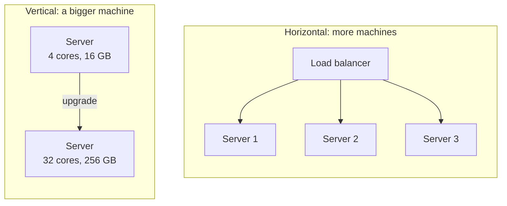

# Scalability basics

After this you can say what "scale" means for a system, find the bottleneck before spending money, and choose between a bigger machine and more machines.

Before this: [memory hierarchy and latency numbers](../../01-how-computers-work/02-hardware/04-memory-hierarchy-and-latency-numbers.md) and [monoliths and microservices](../01-software-design/05-monoliths-and-microservices.md).

## The idea

Your app runs on one server and handles 50 requests per second without trouble. A product launch brings 500 per second, and pages start to time out. Someone says "we need to scale". That sentence hides several questions: what is slow, what is the limit, and what is cheapest to change?

A system **scales** when it can handle more load by adding resources, without a redesign for each step. There are two ways to add them. You can make the one machine bigger, or you can run more machines side by side.



Vertical scaling needs no code change, but it has a ceiling (the biggest machine you can rent) and a single point of failure. Horizontal scaling has no fixed ceiling and survives the loss of one machine, but your code must work when requests land on different servers.

## Key terms

**Throughput** is how much work a system finishes per unit of time, such as requests per second. **Latency** is how long one request takes from start to finish (see the [latency numbers](../../01-how-computers-work/02-hardware/04-memory-hierarchy-and-latency-numbers.md)). They are different goals: a system can process 10,000 requests per second and still make each one wait 2 seconds.

**Vertical scaling** (scaling up) gives one machine more CPU, memory or disk. **Horizontal scaling** (scaling out) adds machines and shares the work.

A server is **stateless** if it keeps nothing between requests that another server would need. Any request can go to any server, because the state lives elsewhere: a database, a cache, or a signed token in the browser (see [sessions, cookies and JWT](../../09-back-end/02-auth/02-sessions-cookies-and-jwt.md)).

A **bottleneck** is the one resource that limits the whole system: CPU, memory, disk, network, a database connection pool, or a lock. Adding capacity anywhere else changes nothing.

A **single point of failure** (SPOF) is a part whose failure takes the whole system down.

## How it works

Scaling is a loop, not a one-off decision.

1. Measure. Find the current requests per second, the 95th percentile latency (the time that 95% of requests beat), and the utilization of CPU, memory, disk and network.
2. Find the bottleneck: the resource that is full while the others are idle.
3. Remove it with the cheapest change: a missing index, a cache, a bigger machine, or a second server.
4. Measure again. A new bottleneck appears somewhere else, and the loop restarts.

Horizontal scaling only helps stateless parts. The usual shape is stateless app servers that scale out freely, with state pushed down into a database or cache that is scaled with more care (the next five lessons). The first thing to check is whether a server stores anything locally: session data in memory, uploaded files on disk, a counter in a variable. Each of these breaks when a second server appears.

More machines do not give a perfect speed-up. **Amdahl's law** says the part of the work that cannot be shared limits the total gain. If a fraction $p$ of the work can run in parallel on $n$ workers, the speed-up is

$$S = \frac{1}{(1 - p) + p / n}$$

In plain words: if 10% of each request must go through one database lock, no number of servers makes the system more than 10 times faster.

```python
def speedup(p, n):
    return 1 / ((1 - p) + p / n)

for p in (0.50, 0.90, 0.99):
    print(f"p={p:.2f}  n=4: {speedup(p, 4):5.2f}x  n=16: {speedup(p, 16):5.2f}x  n=1000: {speedup(p, 1000):6.2f}x  limit: {1/(1-p):.0f}x")
```

```text
p=0.50  n=4:  1.60x  n=16:  1.88x  n=1000:   2.00x  limit: 2x
p=0.90  n=4:  3.08x  n=16:  6.40x  n=1000:   9.91x  limit: 10x
p=0.99  n=4:  3.88x  n=16: 13.91x  n=1000:  90.99x  limit: 100x
```

## Worked examples

<div class="example" markdown>

### Example 1: where is the time going?

An API takes 300 ms per request on a server with 4 cores. A traffic test at 100 requests per second shows 40% CPU use, but latency climbs and requests queue. Do we add servers?

1. Utilization of the CPU is 40%, so the CPU is not the limit. A second server would also be mostly idle.
2. Look at the other resources. Say the app has a pool of 10 database connections and each request holds one for 200 ms.
3. Each connection serves $1 / 0.2 = 5$ requests per second, so the pool serves at most $10 \times 5 = 50$ per second. The test sends 100, so half the requests wait. That is the bottleneck.
4. Two app servers would each have their own pool of 10 and double the connections to the database, which may then become the new limit. The cheaper first step is to shorten the 200 ms query (an [index](../../10-databases-sql-and-postgres/04-postgres-in-depth/01-indexes.md) or a cache), then measure again.

Check the capacity arithmetic:

<details class="code" markdown>
<summary>In code</summary>

```python
pool, hold_s, offered = 10, 0.200, 100
capacity = pool / hold_s
print(f"capacity {capacity:.0f} req/s, offered {offered} req/s, waiting share {1 - capacity / offered:.0%}")
```

```text
capacity 50 req/s, offered 100 req/s, waiting share 50%
```

</details>

This is Little's law in disguise: requests in flight equals arrival rate times time in the system. At 200 requests per second and 50 ms each, about 10 requests are in flight at any moment.

</div>

## Common mistakes

<div class="warning" markdown>

Watch out: scaling before measuring. Adding servers to a system limited by one database query multiplies the cost and not the speed. Find the full resource first.

Watch out: stateful "stateless" servers. Sessions in process memory work with one server. With two, a user logs in on server 1 and is logged out on server 2. Move the state to a shared store.

Watch out: averages. An average of 100 ms can hide 5% of requests taking 3 seconds. Look at the 95th and 99th percentile.

</div>

## Working with AI

<div class="ai" markdown>

Words to use: throughput, p95 latency, bottleneck, stateless, horizontal scaling, single point of failure, Amdahl's law.

Prompts to try:

- "My Express API on one 4-core VM is at 40% CPU but p95 latency is 2 s at 100 req/s. The app uses a Postgres pool of 10. List the resources that could be the bottleneck and the exact metric for each."
- "Review this service for state that would break with three instances behind a load balancer: in-memory sessions, local file uploads, in-process caches, cron jobs."

What to check:

- Advice to "just add more instances" with no mention of what the instances share. Ask what happens to the database connections.
- Made-up capacity numbers, such as "one server handles 10,000 requests per second". Ask what workload that assumes and measure your own.
- A fix for the wrong resource. Compare each suggestion with the metric that is actually full.

</div>

## Quiz

1\. Throughput is 5,000 requests per second. Does that tell you a single request is fast?

<details class="solution" markdown>
<summary>Answer</summary>

No. Throughput and latency are separate. Many slow requests can be in flight at once, so throughput can be high while each request takes seconds.

</details>

2\. Predict the speed-up from `speedup(0.8, 8)`.

<details class="solution" markdown>
<summary>Answer</summary>

$1 / (0.2 + 0.8/8) = 1 / 0.3 \approx 3.33$. The 20% that cannot be shared caps the speed-up at 5, and 8 workers reach only about two thirds of that.

</details>

3\. You add a second app server and users start getting logged out at random. What is the likely cause and the fix?

<details class="solution" markdown>
<summary>Answer</summary>

Sessions are stored in each server's memory, so a request that lands on the other server finds no session. Store sessions in a shared place such as Redis, or use signed tokens.

</details>

4\. A page is slow, CPU is at 15%, and the database shows one query using 90% of its time. Scale up, scale out, or something else?

<details class="solution" markdown>
<summary>Answer</summary>

Neither. The bottleneck is a query, not the app servers. Fix the query (index, rewrite) or cache its result, then measure again.

</details>

## Lab

<div class="lab" markdown>

### Lab: capacity from measurements

Goal: estimate how many servers a workload needs and which resource limits it. Time: about 10 minutes. Runs in: any terminal with Python 3.

1. Save the script below as `capacity.py`.
2. Run it. It models a server with a 10-connection database pool and 4 cores.
3. Change `db_hold_s` to `0.05` and run again. Predict first: which limit moves?
4. Cleanup: delete the file.

```python
cores, cpu_s = 4, 0.040          # CPU time per request
pool, db_hold_s = 10, 0.200      # db connections and time each request holds one
offered = 100                    # requests per second wanted

limits = {"cpu": cores / cpu_s, "db pool": pool / db_hold_s}
bottleneck = min(limits, key=limits.get)
for name, rps in limits.items():
    print(f"{name:8} {rps:6.0f} req/s")
print("bottleneck:", bottleneck, "| servers needed (cpu only):", -(-offered // int(limits["cpu"])))
```

Expected result:

```text
cpu         100 req/s
db pool      50 req/s
bottleneck: db pool | servers needed (cpu only): 1
```

<details class="solution" markdown>
<summary>Solution</summary>

With `db_hold_s = 0.05` the pool allows 200 req/s, so the CPU (100 req/s) becomes the bottleneck. This is the loop from the lesson: removing one bottleneck exposes the next.

</details>

</div>

## Where this shows up

- Spreading requests over several servers: [load balancing](02-load-balancing.md).
- Estimating load and capacity before you build: [back-of-the-envelope estimates](08-back-of-the-envelope-estimates.md).
- Finding the bottleneck from real data: logging, metrics and monitoring<!-- link: ../../13-devops-and-cloud/04-operations/01-logging-metrics-and-monitoring.md -->.
