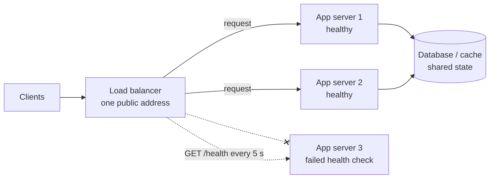

# Load balancing

After this you can explain how a load balancer picks a server, choose between layer 4 and layer 7 and between the common algorithms, and say why sticky sessions cause trouble.

Before this: [scalability basics](01-scalability-basics.md) and [proxies and CDNs](../../07-networking/02-web-protocols/05-proxies-and-cdns.md).

## The idea

You now run three identical app servers. Users type one address, so something must sit in front, accept every request and decide which server gets it. That something is a **load balancer** (LB): a reverse proxy whose job is to spread requests over a pool of servers and to stop sending to the ones that are down.



This works because the app servers are stateless: any of them can answer any request, since the state is in the shared database or cache. The load balancer itself must not become the single point of failure, so production setups run two or more, with a shared address.

## Key terms

A **layer 4** (L4) load balancer works on TCP or UDP connections. It sees IP addresses and ports, picks a server for each connection and forwards the bytes without reading them. It is fast and protocol-agnostic.

A **layer 7** (L7) load balancer reads the HTTP request, so it can route by path (`/api` to one pool, `/images` to another), host name, header or cookie. It can also end TLS, add headers and retry. It costs more CPU per request than L4.

A **health check** is a probe the balancer sends to each server (for example `GET /health` every 5 seconds). A server that fails a few probes in a row is taken out of rotation, and put back after it passes again.

**Sticky sessions** (session affinity) send every request from one client to the same server, usually by a cookie or by hashing the client IP.

**Consistent hashing** maps both servers and keys onto a circle, and sends each key to the next server clockwise. When a server is added or removed, only the keys next to it move.

## How it works

The balancer needs a rule for picking a server.

| Algorithm | Rule | Good for | Weakness |
|---|---|---|---|
| Round robin | Servers in turn: 1, 2, 3, 1, 2, 3 | Similar requests, similar servers | One slow request can pile up behind a busy server |
| Weighted round robin | Same, but a bigger server gets more turns | Mixed server sizes | Weights are set by hand |
| Least connections | The server with the fewest open connections | Requests of very different length | Needs to track connection counts |
| Hash of client or key | Same key, same server | Caches, affinity without cookies | Adding a server reshuffles most keys (unless consistent hashing) |

Plain hashing, `hash(key) % n`, is the weak spot. Changing $n$ from 3 to 4 changes the result for most keys, and for a cache that means most entries are suddenly on the wrong server. The ring avoids this: each server is placed at many points on the circle (virtual nodes, here 100 per server), and a key goes to the first server point clockwise from its own hash.

```python
from bisect import bisect
from hashlib import md5

def h(s):
    return int(md5(s.encode()).hexdigest(), 16)

def ring(servers, vnodes=100):
    return sorted((h(f"{s}#{v}"), s) for s in servers for v in range(vnodes))

def lookup(r, key):
    return r[bisect(r, (h(key), "")) % len(r)][1]

keys = [f"user{i}" for i in range(10_000)]
r3, r4 = ring(["A", "B", "C"]), ring(["A", "B", "C", "D"])
moved = sum(lookup(r3, k) != lookup(r4, k) for k in keys)
print(f"consistent hashing, 3 -> 4 servers: {moved / len(keys):.1%} of keys moved")
moved = sum(h(k) % 3 != h(k) % 4 for k in keys)
print(f"hash mod n,        3 -> 4 servers: {moved / len(keys):.1%} of keys moved")
```

```text
consistent hashing, 3 -> 4 servers: 23.9% of keys moved
hash mod n,        3 -> 4 servers: 74.8% of keys moved
```

The ideal for consistent hashing is $1/4 = 25\%$ (the new server takes its fair share and nothing else moves). Plain modulo moves three keys in four.

**Sticky sessions** are tempting because they let a stateful server keep working, but they cost you. Load becomes uneven, since a heavy user stays on one server. When that server dies or is replaced in a deploy, its users lose their session. And autoscaling is harder, because new servers receive few existing users. Prefer stateless servers with shared session storage.

For global traffic, **DNS-based load balancing** returns different IP addresses for one name, chosen by the user's region or by health, so users reach the nearest data centre (see [DNS and domains](../../07-networking/01-how-the-internet-works/05-dns-and-domains.md)). DNS answers are cached, so a failover takes as long as the record's TTL. Managed load balancers, such as AWS's Application Load Balancer (L7) and Network Load Balancer (L4), do the health checks, TLS and scaling for you, and are the default choice in the cloud.

## Worked examples

<div class="example" markdown>

### Example 1: round robin against least connections

Two servers each run one request at a time. Eight requests arrive one second apart. The first takes 10 seconds, and the other seven take 1 second each. How long do requests wait for a free server?

1. Round robin ignores load. Requests 1, 3, 5 and 7 go to server A, and 2, 4, 6 and 8 go to B. Request 1 holds A for 10 seconds, so requests 3, 5 and 7 queue behind it, while B sits idle most of the time.
2. Least connections (modelled here as "the server that frees up first") sends every quick request to B, because A is busy.
3. Run both policies and compare the waits.

```python
durations = [10, 1, 1, 1, 1, 1, 1, 1]       # request i arrives at second i

def simulate(policy):
    free_at = [0, 0]                        # when each server becomes free
    waits = []
    for i, d in enumerate(durations):
        if policy == "round robin":
            s = i % 2
        else:                               # the server that frees up first
            s = 0 if free_at[0] <= free_at[1] else 1
        start = max(i, free_at[s])
        waits.append(start - i)
        free_at[s] = start + d
    return sum(waits) / len(waits), max(waits)

for p in ("round robin", "least busy"):
    avg, worst = simulate(p)
    print(f"{p:12} average wait {avg:.2f} s, worst wait {worst} s")
```

```text
round robin  average wait 2.62 s, worst wait 8 s
least busy   average wait 0.00 s, worst wait 0 s
```

Check by hand: requests 3, 5 and 7 wait 8, 7 and 6 seconds, which is 21 seconds over 8 requests, or 2.62 on average. Request 3 arrives at second 2 and starts at second 10. Round robin is fair in count of requests, not in load, so when request times vary a lot, prefer least connections.

</div>

## Common mistakes

<div class="warning" markdown>

Watch out: a health check that always says "ok". If `/health` returns 200 without touching the database, the balancer keeps sending traffic to a server that cannot serve it. Check the dependencies the server needs, but keep the check fast.

Watch out: using `hash % n` for a cache pool. Adding one server invalidates most of the cache at once. Use consistent hashing.

Watch out: leaving the balancer as the single point of failure. Run at least two, or use a managed one.

</div>

## Working with AI

<div class="ai" markdown>

Words to use: layer 4, layer 7, health check, round robin, least connections, consistent hashing, sticky sessions.

Prompts to try:

- "I run three Node.js instances behind nginx. Write an upstream block with least_conn, passive health checks and a note on what happens during a deploy that restarts one instance."
- "Our login breaks when we add a second server and sticky sessions are off. List what could hold state in the app process and how to move each piece out."

What to check:

- Directives that do not exist in your version of nginx or HAProxy. Search the official docs for each one.
- A layer 7 feature (path routing, header rewriting) on a layer 4 balancer. Check which layer the product works at.
- Sticky sessions offered as the fix for a state bug. They hide the bug until a server restarts.

</div>

## Quiz

1\. What does a layer 7 balancer do that a layer 4 balancer cannot?

<details class="solution" markdown>
<summary>Answer</summary>

It reads the HTTP request, so it can route by path, host or header, terminate TLS and add or change headers. A layer 4 balancer sees only IPs and ports.

</details>

2\. Predict: 10,000 keys are spread by `hash % 3`. A fourth server is added and the rule becomes `hash % 4`. About what share of keys move?

<details class="solution" markdown>
<summary>Answer</summary>

About 75%. A key stays only when its hash gives the same remainder mod 3 and mod 4, which happens for 3 of every 12 hash values (25%). The lab output shows 74.8%.

</details>

3\. One of three servers crashes at 02:00. The health check runs every 10 seconds and needs 3 failures. How many seconds of failed requests can users see, roughly, and how do you shorten it?

<details class="solution" markdown>
<summary>Answer</summary>

About 30 seconds (3 failed checks at 10 s each). Shorten the interval or the failure threshold, and let the balancer retry a failed request on another server.

</details>

4\. Why do sticky sessions make deploys harder?

<details class="solution" markdown>
<summary>Answer</summary>

Each server holds the sessions of its users. Restarting it ends those sessions, so a rolling deploy logs people out. Shared session storage removes the problem.

</details>

## Lab

<div class="lab" markdown>

### Lab: round robin in Python

Goal: balance requests over three servers and watch a failed one drop out. Time: about 10 minutes. Runs in: any terminal with Python 3.

1. Save the script below as `lb.py`.
2. Run it and read which server handled each request.
3. Change it so server `b` is also marked down when `i == 7`, then run again.
4. Cleanup: delete the file.

```python
import itertools

servers = {"a": True, "b": True, "c": True}      # name -> healthy
turn = itertools.cycle(servers)

def pick():
    for _ in range(len(servers)):
        s = next(turn)
        if servers[s]:
            return s
    return None

for i in range(1, 10):
    if i == 4:
        servers["c"] = False                       # health check marks c down
    print(i, pick())
```

Expected result:

```text
1 a
2 b
3 c
4 a
5 b
6 a
7 b
8 a
9 b
```

<details class="solution" markdown>
<summary>Solution</summary>

After request 4 the balancer skips `c`, so `a` and `b` share the load. Setting `servers["b"] = False` when `i == 7` leaves only `a`, and with all three down `pick()` returns `None`, which a real balancer reports as a 503.

</details>

</div>

## Where this shows up

- Caches sit behind the balancer and use the same consistent hashing idea: [caching strategies](03-caching-strategies.md).
- The same ring spreads data over database shards: [database scaling](04-database-scaling-replication-and-sharding.md).
- Rolling out a new version one server at a time: [deployment strategies](../../13-devops-and-cloud/02-ci-cd/03-deployment-strategies.md).
