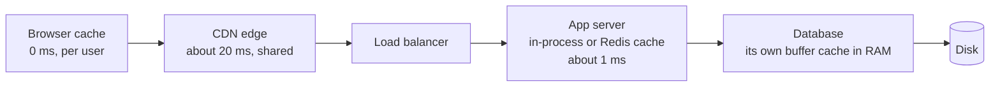
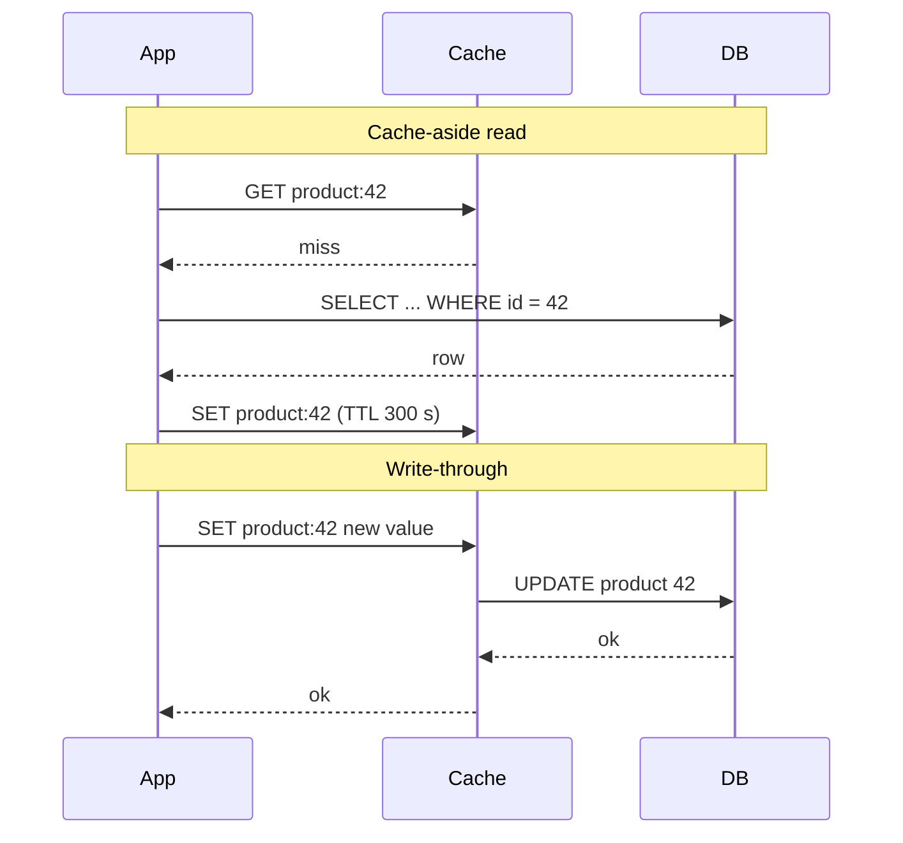

# Caching strategies

After this you can say where a cache should sit, choose between cache-aside, read-through, write-through and write-behind, and estimate what a given hit ratio saves.

Before this: [Redis and caching](../../10-databases-sql-and-postgres/05-databases-in-apps/04-redis-and-caching.md), [HTTP headers, cookies and caching](../../07-networking/02-web-protocols/02-http-headers-cookies-and-caching.md), [proxies and CDNs](../../07-networking/02-web-protocols/05-proxies-and-cdns.md) and [load balancing](02-load-balancing.md).

## The idea

A request to your product page runs three database queries and takes 40 ms. Ten thousand people ask for the same page, and the answer is the same each time. Doing the work 10,000 times is waste. A **cache** keeps the answer close, so the slow source is asked once.

Caches exist at every layer between the user and the data, and the earlier a request is answered, the less of the system it touches.



Each box can answer "I have it" and stop the request. The earlier boxes are cheaper and faster, but cache less (the browser only helps one user) and are harder to clear. The earlier lessons covered the browser and CDN layers (HTTP `Cache-Control`) and Redis. This lesson is about the application-level patterns.

## Key terms

The **hit ratio** is the fraction of lookups that find the value in the cache: hits divided by hits plus misses. **Time to live** (TTL) is how long an entry may be served before it expires. **Invalidation** is removing or replacing an entry when its source data changes. **Eviction** is the cache dropping entries to make room, most often the **least recently used** (LRU) one.

A **thundering herd** (cache stampede) is many requests missing the same expired key at once and all rebuilding it from the database.

A **cache key** is the string that identifies an entry. It must include everything that changes the answer.

## How it works

Four patterns describe who talks to the cache and the database.

**Cache-aside** (lazy loading): the application checks the cache, and on a miss reads the database and stores the result. The cache holds only what was asked for, and the application owns the logic. This is the default.

**Read-through**: the application only talks to the cache; the cache itself loads from the database on a miss. Same effect, with the loading code inside the cache layer.

**Write-through**: every write goes to the cache and the database together, and returns after both succeed. Reads are then fresh, and writes are slower.

**Write-behind** (write-back): the write goes to the cache, which answers at once and saves to the database later in a batch. Writes are fast, but data not yet saved is lost if the cache dies.



Keeping the cache correct is the hard part. A TTL bounds how stale an entry can be, and it is the safe default. For data that must be fresh, **invalidate on write**: delete the key when the row changes, so the next read reloads it. The classic bug is a race: a reader loads the old row, a writer updates and deletes the key, and then the reader stores the old value. The TTL limits the damage.

The speed-up depends on the hit ratio $h$. With a cache lookup time $t_c$ and database time $t_d$, the average time is $t_c + (1 - h)\,t_d$, since every request pays the lookup and only misses pay the database.

```python
def avg_ms(h, cache_ms=0.5, db_ms=20):
    return cache_ms + (1 - h) * db_ms

for h in (0.0, 0.5, 0.9, 0.99):
    print(f"hit ratio {h:4.0%}: {avg_ms(h):5.2f} ms average, {20 * (1 - h):4.1f} ms of DB time per request")
```

```text
hit ratio   0%: 20.50 ms average, 20.0 ms of DB time per request
hit ratio  50%: 10.50 ms average, 10.0 ms of DB time per request
hit ratio  90%:  2.50 ms average,  2.0 ms of DB time per request
hit ratio  99%:  0.70 ms average,  0.2 ms of DB time per request
```

Notice that at 0% the cache makes things slower (20.5 ms against 20 ms), and that 90% to 99% cuts database load by 10 times though the average time barely changes. When you add a cache to protect a database, the database load is the number to watch.

Last, the thundering herd. When a hot key expires, hundreds of requests miss together. Defences: let one request rebuild while the others wait (a lock, or "single flight"), add random jitter to TTLs so keys do not expire together, or serve the stale value while one request refreshes it.

## Worked examples

<div class="example" markdown>

### Example 1: how big must the cache be?

Real traffic is skewed: a few keys get most of the requests. We simulate 100,000 requests over 10,000 keys, where key number $r$ (by popularity rank) is asked for with weight $1/r$, and cache the most recently used keys.

1. Build the request list with `random.choices` and the Zipf weights.
2. Keep an LRU cache of a given size: on a hit, mark the key most recent. On a miss, add it and evict the oldest if over the limit.
3. Count hits for three cache sizes.

```python
import random
from collections import OrderedDict

random.seed(7)
KEYS = 10_000
weights = [1 / (rank + 1) for rank in range(KEYS)]
requests = random.choices(range(KEYS), weights, k=100_000)

def hit_ratio(cache_size):
    cache, hits = OrderedDict(), 0
    for k in requests:
        if k in cache:
            hits += 1
            cache.move_to_end(k)
        else:
            cache[k] = True
            if len(cache) > cache_size:
                cache.popitem(last=False)
    return hits / len(requests)

for size in (10, 100, 1000):
    print(f"cache holds {size:4} of {KEYS:,} keys: hit ratio {hit_ratio(size):.1%}")
```

```text
cache holds   10 of 10,000 keys: hit ratio 13.2%
cache holds  100 of 10,000 keys: hit ratio 39.2%
cache holds 1000 of 10,000 keys: hit ratio 67.6%
```

Check: caching 1% of the keys gives 13% hits and 10% of the keys gives 68%. Each tenfold increase in size gains less, so the right size comes from your own hit ratio, which Redis reports in `INFO stats` as `keyspace_hits` and `keyspace_misses`.

</div>

## Common mistakes

<div class="warning" markdown>

Watch out: a cache key that leaves something out. Caching `price:42` when the price depends on the user's country shows one user another's price. Put every input in the key (`price:42:CA`).

Watch out: caching without a TTL. A missed invalidation then serves wrong data forever. Always set a TTL, even a long one.

Watch out: write-behind for data you cannot lose. A crash between the cache write and the database save loses it. Use write-through for orders and payments.

</div>

## Working with AI

<div class="ai" markdown>

Words to use: cache-aside, write-through, TTL, invalidation, hit ratio, thundering herd, LRU, cache key.

Prompts to try:

- "Add cache-aside to this Python function using redis-py. Key it by user id and locale, set a 5 minute TTL with jitter, and delete the key in the update function. Show how to avoid a stampede."
- "Our Redis hit ratio is 40% with keyspace_hits 4,000 and keyspace_misses 6,000. Give three likely causes and how to check each."

What to check:

- Missing invalidation: find the code that updates the data and confirm it clears or updates the key.
- Cache keys that omit a parameter. Read the query the cached function runs and list its inputs.
- Cached `None` or error results. Check what is stored when the database returns nothing.
- Advice to cache before measuring. Ask where the time goes first.

</div>

## Quiz

1\. What is the difference between cache-aside and read-through?

<details class="solution" markdown>
<summary>Answer</summary>

In cache-aside the application checks the cache and loads the database on a miss. In read-through the cache does the loading, so the application only talks to the cache.

</details>

2\. Using `avg_ms` with a 1 ms cache and a 50 ms database, what is the average time at a 80% hit ratio?

<details class="solution" markdown>
<summary>Answer</summary>

$1 + 0.2 \times 50 = 11$ ms.

</details>

3\. A cached product page shows an old price for hours after the price changed. The code sets a 24-hour TTL and never deletes the key. What do you change?

<details class="solution" markdown>
<summary>Answer</summary>

Delete (or update) the key in the code that changes the price, and shorten the TTL so any missed invalidation heals quickly.

</details>

4\. A popular key with a 60 second TTL causes a spike of 500 database queries every minute. Name two fixes.

<details class="solution" markdown>
<summary>Answer</summary>

Let one request rebuild the value while the others wait or get the stale copy, and add random jitter to TTLs so related keys do not expire together.

</details>

## Lab

<div class="lab" markdown>

### Lab: cache-aside with a counter

Goal: build a cache-aside function and count hits and misses. Time: about 10 minutes. Runs in: any terminal with Python 3.

1. Save the script below as `aside.py` and run it.
2. Change the TTL to `0.1` seconds and add `time.sleep(0.2)` before the last call. Predict the result first.
3. Cleanup: delete the file.

```python
import time

cache, stats = {}, {"hit": 0, "miss": 0}

def slow_db(key):
    time.sleep(0.05)
    return key.upper()

def get(key, ttl=60):
    entry = cache.get(key)
    if entry and entry[1] > time.monotonic():
        stats["hit"] += 1
        return entry[0]
    stats["miss"] += 1
    value = slow_db(key)
    cache[key] = (value, time.monotonic() + ttl)
    return value

for k in ["a", "b", "a", "a", "b"]:
    get(k)
print(stats)
```

Expected result:

```text
{'hit': 3, 'miss': 2}
```

<details class="solution" markdown>
<summary>Solution</summary>

With a TTL of 0.1 s and a 0.2 s sleep before the last call, the final `b` has expired, so the result is `{'hit': 2, 'miss': 3}`. Each expiry costs one database read.

</details>

</div>

## Where this shows up

- Caches decide how stale reads can be, which is the topic of [CAP and consistency](05-cap-and-consistency.md).
- Rate limits are often counters kept in a cache: [rate limiting and API gateways](07-rate-limiting-and-api-gateways.md).
- The same hit-ratio arithmetic shows up in [the memory hierarchy](../../01-how-computers-work/02-hardware/04-memory-hierarchy-and-latency-numbers.md).
