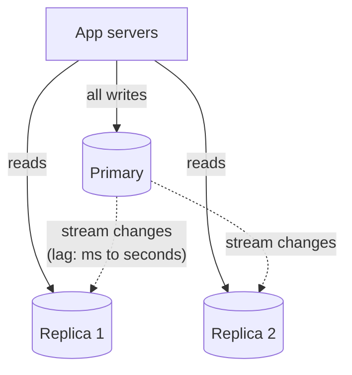
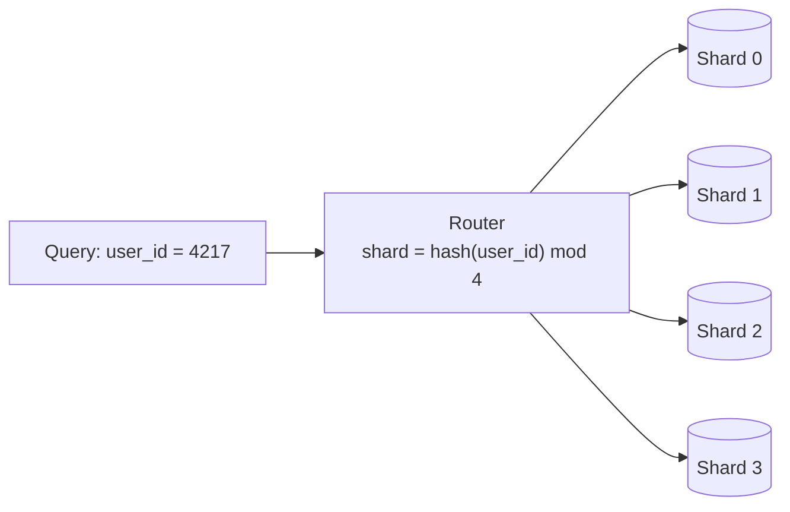

# Database scaling: replication and sharding

After this you can choose the next step when a database is too slow or too big (a bigger machine, read replicas, or sharding), pick a shard key, and name what each step costs.

Before this: [backups, replication and pooling](../../10-databases-sql-and-postgres/04-postgres-in-depth/08-backups-replication-and-pooling.md), [indexes](../../10-databases-sql-and-postgres/04-postgres-in-depth/01-indexes.md), [load balancing](02-load-balancing.md) and [caching strategies](03-caching-strategies.md).

## The idea

The app servers scale out easily because they are stateless. The database holds the state, so it is where scaling gets hard. Most apps read far more than they write, often 10 to 1 or more, and the steps below are ordered by how much they cost you in complexity.

1. Tune first: indexes, better queries, a connection pool, a cache in front.
2. Scale up: a bigger machine. Large servers have terabytes of RAM and dozens of cores, so one Postgres server carries a surprising amount of load.
3. Add read replicas, to spread reads.
4. Shard, to spread writes and data size.

Do each step only when the earlier ones are used up. Every step after the second changes how you write code.



## Key terms

A **read replica** is a copy of the database that receives the primary's changes and answers read-only queries. **Replication lag** is how far behind the primary a replica is. With asynchronous replication the primary confirms a write before the replicas have it, so a read from a replica can return old data.

**Partitioning** splits one large table into pieces (for example one per month) inside one database server, so queries and maintenance touch less data. **Sharding** splits the data across several servers, each holding a subset of the rows. Each server is a **shard**.

A **shard key** is the column that decides which shard a row lives on, such as `user_id`.

A **hot spot** is a shard (or key) that gets much more traffic than the others.

## How it works

**Read replicas** are the cheap step. The app sends writes to the primary and reads to a replica. The catch is lag. A user saves a profile, the next page reads from a replica that has not caught up, and the old name appears. The usual fix is to read from the primary for a short time after a user writes, or for pages where freshness matters. This guarantee has a name, "read-your-writes", in [CAP and consistency](05-cap-and-consistency.md). Replicas add read capacity and a standby for failover, but do nothing for write volume, since every write still goes to the primary.

**Sharding** is the big step. A router (in the app or in a proxy) turns the shard key into a shard number, and each query goes to the shard that has the row.



Choosing the key is the main decision, and it is expensive to change. A good shard key has many different values, spreads traffic evenly, and appears in the queries you run most, so one query touches one shard. Compare two choices:

- `hash(user_id)` spreads users evenly. A query for one user's data hits one shard. A query across all users (a report) must ask every shard and merge the answers.
- A range on `created_at` keeps related rows together and makes date queries easy, but all new writes land on the newest shard. That shard is a hot spot while the others sit idle.

Sharding also costs you. A join or transaction across shards is slow or impossible, unique ids must be generated without a central counter, and **resharding** (going from 4 to 5 shards) means moving data while the system runs. With `hash mod n`, most rows move, as the load balancing lesson showed; consistent hashing, or many small "virtual" shards that are assigned to servers, moves only the share that the new server takes.

```python
from collections import Counter
from zlib import crc32

SHARDS = 4
users = [f"user{i}" for i in range(1000)]            # 1000 writes arriving today
by_hash = Counter(crc32(u.encode()) % SHARDS for u in users)
by_date_range = Counter(3 for _ in users)            # shard 3 owns the newest dates
print("shard key = hash(user_id):", dict(sorted(by_hash.items())))
print("shard key = date range:   ", dict(by_date_range))

before = {u: crc32(u.encode()) % 4 for u in users}
after = {u: crc32(u.encode()) % 5 for u in users}
print("4 -> 5 shards with hash mod n:", sum(before[u] != after[u] for u in users), "of 1000 keys move")
```

```text
shard key = hash(user_id): {0: 249, 1: 251, 2: 249, 3: 251}
shard key = date range:    {3: 1000}
4 -> 5 shards with hash mod n: 801 of 1000 keys move
```

Even a hash can create a hot spot: one celebrity account on one shard gets far more traffic than the rest, and a good shard key still does not fix a single hot key. The fix there is a cache in front, or splitting that one key's data.

Many **NoSQL** databases (see [NoSQL databases](../../10-databases-sql-and-postgres/05-databases-in-apps/03-nosql-databases.md)), such as Cassandra and DynamoDB, are built to shard from the start, with the key chosen when you create the table and queries limited to those that name it. That is a trade, not a free gain: you give up flexible joins and ad hoc queries for easier horizontal scaling. Managed services (Aurora, Cloud Spanner, Citus for Postgres) can also hide some of the sharding work.

## Worked examples

<div class="example" markdown>

### Example 1: which step next?

An orders database on one Postgres server runs at 85% CPU. 90% of the load is `SELECT` queries. Writes are 150 per second. What do we do?

1. Check the cheap steps. Run `EXPLAIN` on the top three queries. Suppose one scans the whole `orders` table, and an index brings it from 80 ms to 2 ms. CPU falls to 30%.
2. If CPU were still high, move to a bigger instance: one change, no code changes.
3. If reads still dominate, add one read replica and send the reporting queries to it, with the app reading the primary right after a user's own write.
4. Writes of 150 per second are small. One primary handles thousands per second, so sharding is far off.

Check: before sharding, compare your write rate with what one primary can do. A common mistake is to shard a database that needed an index.

</div>

## Common mistakes

<div class="warning" markdown>

Watch out: sending a read straight after a write to a replica. The read may not see the write yet. Read from the primary for that case.

Watch out: choosing a shard key that grows over time, such as a timestamp or an auto-increment id. New rows all go to the last shard.

Watch out: sharding early. It makes joins, transactions and migrations harder for years. Most systems never need it.

</div>

## Working with AI

<div class="ai" markdown>

Words to use: read replica, replication lag, shard key, hot spot, resharding, partitioning, consistent hashing.

Prompts to try:

- "A Postgres orders table has 800 million rows and queries almost always filter by customer_id. Compare declarative partitioning by month with sharding by customer_id: what each helps and what each breaks."
- "I added a read replica and some users see stale data right after saving. Show how to route those reads to the primary in Django, and how to measure lag in Postgres."

What to check:

- Sharding suggested before indexes, caching or a bigger machine. Ask what the numbers are for each step.
- A shard key that is monotonic (timestamp, serial id), which creates a hot shard.
- Cross-shard joins and transactions treated as if they were free. Look at which queries touch more than one shard.
- Replica reads used for data that must be fresh, such as a balance after a payment.

</div>

## Quiz

1\. What is the difference between partitioning and sharding?

<details class="solution" markdown>
<summary>Answer</summary>

Partitioning splits a table into pieces inside one database server. Sharding spreads the data over several servers, each holding different rows.

</details>

2\. Why does a read replica not help a write-heavy workload?

<details class="solution" markdown>
<summary>Answer</summary>

Every write goes to the primary and is then copied to each replica, so replicas add read capacity only. Writes need sharding or a bigger primary.

</details>

3\. A table is sharded by `created_at` month, and the database is slow only on the last day of each month. Why?

<details class="solution" markdown>
<summary>Answer</summary>

All writes of the current period go to one shard, which is a hot spot. A hashed key such as `hash(customer_id)` spreads the writes.

</details>

4\. With `hash mod n` going from 4 to 5 shards, about what share of rows moves, and what avoids it?

<details class="solution" markdown>
<summary>Answer</summary>

About 80% (801 of 1000 above). Consistent hashing or many virtual shards move only about one in five rows, the new shard's share.

</details>

## Lab

<div class="lab" markdown>

### Lab: simulate replication lag

Goal: see a stale read from a replica and fix it with read-your-writes. Time: about 10 minutes. Runs in: any terminal with Python 3.

1. Save the script below as `lag.py` and run it.
2. Change the fix so that reads go to the primary for one second after the user's own write. Predict the output before you run it.
3. Cleanup: delete the file.

```python
primary, replica = {"name": "Ana"}, {"name": "Ana"}
pending = []                                    # changes on their way to the replica

def write(key, value):
    primary[key] = value
    pending.append((key, value))                # replicated later

def replicate():
    while pending:
        k, v = pending.pop(0)
        replica[k] = v

write("name", "Anna")
print("read from replica:", replica["name"])    # before replication
replicate()
print("after replication:", replica["name"])
```

Expected result:

```text
read from replica: Ana
after replication: Anna
```

<details class="solution" markdown>
<summary>Solution</summary>

Add `recent = {}` and set `recent[key] = time.monotonic()` in `write`. A `read(key)` function returns `primary[key]` if `time.monotonic() - recent.get(key, -9) < 1`, and `replica[key]` otherwise. The first print then shows `Anna`.

</details>

</div>

## Where this shows up

- Choosing between consistency and availability across replicas: [CAP and consistency](05-cap-and-consistency.md).
- Kafka partitions use the same key-to-partition idea: [queues and event-driven design](06-queues-and-event-driven-design.md).
- Estimating whether one machine is enough: [back-of-the-envelope estimates](08-back-of-the-envelope-estimates.md).
