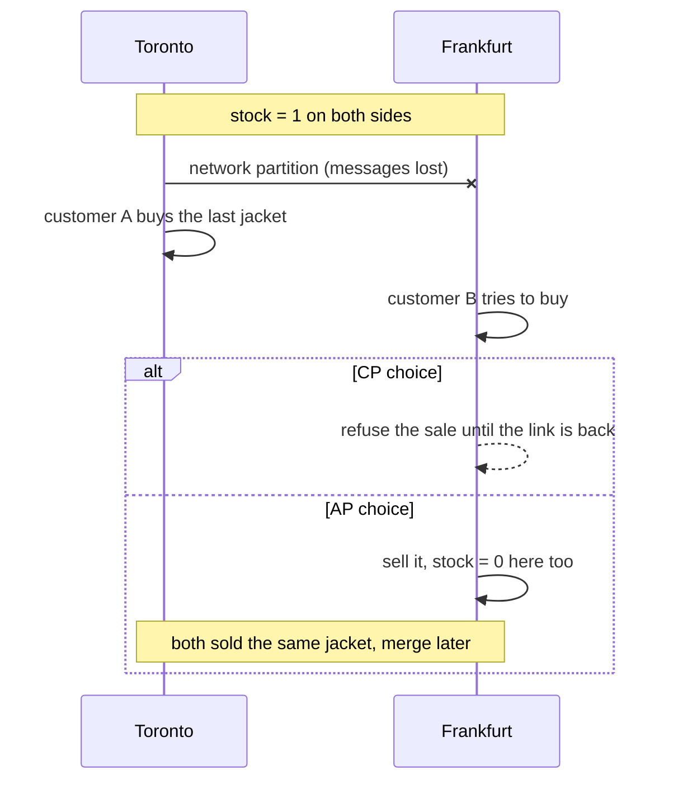
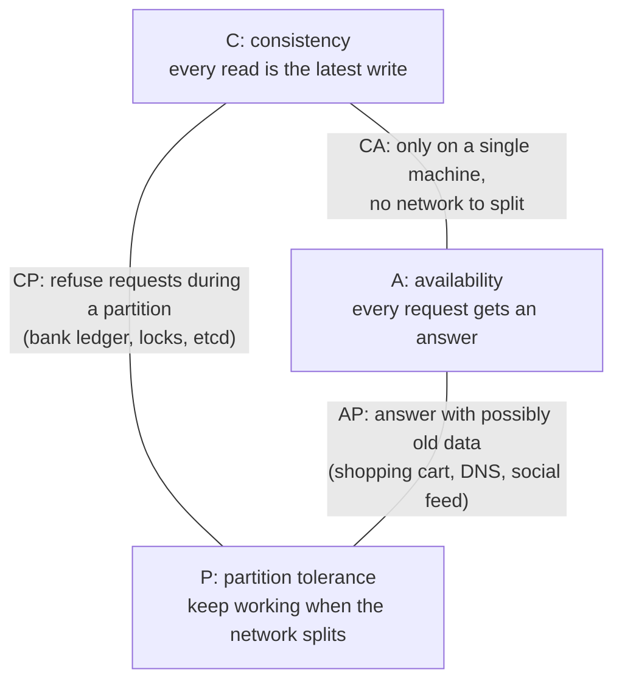

# CAP and consistency

After this you can explain what happens to a replicated system when the network splits, choose between strong and eventual consistency for a feature, and compute a quorum.

Before this: [database scaling](04-database-scaling-replication-and-sharding.md), [caching strategies](03-caching-strategies.md) and [transactions and ACID](../../10-databases-sql-and-postgres/04-postgres-in-depth/03-transactions-and-acid.md).

## The idea

A shop keeps its stock count in two data centres, Toronto and Frankfurt, so each region reads fast and one survives the loss of the other. There is 1 jacket left. Then the cable between the two data centres is cut. A customer in Toronto and another in Frankfurt each try to buy the last jacket. What should each data centre do?

It can refuse to sell until it can check with the other side. That keeps the count correct, but the customer sees an error. Or it can sell, and risk two sales of one jacket. No design avoids this choice, and that is the **CAP theorem**.



## Key terms

A **partition** (network partition) is a failure where nodes are both running but cannot reach each other.

The CAP theorem says that when a partition happens, a replicated system cannot be both **consistent** and **available**. Here **consistency** means every read sees the latest write (the formal word is linearizability), and **availability** means every request to a working node gets an answer, not an error or a timeout.

**Strong consistency** means that after a write completes, every later read, from any node, returns it. **Eventual consistency** means that if writes stop, all replicas end up with the same value, but a read in the meantime may return old data.

**Read-your-writes** is the promise that a client always sees its own earlier writes, even if others may still see old values.

A **quorum** is the number of replicas that must agree for an operation to count. With $N$ replicas, a write waits for $W$ of them and a read asks $R$ of them.

An operation is **idempotent** if running it twice has the same effect as running it once.

## How it works

CAP is often drawn as a triangle with "pick two of three". That is misleading. Partitions will happen on any real network, so you cannot give up P. The real choice is made during a partition, as in the diagram.



CP systems return errors or wait when they cannot confirm with the others. AP systems keep answering and repair differences afterwards. Between partitions, the trade is smaller but real. **PACELC** extends CAP: if there is a Partition, choose Availability or Consistency; Else, in normal operation, choose Latency or Consistency. Waiting for every replica to confirm a write is consistent but slower, which is why many databases default to weaker guarantees.

Quorums let you tune this with $N$, $R$ and $W$. If

$$R + W > N$$

then every read set overlaps every write set in at least one replica, so a read sees the latest write. With $N = 3$, $W = 2$ and $R = 2$, a write reaches two replicas and a read asks two, so at least one has the new value. A lower $W$ makes writes faster but reads staler. DynamoDB and Cassandra expose these settings.

```python
import random
N = 3
replicas = [{"v": 0} for _ in range(N)]

def write(version, W):
    for r in random.sample(replicas, W):
        r["v"] = version

def read(R):
    return max(r["v"] for r in random.sample(replicas, R))   # the newest version wins

def stale_reads(R, W, trials=100_000):
    stale = 0
    for t in range(1, trials + 1):
        write(t, W)
        if read(R) != t:
            stale += 1
    return stale / trials

for R, W in [(1, 1), (1, 2), (2, 2), (1, 3), (3, 1)]:
    print(f"N=3 R={R} W={W} R+W>N: {R + W > N!s:5}  stale reads: {stale_reads(R, W):.1%}")
```

```text
N=3 R=1 W=1 R+W>N: False  stale reads: 66.7%
N=3 R=1 W=2 R+W>N: False  stale reads: 33.5%
N=3 R=2 W=2 R+W>N: True   stale reads: 0.0%
N=3 R=1 W=3 R+W>N: True   stale reads: 0.0%
N=3 R=3 W=1 R+W>N: True   stale reads: 0.0%
```

The staleness matches the overlap: with $R = 1$ and $W = 1$, a read lands on the one replica holding the new value only one time in three, so 2/3 are stale. The simulation leaves out failures and concurrent writes, which real systems must also handle.

Eventually consistent systems need two habits. First, writes can be retried or delivered twice, so make them idempotent: set a value rather than add to it (`stock = 0`, not `stock = stock - 1`), or attach an **idempotency key** that lets the server recognize a repeat (see [background jobs](../../09-back-end/03-api-quality/01-background-jobs.md)). Second, decide per feature how stale is acceptable, as the next section shows.

## Worked examples

<div class="example" markdown>

### Example 1: pick the guarantee for each feature

A shop has three features. For each, ask: what is the cost of a stale read, and what is the cost of an error?

1. Checkout stock count. A stale read means selling a jacket that does not exist, which costs a refund and an apology. Prefer consistency: take the lock on the primary, and return an error if it cannot be reached.
2. Product page "42 people viewing". A stale read costs nothing. Prefer availability and low latency: serve from the nearest replica or cache.
3. "Your order was placed" confirmation page. The user just wrote the order and must see it. Prefer read-your-writes: read from the primary, or from a replica known to have the write, for this user.

Check: write the cost of a wrong answer and of no answer next to each feature before you pick. If both are high, as with a payment, choose consistency and add retries and idempotency to cope with the errors.

</div>

## Common mistakes

<div class="warning" markdown>

Watch out: "CAP says pick two". Partitions are not optional. The choice that matters is consistency or availability while one is happening.

Watch out: calling a system "consistent" without saying which kind. ACID consistency (constraints hold) is a different idea from CAP consistency (all nodes agree on the latest write).

Watch out: retrying a non-idempotent write. A timeout does not tell you whether the write happened, and a retry may charge a card twice. Use an idempotency key.

</div>

## Working with AI

<div class="ai" markdown>

Words to use: partition, linearizable, eventual consistency, read-your-writes, quorum, idempotency key, PACELC.

Prompts to try:

- "We run Cassandra with replication factor 3. Compare QUORUM and ONE for reads and writes on an order table: which stale reads are possible and what does each cost in latency?"
- "Design the retry behaviour for a POST /payments endpoint where the client may time out and retry. Use an idempotency key and describe what the server stores."

What to check:

- A claim that a database is "CA". Any distributed one must handle partitions.
- Quorum settings where $R + W \le N$ described as strongly consistent. Do the sum.
- Retried writes that are not idempotent. Look for `+=`, `INSERT` without a unique key, and "send email" in the retried code.

</div>

## Quiz

1\. During a partition, what does a CP system do and what does an AP system do?

<details class="solution" markdown>
<summary>Answer</summary>

A CP system refuses or delays requests it cannot confirm, keeping data correct. An AP system keeps answering, possibly with old data, and reconciles later.

</details>

2\. Is $N = 5$, $W = 3$, $R = 3$ guaranteed to read the latest write? What about $W = 2$, $R = 3$?

<details class="solution" markdown>
<summary>Answer</summary>

Yes for the first: $3 + 3 = 6 > 5$. No for the second: $2 + 3 = 5$, which is not greater than 5, so a read set can miss every replica that has the write.

</details>

3\. A user edits their profile and the next page still shows the old name. The app reads from an asynchronous replica. What is the guarantee that is missing, and one fix?

<details class="solution" markdown>
<summary>Answer</summary>

Read-your-writes. Read from the primary for a short time after the user's own write, or route that user's reads to a replica that has the write.

</details>

4\. Why is `UPDATE accounts SET balance = balance - 10` risky when a request is retried, and how do you make it safe?

<details class="solution" markdown>
<summary>Answer</summary>

Each run subtracts again, so a retry after a lost response takes 20. Store an idempotency key with the operation and skip it if the key was already applied.

</details>

## Lab

<div class="lab" markdown>

### Lab: find the smallest safe quorum

Goal: use the simulation to see how $R$ and $W$ change stale reads. Time: about 10 minutes. Runs in: any terminal with Python 3.

1. Save the code from the lesson as `quorum.py` and run it.
2. Change `N` to 5 and the pairs to `(1, 1), (2, 2), (3, 3), (1, 5), (2, 4)`. Predict which are strongly consistent before running.
3. Cleanup: delete the file.

Expected result: the pairs with $R + W > 5$ show 0.0% stale reads, namely `(3, 3)`, `(1, 5)` and `(2, 4)`. The other two print about 80.0% and 30.0%.

<details class="solution" markdown>
<summary>Solution</summary>

`(1, 1)` and `(2, 2)` have sums of 2 and 4, which are not above 5, so they read stale values. The other three all sum to 6, so each read set overlaps the write set. `(1, 5)` makes writes slow (all five replicas) and reads fast, `(3, 3)` balances them, and `(2, 4)` sits between.

</details>

</div>

## Where this shows up

- Messages that may arrive twice, and consumers that must cope: [queues and event-driven design](06-queues-and-event-driven-design.md).
- Distributed systems interview questions about consistency: [system design interviews](09-system-design-interviews.md).
- Stale data in caches follows the same reasoning: [caching strategies](03-caching-strategies.md).
- What partitions, slow nodes and clock skew do to a real system: [why distributed systems are hard](../03-distributed-systems/01-why-distributed-systems-are-hard.md).
