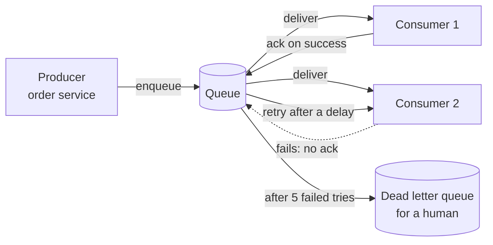
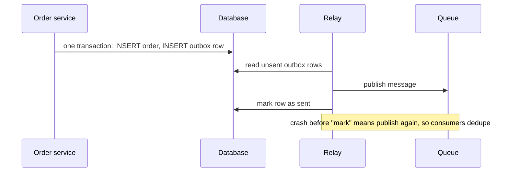

# Queues and event-driven design

After this you can decide when to put a queue between two parts of a system, choose between a queue and publish/subscribe, and write a consumer that is safe when a message arrives twice.

Before this: [background jobs](../../09-back-end/03-api-quality/01-background-jobs.md), [batch and streaming](../../11-data-engineering-and-data-science/01-data-engineering/05-batch-and-streaming.md), [database scaling](04-database-scaling-replication-and-sharding.md) and [CAP and consistency](05-cap-and-consistency.md).

## The idea

When a customer places an order, the system must save it, charge the card, send an email, update stock and tell the warehouse. If the order endpoint does all five in one request, it is as slow as the slowest step, and a failure in the email service fails the order.

The alternative is to do the part the customer must wait for (save the order) and put the rest in a **queue**, where other programs pick it up. The customer gets a quick answer, a slow or broken email service no longer blocks orders, and each part scales on its own.



## Key terms

A **message queue** holds messages from **producers** until **consumers** take them. Each message is processed by one consumer. A consumer sends an **acknowledgement** (ack) when done; without it the queue delivers the message again.

**Publish/subscribe** (pub/sub) sends each message to every subscriber, each with its own copy. A queue shares work among consumers; pub/sub broadcasts an event to many. Kafka covers both: consumers in the same consumer group share a topic's messages like a queue, and separate groups each get all of them.

**Synchronous** means the caller waits for the answer. **Asynchronous** means the caller sends a message and continues.

**At-least-once delivery** means a message is delivered one or more times, never zero. **At-most-once** means zero or one. **Exactly-once** processing cannot be guaranteed by the network alone and is built with at-least-once delivery and an idempotent consumer.

A **dead letter queue** (DLQ) holds messages that failed every retry. **Backpressure** is a signal that makes producers slow down when consumers cannot keep up.

## How it works

Why at-least-once? A consumer finishes the work, then crashes before sending the ack. The queue cannot tell this from a crash before the work, so it must send the message again. Dropping messages would be worse. The consequence is that **consumers must be idempotent**: record the ids of handled messages, or write in a way that repeats safely (see [CAP and consistency](05-cap-and-consistency.md)).

```python
processed = set()          # ids of messages already handled
balance = 0

def handle(msg):
    global balance
    if msg["id"] in processed:
        return "duplicate, skipped"
    balance += msg["amount"]
    processed.add(msg["id"])
    return "applied"

# At-least-once: the broker redelivers message 2 because the ack was lost
deliveries = [{"id": 1, "amount": 50}, {"id": 2, "amount": 30}, {"id": 2, "amount": 30}]
for m in deliveries:
    print(m["id"], handle(m))
print("balance:", balance)
```

```text
1 applied
2 applied
2 duplicate, skipped
balance: 80
```

In a real system the `processed` set lives in the same database transaction as the balance update, so a crash cannot leave one without the other.

**Ordering** is limited. A queue with several consumers cannot promise global order, because consumer 2 may finish before consumer 1. The usual rule, as with Kafka partitions, is order within one key: all messages for one order id go to the same partition and the same consumer, so they stay in order, while different orders run in parallel.

**Backpressure** matters because a queue hides overload. If producers add 1,000 messages per second and consumers finish 800, the queue grows by 200 per second, and the delay grows with it. Watch queue depth and message age, set a maximum length, add consumers while the work is parallel, and slow or reject producers when the limit is reached.

A subtle problem is the **dual write**. The order service saves the order to the database and then publishes a message. If it crashes between the two, the order exists with no message, or the other way round. The **outbox pattern** fixes this: in the same database transaction as the order, insert a row into an `outbox` table. A separate relay process reads new outbox rows, publishes them and marks them sent. Delivery is at-least-once, which the idempotent consumer handles.



One more idea builds on events. **Event sourcing** stores the sequence of events (deposited 50, withdrew 20) as the source of truth instead of only the current state, and computes the state by replaying them. It gives a full history and lets you rebuild any view, but it adds complexity, so use it only where the history is the point, as in a ledger.

## Worked examples

<div class="example" markdown>

### Example 1: should this be a queue?

We have four things to do after an order. For each, decide whether to do it in the request or through a queue.

1. Charge the card. The customer needs the result now, so do it in the request. Make it idempotent with a key, as in the CAP lesson.
2. Send the confirmation email. The customer does not need to wait, a delay of seconds is fine, and the email service can be down, so queue it.
3. Update the analytics dashboard. Several consumers want the same "order placed" event, so use pub/sub and add readers without changing the order service.
4. Notify the warehouse. It must not be lost, so use the outbox pattern and have a DLQ alert somebody.

Check: for each item ask "can the customer wait for this" and "what happens if it runs twice". If the second answer is "something bad", fix the consumer before adding the queue.

</div>

## Common mistakes

<div class="warning" markdown>

Watch out: assuming exactly-once. A consumer that adds money or sends an email on each delivery will do it twice. Deduplicate by message id.

Watch out: retrying forever. A bad message that always fails blocks the queue or loops. Cap the retries, back off between them, and send the message to a DLQ.

Watch out: a queue with no monitoring. Depth, oldest message age and DLQ size are the first signs of trouble.

</div>

## Working with AI

<div class="ai" markdown>

Words to use: at-least-once, idempotent consumer, dead letter queue, backpressure, consumer group, outbox pattern, partition key.

Prompts to try:

- "Write a Python consumer for an SQS queue that handles at-least-once delivery. Store processed message ids in Postgres in the same transaction as the business update, and show the retry and DLQ settings."
- "We publish to Kafka after committing to Postgres and sometimes lose events. Explain the dual-write problem and show a transactional outbox table with a relay."

What to check:

- A claim that the queue gives "exactly once". Look for the dedupe step in the consumer.
- Acknowledging the message before the work is done. A crash then loses the message.
- A consumer that is not idempotent, such as `INSERT` without a unique key, or a counter increment.
- Ordering assumed across partitions. Check the partition key.

</div>

## Quiz

1\. What is the difference between a queue and pub/sub?

<details class="solution" markdown>
<summary>Answer</summary>

A queue gives each message to one consumer, sharing the work. Pub/sub gives each message to every subscriber, so each gets its own copy.

</details>

2\. Predict the output of the lesson's code if the third delivery had `id` 3 and `amount` 30.

<details class="solution" markdown>
<summary>Answer</summary>

It is a new id, so it is applied: `3 applied` and `balance: 110`.

</details>

3\. A consumer acks the message first, then writes to the database, and the database is down. What is lost and what is the fix?

<details class="solution" markdown>
<summary>Answer</summary>

The message is gone because the ack told the queue it was done. Ack after the work succeeds, and make the work idempotent so a redelivery is safe.

</details>

4\. Producers add 1,000 messages per second and consumers finish 800. After 10 minutes, about how deep is the queue, and what do you do?

<details class="solution" markdown>
<summary>Answer</summary>

$200 \times 600 = 120{,}000$ messages. Add consumers if the work can be shared, make each message cheaper, or apply backpressure to the producers.

</details>

## Lab

<div class="lab" markdown>

### Lab: retries and a dead letter queue

Goal: build a worker with three tries and a DLQ. Time: about 15 minutes. Runs in: any terminal with Python 3.

1. Save the script below as `dlq.py` and run it.
2. Change `work` so `bad` fails only on its first try (keep a set of jobs already tried). Predict where it ends up.
3. Cleanup: delete the file.

```python
from collections import deque

queue = deque([("ok", 0), ("bad", 0), ("ok2", 0)])   # (job, tries so far)
dlq = []

def work(job):
    if job == "bad":
        raise ValueError("cannot process")

while queue:
    job, tries = queue.popleft()
    try:
        work(job)
        print("done", job)
    except ValueError:
        if tries + 1 >= 3:
            dlq.append(job)
            print("dead letter", job)
        else:
            queue.append((job, tries + 1))
            print("retry", job, "try", tries + 2)
print("DLQ:", dlq)
```

Expected result:

```text
done ok
retry bad try 2
done ok2
retry bad try 3
dead letter bad
DLQ: ['bad']
```

<details class="solution" markdown>
<summary>Solution</summary>

Add `tried = set()` and, in `work`, raise only if `job == "bad" and job not in tried`, adding the job to `tried` first. The job then succeeds on the second try and the DLQ stays empty. A real queue also waits longer between retries (exponential backoff).

</details>

</div>

## Where this shows up

- Throttling producers and clients: [rate limiting and API gateways](07-rate-limiting-and-api-gateways.md).
- Chat messages, notifications and feeds are queues and pub/sub: [case study: a chat app](11-case-study-chat-app.md).
- Deployed workers and their logs: [logging, metrics and monitoring](../../13-devops-and-cloud/04-operations/01-logging-metrics-and-monitoring.md).
