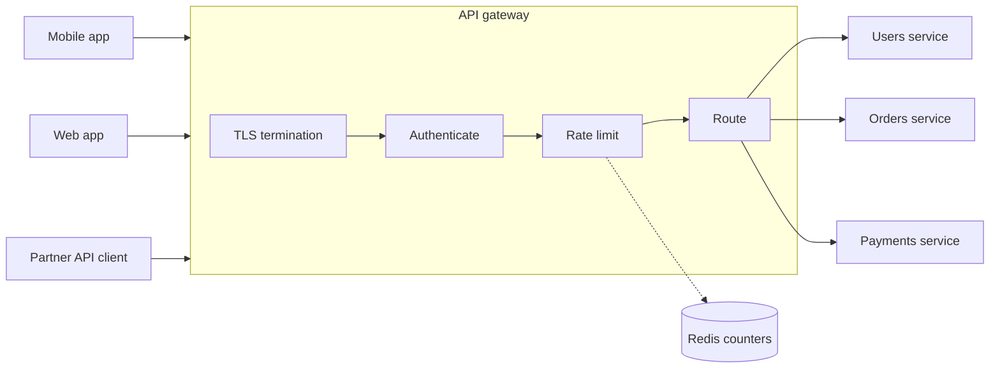

# Rate limiting and API gateways

After this you can choose a rate-limiting algorithm for an API, return the right response when a client is over the limit, and say what an API gateway does in front of your services.

Before this: [REST API design](../../09-back-end/01-servers-and-apis/04-rest-api-design.md), [secure authentication](../../12-security/01-web-security/05-secure-authentication.md), [Redis and caching](../../10-databases-sql-and-postgres/05-databases-in-apps/04-redis-and-caching.md), and [load balancing](02-load-balancing.md).

## The idea

One client with a bug in its retry loop sends 5,000 requests a second to your API. The other 20,000 users start seeing timeouts, although nothing is wrong with them. A **rate limiter** stops one caller from using more than its share, so a bug, a scraper or an attacker slows only itself.

Where the check runs matters. In a system with many services, you do not want every service to implement limits, authentication and TLS again. A single front door, the **API gateway**, does that work once and forwards the allowed requests.



In the diagram, a request passes four steps in order, and the rate limiter reads and writes its counters in Redis, not in the gateway's own memory.

## Key terms

A **rate limit** is a cap on how many requests one caller may make in a period of time, such as 100 per minute.

A **rate-limit key** is what identifies the caller: a user ID, an API key or an IP address. Per-user keys are fair but need authentication first. Per-IP keys work before login, but many users share one IP behind a company or campus network (NAT), so an IP limit can block innocent people.

An **API gateway** is a server that is the single entry point to a set of back-end services. It handles routing, authentication, rate limiting, TLS termination (decrypting HTTPS so services receive plain HTTP inside the network) and logging.

A **backend for frontend** (BFF) is a gateway layer written for one kind of client, such as the mobile app, that combines several service calls into one response shaped for that screen.

## How it works

Four algorithms cover most limiters. The first two count requests in time; the last two model a bucket.

| Algorithm | Idea | Weakness |
|---|---|---|
| Fixed window | One counter per window (per minute). Reject above the limit. | A burst at a window edge: 100 at 0:59 and 100 at 1:00 means 200 in two seconds. |
| Sliding window | Count requests in the last 60 seconds, from stored timestamps or a weighted blend of two windows. | Timestamps cost memory; the blend is approximate. |
| Token bucket | A bucket holds up to $b$ tokens and refills at $r$ per second. Each request takes one token. | Allows a burst of up to $b$ by design. |
| Leaky bucket | Requests enter a queue and leave at a fixed rate. A full queue rejects. | Smooth output, but delays requests and old ones can starve new ones. |

Token bucket is the usual default, because real clients are bursty and a limit of "5 per second, burst of 20" matches that. Stripe describes its limiters in [Scaling your API with rate limiters](https://stripe.com/blog/rate-limiters), and AWS API Gateway documents token-bucket throttling.

A rejected request gets status `429 Too Many Requests`, and a `Retry-After` header says how many seconds to wait. Well-behaved clients wait and add random jitter to their retries, so they do not all return at the same instant.

```text
HTTP/1.1 429 Too Many Requests
Retry-After: 30
Content-Type: application/json
```

With several gateway instances, a counter kept in each one's memory lets a client send the limit times the number of instances. The shared store is Redis: the check runs as one atomic step (an `INCR` plus `EXPIRE`, or a Lua script), so two instances cannot both read the old value. Redis adds one round trip per request, about 0.5 ms in a data centre (see [latency numbers](../../01-how-computers-work/02-hardware/04-memory-hierarchy-and-latency-numbers.md)). If Redis is down, decide in advance whether to fail open (allow everything) or fail closed (reject everything).

## Worked examples

<div class="example" markdown>

### Example 1: a token bucket

We want 2 requests per second sustained, with bursts of up to 5.

1. Keep two numbers per key: the tokens and the time of the last check.
2. On each request, add `elapsed * rate` tokens, capped at the capacity.
3. If at least one token is present, remove one and allow. Otherwise reject.

```python
class TokenBucket:
    def __init__(self, capacity, refill_per_sec):
        self.capacity = capacity
        self.rate = refill_per_sec
        self.tokens = capacity
        self.last = 0.0

    def allow(self, now):
        self.tokens = min(self.capacity, self.tokens + (now - self.last) * self.rate)
        self.last = now
        if self.tokens >= 1:
            self.tokens -= 1
            return True
        return False

bucket = TokenBucket(capacity=5, refill_per_sec=2)
times = [0, 0.1, 0.2, 0.3, 0.4, 0.5, 0.6, 1.0, 1.5, 2.0, 3.0]
for t in times:
    print(f"t={t:<4} allowed={bucket.allow(t)}  tokens_left={bucket.tokens:.1f}")
```

```text
t=0    allowed=True  tokens_left=4.0
t=0.1  allowed=True  tokens_left=3.2
t=0.2  allowed=True  tokens_left=2.4
t=0.3  allowed=True  tokens_left=1.6
t=0.4  allowed=True  tokens_left=0.8
t=0.5  allowed=True  tokens_left=0.0
t=0.6  allowed=False  tokens_left=0.2
t=1.0  allowed=True  tokens_left=0.0
t=1.5  allowed=True  tokens_left=0.0
t=2.0  allowed=True  tokens_left=0.0
t=3.0  allowed=True  tokens_left=1.0
```

Check: the first six requests drain the full bucket (the burst), the one at 0.6 s is rejected because only 0.2 tokens refilled, and from then on about 2 requests per second get through. At the end the bucket has refilled to 2 tokens and one was spent.

</div>

<div class="example" markdown>

### Example 2: the fixed-window edge burst

With a limit of 5 per second, we send 5 requests at 0.9 s and 5 more at 1.1 s. The window changes at 1.0 s, so each batch has its own counter.

```python
def fixed_window(times, limit, window):
    counts, out = {}, []
    for t in times:
        w = int(t // window)
        counts[w] = counts.get(w, 0) + 1
        out.append(counts[w] <= limit)
    return out

print(fixed_window([0.9]*5 + [1.1]*5, 5, 1))
```

```text
[True, True, True, True, True, True, True, True, True, True]
```

All 10 pass within 0.2 s, twice the intended rate. A sliding window or a token bucket would reject the second batch.

</div>

## Common mistakes

<div class="warning" markdown>

Watch out: limiting by IP alone. Users behind one NAT share a limit, and an attacker with many IPs has no limit. Use the user or API key once known, and IP only for unauthenticated routes.

Watch out: a limit counted in each server's memory. Behind a load balancer the real limit is multiplied by the number of servers. Count in a shared store.

Watch out: a `429` with no `Retry-After`. Clients then retry at once, which makes the overload worse.

</div>

## Working with AI

<div class="ai" markdown>

Words to use: token bucket, sliding window, rate-limit key, `429`, `Retry-After`, API gateway, TLS termination, fail open.

Prompts to try:

- "Write an Express middleware that rate-limits by API key with a token bucket in Redis, 10 requests per second, burst 30. The check must be one atomic Lua script. Explain what happens if Redis is unreachable."
- "Our gateway has 4 instances and each keeps an in-memory fixed-window counter of 100 per minute. What is the real limit, and how do I fix it?"

What to check:

- Read-then-write counters in Redis (`GET`, then `SET`). Two instances can both pass. The check must be atomic.
- Missing `Retry-After` or the wrong status code (`403` or `503` in place of `429`).
- Time taken from the client or from each server's own clock. Use the Redis server's time, or one shared source.

</div>

## Quiz

1\. Why is a token bucket usually preferred to a fixed window?

<details class="solution" markdown>
<summary>Answer</summary>

It allows controlled bursts and has no window-edge problem. A fixed window can pass twice the limit around a boundary.

</details>

2\. A bucket has capacity 10 and refills at 5 tokens per second. It is full. A client sends 30 requests in the same instant. How many pass?

<details class="solution" markdown>
<summary>Answer</summary>

10. The bucket holds 10 tokens and no time passes, so nothing refills. The other 20 get `429`.

</details>

3\. You run 3 gateway instances, each with an in-memory limit of 60 requests per minute per user, behind a round-robin load balancer. What can one user send per minute?

<details class="solution" markdown>
<summary>Answer</summary>

Up to 180, because each instance counts separately. Move the counters to Redis so there is one count per user.

</details>

4\. Name four jobs an API gateway does so each service does not have to.

<details class="solution" markdown>
<summary>Answer</summary>

Routing, authentication, rate limiting and TLS termination. Logging and request metrics are also common.

</details>

## Lab

<div class="lab" markdown>

### Lab: a limiter that returns 429

Goal: add a token-bucket limit to a small HTTP server and watch it reject. Time: about 15 minutes. Runs in: any terminal with Python 3.

1. Save the `TokenBucket` class from Example 1, but use `time.monotonic()` in place of the `now` argument.
2. Write a handler using `http.server` that calls `allow()` and replies `200` or `429` with `Retry-After: 1`.
3. Start it, then run `for i in $(seq 1 12); do curl -s -o /dev/null -w "%{http_code} " localhost:8000; done` in WSL.
4. Cleanup: stop the server with Ctrl+C.

Expected result: about the first 5 requests return `200`, then `429` appears.

```text
200 200 200 200 200 429 429 429 429 429 429 429
```

<details class="solution" markdown>
<summary>Solution</summary>

```python
import time
from http.server import BaseHTTPRequestHandler, HTTPServer

class TokenBucket:
    def __init__(self, capacity, rate):
        self.capacity, self.rate = capacity, rate
        self.tokens, self.last = capacity, time.monotonic()

    def allow(self):
        now = time.monotonic()
        self.tokens = min(self.capacity, self.tokens + (now - self.last) * self.rate)
        self.last = now
        if self.tokens >= 1:
            self.tokens -= 1
            return True
        return False

bucket = TokenBucket(5, 1)

class Handler(BaseHTTPRequestHandler):
    def do_GET(self):
        if bucket.allow():
            self.send_response(200)
        else:
            self.send_response(429)
            self.send_header("Retry-After", "1")
        self.end_headers()

HTTPServer(("", 8000), Handler).serve_forever()
```

The bucket is one global bucket, to keep the lab short. A real limiter keeps a dictionary of buckets keyed by user or API key.

</details>

</div>

## Where this shows up

- Login protection, in [secure authentication](../../12-security/01-web-security/05-secure-authentication.md), uses the same limiters per account and per IP.
- Gateways also sit at the edge with proxies and CDNs, in [proxies and CDNs](../../07-networking/02-web-protocols/05-proxies-and-cdns.md).
- The interview framework uses limiters as a standard bottleneck fix: [system design interviews](09-system-design-interviews.md).
