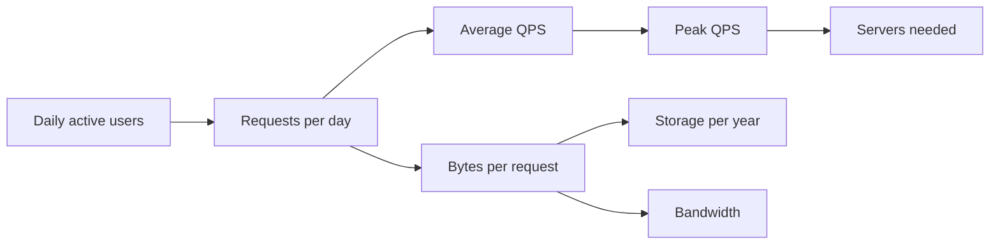

# Back-of-the-envelope estimates

After this you can turn "100 million daily users" into requests per second, storage per year and bandwidth, and judge whether a design is the right size.

Before this: [memory hierarchy and latency numbers](../../01-how-computers-work/02-hardware/04-memory-hierarchy-and-latency-numbers.md), [bits, bytes and units](../../01-how-computers-work/01-bits-and-data/02-bits-bytes-and-units.md) and [scalability basics](01-scalability-basics.md).

## The idea

A teammate proposes one Postgres server for a new product. Another says it needs sharding. Neither has a number. A **back-of-the-envelope estimate** settles it in five minutes: a rough calculation, good to within a factor of two or three, that tells you which order of magnitude you are in. If the peak is 300 requests per second, one server is fine. If it is 300,000, it is not.

The estimate is a chain, and each link feeds the next.



## Key terms

**QPS** (queries per second) is the number of requests a system handles each second. **DAU** is daily active users, the count of distinct users who use the product in a day.

The **peak factor** is the ratio of the busiest moment to the daily average, usually 2 to 5 for consumer products. Design for the peak, not the average.

The **read to write ratio** compares how often data is read with how often it is written. It decides whether caching or write capacity matters more.

## How it works

Memorise a few numbers, then do arithmetic in powers of ten.

| Quantity | Value to remember |
|---|---|
| Seconds per day | 86,400, round to about $10^5$ |
| Seconds per year | about $3 \times 10^7$ |
| $2^{10}$ | 1,024, about a thousand (KB) |
| $2^{20}$ | about a million (MB) |
| $2^{30}$ | about a billion (GB) |
| $2^{40}$ | about a trillion (TB) |
| 1 million requests per day | about 12 per second |
| A typical app server | roughly 1,000 simple requests per second |
| Round trip in one data centre | about 0.5 ms |
| SSD random read | about 100 µs |

The procedure:

1. State the assumptions as numbers: DAU, actions per user per day, size of one record.
2. Requests per day is DAU times actions. Divide by 86,400 for the average QPS.
3. Multiply by the peak factor.
4. Storage per year is new records per day times record size times 365. Multiply by the replication factor (usually 3 copies) if the question is about disk bought.
5. Bandwidth is peak QPS times bytes per response.
6. Sanity-check each result against what one machine can do.

Round aggressively. Using 100,000 for 86,400 gives an answer 16% too high, which does not matter at this precision, and it makes the arithmetic doable in your head. Always carry units.

## Worked examples

<div class="example" markdown>

### Example 1: a post-sharing app with 100 million DAU

Assumptions, which you state aloud in an interview: each user reads 10 posts and writes 1 post per day, a post record is 500 bytes, a response is 2 KB, peak factor 3.

1. Reads per day: $100\text{M} \times 10 = 10^9$. Divided by 86,400, the average is 11,574 reads per second. Peak: 34,722.
2. Writes per day: $10^8$. Average 1,157 per second, peak 3,472.
3. New records per year: $10^8 \times 365 = 36.5$ billion. At 500 bytes that is 18.2 TB per year, so 91.2 TB over 5 years.
4. Bandwidth out at peak: 34,722 requests per second times 2,000 bytes is 69 MB/s, about 0.6 Gbit/s.

<details class="code" markdown>
<summary>In code</summary>

```python
dau = 100_000_000
reads_per_user = 10
writes_per_user = 1
seconds_per_day = 24 * 60 * 60
avg_read_qps = dau * reads_per_user / seconds_per_day
avg_write_qps = dau * writes_per_user / seconds_per_day
peak = 3
print(f"seconds/day {seconds_per_day:,}")
print(f"avg read QPS {avg_read_qps:,.0f}, peak {avg_read_qps*peak:,.0f}")
print(f"avg write QPS {avg_write_qps:,.0f}, peak {avg_write_qps*peak:,.0f}")
rec = 500
per_year = dau * writes_per_user * 365 * rec
print(f"records/year {dau*writes_per_user*365:,}")
print(f"storage/year {per_year/1e12:.1f} TB, 5 years {5*per_year/1e12:.1f} TB")
resp = 2_000
bw = avg_read_qps * peak * resp
print(f"peak egress {bw/1e6:.0f} MB/s = {bw*8/1e9:.1f} Gbit/s")
```

```text
seconds/day 86,400
avg read QPS 11,574, peak 34,722
avg write QPS 1,157, peak 3,472
records/year 36,500,000,000
storage/year 18.2 TB, 5 years 91.2 TB
peak egress 69 MB/s = 0.6 Gbit/s
```

</details>

Sanity checks, each against a known limit:

- 3,472 writes per second is within one well-tuned Postgres primary, but 34,722 reads per second at 2 ms each needs replicas or a cache. That points to caching<!-- link: 03-caching-strategies.md --> and read replicas<!-- link: 04-database-scaling-replication-and-sharding.md -->.
- 35k peak QPS at 1,000 per server is about 35 app servers, plus headroom, so tens and not thousands.
- 91 TB does not fit on one disk, so storage will need sharding or an object store.
- 0.6 Gbit/s is below a 10 Gbit/s network card, so bandwidth is not the bottleneck.

</div>

<div class="example" markdown>

### Example 2: a quick check of someone else's claim

A proposal says "1 million users, so we need 50 servers." Assume each user makes 20 requests a day. That is $2 \times 10^7$ per day, about 230 per second on average, and maybe 700 at peak. One server handles that. The claim is off by 50 times, and the estimate showed it in two lines.

</div>

## Common mistakes

<div class="warning" markdown>

Watch out: mixing bits and bytes, or MB and Mb. Network speeds are in bits per second; storage is in bytes. Multiply by 8 to go from bytes to bits.

Watch out: using the average where the peak decides. A system sized for 11k QPS fails at 35k.

Watch out: false precision. "18.2 TB" is an answer; "18.247 TB" claims accuracy the assumptions do not have. Say "about 20 TB".

</div>

## Working with AI

<div class="ai" markdown>

Words to use: QPS, DAU, peak factor, read to write ratio, replication factor, order of magnitude.

Prompts to try:

- "Estimate the QPS, storage per year and peak bandwidth for a photo app with 20 million DAU. State every assumption as a number and show each step, then list which assumptions most change the answer."
- "Here is my estimate: [paste]. Recompute each line and flag any step that mixes units or forgets the peak factor."

What to check:

- Arithmetic. Language models slip on large multiplications, so redo the chain in Python as in Example 1.
- Unstated assumptions, such as record size, read to write ratio or peak factor. If the answer does not list them, ask.
- Confident figures about real companies' traffic. Treat them as unsourced.

</div>

## Quiz

1\. About how many requests per second is 10 million requests per day?

<details class="solution" markdown>
<summary>Answer</summary>

About 115, from $10^7 / 86{,}400$. The rule of thumb is that 1 million per day is about 12 per second.

</details>

2\. Predict: 50 million new records per day, 1 KB each. How much storage grows per year?

<details class="solution" markdown>
<summary>Answer</summary>

$5 \times 10^7 \times 1000 \times 365 \approx 1.8 \times 10^{13}$ bytes, about 18 TB. With 3 replicas, about 55 TB of disk.

</details>

3\. An estimate gives an average of 2,000 QPS, and the team sizes the database for exactly 2,000. What goes wrong?

<details class="solution" markdown>
<summary>Answer</summary>

Traffic peaks above the average, commonly 2 to 5 times. The database saturates at the busy hour. Size for the peak, with headroom.

</details>

4\. Your estimate says 4 Gbit/s of outgoing traffic. How many bytes per second is that?

<details class="solution" markdown>
<summary>Answer</summary>

Divide by 8: 500 MB/s.

</details>

## Lab

<div class="lab" markdown>

### Lab: estimate your own app

Goal: build an estimate for a product you choose and sanity-check it. Time: about 15 minutes. Runs in: any terminal with Python 3.

1. Pick a product (a notes app, a food-delivery app) and write down DAU, actions per user, record size and peak factor.
2. Copy the script from Example 1 and put in your numbers.
3. Run it and note which limit from the sanity checks you cross first (one server, one disk, one network card).
4. Change the DAU by 10 times and see which result crosses a limit.

Expected result: a table of QPS, storage and bandwidth, and one sentence naming the first bottleneck.

<details class="solution" markdown>
<summary>Solution</summary>

For a notes app with 2 million DAU, 20 reads and 5 writes per user per day, 2 KB per note and a peak factor of 4: reads average 463 per second (peak 1,852), writes 116 (peak 463), and storage grows 7.3 TB per year. One database server handles the traffic, and 7.3 TB of data fits on a few disks, so nothing crosses a limit. At 20 million DAU (10 times), peak reads are 18.5k per second, so a cache or replicas become the first change.

</details>

</div>

## Where this shows up

- Step 2 of every interview answer: [system design interviews](09-system-design-interviews.md).
- Sizing the cache and the code space in the [URL shortener case study](10-case-study-url-shortener.md).
