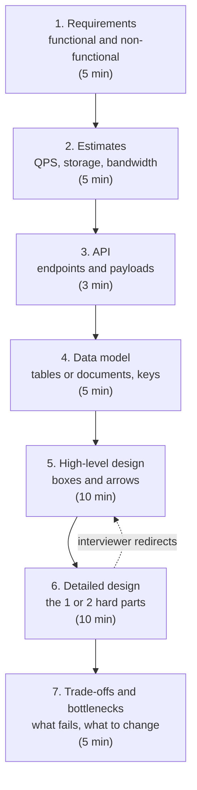

# System design interviews

After this you can run a 45-minute system design interview with a fixed sequence of steps, and avoid the mistakes that cost most candidates the round.

Before this: [back-of-the-envelope estimates](08-back-of-the-envelope-estimates.md), [REST API design](../../09-back-end/01-servers-and-apis/04-rest-api-design.md), and the earlier lessons of this chapter, from [scalability basics](01-scalability-basics.md) to [queues and event-driven design](06-queues-and-event-driven-design.md).

## The idea

The prompt is one line: "Design a URL shortener" or "Design a chat app." There is no right answer to find. The interviewer wants to watch you work through an open problem: ask questions, size it, choose parts, and defend the trade-offs. Candidates who start drawing boxes in the first minute usually design the wrong system.

A fixed sequence removes the panic of the blank whiteboard. It also means the pieces from the earlier lessons (caches, load balancers, replicas, queues) arrive when the numbers call for them, not as a list of buzzwords.

The times in the diagram are a guide for 45 minutes. The dashed arrow shows that interviewers often send you back to change the design.

## Key terms

A **functional requirement** is something the system does ("a user can create a short link"). A **non-functional requirement** is a quality it must have: latency, availability, consistency, durability, scale.

A **trade-off** is a choice where improving one property costs another, such as lower latency for weaker consistency. A **bottleneck** is the part of a system that limits total throughput first. A **single point of failure** is a component whose failure takes the whole system down.

## How it works

1. Requirements. Ask what is in and out of scope, and write down 3 to 5 functional requirements. Then ask the non-functional ones: how many users, read-heavy or write-heavy, how fresh must data be, what happens if it is down for a minute. Say your assumptions aloud.
2. Estimates. Compute average and peak QPS, storage and bandwidth, as in the estimates lesson. The goal is to find out which components you will need, not to be exact.
3. API. List the main endpoints with their method, path and key fields. Two or three are enough.
4. Data model. Name the entities, their keys and the main queries. Choose a store and say why (relational for joins and transactions, key-value for lookups by id at high volume).
5. High-level design. Draw the clients, the load balancer, the services, the caches, the databases and any queues. Walk one request through it from end to end.
6. Detailed design. The interviewer picks, or you propose, the one or two hard parts: ID generation, fan-out, hot keys, sharding.
7. Trade-offs and bottlenecks. Name what breaks first at 10 times the load, and what you would add.

## What interviewers look for

Four things, roughly equal: that you clarify before building, that you can reason with numbers, that your design fits the numbers (not every box from the book), and that you can say what you gave up. Communication counts as much as the diagram. A calm "I'll pick X because reads dominate, and I accept stale reads for a few seconds" beats a perfect box with no reason.

## Worked examples

### Example 1: the first ten minutes for "design a paste service"

Prompt: "Design a service where users paste text and share a link."

1. Ask: can pastes be edited? Do they expire? Is there a size limit? Say: "I'll assume no edits, optional expiry, 1 MB limit, 10 million new pastes a day."
2. Estimate: $10^7 / 86{,}400 \approx 116$ writes per second. If reads are 10 times writes, about 1,160 reads per second. At an average of 10 KB, storage is $10^7 \times 10\text{ KB} \times 365 \approx 36.5$ TB per year.
3. Conclude out loud: "QPS is small. Storage is the real problem, so text goes in an object store and the database holds metadata."
4. API: `POST /pastes` returns an id, `GET /pastes/{id}` returns the text.

Check: after ten minutes, every later choice has a number behind it. The estimate also moved the design away from "put the text in Postgres."

## Common mistakes

Watch out: jumping to the design. Skipping steps 1 and 2 means you solve a problem nobody asked for.

Watch out: listing every technology you know. Add a component only when a number or a requirement asks for it, and say which.

Watch out: staying silent while thinking, or never stating a trade-off. The interviewer can only grade what they hear.

## Working with AI

Words to use: functional requirement, non-functional requirement, bottleneck, trade-off, single point of failure, detailed design.

Prompts to try:

- "Act as a system design interviewer. Ask me to design a rate limiter, and answer my clarifying questions. After my design, grade me on requirements, estimates, design, trade-offs and communication."
- "Here is my design for [problem] and my estimates: [paste]. List the three weakest assumptions and what breaks first at 10 times the load."

What to check:

- Invented numbers in the interviewer's answers. Ask the AI to give its source, or treat them as assumptions.
- Designs with every component included. Ask which ones the numbers justify.
- Praise without specifics. Ask for the exact step where you lost points.

## Quiz

1\. List the seven steps in order.

Answer

Requirements, estimates, API, data model, high-level design, detailed design, trade-offs and bottlenecks.

2\. Which of these is non-functional: "users can follow other users", "the feed loads in under 300 ms at the 99th percentile"?

Answer

The second one. It is a quality (latency), not a feature.

3\. A candidate adds Kafka, sharding and a CDN to a design for 50 requests per second. What is wrong?

Answer

The estimate does not support them. One server and one database handle 50 QPS. Each component should be tied to a number or a requirement.

4\. The interviewer asks "what if the primary database dies?" Which step is this?

Answer

Trade-offs and bottlenecks (a single point of failure). A good answer names a replica with failover and says what is lost, such as the last few writes.

## Lab

### Lab: a timed mock round

Goal: practise the sequence on one prompt, out loud. Time: about 20 minutes. Runs in: paper or any notes app.

1. Pick a prompt: "Design a pastebin" is a good first one, and it is not covered in this chapter.
2. Set a timer for 20 minutes. Write requirements, estimates, API and data model in the first 10 minutes.
3. Draw the high-level design and walk one write and one read through it.
4. Name the first bottleneck and one fix. Then ask an AI to grade it using the second prompt above.

Expected result: one page with numbers, a diagram and two or three stated trade-offs.

Solution

A reasonable answer: about 100 writes and 1,000 reads per second. Pastes stored as objects in blob storage, with a table holding id, owner, creation time, expiry and blob location. Reads go through a CDN and a cache. Ids come from a counter in base62, as in the [URL shortener](10-case-study-url-shortener.md). Trade-off: expiry cleanup runs as a background job, so expired pastes may be readable for a few minutes.

## Where this shows up

- The two case studies apply the sequence: the [URL shortener](10-case-study-url-shortener.md) and the [chat app](11-case-study-chat-app.md).
- The same steps work on the job, in a design document before building a feature.
