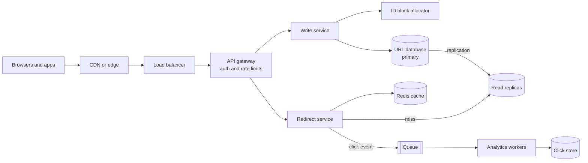
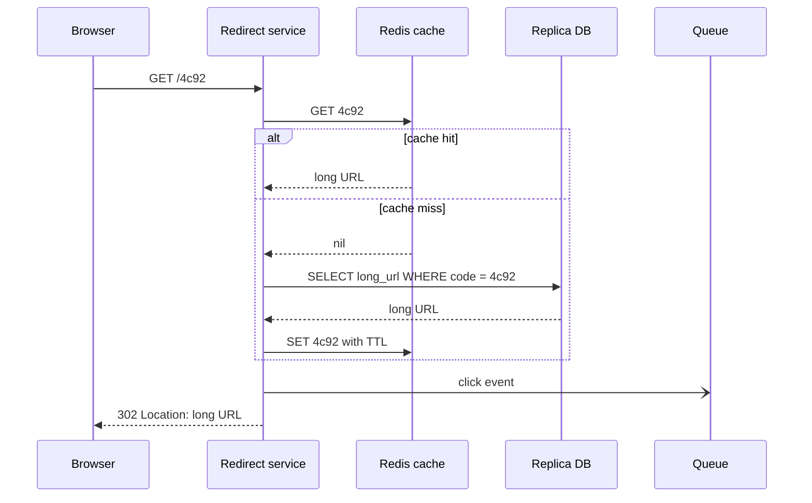

# Case study: a URL shortener

After this you can design a URL shortener from requirements to scaling, and explain how short codes are generated, stored, cached and redirected.

Before this: [system design interviews](09-system-design-interviews.md), [back-of-the-envelope estimates](08-back-of-the-envelope-estimates.md), [rate limiting and API gateways](07-rate-limiting-and-api-gateways.md), [Redis and caching](../../10-databases-sql-and-postgres/05-databases-in-apps/04-redis-and-caching.md) and [indexes](../../10-databases-sql-and-postgres/04-postgres-in-depth/01-indexes.md).

## The idea

A **URL shortener** turns `https://example.com/articles/2026/very-long-title?utm=abc` into `https://sho.rt/4c92`, and sends anyone who opens the short link to the long one. It looks tiny, which makes it a good first case: the whole interview sequence fits, and one problem (making unique short codes) is genuinely hard at scale.

We follow the seven steps from the interview lesson.

## Requirements and estimates

Functional: create a short link from a long URL, redirect a short link to its long URL, optionally let the user pick an alias and an expiry date, and count clicks. Non-functional: redirects must be fast (a few tens of milliseconds) and highly available, since a dead link is a broken link on someone else's page. A short code never changes once issued. Reads far outnumber writes.

Assumptions: 100 million new URLs per month, 100 reads per write, 500 bytes per record, a peak factor of 3.

```python
new_per_month = 100_000_000
w = new_per_month / (30 * 86_400)
r = w * 100
print(f"write {w:.1f}/s, read {r:,.0f}/s, peak read {3*r:,.0f}/s")
urls_5y = new_per_month * 12 * 5
print(f"URLs in 5 years {urls_5y:,}, storage {urls_5y*500/1e12:.1f} TB")
reads_day = r * 86_400
print(f"reads/day {reads_day/1e6:.0f}M, cache 20%: {0.2*reads_day*500/1e9:.0f} GB")
```

```text
write 38.6/s, read 3,858/s, peak read 11,574/s
URLs in 5 years 6,000,000,000, storage 3.0 TB
reads/day 333M, cache 20%: 33 GB
```

The numbers say: 39 writes per second is trivial, 3.9k reads per second (11.6k at peak) is moderate, and 3 TB over five years fits on one machine's disk. The design problem is therefore read speed and availability, not size. Caching the hottest 20% of a day's reads takes about 33 GB of RAM, one cache node or a few.

## API and data model

```text
POST /api/v1/urls     body: {"long_url": "...", "alias": "optional", "expires_at": "optional"}
                      returns 201 {"short_url": "https://sho.rt/4c92"}
GET  /{code}          returns 301 or 302 with Location: the long URL
```

One table does the job: `urls(code PRIMARY KEY, long_url, created_at, expires_at, owner_id)`. The primary key on `code` gives an index, so a redirect is one indexed lookup. The access pattern is always "get by code", with no joins, so a key-value store such as DynamoDB or Cassandra also fits, and scales out more easily. Postgres is fine at 3 TB with replicas. State the choice and the reason.

## Short-code generation

How long must a code be? With base62 (digits, lowercase and uppercase letters), 6 characters give $62^6 = 56{,}800{,}235{,}584$ codes and 7 give $62^7 = 3{,}521{,}614{,}606{,}208$. Six billion URLs in five years fills 10.6% of the 6-character space and 0.17% of the 7-character space, so 7 characters leave room.

Three ways to produce the code:

| Method | How | Problem |
|---|---|---|
| Counter plus base62 | A unique number, written in base62 | Codes are guessable in sequence. Needs a shared counter. |
| Hash and truncate | Hash the long URL, keep the first 7 characters | Collisions: two URLs get one code, so you must check and retry. |
| Random | Pick 7 random characters | Collisions again, and a check on every write. |

Counter plus base62 never collides, because every number is different, so it is the usual choice. To avoid one counter being a bottleneck and a single point of failure, each application server asks a coordinator (a database sequence, ZooKeeper or Redis `INCR`) for a block of, say, 1,000 numbers, and hands them out locally. If you need codes that cannot be guessed, run the number through a reversible shuffle, or add a random component.

For hashes the collision rate is about the fill ratio: with 6 billion URLs in a $62^6$ space, about 10% of new codes collide, and each collision costs a database read and a retry. That is why hashing needs the check and the counter does not.

```python
ALPHABET = "0123456789abcdefghijklmnopqrstuvwxyzABCDEFGHIJKLMNOPQRSTUVWXYZ"

def encode(n):
    if n == 0:
        return ALPHABET[0]
    out = []
    while n:
        n, r = divmod(n, 62)
        out.append(ALPHABET[r])
    return "".join(reversed(out))

def decode(s):
    n = 0
    for ch in s:
        n = n * 62 + ALPHABET.index(ch)
    return n

for n in (0, 61, 62, 125, 1_000_000, 3_500_000_000_000):
    s = encode(n)
    print(n, s, decode(s) == n)
```

```text
0 0 True
61 Z True
62 10 True
125 21 True
1000000 4c92 True
3500000000000 ZCpdjxe True
```

Number 62 is `10` in base62, the same way 10 is written after 9 in base 10. The last column checks that `decode` reverses `encode`.

## High-level design



In the diagram, the two paths are separate services because their load differs by 100 times. Writes go to the primary; redirects read the cache first, then a replica. Click events go through a queue so counting never slows a redirect.



In the sequence, the click event is sent with an asynchronous arrow and the redirect does not wait for it.

## Redirects and analytics

A `301 Moved Permanently` lets browsers and proxies cache the redirect, which cuts load but hides later clicks from your servers. A `302 Found` is not cached, so every click reaches you and can be counted, at a higher cost. Services that sell analytics use `302`; a service that wants minimum load and no analytics can use `301`. Say which you chose.

## Scaling and bottlenecks

The cache holds the hot codes, and a replica set handles misses; if reads grow, add replicas, then shard the table by hash of `code`, as in [database scaling](04-database-scaling-replication-and-sharding.md). Rate limit creation per user or API key so one client cannot exhaust the code space. Run the redirect service in several availability zones behind the load balancer. Expired links are deleted by a background job, and cache entries use a TTL (time to live) so deleted links stop working within minutes.

## Common mistakes

<div class="warning" markdown>

Watch out: hashing without a collision check. Two long URLs silently share a code, and one of them redirects to the wrong place.

Watch out: counting clicks inside the redirect request. A slow analytics write makes every redirect slow. Send an event to a queue.

Watch out: using sequential codes for private links. Anyone can walk through `4c92`, `4c93`, and read what others shortened.

</div>

## Working with AI

<div class="ai" markdown>

Words to use: base62, collision, `301` and `302`, cache-aside, read replica, TTL, idempotent.

Prompts to try:

- "Design a URL shortener for 100 million new URLs per month and 100 reads per write. Give the estimates step by step, the table schema, and how codes are generated without collisions across 10 app servers."
- "Review this base62 encode function for off-by-one errors and the zero case: [paste]. Write tests for round trips."

What to check:

- Code length that does not match the estimate. Recompute $62^k$ against the URL count.
- A hash design with no collision handling.
- `301` suggested together with a click-analytics requirement.

</div>

## Quiz

1\. How many 6-character base62 codes exist?

<details class="solution" markdown>
<summary>Answer</summary>

$62^6 = 56{,}800{,}235{,}584$, about 57 billion.

</details>

2\. What does `encode(125)` return, and why?

<details class="solution" markdown>
<summary>Answer</summary>

`21`. Since $125 = 2 \times 62 + 1$, the digits are 2 and 1.

</details>

3\. Analytics shows far fewer clicks than your server logs expected. A teammate chose `301`. Why would that undercount?

<details class="solution" markdown>
<summary>Answer</summary>

Browsers cache a `301`, so repeat visits go straight to the long URL without reaching your service. Use `302` if every click must be counted.

</details>

4\. Why does counter-based generation avoid collisions, and what does it cost?

<details class="solution" markdown>
<summary>Answer</summary>

Every number is issued once, so every code is different. The cost is a shared counter to coordinate (usually blocks of numbers per server) and codes that are guessable unless shuffled.

</details>

## Lab

<div class="lab" markdown>

### Lab: a working shortener in 30 lines

Goal: build the create and redirect paths with the base62 encoder. Time: about 20 minutes. Runs in: any terminal with Python 3.

1. Put `encode` from this lesson in `shortener.py`, with a dictionary `store` and a counter starting at 1,000,000.
2. Write `shorten(url)`, which encodes the counter, saves the pair and returns the code.
3. Write `resolve(code)`, which returns the long URL or `None`.
4. Shorten two URLs, print the codes, resolve both and one unknown code.

Expected result:

```text
4c92 https://example.com/a
4c93 https://example.com/b
https://example.com/a None
```

<details class="solution" markdown>
<summary>Solution</summary>

```python
ALPHABET = "0123456789abcdefghijklmnopqrstuvwxyzABCDEFGHIJKLMNOPQRSTUVWXYZ"

def encode(n):
    out = []
    while n:
        n, r = divmod(n, 62)
        out.append(ALPHABET[r])
    return "".join(reversed(out)) or ALPHABET[0]

store, counter = {}, 1_000_000

def shorten(url):
    global counter
    code = encode(counter)
    counter += 1
    store[code] = url
    return code

def resolve(code):
    return store.get(code)

a, b = shorten("https://example.com/a"), shorten("https://example.com/b")
print(a, "https://example.com/a")
print(b, "https://example.com/b")
print(resolve(a), resolve("zzzzzz"))
```

</details>

</div>

## Where this shows up

- The same read-heavy shape (cache, replicas, async events) appears in every content site.
- Next, a very different shape: the [chat app](11-case-study-chat-app.md), where connections stay open.
