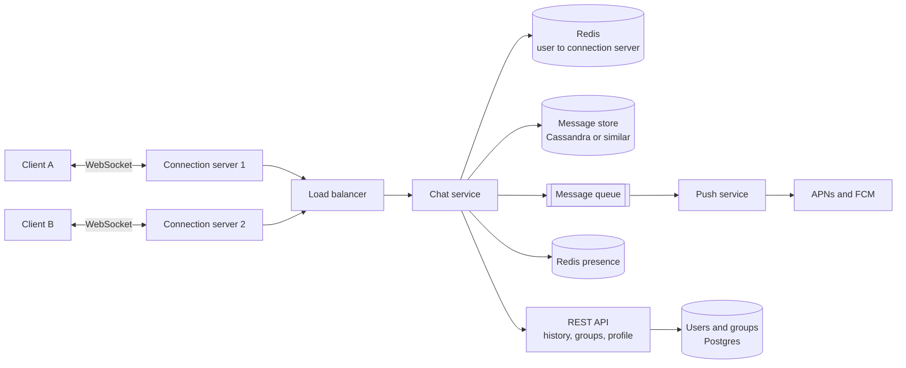
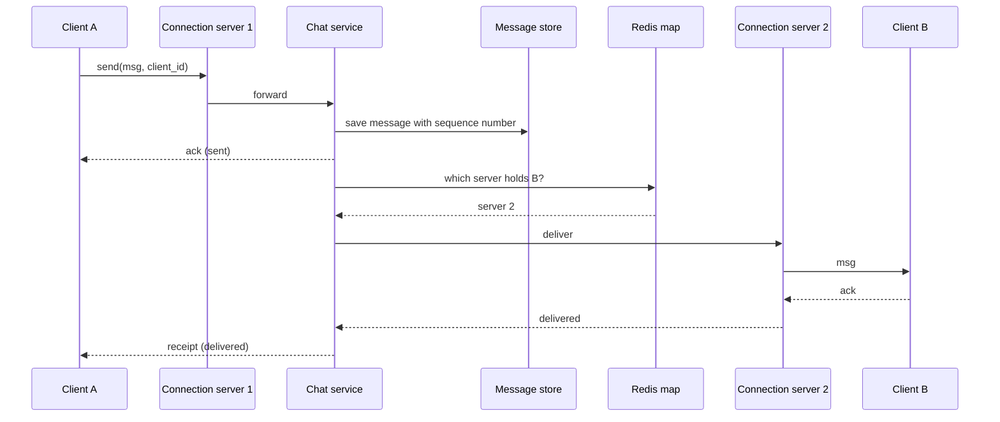

# Case study: a chat app

After this you can design a chat system with 1:1 and group messages, explain how messages reach connected and offline users, and name the trade-offs in ordering, receipts and presence.

Before this: [system design interviews](09-system-design-interviews.md), [WebSockets and real time](../../07-networking/02-web-protocols/06-websockets-and-real-time.md), [Redis and caching](../../10-databases-sql-and-postgres/05-databases-in-apps/04-redis-and-caching.md), [NoSQL databases](../../10-databases-sql-and-postgres/05-databases-in-apps/03-nosql-databases.md), and [queues and event-driven design](06-queues-and-event-driven-design.md). This lesson is optional.

## The idea

A URL shortener answers a request and closes the connection. A chat app is the opposite: millions of clients stay connected, and the server must push a message to a specific person the moment it arrives. HTTP request and response does not fit, because the server cannot start a conversation. The standard answer is a WebSocket connection held open per client, on servers built to hold many connections.

Requirements: 1:1 chat, group chat up to a few hundred members, delivery and read receipts, online status, push notifications, and message history that syncs across devices. Non-functional: low latency (well under a second), no lost messages, messages in order within a conversation.

## Key terms

A **connection server** (or gateway) holds the open WebSocket connections and forwards messages in and out. It keeps no business logic.

**Fan-out** is copying one message to every recipient. In a group of 200, one send becomes 200 deliveries.

**Presence** is whether a user is online. A **delivery receipt** says the message reached the recipient's device; a **read receipt** says it was opened.

A **push notification** is a message sent through the phone vendor's service (APNs for iOS, FCM for Android) to wake a device whose app is closed.

## How it works



In the diagram, clients A and B are on different connection servers. The chat service finds B's server through the Redis map from user to connection server, and sends the message there.

The send path, for a 1:1 message:



In the sequence, the message is saved before it is delivered, so a crash cannot lose it. If Redis has no entry for B, B is offline: the chat service puts a job on the queue, and the push service sends a notification. The message waits in the store.

Storage: a conversation is a partition and messages are rows sorted by a sequence number, so loading the last 50 messages is one sequential read. Wide-column stores such as Cassandra suit this write-heavy, time-ordered pattern; Postgres works at smaller scale.

Ordering: use a per-conversation sequence number assigned by the chat service, not the client's clock, which can be wrong or changed. Clients retry sends, so each message carries a client-generated ID, and the server ignores a repeated ID (it makes the send idempotent).

Group messages: for small groups, write the message once and fan out to each member's connection or inbox at send time. For very large groups, members pull from the group's log instead, because copying a message a million times is too costly.

Presence: each client sends a heartbeat every few seconds, and the server sets a Redis key with a short TTL. When the key expires, the user is offline. Publish status changes only to friends who are viewing the user, not to everyone.

Offline sync: when a device reconnects, it sends the last sequence number it has for each conversation, and the server returns everything newer.

## Worked examples

<div class="example" markdown>

### Example 1: sizing the connection servers

Assume 50 million DAU, 20% online at once, and one server holds about 100,000 idle WebSocket connections (an assumption you would test; the limit is memory and file descriptors).

1. Concurrent connections: $50\text{M} \times 0.2 = 10\text{M}$.
2. Connection servers: $10\text{M} / 100\text{k} = 100$.
3. Messages: 40 per user per day gives $2 \times 10^9$ messages per day, about 23,000 per second on average.
4. Storage at 200 bytes each: $4 \times 10^{11}$ bytes, 400 GB per day, about 146 TB per year before replication.

```python
dau = 50_000_000
online = dau * 0.2
servers = online / 100_000
msgs = dau * 40
print(f"{online:,.0f} online, {servers:.0f} connection servers")
print(f"{msgs:,.0f}/day, {msgs/86_400:,.0f}/s")
print(f"{msgs*200/1e9:.0f} GB/day, {msgs*200*365/1e12:.0f} TB/year")
```

```text
10,000,000 online, 100 connection servers
2,000,000,000/day, 23,148/s
400 GB/day, 146 TB/year
```

Check: the numbers match the arithmetic above. The conclusion for the interview is that connections and storage drive the design, not CPU.

</div>

## Common mistakes

<div class="warning" markdown>

Watch out: ordering by the sender's timestamp. Phone clocks differ, so messages appear out of order. Use a server-assigned sequence per conversation.

Watch out: keeping the user to connection mapping inside each server. Another server cannot find the user. Keep it in a shared store.

Watch out: broadcasting presence to everyone. With millions of users, each status change becomes millions of messages.

</div>

## Working with AI

<div class="ai" markdown>

Words to use: WebSocket, connection server, fan-out, presence, heartbeat, sequence number, idempotent, push notification.

Prompts to try:

- "Design the message send path for a chat app with WebSockets across 100 connection servers. Show how a message reaches a user on a different server and what happens if the user is offline."
- "Explain how to give each message in a group chat a total order. Compare a per-conversation sequence number with timestamps and with a vector clock."

What to check:

- Ordering by client timestamps.
- A design that delivers a message without saving it first.
- No mention of what happens to a user who is offline or to a retry from a flaky connection.

</div>

## Quiz

1\. Why do chat apps use WebSockets in place of plain HTTP requests?

<details class="solution" markdown>
<summary>Answer</summary>

The server must push messages to the client at any moment, and an open connection allows that without the client asking repeatedly.

</details>

2\. A group has 300 members. How many deliveries does one message produce, counting the sender's own other devices as zero?

<details class="solution" markdown>
<summary>Answer</summary>

299, one for each other member. That multiplication is fan-out.

</details>

3\. Two users see messages in different orders. What was likely used to sort them?

<details class="solution" markdown>
<summary>Answer</summary>

Client clocks or arrival time at different servers. Use one server-assigned sequence number per conversation.

</details>

4\. A user's phone loses signal for an hour. How does the app catch up?

<details class="solution" markdown>
<summary>Answer</summary>

On reconnect it sends its last sequence number per conversation, and the server returns all newer messages from the store.

</details>

## Lab

<div class="lab" markdown>

### Lab: a tiny in-memory chat room

Goal: model sequence numbers and offline delivery in Python. Time: about 15 minutes. Runs in: any terminal with Python 3.

1. Write a `Room` with a list `log` and a function `send(user, text)` that appends `(seq, user, text)` with `seq` starting at 1.
2. Write `sync(last_seq)` that returns all entries with a larger sequence number.
3. Send three messages. Sync from 0, and again from 2.

Expected result:

```text
[(1, 'ana', 'hi'), (2, 'raj', 'hello'), (3, 'ana', 'ready?')]
[(3, 'ana', 'ready?')]
```

<details class="solution" markdown>
<summary>Solution</summary>

```python
class Room:
    def __init__(self):
        self.log = []

    def send(self, user, text):
        self.log.append((len(self.log) + 1, user, text))

    def sync(self, last_seq):
        return [m for m in self.log if m[0] > last_seq]

room = Room()
room.send("ana", "hi")
room.send("raj", "hello")
room.send("ana", "ready?")
print(room.sync(0))
print(room.sync(2))
```

</details>

</div>

## Where this shows up

- The same ideas appear in notifications, collaborative editors and live dashboards: open connections, a fan-out step and a catch-up from a sequence number.
- Delivering through a queue is the pattern from [queues and event-driven design](06-queues-and-event-driven-design.md).
