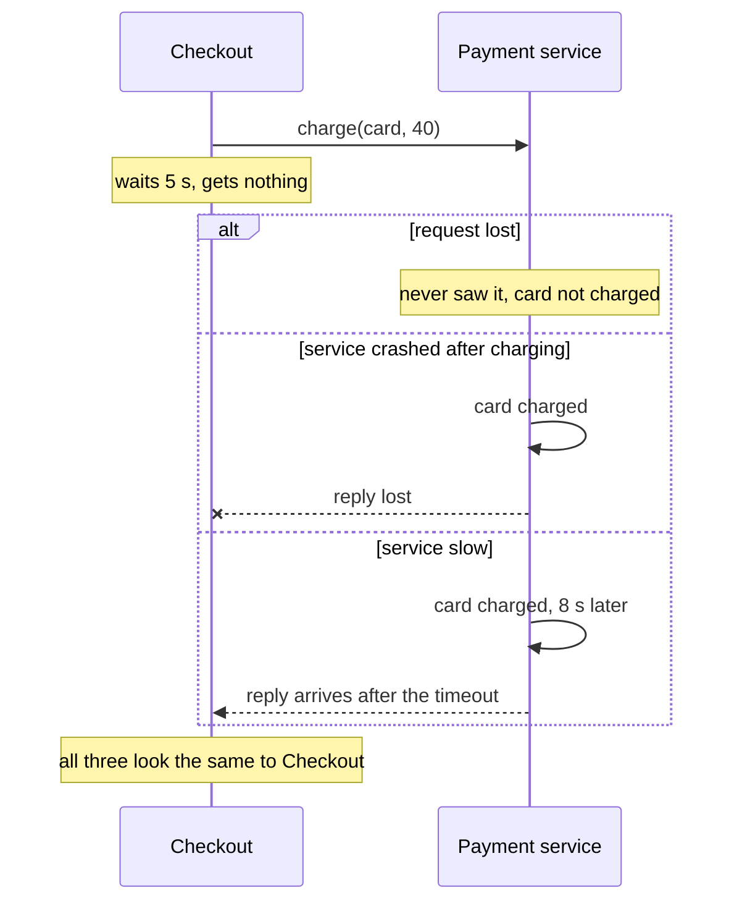
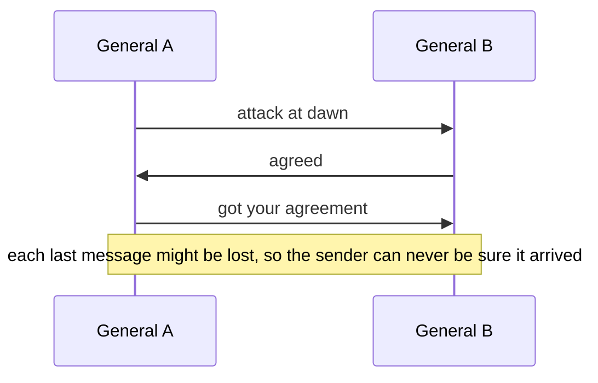

# Why distributed systems are hard

After this you can explain why a call to another machine can fail in ways a function call cannot, recite the eight fallacies of distributed computing, and say why "did it work?" has no certain answer after a timeout.

Before this: [monoliths and microservices](../01-software-design/05-monoliths-and-microservices.md), [database scaling](../02-system-design/04-database-scaling-replication-and-sharding.md) and [CAP and consistency](../02-system-design/05-cap-and-consistency.md).

## The idea

Your checkout service calls a payment service over the network: `charge(card, 40)`. In a single program, a function call either returns or raises an exception, and you know the function stopped. Over a network, you send a request and wait. Nothing comes back for five seconds. What happened?

Maybe the request never arrived. Maybe the payment service charged the card and the reply was lost. Maybe the service is slow and will answer in a moment. Maybe it crashed halfway through. From where you sit, all four look identical: silence.



That ambiguity is the heart of the chapter.

## Key terms

A **distributed system** is a set of computers that communicate only by sending messages over a network and work together on one task. A web app with a database on a second machine already counts.

**Partial failure** means some parts of the system fail while others keep running. A single program mostly fails all at once; a distributed system is nearly always partly broken somewhere.

A **network partition** is a failure where nodes are running but cannot reach each other (the term from [CAP and consistency](../02-system-design/05-cap-and-consistency.md)).

**Latency** is the time a message takes to arrive. A **timeout** is the longest you wait before you give up and treat the call as failed.

## How it works

Three facts cause most of the difficulty.

1. Messages can be lost, delayed, duplicated or reordered. The network gives no guarantee about when, or whether, a message arrives.
2. There is no shared memory and no shared clock. Each machine sees only its own state plus the messages it has received. The next two lessons show what that does to ordering.
3. You cannot tell a slow node from a dead one. A **failure detector** (code that decides a node is down) can only guess, usually from a timeout. Set it short and you declare healthy nodes dead; set it long and you wait on dead ones.

The simulation below models a service that fails to answer 10% of the time and is otherwise fast, with a 200 ms timeout.

```python
import random

random.seed(7)

def call_service():
    """Return a latency in ms. 10% of the time the service never answers."""
    if random.random() < 0.10:
        return None                         # no reply at all
    return random.expovariate(1 / 40)       # mean 40 ms

TIMEOUT_MS = 200
timed_out = lost = 0
for _ in range(10_000):
    latency = call_service()
    if latency is None or latency > TIMEOUT_MS:
        timed_out += 1
        if latency is None:
            lost += 1
print(f"timed out: {timed_out}, never answered: {lost}, merely slow: {timed_out - lost}")
```

```text
timed out: 1051, never answered: 991, merely slow: 60
```

Of 1051 timeouts, 60 were calls that would have succeeded if we had waited longer. The caller sees only the 1051 timeouts and cannot separate the two groups. Those 60 matter: if the work was a payment and you retry it, you may charge twice.

The **eight fallacies of distributed computing** (listed by Peter Deutsch and colleagues at Sun Microsystems in the 1990s, see [the Wikipedia summary](https://en.wikipedia.org/wiki/Fallacies_of_distributed_computing)) are false beliefs that new designs keep assuming:

| Fallacy | What goes wrong |
|---|---|
| The network is reliable | Packets drop, connections reset. Plan for failure on every call. |
| Latency is zero | A call across regions costs tens or hundreds of milliseconds, 1000 times a local call. |
| Bandwidth is infinite | Large responses and chatty protocols saturate links. |
| The network is secure | Traffic can be read or altered unless you encrypt and authenticate it. |
| Topology does not change | Servers are added, moved and replaced while you run. |
| There is one administrator | Cloud, partner and third-party services follow different rules and schedules. |
| Transport cost is zero | Serialization, and cloud data-transfer fees, cost real time and money. |
| The network is homogeneous | Different hardware, operating systems and versions have to interoperate. |

The first three produce most outages. If a design says "call service B, then service C" with no thought for what happens when either call fails or stalls, it is assuming the first two.

**The two generals problem** shows why certainty is impossible, not just hard. Two generals on opposite hills must attack at the same moment. They can only send messengers across a valley where messengers may be caught.



If A sends "attack at dawn", A cannot attack until B confirms. B's confirmation might be lost, so B wants A to confirm that, and so on without end. No finite number of messages gives both sides certainty. Real systems accept this and work with probability: acknowledgements, timeouts and retries (next lesson), and agreement protocols that tolerate lost messages ([consensus](04-consensus-and-leader-election.md)).

## Worked examples

<div class="example" markdown>

### Example 1: what a timeout tells you

A client calls `POST /payments` and gets a timeout after 5 seconds.

1. List what could have happened: request lost, request processed and reply lost, request still being processed.
2. Ask what each choice costs. Giving up when the payment went through leaves the customer charged with no order. Retrying when it went through charges them twice.
3. Conclude that the client cannot decide alone. It must either send a repeat that the server can recognize (an idempotency key, next lesson) or ask the server "did payment X happen?" before acting.

Check: in the sequence diagram at the top, the three branches end in the same `Note` for Checkout. If your design needs to know which branch occurred, it needs a second source of truth, such as a status endpoint.

</div>

## Common mistakes

<div class="warning" markdown>

Watch out: treating a timeout as "it failed". A timeout means "I don't know". Treat the operation as possibly done.

Watch out: wrapping a remote call in a function that looks local (`user = users.get(id)`) and giving it no timeout or failure path. The fallacies are hidden by the nice name.

Watch out: assuming "slow" and "down" can be separated by choosing a clever timeout. Any timeout is a guess, and the right value changes with load.

</div>

## Working with AI

<div class="ai" markdown>

Words to use: partial failure, network partition, timeout, failure detector, idempotent, at-least-once, fallacies of distributed computing.

Prompts to try:

- "Review this Python function that calls two internal HTTP services in a row. For each call, say what happens on a timeout, a connection reset and a slow reply, and what state the system is left in."
- "We split a monolith into an orders service and an inventory service. List the failure cases of the call from orders to inventory, and which ones leave data inconsistent."

What to check:

- Generated code that makes a network call with no timeout. In Python's `requests`, the default is to wait forever.
- Error handling that logs "failed" and moves on without asking whether the remote side may have acted.
- Advice that treats a distributed call like a local one, with no mention of retries, duplicates or partial failure.

</div>

## Quiz

1\. A caller gets a timeout. Name three different things that may have happened at the remote service.

<details class="solution" markdown>
<summary>Answer</summary>

It never received the request; it processed the request but the reply was lost; it is still processing or is slow and will answer after the timeout. A crash partway through is a fourth.

</details>

2\. Which fallacy does "we will call the service in a loop for each of the 10,000 items" most directly assume?

<details class="solution" markdown>
<summary>Answer</summary>

Latency is zero (and transport cost is zero). At 20 ms per call, 10,000 sequential calls take 200 seconds. Batch the request instead.

</details>

3\. In the simulation, 60 of 1051 timeouts were calls that would have worked with a longer wait. Why does that make "retry on timeout" unsafe for a payment?

<details class="solution" markdown>
<summary>Answer</summary>

Those calls may already have charged the card. A retry charges it a second time unless the server can recognize the repeat.

</details>

4\. Why can the two generals never be fully certain, however many messages they exchange?

<details class="solution" markdown>
<summary>Answer</summary>

The sender of the last message cannot know whether it arrived. If it needs confirmation, the confirmation is itself a last message that may be lost, so the uncertainty always moves to the final message.

</details>

## Lab

<div class="lab" markdown>

### Lab: slow or dead?

Goal: see how the timeout value trades false alarms for wait time. Time: about 10 minutes. Runs in: any terminal with Python 3.

1. Save the simulation from this lesson as `timeouts.py` and run it. Note the "merely slow" count.
2. Change `TIMEOUT_MS` to 50, then 100, then 500 and run again each time.
3. Predict first: will "merely slow" rise or fall as the timeout grows? Will "never answered" change?
4. Cleanup: delete the file.

Expected result: "never answered" stays at 991 for every timeout (those calls never reply). "Merely slow" falls as the timeout grows, because fewer slow replies cross the line, and a long timeout costs the caller more waiting on the dead calls.

<details class="solution" markdown>
<summary>Solution</summary>

The never-answered calls are fixed by the seed, so they stay constant. The slow calls follow an exponential distribution with mean 40 ms, so a larger timeout catches more of them in time. At 500 ms none remain, but every one of the 991 dead calls now holds a caller for 500 ms. No value separates the two groups cleanly, which is the point.

</details>

</div>

## Where this shows up

- Handling the silence with timeouts, retries and breakers: [timeouts, retries and circuit breakers](02-timeouts-retries-and-circuit-breakers.md).
- Ordering events when machines disagree about time: [clocks, ordering and delivery](03-clocks-ordering-and-delivery.md).
- Getting nodes to agree despite failures: [consensus and leader election](04-consensus-and-leader-election.md).
