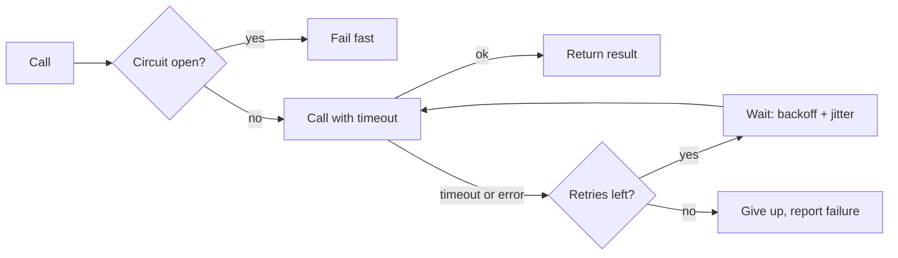
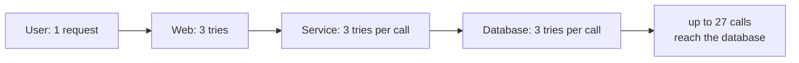
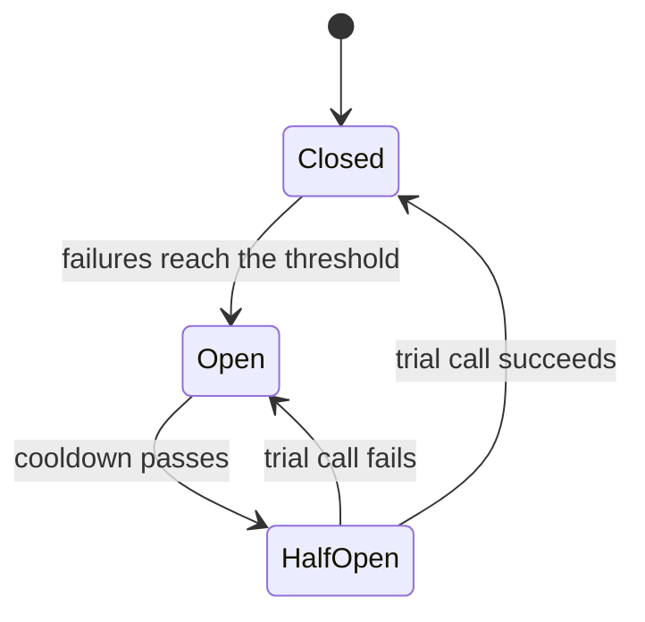

# Timeouts, retries and circuit breakers

After this you can set sensible timeouts, write a retry with exponential backoff and jitter, explain how retries cause outages, and describe what a circuit breaker and a bulkhead do.

Before this: [why distributed systems are hard](01-why-distributed-systems-are-hard.md), [REST API design](../../09-back-end/01-servers-and-apis/04-rest-api-design.md) and [orchestration and idempotent jobs](../../11-data-engineering-and-data-science/01-data-engineering/06-orchestration-and-idempotent-jobs.md).

## The idea

The previous lesson ended with silence: a call that may have worked. Four habits turn that silence into a controlled outcome. Put a timeout on every call, so a stuck dependency cannot hold your threads forever. Retry failures that are likely to be temporary, with growing and randomized waits. Make retried operations safe to repeat. And stop calling a dependency that is known to be down, so you fail fast and give it room to recover.



## Key terms

A **timeout** is the longest a caller waits for a reply. Without one, a slow dependency makes every caller slow, then exhausts threads or connections.

A **retry** repeats a failed call. **Exponential backoff** doubles the wait window after each failure (0.1 s, 0.2 s, 0.4 s, ...), usually up to a cap. **Jitter** adds randomness to the wait so many clients do not retry at the same moment.

A **retry storm** is what happens when many clients retry at once against a service that is already overloaded, which keeps it overloaded.

An operation is **idempotent** if doing it twice has the same effect as once. An **idempotency key** is a unique value the client sends with a request, so the server can recognize a repeat and return the first result. Retrying only a `GET`, `PUT` or `DELETE` is safe by definition; a `POST` needs a key (see [REST API design](../../09-back-end/01-servers-and-apis/04-rest-api-design.md) and, for jobs, [orchestration and idempotent jobs](../../11-data-engineering-and-data-science/01-data-engineering/06-orchestration-and-idempotent-jobs.md)).

A **circuit breaker** wraps calls to a dependency and stops making them after repeated failures. A **bulkhead** limits the share of resources (threads, connections) any one dependency can use, so one failing dependency cannot take everything down. The name comes from the sealed compartments in a ship's hull.

## How it works

Timeouts come first. Set one for connecting and one for the whole call, shorter than the timeout of whoever calls you. If the user's request times out at 10 s, your database call should not wait 30 s. Python's `requests` library waits forever unless you pass `timeout=`.

For retries, only retry errors that can be temporary: timeouts, connection resets, `503`. A `400` or `404` will fail the same way again. Cap the number of attempts, and use backoff with jitter. The common "full jitter" version picks a random wait between 0 and `min(cap, base * 2**n)`:

```python
import random

def backoff_delays(tries, base=0.1, cap=2.0, rng=random):
    """Full jitter: wait a random time between 0 and min(cap, base * 2**n)."""
    return [rng.uniform(0, min(cap, base * 2 ** n)) for n in range(1, tries + 1)]

random.seed(3)
print([round(d, 2) for d in backoff_delays(5)])
```

```text
[0.05, 0.22, 0.3, 0.97, 1.25]
```

The waits roughly grow, but each is random. Without the randomness, 1000 clients that failed together would retry together at 0.2 s, again at 0.4 s, and so on, each wave hitting the service as hard as the first.

Retries also multiply across layers. If each of three layers retries 3 times, one user action becomes up to $3 \times 3 \times 3 = 27$ calls to the database.



Retry in one layer, usually the one closest to the user or the edge, and have the others fail fast. Many systems also cap retries as a fraction of traffic (a **retry budget**).

A circuit breaker has three states.



Closed means calls pass through and failures are counted. Open means calls fail immediately, without touching the dependency. After a cooldown the breaker goes half-open and lets one trial call through: success closes it, failure opens it again. A minimal version, with the clock passed in so the output is reproducible:

```python
class Breaker:
    def __init__(self, threshold=3, cooldown=10):
        self.threshold, self.cooldown = threshold, cooldown
        self.failures, self.state, self.opened_at = 0, "closed", 0

    def call(self, fn, now):
        if self.state == "open":
            if now - self.opened_at < self.cooldown:
                raise RuntimeError("circuit open: failing fast")
            self.state = "half-open"                # allow one trial call
        try:
            result = fn()
        except Exception:
            self.failures += 1
            if self.state == "half-open" or self.failures >= self.threshold:
                self.state, self.opened_at = "open", now
            raise
        self.failures, self.state = 0, "closed"
        return result
```

Calling it with three failures, then a call during the cooldown, then a healthy call after it:

```text
t= 0 state=closed    error: down
t= 1 state=closed    error: down
t= 2 state=open      error: down
t= 3 state=open      error: circuit open: failing fast
t=13 state=closed    ok
```

Real breakers (in libraries such as resilience4j, Polly or Envoy) add rolling windows, failure percentages and metrics, but the three states are the same.

## Worked examples

<div class="example" markdown>

### Example 1: retrying a payment safely

A client calls `POST /payments` and times out. It already knows from the last lesson that it cannot tell whether the card was charged.

1. Before the first attempt, the client generates a random key, for example a UUID, and sends it as an `Idempotency-Key` header.
2. The server stores the key together with the result, in the same transaction as the charge.
3. On timeout, the client waits a jittered delay and sends the same request with the same key.
4. If the first attempt did charge the card, the server finds the key and returns the stored result without charging again. If not, it processes the request now.

Check: send the same request twice with the same key to your own test endpoint and confirm that one charge row exists. If you see two, the key is not stored atomically with the charge.

</div>

## Common mistakes

<div class="warning" markdown>

Watch out: retrying immediately in a tight loop. It adds load to a service that is already struggling. Use backoff and jitter.

Watch out: retrying non-idempotent calls without a key, or retrying at every layer. The first double-charges customers; the second turns one request into 27.

Watch out: a breaker with no fallback. Failing fast helps the dependency, but the user still needs an answer, such as cached data or a clear error.

</div>

## Working with AI

<div class="ai" markdown>

Words to use: timeout, exponential backoff, jitter, retry storm, idempotency key, circuit breaker, half-open, bulkhead.

Prompts to try:

- "Add retries to this Python function that calls a payment API with `requests`. Use full jitter, a cap of 4 attempts, retry only on timeouts and 503, and send an `Idempotency-Key` header that stays the same across attempts."
- "Our service A retries 3 times to B, and B retries 3 times to C. Explain the worst-case load on C and propose where to keep the retries."

What to check:

- A new random idempotency key generated inside the retry loop. It must be created once, before the first attempt.
- Backoff without jitter, or a `sleep` with a fixed value.
- Retrying on every exception, including `400` responses and programming errors.
- A circuit breaker library used with defaults that never open for your traffic volume. Read the threshold settings.

</div>

## Quiz

1\. Why add jitter to exponential backoff?

<details class="solution" markdown>
<summary>Answer</summary>

Without it, clients that failed together retry together, producing synchronized waves of load. Random waits spread the retries out.

</details>

2\. Three layers each retry 4 times on failure. How many calls can reach the bottom layer from one request?

<details class="solution" markdown>
<summary>Answer</summary>

$4^3 = 64$ in the worst case, since each layer multiplies by 4.

</details>

3\. A breaker is open and the cooldown has passed. What happens on the next call and what decides the state afterwards?

<details class="solution" markdown>
<summary>Answer</summary>

The breaker goes half-open and lets that one call through. If it succeeds the breaker closes; if it fails the breaker opens again for another cooldown.

</details>

4\. A client retries `PUT /users/7` with the same body after a timeout. Is a key needed?

<details class="solution" markdown>
<summary>Answer</summary>

No. `PUT` sets the resource to a given state, so applying it twice gives the same result. A key matters for `POST` and other operations that add to a value instead of setting it.

</details>

## Lab

<div class="lab" markdown>

### Lab: no retry, naive retry or backoff with jitter

Goal: compare three client strategies against an overloaded service. Time: about 15 minutes. Runs in: any terminal with Python 3.

1. Save the code below as `retries.py` and run it. 300 clients call at tick 0. The service answers 50 calls per tick and rejects the rest.
2. Read the three rows. Which strategy sends the most calls in total? Which has the busiest retry tick?
3. Change `TRIES` to 3, then 8, and run again.
4. Change the seed argument of `simulate` to 2 and confirm the ordering of the strategies stays the same.
5. Cleanup: delete the file.

```python
import random

CLIENTS = 300       # clients that all call at tick 0
CAPACITY = 50       # the service answers 50 calls per tick, rejects the rest
TRIES = 5

def delay(strategy, attempt, rng):
    """Ticks to wait after failed attempt number `attempt` (1, 2, 3...)."""
    if strategy == "naive":
        return 1
    return rng.randint(1, 2 ** attempt)      # window doubles, random pick = jitter

def simulate(strategy, seed=1):
    rng = random.Random(seed)
    tries_left = 1 if strategy == "none" else TRIES
    next_send = {c: 0 for c in range(CLIENTS)}
    attempts = {c: 0 for c in range(CLIENTS)}
    ok = calls = peak = 0
    for tick in range(100):
        due = [c for c, t in next_send.items() if t == tick]
        rng.shuffle(due)
        if tick > 0:
            peak = max(peak, len(due))
        calls += len(due)
        for i, c in enumerate(due):
            attempts[c] += 1
            if i < CAPACITY:                 # served
                ok += 1
                del next_send[c]
            elif attempts[c] >= tries_left:  # gave up
                del next_send[c]
            else:
                next_send[c] = tick + delay(strategy, attempts[c], rng)
    return ok, calls, peak

print(f"{'strategy':10} {'succeeded':>9} {'total calls':>11} {'busiest retry tick':>18}")
for s in ("none", "naive", "jitter"):
    ok, calls, peak = simulate(s)
    print(f"{s:10} {ok:>9} {calls:>11} {peak:>18}")
```

Expected result with `TRIES = 5` and seed 1:

```text
strategy   succeeded total calls busiest retry tick
none              50         300                  0
naive            250        1000                250
jitter           300         718                138
```

<details class="solution" markdown>
<summary>Solution</summary>

With no retry, only the 50 clients served at tick 0 succeed. Naive retry sends every failed client back at the next tick, so the retry load is 250, then 200, and so on: five waves of 300, 250, 200, 150 and 100 calls, 1000 in total, and 50 clients still fail after their fifth attempt. Backoff with jitter spreads retries over a growing window, so the busiest retry tick is 138, every client eventually succeeds, and fewer calls (718) are made. The simulation is a simplification: real services degrade under overload instead of rejecting cleanly, which makes naive retry worse than shown.

</details>

</div>

## Where this shows up

- Queues retry failed messages for you, so consumers must be idempotent: [queues and event-driven design](../02-system-design/06-queues-and-event-driven-design.md).
- A client told to slow down with `429` should back off the same way: [rate limiting and API gateways](../02-system-design/07-rate-limiting-and-api-gateways.md).
- Delivery guarantees and why retries create duplicates: [clocks, ordering and delivery](03-clocks-ordering-and-delivery.md).
