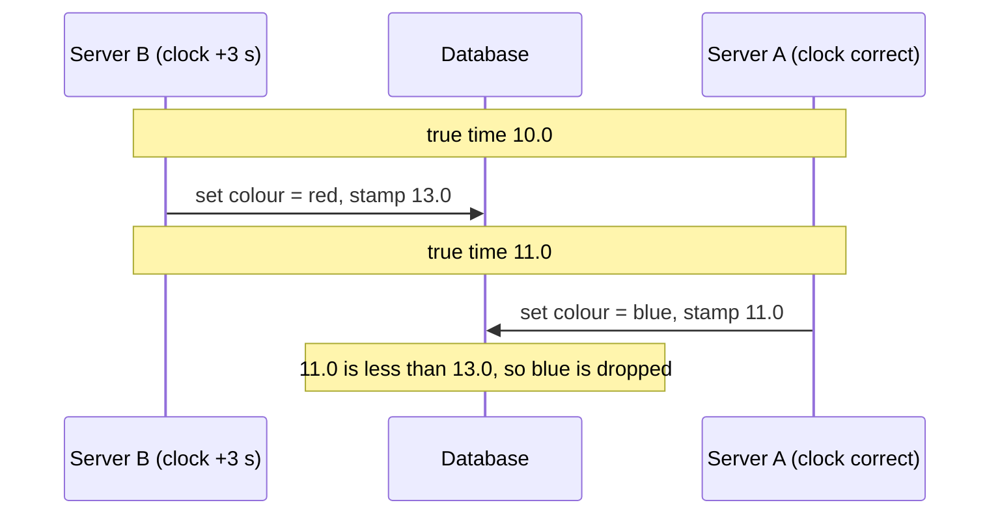
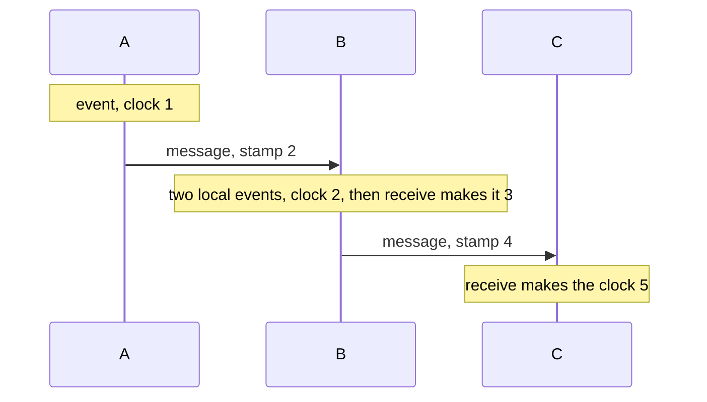

# Clocks, ordering and delivery

After this you can explain why timestamps from different machines cannot be trusted to order events, compute Lamport clock values for a set of messages, and say what at-most-once, at-least-once and exactly-once delivery mean in practice.

Before this: [how computers keep time](../../09-back-end/04-dates-and-times/01-how-computers-keep-time.md), [why distributed systems are hard](01-why-distributed-systems-are-hard.md), [timeouts, retries and circuit breakers](02-timeouts-retries-and-circuit-breakers.md) and [queues and event-driven design](../02-system-design/06-queues-and-event-driven-design.md).

## The idea

Two servers handle edits to the same shared document. Server B saves "red" and, one second later, server A saves "blue". The database keeps the version with the later timestamp, an approach called **last write wins**. But B's clock runs 3 seconds fast, so B stamped its write 13.0 and A's write got 11.0. The database keeps "red" and throws away the newer edit, with no error.

Every computer has its own clock, and no two agree exactly. Ordering events by comparing wall-clock times from different machines therefore gives wrong answers.



## Key terms

**Clock skew** is the difference between two machines' clocks at the same instant. **Clock drift** is the rate at which one clock gains or loses time. Protocols such as NTP correct both, but only to within some error, and the correction itself can move a clock backwards.

A **wall-clock time** is the calendar time a machine reports. A **monotonic clock** only moves forward and is used to measure durations, not dates (see [how computers keep time](../../09-back-end/04-dates-and-times/01-how-computers-keep-time.md)).

Event A **happens before** event B if A could have influenced B: both are on one machine with A first, or A is the sending of a message that B receives, or the relation chains through other events. Two events with no such chain are **concurrent**.

A **Lamport clock** is a counter on each node that gives events numbers consistent with happens-before. A **vector clock** is a list of counters, one per node, that can also tell whether two events are concurrent.

## How it works

Leslie Lamport's rules for the counter on each node:

1. Before a local event, add 1 to the counter.
2. When sending a message, add 1 and attach the counter value to the message.
3. When receiving a message with value $m$, set the counter to $\max(\text{own}, m) + 1$.

If event X happens before event Y, then X has a smaller number than Y. The reverse does not hold: a smaller number does not prove happens-before, since concurrent events also get numbers. Ties between nodes are broken by node id when a total order is needed.

```python
class Node:
    def __init__(self, name):
        self.name, self.clock = name, 0
    def event(self):                       # a local event
        self.clock += 1
        return self.clock
    def send(self):                        # attach the clock to the message
        self.clock += 1
        return self.clock
    def receive(self, stamp):              # jump past the sender's clock
        self.clock = max(self.clock, stamp) + 1
        return self.clock

a, b, c = Node("A"), Node("B"), Node("C")
print("A event ", a.event())
print("A send  ", m1 := a.send())
print("B event ", b.event())
print("B event ", b.event())
print("B recv  ", b.receive(m1))
print("B send  ", m2 := b.send())
print("C recv  ", c.receive(m2))
```

```text
A event  1
A send   2
B event  1
B event  2
B recv   3
B send   4
C recv   5
```



The receive on B jumps the counter to 3 even though B's own count was 2, because the message carried 2 and 3 is one more than that. The numbers say the send on A (2) came before the receive on B (3) and before the receive on C (5), with no wall clock involved. B's first two local events (1 and 2) have no link to A's events, and the numbers do not reveal that.

Vector clocks fix that gap. Each node keeps one counter per node; A's first event is $(1,0)$ and B's first event is $(0,1)$. Neither vector is less than or equal to the other in every position, so the events are concurrent. Databases in the Dynamo family used vector clocks to detect conflicting writes and keep both versions for the application to merge, instead of silently picking one. You only need the idea: vectors detect concurrency, and Lamport clocks do not.

Wall-clock timestamps still have uses: logs, display and expiry times. Where correctness needs an order, use a counter on a single node, a Lamport-style counter, a sequence number from a leader (next lesson), or hardware-backed time with a known error bound, as in Google Spanner's TrueTime.

Delivery guarantees follow from the earlier lessons. A sender transmits a message and waits for an acknowledgement; the choice of what to do on silence defines the guarantee.

| Guarantee | Sender behaviour | Result |
|---|---|---|
| At-most-once | Send once, never retry | Message may be lost, never duplicated |
| At-least-once | Retry until acknowledged | Never lost, may be duplicated |
| Exactly-once | Not achievable by the network alone | See below |

After a lost acknowledgement the sender cannot tell "message lost" from "message processed, ack lost" (the two generals again). It must either risk loss or risk duplication. Systems that advertise "exactly-once" achieve the effect by combining at-least-once delivery with deduplication: each message has an id, and the receiver records processed ids in the same transaction as the work, so a repeat is recognized and skipped. This is the idempotent consumer from [queues and event-driven design](../02-system-design/06-queues-and-event-driven-design.md). Apache Kafka's [design documentation](https://kafka.apache.org/42/design/design/) says it guarantees at-least-once delivery by default, offers an idempotent producer that removes duplicates caused by retries, and supports exactly-once for Kafka Streams; other destination systems must cooperate.

## Worked examples

<div class="example" markdown>

### Example 1: last write wins loses an edit

The simulation replays the opening story. B writes "red" at true time 10.0 and A writes "blue" at 11.0, but B's clock is 3 seconds fast.

1. Each write is stamped with its machine's clock: B stamps 13.0, A stamps 11.0.
2. The store keeps a write only if its stamp is larger than the stored one.
3. B's write is stored first. A's write has the smaller stamp (11.0), so it is dropped.

```python
true_writes = [("B", 10.0, "red"), ("A", 11.0, "blue")]
skew = {"A": 0.0, "B": 3.0}

store = {}
for node, t, value in true_writes:
    stamp = t + skew[node]            # what that machine's clock says
    if "k" not in store or stamp > store["k"][0]:   # last write wins
        store["k"] = (stamp, value)
print("true latest write: blue")
print("last-write-wins kept:", store["k"][1], "with stamp", store["k"][0])
```

```text
true latest write: blue
last-write-wins kept: red with stamp 13.0
```

Check: set B's skew to 0.0 and rerun. The store now keeps blue. The only difference is the clock error, which is the whole problem.

</div>

## Common mistakes

<div class="warning" markdown>

Watch out: using `now()` from application servers as the ordering of events. Use a database-generated sequence, a version number checked on update, or a logical clock.

Watch out: reading "exactly-once" as a network property. It means at-least-once delivery plus deduplication, and it holds only inside the system that does the deduplication. A side effect outside it (an email, a call to a third party) can still happen twice.

Watch out: assuming NTP makes clocks equal. It keeps them close but not identical, and a correction can step a clock forward or backward.

</div>

## Working with AI

<div class="ai" markdown>

Words to use: clock skew, monotonic clock, last write wins, happens-before, Lamport clock, vector clock, at-least-once, idempotent consumer.

Prompts to try:

- "Our Postgres table is updated by three app servers and uses `updated_at` for conflict resolution. Show how a skewed clock loses an update, and rewrite the update to use optimistic locking with a version column."
- "Explain what Kafka's idempotent producer and transactions guarantee, and which side effects are still not covered if my consumer also calls a payment API."

What to check:

- Code that compares `datetime.now()` values from different machines to decide which write is newer.
- A claim that a message system "guarantees exactly-once" with no mention of where duplicates are filtered.
- Elapsed-time measurement with wall-clock time instead of a monotonic clock (`time.monotonic()` in Python).

</div>

## Quiz

1\. Server A's clock is 5 seconds behind true time and B's is correct. B writes at true time 100, then A writes at true time 102. Which write does last-write-wins keep?

<details class="solution" markdown>
<summary>Answer</summary>

B stamps 100 and A stamps 102 minus 5, which is 97. The larger stamp wins, so B's older write is kept and A's newer write is lost.

</details>

2\. A Lamport counter on node X is 7. It receives a message stamped 12. What is X's counter after the receive?

<details class="solution" markdown>
<summary>Answer</summary>

$\max(7, 12) + 1 = 13$.

</details>

3\. Two events have Lamport values 4 and 9. Does the first happen before the second?

<details class="solution" markdown>
<summary>Answer</summary>

Not necessarily. Happens-before implies a smaller value, but a smaller value does not imply happens-before; the events may be concurrent. Vector clocks can tell the difference.

</details>

4\. Your consumer reads a message, sends an email, and crashes before acknowledging. The queue redelivers. What should the consumer do to get an exactly-once effect?

<details class="solution" markdown>
<summary>Answer</summary>

Record the message id as processed, in the same transaction as the work where possible, and skip ids already recorded. For the email, which is outside any transaction, store a "sent" marker before or with sending and pass an idempotency key to the mail provider if it supports one.

</details>

## Lab

<div class="lab" markdown>

### Lab: stamp a conversation with Lamport clocks

Goal: predict and check Lamport values by hand, then see last-write-wins fail. Time: about 15 minutes. Runs in: any terminal with Python 3.

1. Save the `Node` class from this lesson in `lamport.py`, without the printing lines.
2. On paper, predict the clock after each step: A has a local event, A sends to B, B receives, B has a local event, B sends to C, C receives, C has a local event, C sends to A, A receives.
3. Add the steps to the file with `print` calls and compare with your prediction.
4. Run the last-write-wins example with B's skew set to 3.0, then to 0.0, then to `-3.0`, and note the result.
5. Cleanup: delete the files.

Expected result: A's final receive prints 9. Last-write-wins keeps blue only when B's skew is less than 1.0 second, so 0.0 and `-3.0` keep blue and 3.0 keeps red.

<details class="solution" markdown>
<summary>Solution</summary>

The values in order are: A event 1, A send 2, B receive $\max(0,2)+1 = 3$, B event 4, B send 5, C receive $\max(0,5)+1 = 6$, C event 7, C send 8, A receive $\max(2,8)+1 = 9$. For the skew test, B stamps $10.0 + s$ and A stamps 11.0, so blue wins when $11.0 > 10.0 + s$, that is, when $s < 1.0$.

</details>

</div>

## Where this shows up

- A single node that hands out a sequence of numbers is the simplest way to order events, and electing it safely is the next lesson: [consensus and leader election](04-consensus-and-leader-election.md).
- Conflict handling in replicated databases: [CAP and consistency](../02-system-design/05-cap-and-consistency.md).
- Time zones and storing timestamps in UTC: [time zones and daylight saving](../../09-back-end/04-dates-and-times/02-time-zones-and-daylight-saving.md).
