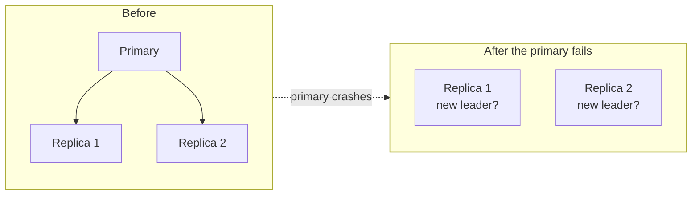
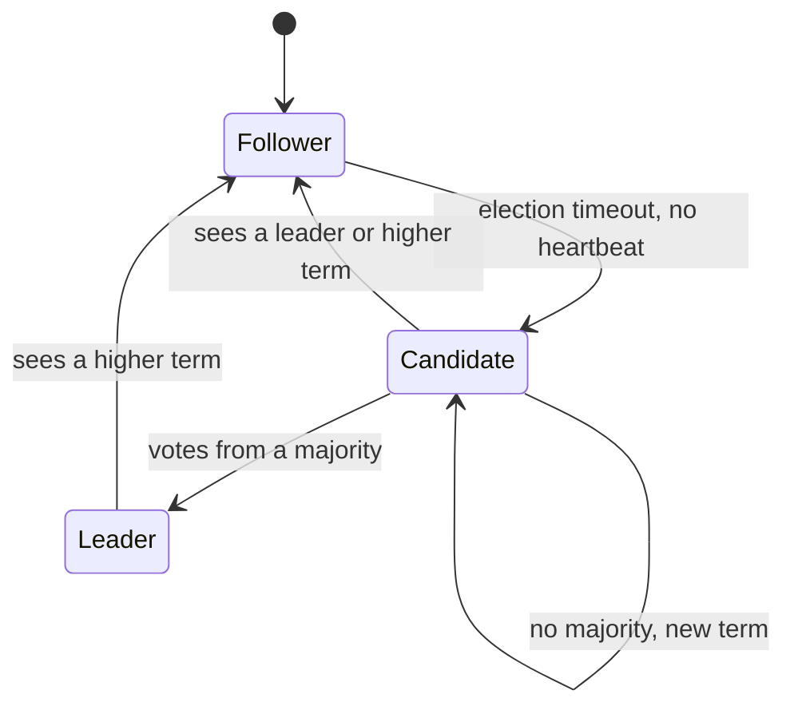
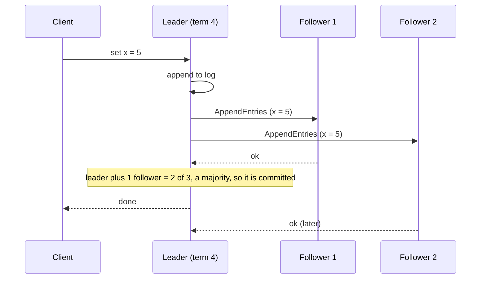

# Consensus and leader election

After this you can explain why replicas need to agree, compute a majority quorum and say why clusters use 3 or 5 nodes, describe split brain, and follow how Raft elects a leader and replicates a log.

Before this: [why distributed systems are hard](01-why-distributed-systems-are-hard.md), [clocks, ordering and delivery](03-clocks-ordering-and-delivery.md), [database scaling](../02-system-design/04-database-scaling-replication-and-sharding.md) and [CAP and consistency](../02-system-design/05-cap-and-consistency.md).

## The idea

A database has one primary that accepts writes and two replicas that copy it. The primary crashes. One replica must take over, and it must be exactly one: if both replicas decide they are the new primary, they accept different writes and the data diverges. Or the old primary was only slow, and now it and the new one both accept writes.

So the nodes need to agree, despite lost messages and crashed machines, on a single fact: who is the leader. Agreeing on one value, and later on a sequence of values, is the **consensus** problem.



## Key terms

**Consensus** is getting a group of nodes to agree on a value even if some nodes fail and messages are lost. The result must be a value one node proposed, all nodes that decide must decide the same, and the group must eventually decide as long as enough nodes work.

A **quorum** is a majority of the nodes: for $N$ nodes, $\lfloor N/2 \rfloor + 1$. Any two majorities share at least one node, so two decisions that each needed a majority cannot disagree without one node having seen both. (CAP and consistency used a read and write quorum; this is the special case where both are a majority.)

**Split brain** is a failure where two parts of a cluster both believe they are the leader and both accept writes.

A **leader** (primary) is the one node that orders writes. A **follower** only copies what the leader sends. **Leader election** is the process by which followers choose a new leader when the old one is gone.

**Raft** is a consensus algorithm designed to be easy to understand, described on [raft.github.io](https://raft.github.io/) and in the paper "In Search of an Understandable Consensus Algorithm" by Diego Ongaro and John Ousterhout.

## How it works

Why majorities? With $N$ nodes, a majority tolerates the loss of $N - \lfloor N/2 \rfloor - 1$ nodes.

```python
for n in (1, 2, 3, 4, 5, 7):
    majority = n // 2 + 1
    print(f"nodes={n}  majority={majority}  failures tolerated={n - majority}")
```

```text
nodes=1  majority=1  failures tolerated=0
nodes=2  majority=2  failures tolerated=0
nodes=3  majority=2  failures tolerated=1
nodes=4  majority=3  failures tolerated=1
nodes=5  majority=3  failures tolerated=2
nodes=7  majority=4  failures tolerated=3
```

Two nodes tolerate no failures, and four tolerate only one, the same as three. That is why clusters have 3 or 5 members, rarely more: the odd count wastes nothing, and every extra node adds more messages to every decision. etcd's [FAQ](https://etcd.io/docs/v3.5/faq/) says the same: it recommends an odd number of members, notes that an even-sized cluster tolerates no more failures than the odd one below it, and suggests 5 as a sensible size.

Majorities also prevent split brain. Suppose a 5-node cluster splits into 3 and 2. Only the side with 3 can assemble a majority, so only it can elect a leader or commit a write. The side with 2 stays read-only or unavailable, which is the CP choice from CAP.

```python
def can_elect(cluster_size, reachable):
    """A candidate needs votes from a majority of the whole cluster."""
    return reachable >= cluster_size // 2 + 1

N = 5
for side_a, side_b in [(3, 2), (4, 1)]:
    print(f"split {side_a}/{side_b}: A elects {can_elect(N, side_a)}, B elects {can_elect(N, side_b)}")
print(f"split 2/2 of 4 nodes: A {can_elect(4, 2)}, B {can_elect(4, 2)}")
```

```text
split 3/2: A elects True, B elects False
split 4/1: A elects True, B elects False
split 2/2 of 4 nodes: A False, B False
```

Note that a majority is counted against the whole cluster, not against the nodes you can currently reach. A node that sees only itself and one peer in a 5-node cluster has no majority, however healthy it feels.

Raft splits consensus into two parts. Time is divided into **terms**, numbered 1, 2, 3 and so on, and each term has at most one leader. Terms act as a logical clock (as in the last lesson): a node that sees a higher term than its own steps down.

Election works like this:

1. Every node starts as a follower. It expects a heartbeat from the leader.
2. A follower that hears nothing for a random **election timeout** becomes a candidate, adds 1 to its term, votes for itself and asks the others for votes. The timeout is random so that nodes rarely time out at the same moment.
3. A node gives its vote to at most one candidate per term, first come first served.
4. A candidate that receives votes from a majority becomes leader and sends heartbeats. If no one wins, the timeout fires again and a new term starts.



Once there is a leader, writes go through it. The leader keeps an ordered **log** of commands. It appends each new command, sends it to the followers, and counts it **committed** once a majority hold it. Only then does it apply the command and answer the client.



If the leader dies after committing, any new leader must have been elected by a majority, and a majority overlaps the one that held the entry. Raft's voting rule only elects a candidate whose log is at least as up to date as the voter's, so the committed entry survives. That overlap argument is the same one as for quorums.

## Where you meet it

The quoted claims below come from each project's own documentation.

| System | Use of consensus |
|---|---|
| etcd | A key-value store using Raft. [Kubernetes](https://kubernetes.io/docs/concepts/architecture/) uses it as the backing store for all cluster data. Lose etcd and the cluster loses its state. |
| ZooKeeper | A coordination service. Per its [overview](https://zookeeper.apache.org/doc/current/zookeeperOver.html), it runs as a replicated ensemble where writes go through a single leader, and the service stays available while a majority of servers are up. It uses its own protocol, not Raft. |
| Kafka KRaft | Kafka's [KRaft mode](https://kafka.apache.org/42/operations/kraft/) keeps cluster metadata in a quorum of controller nodes, with one active controller; the docs recommend 3 or 5 controllers and require a majority to stay alive. It replaces ZooKeeper for metadata, and Kafka 3.9 is the last bridge release for migrating (as of 2026). |

Application code rarely implements Raft. You use a system that has it, for leader election ("only one instance runs the nightly job"), locks and configuration, and you need to know that these operations need a majority and can fail or block when it is missing.

## Worked examples

<div class="example" markdown>

### Example 1: a 5-node cluster loses two nodes, then a third

Take a cluster of 5 with nodes A to E, and A as leader in term 3.

1. Nodes D and E crash. A, B and C are 3 of 5, which is a majority, so A keeps committing writes.
2. Node C crashes as well. Now A and B are 2 of 5. A can still send heartbeats but cannot get a majority to acknowledge a write, so writes stop. Reads served by A may be stale, depending on the system.
3. D and E restart, with C still down. A, B, D and E are 4 of 5. The cluster commits writes again. Had A been the node that crashed instead, one of the others would time out, become a candidate in term 4 and need 3 votes to lead.

Check: compute the majority for 5, which is 3, and count the live nodes at each step. Writes proceed exactly when the count is at least 3.

</div>

## Common mistakes

<div class="warning" markdown>

Watch out: running an even number of nodes, such as 2 or 4, for "more safety". A 4-node cluster needs 3 and tolerates 1 failure, the same as 3 nodes, with more cost.

Watch out: spreading a 3-node cluster over 2 data centres. Whichever side holds two nodes can survive alone; if that site goes down, the cluster stops. Use 3 sites, or accept the dependency.

Watch out: implementing your own leader election with a timestamp or a database row and a timeout. A paused process (a long garbage collection, for example) wakes up still believing it is leader. Use an existing consensus system, and have the resource check a fencing token (a number that increases with each leader) so a stale leader is rejected.

</div>

## Working with AI

<div class="ai" markdown>

Words to use: consensus, quorum, majority, split brain, leader election, Raft, term, log replication, fencing token.

Prompts to try:

- "We run a 3-node etcd cluster for Kubernetes. What happens if one node fails, two fail, or a network partition isolates one node from the other two? Say which side can still write."
- "Explain Raft leader election in a sequence diagram with three nodes, including what happens when two followers become candidates in the same term."

What to check:

- A cluster size of 2 or 4 recommended as highly available. Compute the majority and failures tolerated yourself.
- Home-made "leader election" built from `SELECT ... FOR UPDATE` or timestamps with no fencing token.
- A description of ZooKeeper as using Raft. It uses its own protocol; etcd and Kafka KRaft use Raft.
- Claims about Kafka and ZooKeeper versions. Check the current release notes, since this changes.

</div>

## Quiz

1\. How many failures does a 7-node majority-quorum cluster tolerate?

<details class="solution" markdown>
<summary>Answer</summary>

The majority is 4, so it tolerates $7 - 4 = 3$ failures.

</details>

2\. A 5-node cluster splits 2 and 3. Which side can elect a leader and why?

<details class="solution" markdown>
<summary>Answer</summary>

The side with 3, because a leader needs votes from a majority of the whole cluster (3 of 5). The side with 2 cannot reach 3, so it cannot elect a leader or commit writes. That is how split brain is avoided.

</details>

3\. In Raft, why is the election timeout random?

<details class="solution" markdown>
<summary>Answer</summary>

If every follower timed out at the same instant, they would all become candidates and split the votes, and no one would win. Random timeouts mean one node usually becomes a candidate first and collects the votes.

</details>

4\. A leader sends a write to 4 followers in a 5-node cluster. How many acknowledgements does it need before the entry is committed?

<details class="solution" markdown>
<summary>Answer</summary>

Two from followers. With the leader's own copy that makes 3 of 5, a majority.

</details>

## Lab

<div class="lab" markdown>

### Lab: split a cluster and count votes

Goal: use code to check which side of a partition can elect a leader. Time: about 10 minutes. Runs in: any terminal with Python 3.

1. Save the `can_elect` snippet from this lesson as `election.py`.
2. Predict, then print, the result for a 7-node cluster split 4/3, 5/2 and 6/1.
3. Predict the result for a 6-node cluster split 3/3, then print it.
4. Explain in a comment why 6 nodes are no better than 5 for failures tolerated.
5. Cleanup: delete the file.

Expected result: in the 7-node cases, only the larger side elects. In the 6-node 3/3 split, neither side does (majority is 4), so the cluster stops.

<details class="solution" markdown>
<summary>Solution</summary>

```python
def can_elect(cluster_size, reachable):
    return reachable >= cluster_size // 2 + 1

for a, b in [(4, 3), (5, 2), (6, 1)]:
    print(f"7 nodes {a}/{b}: {can_elect(7, a)} {can_elect(7, b)}")
print("6 nodes 3/3:", can_elect(6, 3), can_elect(6, 3))
# 6 nodes need 4, so they tolerate 2 failures, the same as 5 nodes (need 3).
```

```text
7 nodes 4/3: True False
7 nodes 5/2: True False
7 nodes 6/1: True False
6 nodes 3/3: False False
```

</details>

</div>

## Where this shows up

- Choosing consistency over availability during a partition, as etcd and ZooKeeper do: [CAP and consistency](../02-system-design/05-cap-and-consistency.md).
- Kubernetes and its state store: [registries and Kubernetes basics](../../13-devops-and-cloud/01-containers/04-registries-and-kubernetes-basics.md).
- Interview questions on leader election and quorum: [system design interviews](../02-system-design/09-system-design-interviews.md).
