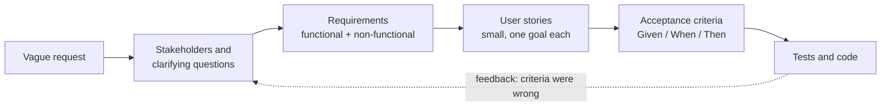
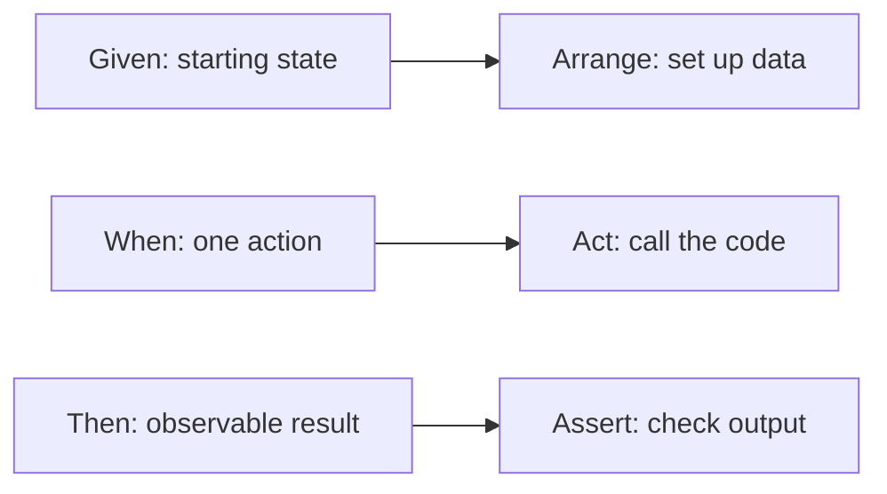

# Requirements and user stories

After this you can turn a vague request into stories with measurable acceptance criteria, ask the clarifying questions that remove ambiguity, and write a spec that a teammate or an AI tool can build and test from.

Before this: [unit testing](../../04-developer-tools-and-workflow/03-code-quality/01-unit-testing.md) and [clean code](../01-software-design/01-clean-code.md).

## The idea

A manager says: "Users keep forgetting their passwords. Can you add a reset feature, and make it secure?" Three words in that sentence hide a week of rework. Who counts as a user? What is a reset: an email link, a code, a call to support? What does "secure" mean in numbers?

Requirements work is the step that turns a wish into statements you can check. If you skip it, you build the wrong thing correctly, and an AI tool will do the same faster. The route is short: find the people affected, ask until the ambiguity is gone, write small stories, and give each one criteria that a test can pass or fail.



## Key terms

A **stakeholder** is anyone affected by the software or able to affect it: users, the client who pays, support staff, security, legal, the team that runs it.

A **requirement** is a statement of something the system must do or a quality it must have. A **functional requirement** says what the system does ("the system emails a reset link"). A **non-functional requirement** (NFR, also called a quality attribute) says how well it does it: performance, security, availability, accessibility. An NFR is only useful when it is measurable.

A **user story** is a one-sentence need from a user's point of view: "As a `<role>`, I want `<goal>`, so that `<benefit>`." The "so that" part matters, because it lets the team find a cheaper way to deliver the same benefit.

**Acceptance criteria** are the conditions a story must meet to count as done. **Gherkin** is a plain-text format for them: Given (the starting state), When (the action), Then (the observable result).

A **use case** is a longer description of one actor reaching one goal: a main flow of numbered steps, plus alternative flows for what goes wrong. You will meet it in older and regulated projects; stories are the lighter form.

**Ambiguity** is a statement that two readers can understand differently. "Fast", "secure" and "easy" are ambiguous until they carry a number.

## How it works

Stories should be INVEST: a checklist for splitting and judging them.

| Letter | Means | Failing example |
|---|---|---|
| Independent | Can be built in any order | "Reset password" that needs "Admin panel" first |
| Negotiable | Describes the need, not the design | "Use a 6-digit SMS code" in the story |
| Valuable | A user or customer sees a benefit | "Create the users table" |
| Estimable | The team can size it | "Make the app better" |
| Small | Fits in days, not weeks | "Build the whole account system" |
| Testable | You can say when it is done | "Reset should feel smooth" |

Non-functional requirements become testable when they name a number, a condition and a way to measure.

| Vague | Measurable |
|---|---|
| Search is fast | 95% of search requests finish in under 300 ms at 200 requests per second, measured at the server |
| It must be secure | Passwords are stored as salted hashes, reset tokens are single-use and expire after 30 minutes |
| It must always be up | 99.9% availability per 30-day month |
| It must be accessible | Every page meets WCAG 2.2 level AA, checked with an automated scan and a keyboard-only pass |

For accessibility, WCAG 2.2 is the current W3C Recommendation ([W3C](https://www.w3.org/TR/WCAG22/), as of 2026). In Ontario, the AODA rules for public websites name WCAG 2.0 level AA as the legal minimum ([ontario.ca](https://www.ontario.ca/page/how-make-websites-accessible), as of 2026), so check which version your client is bound to. An availability figure also turns into a budget you can compute:

```python
for target in (0.99, 0.999, 0.9999):
    minutes = 30 * 24 * 60 * (1 - target)
    print(f"{target:.2%} -> {minutes:.1f} min of downtime per 30 days")
```

```text
99.00% -> 432.0 min of downtime per 30 days
99.90% -> 43.2 min of downtime per 30 days
99.99% -> 4.3 min of downtime per 30 days
```

Gherkin scenarios map straight onto the arrange, act, assert shape of a test, which is why they are good input for an AI tool.



To ask clarifying questions, go through six prompts: who is the user and what are they trying to do, what exactly should happen (ask for an example with real values), how many or how fast, what happens when it fails, what is out of scope, and how will we know it is done. Write the answers down; an answer that stays in a chat is forgotten.

## Worked examples

<div class="example" markdown>

### Example 1: from "add a password reset" to a spec

Step 1: ask the six questions. Suppose the answers are: any registered user; an emailed link; the link lasts 30 minutes and works once; the screen must not reveal whether an email is registered; SMS and security questions are out of scope.

Step 2: write the story.

```text
As a registered user who forgot my password,
I want to get a reset link by email,
so that I can get back into my account without calling support.
```

Step 3: write criteria in Gherkin. The unknown-email scenario is the one people forget.

```text
Scenario: registered email
  Given a user ana@example.com exists
  When she requests a reset for ana@example.com
  Then a reset link is emailed to her
  And the page says "If that account exists, we sent a link"

Scenario: unknown email
  Given no user who@example.com exists
  When someone requests a reset for who@example.com
  Then no email is sent
  And the page shows the same message as above

Scenario: link used in time
  Given a link was issued 29 minutes ago
  When she opens it and sets a new password
  Then the password changes and the link stops working

Scenario: link used too late
  Given a link was issued 31 minutes ago
  When she opens it
  Then she sees "This link has expired"
```

Step 4: add the NFRs and the scope: rate limit of 5 requests per hour per address, SMS excluded. Now each scenario becomes a test almost word for word.

```python
from datetime import datetime, timedelta

USERS = {"ana@example.com"}
TOKEN_LIFETIME = timedelta(minutes=30)

def request_reset(email, now):
    return {"token": "abc123", "expires": now + TOKEN_LIFETIME} if email in USERS else None

def use_token(token, now):
    return "expired" if now > token["expires"] else "ok"

NOW = datetime(2026, 1, 5, 9, 0)

def test_registered_email_gets_a_token():
    assert request_reset("ana@example.com", NOW) is not None

def test_unknown_email_gets_no_token():
    assert request_reset("who@example.com", NOW) is None

def test_token_works_inside_30_minutes():
    token = request_reset("ana@example.com", NOW)
    assert use_token(token, NOW + timedelta(minutes=29)) == "ok"

def test_token_expires_after_30_minutes():
    token = request_reset("ana@example.com", NOW)
    assert use_token(token, NOW + timedelta(minutes=31)) == "expired"
```

```text
....                                                                     [100%]
4 passed in 0.02s
```

Check: run `pytest` on the file. Each Then line in the scenarios has an assertion. A Then you cannot turn into an assertion, such as "she feels reassured", is not a criterion yet.

</div>

## Common mistakes

<div class="warning" markdown>

Watch out: writing a design as a story ("As a user, I want a Redis cache"). Stories name the need and leave the solution to the team.

Watch out: only writing the happy path. Ask "what happens when it fails" for each story, and write a scenario for empty input, unknown users, expired links and double submits.

Watch out: an NFR with no number. "Performant" cannot fail a test, so nobody will ever know it was missed.

</div>

## Working with AI

<div class="ai" markdown>

Words to use: stakeholder, functional requirement, non-functional requirement, user story, INVEST, acceptance criteria, Given/When/Then, out of scope.

Prompts to try:

- "Here is a vague request: 'users should be able to reset their password'. Do not write code. List the clarifying questions you need answered, grouped by who, what, how many, failure cases and scope."
- "Turn these answers into a spec: one user story, six Given/When/Then scenarios including failure cases, NFRs with numbers, and an out-of-scope list. Then write pytest tests for each scenario before any implementation."

What to check:

- Invented requirements. The AI may add features (SMS codes, lockout rules) nobody asked for. Strike anything you cannot trace to an answer.
- Scenarios with no failure case or with several actions in one When. Split them.
- NFRs that sound exact but are made up, such as "99.99% uptime". Confirm every number with the stakeholder.
- Then lines that no test can check.

</div>

## Quiz

1\. Classify each as functional or non-functional: (a) "The system emails a reset link." (b) "Reset emails arrive within 60 seconds for 99% of requests."

<details class="solution" markdown>
<summary>Answer</summary>

(a) is functional: it says what the system does. (b) is non-functional: it states a performance quality with a number and a percentage.

</details>

2\. Which INVEST letters does "As a developer, I want the orders table created" fail, and why?

<details class="solution" markdown>
<summary>Answer</summary>

Valuable, because no user sees a benefit, and usually Negotiable, because it names a design. Rewrite it around what the user can do once the table exists, such as viewing past orders.

</details>

3\. A story says "Search should be fast". Rewrite it as a testable criterion, and name what you would need to ask first.

<details class="solution" markdown>
<summary>Answer</summary>

For example: "95% of searches return in under 300 ms with 10,000 products and 200 requests per second." First ask how large the catalogue is, how much traffic to expect, and where the time is measured.

</details>

4\. How many minutes of downtime per 30-day month does 99.95% availability allow?

<details class="solution" markdown>
<summary>Answer</summary>

$30 \times 24 \times 60 \times 0.0005 = 21.6$ minutes.

</details>

## Lab

<div class="lab" markdown>

### Lab: specify a discount code feature

Goal: write a spec for a feature from a two-line request. Time: about 20 minutes. Runs in: any text editor.

The request: "Customers should be able to enter a discount code at checkout. Make it work well."

1. Write 6 clarifying questions you would ask, using the six prompts from this lesson.
2. Invent a plausible answer for each, and write them as a short list.
3. Write two user stories that pass INVEST.
4. Write 5 Given/When/Then scenarios, at least 3 of them failure cases.
5. Write 2 measurable NFRs.
6. Add an out-of-scope list of at least 2 items.

Expected result: one page with questions and answers, 2 stories, 5 scenarios, 2 NFRs and an out-of-scope list.

<details class="solution" markdown>
<summary>Solution</summary>

Questions and answers: Who can use codes (logged-in customers and guests)? What kinds (a percentage off, one code per order)? Can codes combine (no)? What happens at expiry (rejected with a message)? How many codes exist and how many redemptions per second at peak (about 50,000 codes, 20 per second)? What is out of scope (referral rewards, stacking)?

Story 1: As a shopper, I want to enter a discount code at checkout, so that I pay the lower price I was promised.

Story 2: As a marketing manager, I want each code to have an expiry date and a use limit, so that a leaked code cannot cost us unlimited revenue.

```text
Scenario: valid code
  Given a cart totalling $100.00 and code SAVE10 giving 10% off
  When the shopper applies SAVE10
  Then the total becomes $90.00

Scenario: expired code
  Given code OLD5 expired yesterday
  When the shopper applies OLD5
  Then the total is unchanged and the message says "This code has expired"

Scenario: unknown code
  Given no code named NOPE exists
  When the shopper applies NOPE
  Then the total is unchanged and the message says "Code not recognized"

Scenario: use limit reached
  Given code ONCE has a limit of 1 use and one order already used it
  When another shopper applies ONCE
  Then the total is unchanged and the message says "This code is no longer available"

Scenario: second code
  Given SAVE10 is already applied
  When the shopper applies a second code
  Then the first code stays and the message says "Only one code per order"
```

NFRs: applying a code responds in under 400 ms for 95% of requests at 20 requests per second. The code check is rate limited to 10 attempts per minute per session, so codes cannot be guessed.

Out of scope: stacking codes, referral rewards.

</details>

</div>

## Where this shows up

- Writing tests before code and giving them to an AI tool: [the plan, build, test, review workflow](../../15-ai-and-llms/03-ai-assisted-development/02-plan-build-test-review-workflow.md).
- Drawing the structure and behaviour the stories imply: [UML class and sequence diagrams](02-uml-class-and-sequence-diagrams.md).
- Stories in a sprint and a backlog: [Agile, Scrum and Kanban](../../16-the-workplace/02-agile-scrum-and-kanban.md).
