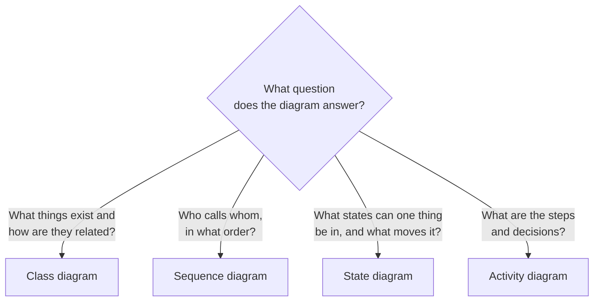
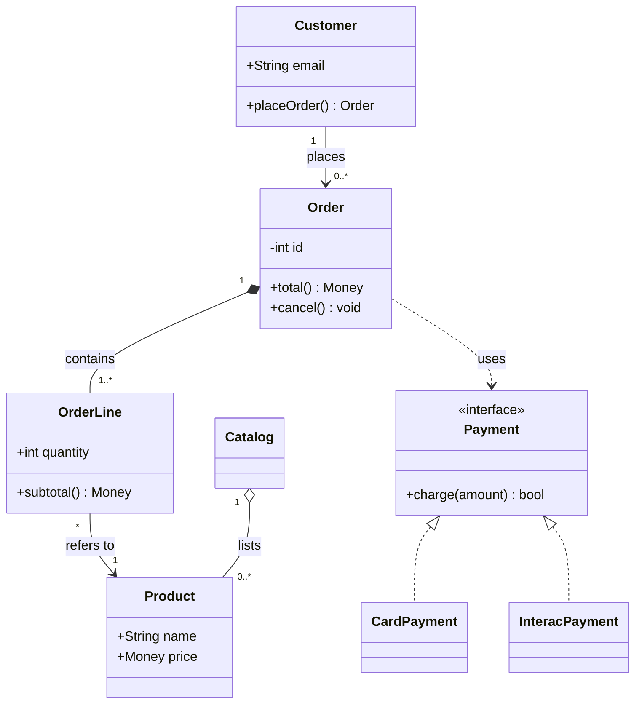
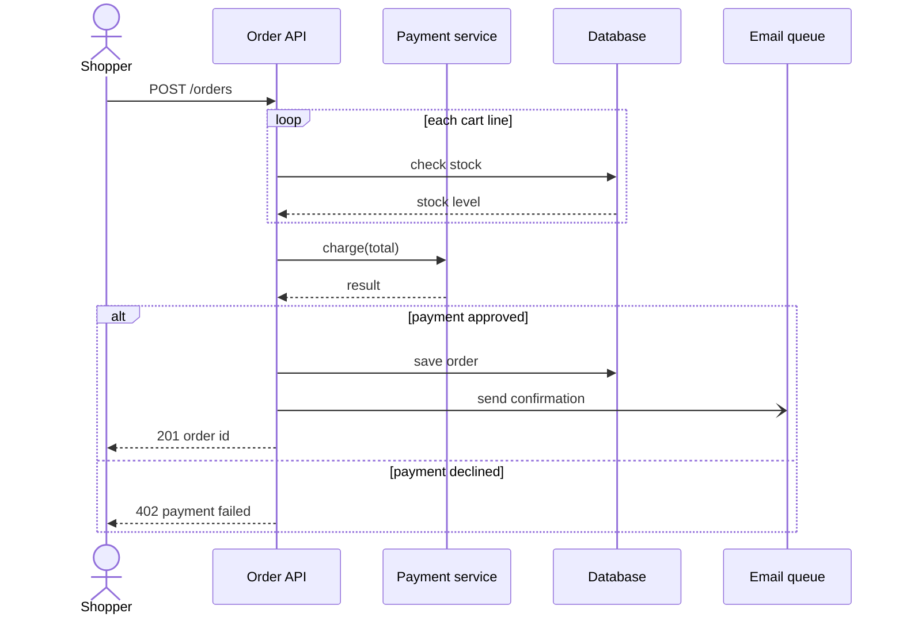
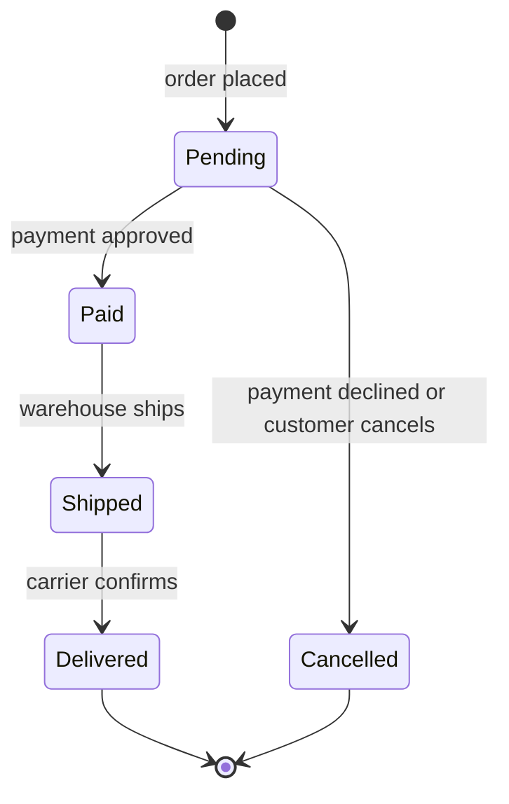
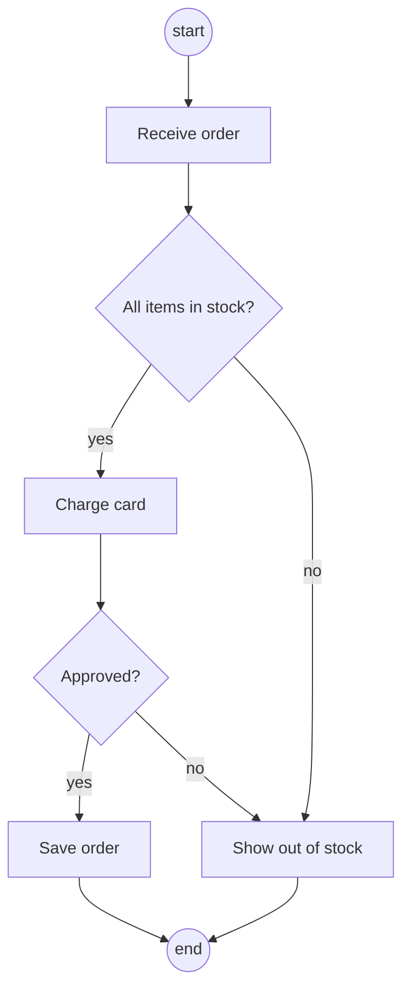
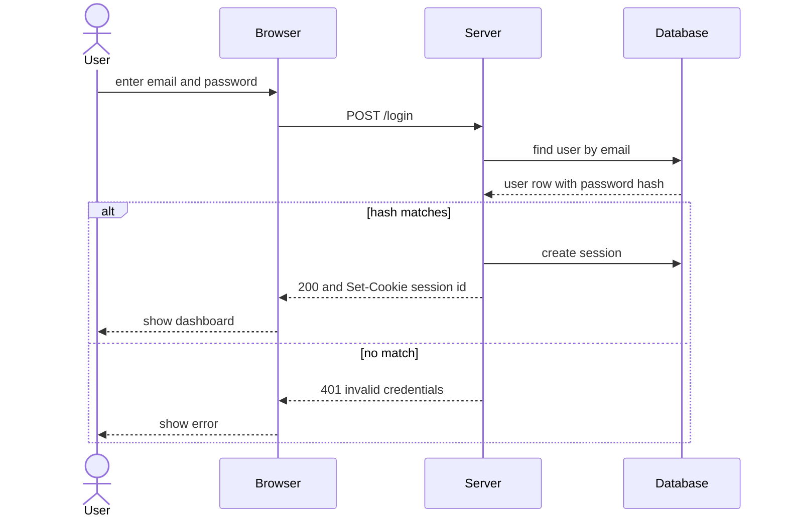
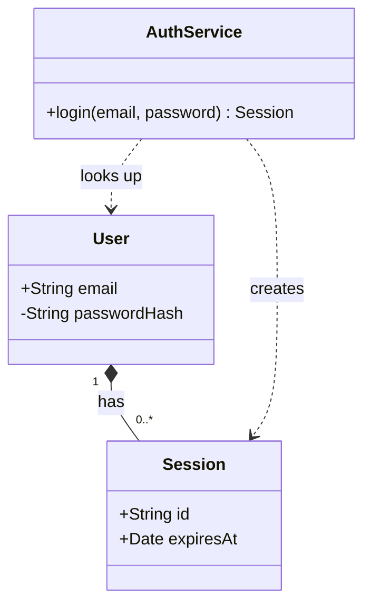

# UML class and sequence diagrams

After this you can read and draw class, sequence, state and activity diagrams in Mermaid, tell composition from aggregation, and use a diagram to give an AI tool or a teammate the structure of a design.

Before this: [requirements and user stories](01-requirements-and-user-stories.md), [SOLID principles](../01-software-design/02-solid-principles.md) and [layered architecture and MVC](../01-software-design/04-layered-architecture-and-mvc.md).

## The idea

Before a team writes an order system, someone goes to a whiteboard. They draw boxes for the things in the system, lines for how the things relate, and arrows for who calls whom when a customer checks out. A design can be explained in 10 minutes this way and argued about before any code exists.

**UML** (Unified Modeling Language) is the standard vocabulary for those sketches. It has about a dozen diagram types, and you will meet four: class diagrams for structure, sequence diagrams for a conversation over time, state diagrams for the life of one object, and activity diagrams for a workflow. You do not need to memorize the notation. You need to read it in a design doc or an interview, and draw it quickly. Mermaid draws these from plain text, so the diagram lives in the repository next to the code and shows up in a diff.



## Key terms

A **class diagram** shows classes, their attributes and methods, and the relationships between them. Each class is a box with the name, then the attributes, then the methods. A `+` before a member means public, `-` private and `#` protected.

**Multiplicity** says how many objects sit at each end of a relationship: `1`, `0..1` (optional), `0..*` (any number) or `1..*` (at least one).

An **association** is a plain "knows about" link. **Aggregation** is a "has a" link where the part can exist without the whole (a catalog has products, and the products survive if the catalog is deleted). **Composition** is a "owns a" link where the part is created and destroyed with the whole (an order owns its order lines). **Inheritance** (generalization) is an "is a" link. **Realization** means a class implements an interface. A **dependency** is a brief use, such as a parameter.

A **sequence diagram** shows participants as **lifelines** (vertical lines down the page) and messages between them as horizontal arrows, with time running downward. A **synchronous** message means the caller waits for the answer. An **asynchronous** message means the caller carries on without waiting. A **return** is the reply. Fragments such as `alt` (choose one branch) and `loop` (repeat) box the messages they cover.

## How it works

In the class diagram below, read each line as a sentence. A customer places zero or more orders. An order owns one or more order lines. Each line refers to one product. An order uses a payment method, which is an interface with two implementations. A catalog has products.



The Mermaid line for each relationship:

```text
A --> B       association (A knows B)
A o-- B       aggregation (A has B, B lives on its own)
A *-- B       composition (A owns B, B dies with A)
A <|-- B      inheritance (B is an A)
A <|.. B      realization (B implements interface A)
A ..> B       dependency (A uses B briefly)
```

Aggregation and composition differ only in lifetime, and many teams draw plain association for both. Ask the lifetime question when it matters: when the order is deleted, should its lines go too?

Next, behaviour. The sequence diagram follows one checkout. Solid arrows with `->>` are calls, dashed arrows with `-->>` are returns, and `-)` is an asynchronous send, so the API does not wait for the email to go out. The `loop` repeats for each cart line, and the `alt` has one branch per outcome.



A state diagram shows what one object can be and what moves it. An order cannot be shipped before it is paid, and the diagram makes that rule visible.



An activity diagram is a flowchart of a process, with decisions as diamonds. Mermaid draws it with `flowchart`.



## Worked examples

<div class="example" markdown>

### Example 1: from the class diagram to code

We turn the class diagram into Python and check that the lifetimes match.

1. Inheritance and realization: `Payment` is a `Protocol` (an interface), and `CardPayment` implements its `charge` method.
2. Composition: `Order` creates its own `OrderLine` objects inside `add`. Nothing else holds them.
3. Association: an `OrderLine` stores a reference to a `Product` that it did not create.
4. Aggregation: `Catalog` receives a list of products from outside.
5. Dependency: `Order.pay` takes a `Payment` as a parameter and does not keep it.

```python
from dataclasses import dataclass
from typing import Protocol

@dataclass
class Product:
    name: str
    price: float

class Catalog:                       # aggregation: products are passed in and outlive the catalog
    def __init__(self, products: list[Product]):
        self.products = products

class OrderLine:                     # association: a line refers to a Product it does not own
    def __init__(self, product: Product, quantity: int):
        self.product, self.quantity = product, quantity
    def subtotal(self) -> float:
        return self.product.price * self.quantity

class Order:                         # composition: the Order creates and owns its lines
    def __init__(self):
        self.lines: list[OrderLine] = []
    def add(self, product: Product, quantity: int):
        self.lines.append(OrderLine(product, quantity))
    def total(self) -> float:
        return sum(line.subtotal() for line in self.lines)
    def pay(self, method: "Payment") -> bool:   # dependency: uses Payment, does not keep it
        return method.charge(self.total())

class Payment(Protocol):             # the <<interface>>
    def charge(self, amount: float) -> bool: ...

class CardPayment:                   # realization: implements Payment
    def charge(self, amount: float) -> bool:
        return amount < 500

pen = Product("pen", 2.50)
catalog = Catalog([pen])
order = Order()
order.add(pen, 4)
print(order.total(), order.pay(CardPayment()))
del order
print(catalog.products[0].name)
```

```text
10.0 True
pen
```

Check: after `del order` the order and its lines are gone, but the product is still in the catalog. That is the difference between the filled diamond and the hollow one.

</div>

## Common mistakes

<div class="warning" markdown>

Watch out: drawing everything. A class diagram with 40 boxes shows nothing. Draw the 5 to 10 classes that matter for the question, and leave out getters, helpers and framework classes.

Watch out: mixing up the arrows. In a class diagram the triangle points at the parent (`Animal <|-- Dog`). In a sequence diagram a dashed line is a return, not a call.

Watch out: treating a generated diagram as correct. Diagrams written from code or from a description often invent a relationship or reverse a direction. Compare each arrow with the code or the requirement.

</div>

## Working with AI

<div class="ai" markdown>

Words to use: class diagram, multiplicity, composition, aggregation, inheritance, lifeline, synchronous, asynchronous, alt fragment.

Prompts to try:

- "Read these Python classes in `orders/models.py` and write a Mermaid classDiagram. Use composition only where the child is created inside the parent. Show multiplicity on every association."
- "Write a Mermaid sequenceDiagram for a login: browser, server, database. Include an alt fragment for wrong password, and show the session cookie on success. Only use messages that appear in this code: [paste the route handler]."

What to check:

- Mermaid that does not parse. Paste it into the Mermaid live editor or the site preview, because AI output often has a stray semicolon or bracket.
- Relationships that are not in the code. Search the code for each arrow.
- Wrong lifetime arrows. Ask "does this part die with the whole?" for every diamond.
- Missing failure branches in a sequence diagram. Check there is an `alt` for every error the code returns.

</div>

## Quiz

1\. A `Team` has `Player` objects, and players can move to another team. Aggregation or composition?

<details class="solution" markdown>
<summary>Answer</summary>

Aggregation. A player outlives the team, so the team does not own the player's lifetime.

</details>

2\. What does `Order "1" *-- "1..*" OrderLine` say in words?

<details class="solution" markdown>
<summary>Answer</summary>

An order owns one or more order lines, and the lines are deleted with the order. The filled diamond is on the owner's side.

</details>

3\. In a sequence diagram, the API sends a confirmation email with `API->>Mail: send` and the user waits 3 seconds for the response. What would you change in the design and in the diagram?

<details class="solution" markdown>
<summary>Answer</summary>

Send the email asynchronously through a queue and reply to the user first. In the diagram, change the arrow to `API-)Mail: send` so the API no longer waits.

</details>

4\. Which diagram would you draw to show that an order cannot go from Pending straight to Delivered?

<details class="solution" markdown>
<summary>Answer</summary>

A state diagram. It lists the allowed transitions, so a missing arrow from Pending to Delivered is the rule.

</details>

## Lab

<div class="lab" markdown>

### Lab: draw a login flow

Goal: draw a login as a Mermaid sequence diagram and a class diagram for the pieces behind it. Time: about 15 minutes. Runs in: the Mermaid live editor at mermaid.live, or a Markdown preview that renders Mermaid.

1. Write a `sequenceDiagram` with a user, a browser, a server and a database.
2. Show the credentials going to the server, the server looking up the user, and the database returning a password hash.
3. Add an `alt` with two branches: the hash matches (create a session, return a cookie) and it does not (return 401).
4. Draw a `classDiagram` with `User`, `Session` and `AuthService`. A user has zero or more sessions, and a session cannot exist without its user.
5. Check that both diagrams render with no errors.

Expected result: two diagrams that render, with at least one `alt` fragment and one composition arrow.

<details class="solution" markdown>
<summary>Solution</summary>





A session belongs to one user and is deleted with the user, so the relationship is composition. The auth service only uses both classes, so those arrows are dependencies.

</details>

</div>

## Where this shows up

- Design docs that include a sequence diagram of a new feature: [design docs and writing](../../16-the-workplace/05-design-docs-and-writing.md).
- The phases of a project that produce these diagrams: [SDLC models](03-sdlc-models.md).
- System design interviews, where you sketch boxes and arrows: [system design interviews](../02-system-design/09-system-design-interviews.md).
