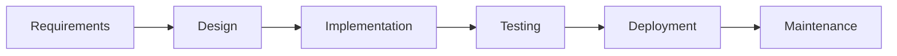
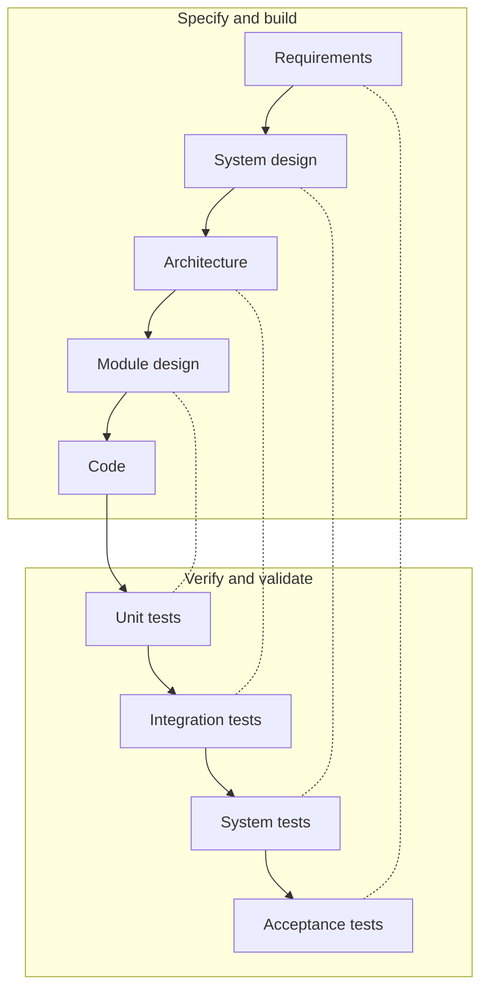
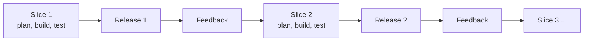
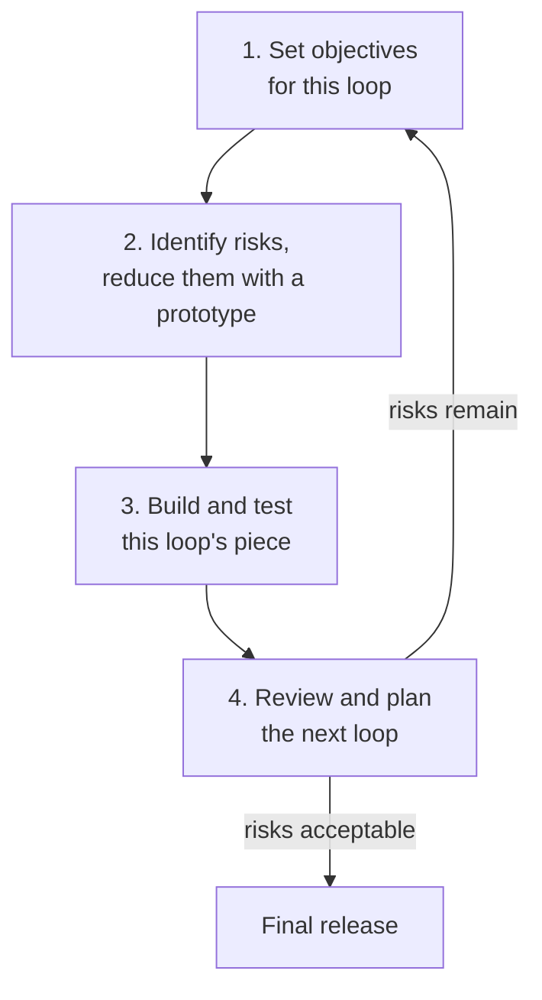
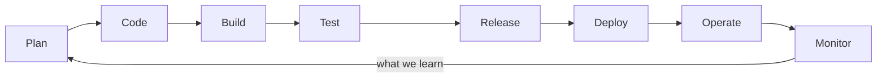
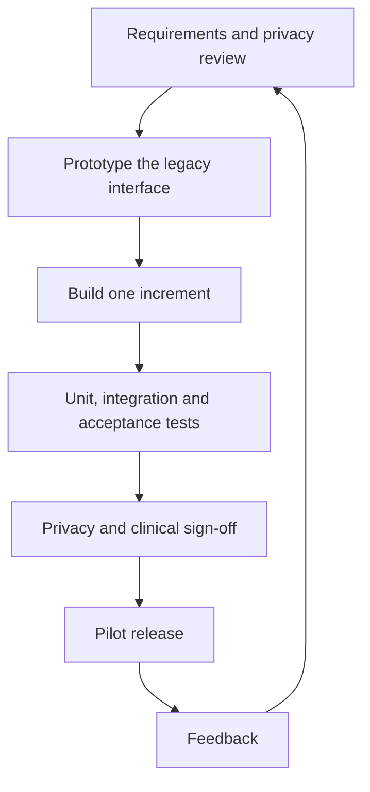

# SDLC models

After this you can name the main software development life cycle models, say how each orders and repeats the same activities, and pick one for a project by looking at how well the requirements are known, how costly a mistake is, and how often you can release.

Before this: [requirements and user stories](01-requirements-and-user-stories.md), [UML class and sequence diagrams](02-uml-class-and-sequence-diagrams.md) and [CI/CD concepts](../../13-devops-and-cloud/02-ci-cd/01-ci-cd-concepts.md).

## The idea

Two teams get a job. One writes the firmware for an insulin pump, where a bug can injure a patient and a regulator will ask for proof of every test. The other builds a ticket-resale app for a startup that does not know yet whether anyone wants it. Both teams gather requirements, design, build, test, release and maintain. But if the first team shipped weekly with no written design, or the second wrote a 200-page specification first, both would fail.

An **SDLC** (software development life cycle) is the set of activities every project goes through. An **SDLC model** is a rule for how those activities are ordered and repeated. The oldest model runs them once, in a line.

Every other model on this page is a different answer to one question: what do we do when we learn that an earlier step was wrong?

## Key terms

**Waterfall** runs the phases once, in order, and each phase finishes (and is signed off) before the next starts. It is predictable and well documented, and it finds problems late: a wrong requirement may only show up at testing.

The **V-model** is waterfall bent into a V. Each design phase on the left is paired with a test level on the right that checks it. **Verification** asks "did we build it right?" (against the design), and **validation** asks "did we build the right thing?" (against what the user needs).

**Iterative** development repeats the cycle, improving the product each time from feedback. **Incremental** development builds the product in slices, each one working and releasable. Most real projects are both.

The **spiral model** repeats the cycle in loops, and each loop starts by finding and reducing the biggest **risk**: something that could badly hurt the project, such as an unproven technology or an unclear requirement.

**Agile** is a family of methods built on the four values of the [Agile Manifesto](https://agilemanifesto.org/): individuals and interactions over processes and tools, working software over comprehensive documentation, customer collaboration over contract negotiation, and responding to change over following a plan. Scrum, Kanban and Extreme Programming (XP) are members of the family. The ceremonies are taught in [Agile, Scrum and Kanban](../../16-the-workplace/02-agile-scrum-and-kanban.md).

**DevOps** joins development and operations so the same team builds, releases and runs the software, backed by automation. **Continuous delivery** keeps every commit releasable through an automated pipeline.

## How it works

The V-model matches each left-hand phase with the test level that checks it. The dotted lines in the diagram are the pairings, and test cases for a level are written when its paired phase is written, not at the end.

Iterative and incremental development drop the idea of finishing a phase for the whole product. Each pass builds a thin slice through every phase, ships it, and uses what was learned to choose the next slice.

The spiral model adds one step to each loop: look for the riskiest unknown first, and spend a prototype on it before committing to the full build.

DevOps closes the loop after release: what you learn from running the software feeds the next change. With continuous delivery, the "release" step is automated and happens many times a day.

Test levels still exist in a continuous pipeline. They run as automatic stages (unit, then integration, then acceptance) instead of as a phase at the end.

Which model fits depends on a few questions.

| Situation | Leans toward | Why |
|---|---|---|
| Requirements fixed and certified (medical devices, avionics, rail) | V-model or waterfall, often with agile inside | Regulators ask for traceability from each requirement to a design and a test |
| Requirements unclear, users can give feedback | Agile with iterative releases | Learning is the main cost, so shorten the feedback loop |
| Large technical unknown (new hardware, new algorithm) | Spiral style: prototype the risk first | A failed core idea is cheaper to find early |
| Web product with automated tests and rollback | DevOps with continuous delivery | A wrong change can be undone in minutes |
| Fixed-price contract with a fixed scope | Waterfall-like planning, agile delivery inside it | The contract needs dates and scope, the team still needs feedback |

Many regulated teams run short agile cycles inside a V-shaped record: they iterate, but every requirement still traces to a design and a test.

## Worked examples

### Example 1: choosing a model for three projects

For each project we answer three questions: how well are the requirements known, what does a bug cost, and how often can we release?

1. Insulin pump firmware. Requirements come from a clinical specification and are stable. A bug can injure someone, and releases need regulatory approval, so they are rare. Choose a V-model: each requirement gets a design, a test level and a traceability record. Teams still build in short iterations, but the documentation structure is V-shaped.
2. Ticket-resale startup. Nobody knows which features matter. A bug costs a refund, and a release takes five minutes. Choose agile with continuous delivery: ship the smallest slice that can teach you something, and watch the metrics.
3. A bank moving its ledger to a new database. The requirement is clear (same behaviour), but the risk is large: data loss, speed, an unknown tool. Choose a spiral style: prototype the migration on a copy of real data first, then the cutover, then the cleanup.

Check: write the three answers (requirements, cost of a bug, release frequency) as a row for each project. If two rows look alike, the models should look alike. The pump and the startup differ on all three, which is why a single process for both would be wrong.

## Common mistakes

Watch out: "agile means no documentation and no plan". The manifesto prefers working software over comprehensive documentation, not over all documentation. Teams still write requirements, design notes and tests.

Watch out: calling a project agile because it has stand-up meetings. If a release still happens once a year after a long test phase, the process is waterfall with meetings.

Watch out: choosing a model once and applying it everywhere. A team can use waterfall-like planning for hardware and agile for the app that talks to it. Choose by project risk and feedback speed.

## Working with AI

Words to use: SDLC, waterfall, V-model, verification, validation, incremental, spiral, continuous delivery, traceability.

Prompts to try:

- "We build firmware for a Class II medical device and must keep requirement-to-test traceability. Suggest how to run two-week iterations inside a V-model structure. List the documents each iteration produces."
- "Here is our current release process: [describe it]. Which SDLC model does it match, where is the longest feedback delay, and what is one change to shorten it?"

What to check:

- Models mixed up. AI sometimes calls any loop "agile" or any phased plan "waterfall". Compare with the definitions above.
- Regulatory claims. If the answer names a standard, open the standard or the regulator's page. Do not trust a clause number from memory.
- Advice with no tradeoff. Every model has a cost (late feedback, documentation load, discipline). If the answer lists only benefits, ask what the model costs.

## Quiz

1\. What is the difference between verification and validation?

Answer

Verification checks that the software matches its design and specification ("built it right"). Validation checks that it meets the user's real need ("built the right thing").

2\. In the V-model, which test level checks the requirements phase, and which checks the module design?

Answer

Acceptance tests check the requirements. Unit tests check the module design.

3\. A team has a two-week sprint, but their release goes through a manual test phase that takes four weeks. What have they built, and what should they change first?

Answer

A waterfall-like release process behind agile planning. Users see a change only every six weeks or more. Automate the regression tests in a CI pipeline so each increment can be released without the manual phase.

4\. Why does the spiral model start each loop with risk analysis?

Answer

The biggest unknown is the most likely cause of failure, and a small prototype finds out cheaply whether it is real. Work then goes to the parts that do not depend on an unproven assumption.

## Lab

### Lab: recommend a process

Goal: write a one-page process recommendation for a project and draw it. Time: about 20 minutes. Runs in: any text editor and the Mermaid live editor.

The project: a hospital wants an app that lets patients see their lab results. Results come from a legacy system with no test environment. The privacy office must approve any release.

1. List three facts about the project: how known the requirements are, what a bug costs, and how often a release is allowed.
2. Pick one model, or a combination, and write two sentences of why.
3. Draw the process in Mermaid as a `flowchart` with at most 8 boxes.
4. Name the two biggest risks and say in which step you would deal with each.
5. Say what you would automate first in a pipeline.

Expected result: a page with three facts, a chosen model with a reason, a rendering diagram, two risks and one automation.

Solution

Facts: requirements are partly known (viewing results is clear, the screens are not). A bug can show a patient the wrong result, so the cost is high. Releases need privacy sign-off, so they happen every few weeks, not daily.

Model: iterative and incremental inside a light V-model. Build in four-week increments, and for each one keep a requirement, a test and a privacy review on record. Patients cannot be asked daily, but a small pilot group can give feedback after each increment.

Risks: the legacy system has no test environment, so build a fake of its interface and prototype against real sample data early (the "Prototype" step). The privacy office could block a release, so include them in requirements and sign-off in every increment, not at the end.

Automate first: the unit and integration tests against the fake interface, run on every push.

## Where this shows up

- Running a sprint, a backlog and a board: [Agile, Scrum and Kanban](../../16-the-workplace/02-agile-scrum-and-kanban.md).
- Choosing how much to release at once: [deployment strategies](../../13-devops-and-cloud/02-ci-cd/03-deployment-strategies.md).
- Test levels as a pipeline: [integration tests, mocks and end-to-end tests](../../04-developer-tools-and-workflow/03-code-quality/02-integration-tests-mocks-and-e2e.md).
