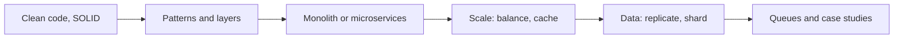

# Software and system design

How to structure code that stays maintainable, and how to design systems that scale, with worked case studies.

Before this folder: Back end, Databases, SQL and Postgres, and DevOps and cloud.

This folder has two chapters. Software design covers how to structure code so it stays maintainable: clean code, SOLID, design patterns, layered architecture and MVC, monoliths versus microservices, and refactoring. System design covers how to build systems that handle load: scalability, load balancing, caching, replication and sharding, CAP, queues, rate limiting, estimates, and two worked case studies.

An AI tool can add code faster than you can keep it organised. Without a sense of coupling and layers, generated changes pile up into a tangle, and without system design vocabulary you cannot say what a design trades away. Interviews also test this chapter directly.

It draws on nearly everything before it: [Back end](../09-back-end/index.md), [Databases, SQL and Postgres](../10-databases-sql-and-postgres/index.md) and [DevOps and cloud](../13-devops-and-cloud/index.md) most of all, along with the costs from [Data structures and algorithms](../06-data-structures-and-algorithms/index.md). It leads into [AI and LLMs](../15-ai-and-llms/index.md) and [The workplace](../16-the-workplace/index.md).

### How to use this folder

- Read the Software design chapter with a project of your own open, so you can find examples.
- Do the back-of-the-envelope estimates before the case studies.
- The chat app case study is optional. The rate limiting lab uses `curl` in WSL.

<!-- lessons:start -->
## Lessons

### 1. [Software design](01-software-design/index.md)

1. [Clean code](01-software-design/01-clean-code.md)
2. [SOLID principles](01-software-design/02-solid-principles.md)
3. [Design patterns](01-software-design/03-design-patterns.md)
4. [Layered architecture and MVC](01-software-design/04-layered-architecture-and-mvc.md)
5. [Monoliths and microservices](01-software-design/05-monoliths-and-microservices.md)
6. [Coupling, cohesion and refactoring](01-software-design/06-coupling-cohesion-and-refactoring.md)

### 2. [System design](02-system-design/index.md)

1. [Scalability basics](02-system-design/01-scalability-basics.md)
2. [Load balancing](02-system-design/02-load-balancing.md)
3. [Caching strategies](02-system-design/03-caching-strategies.md)
4. [Database scaling: replication and sharding](02-system-design/04-database-scaling-replication-and-sharding.md)
5. [CAP and consistency](02-system-design/05-cap-and-consistency.md)
6. [Queues and event-driven design](02-system-design/06-queues-and-event-driven-design.md)
7. [Rate limiting and API gateways](02-system-design/07-rate-limiting-and-api-gateways.md)
8. [Back-of-the-envelope estimates](02-system-design/08-back-of-the-envelope-estimates.md)
9. [System design interviews](02-system-design/09-system-design-interviews.md)
10. [Case study: a URL shortener](02-system-design/10-case-study-url-shortener.md)
11. [Case study: a chat app](02-system-design/11-case-study-chat-app.md) (optional)

<!-- lessons:end -->
