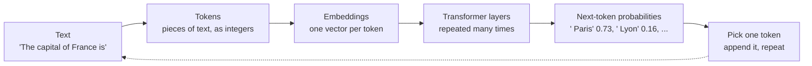
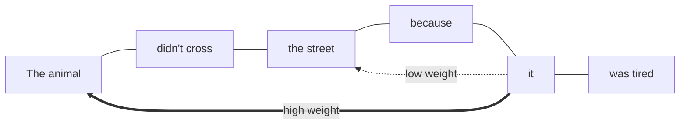

# From ML to transformers

After this you can describe a large language model as a next-token predictor built from transformer layers, and say what attention, parameters, training and inference each mean.

Before this: [what machine learning is](../../11-data-engineering-and-data-science/02-data-science-and-ml/04-what-machine-learning-is.md) and [neural networks and deep learning](../../11-data-engineering-and-data-science/02-data-science-and-ml/07-neural-networks-and-deep-learning.md).

## The idea

Your phone keyboard suggests the next word as you type. A large language model does the same job at a much bigger scale: given some text, it produces a probability for every possible next piece of text, picks one, appends it and repeats. Asking it to "write a function that parses a date" means it keeps predicting the next piece until it predicts a stop.

That is the whole interface. There is no database of facts inside and no program that looks things up. There is one very large function from text to probabilities, whose numbers were adjusted during training until its predictions matched a huge amount of real text.



In the diagram, each box has its own lesson in this chapter: tokens and embeddings in [the next lesson](02-tokens-embeddings-and-context-windows.md), the final pick in [sampling](04-sampling-and-hallucinations.md).

## Key terms

A **language model** is a model that assigns a probability to the next token given the tokens before it. A **large language model (LLM)** is one with billions of parameters, trained on a large part of the public text on the internet plus books and code.

A **token** is the unit of text the model reads and writes: a word, part of a word, or punctuation.

A **parameter** (or weight) is one learned number inside the model. A model with 70 billion parameters stores 70 billion numbers. Parameters are what training changes.

A **transformer** is the neural network design behind current LLMs, introduced in the paper [Attention Is All You Need](https://arxiv.org/abs/1706.03762) (Vaswani et al., 2017). It is a stack of identical layers, each with an attention step and a feed-forward step.

**Attention** is the step where each token looks at the other tokens in the input and takes in information from the ones that matter for it.

**Training** adjusts the parameters on data. **Inference** uses the fixed parameters to answer a prompt.

## How it works

Earlier you saw a neural network as layers of weighted sums and activations, trained by gradient descent on a loss. An LLM is that, with two choices that made it work.

First, the task. Text needs no human labels: every sentence already contains its own answers. Take "the cat sat on the mat", hide the last word, and ask the model to predict it. The loss measures how little probability the model gave the real next token. Billions of such examples teach grammar, facts and coding patterns as a side effect of getting predictions right. This is **self-supervised learning**.

Second, the architecture. Older sequence models read words one after another and struggled to connect a word to something far back. In a transformer, each layer lets every token compare itself with every earlier token at once.



In the diagram, the token "it" gives a high weight to "animal" and a low weight to "street". Change the last words to "was wide" and the weights shift toward "street". Each token builds a query, every other token offers a key, and the match scores decide how much of each token's content (its value) is mixed in. Real models do this with many **attention heads** in parallel, each free to track a different relationship. You do not need the matrix formulas to use the idea: attention is a learned, per-prompt weighting of which earlier tokens matter.

The model is **autoregressive**: its own output becomes part of the next input. The loop is one forward pass per generated token.

```python
from collections import Counter, defaultdict

text = "the cat sat on the mat . the cat ate the fish . the dog sat on the log ."
words = text.split()
after = defaultdict(Counter)
for prev, nxt in zip(words, words[1:]):
    after[prev][nxt] += 1

counts = after["the"]
total = sum(counts.values())
for word, n in counts.most_common():
    print(f"P({word!r} | 'the') = {n}/{total} = {n/total:.2f}")
```

```text
P('cat' | 'the') = 2/6 = 0.33
P('mat' | 'the') = 1/6 = 0.17
P('fish' | 'the') = 1/6 = 0.17
P('dog' | 'the') = 1/6 = 0.17
P('log' | 'the') = 1/6 = 0.17
```

This toy model looks only at the previous word and learns by counting. An LLM looks at thousands of previous tokens and learns by gradient descent, but its output has the same shape: a probability for each candidate next token.

Why did scale matter? Researchers found that test loss falls smoothly and predictably as you increase parameters, training data and compute together (the "scaling laws" papers). Past a certain size, models also became useful on tasks nobody trained them for, such as translating or following written instructions. That is why the field moved from small task-specific models to a few very large general ones.

## Worked examples

<div class="example" markdown>

### Example 1: how big is "big"?

We want a rough parameter count for a transformer with 32 layers and vectors of width 4096.

1. In each layer, attention has four 4096 by 4096 weight matrices.
2. The feed-forward step has two matrices, 4096 by 16384 and back.
3. Multiply by 32 layers. This ignores the embedding table and small extras, so it is an estimate.

<details class="code" markdown>
<summary>In code</summary>

```python
d_model, layers = 4096, 32
# each layer: attention (4 matrices d x d) + feed-forward (2 matrices d x 4d)
per_layer = 4 * d_model**2 + 2 * d_model * (4 * d_model)
params = layers * per_layer
print(f"{params/1e9:.1f} billion parameters")
print(f"{params * 2 / 1e9:.0f} GB at 2 bytes each (16-bit)")
```

```text
6.4 billion parameters
13 GB at 2 bytes each (16-bit)
```

</details>

Check: 13 GB is why the model must sit in GPU memory to run quickly, and why a model with ten times the parameters needs ten times the memory. The weights are the same numbers for every user; only the prompt changes.

</div>

## Common mistakes

<div class="warning" markdown>

Watch out: thinking the model learns from your conversation. During inference the parameters are fixed. A chat "remembers" earlier turns only because the whole conversation is sent back as input each time. A new chat starts blank.

Watch out: thinking the model looks answers up. It generates the likeliest continuation. When that continuation is a fact, it is because the pattern was common in training, not because it was retrieved and checked.

Watch out: reading "next-token predictor" as "simple". The task is simple to state, but predicting the next token of a proof or a program well requires the model to have learned a lot about proofs and programs.

</div>

## Working with AI

<div class="ai" markdown>

Words to use: token, parameter, context, inference, attention, autoregressive.

Prompts to try:

- "Explain in 150 words how attention lets a transformer resolve what 'it' refers to in 'The trophy didn't fit in the suitcase because it was too big'. Use the words query, key and value once each."
- "I have a 7B-parameter model stored in 16-bit weights. How much memory do the weights alone need, and what else uses memory at inference time? Show the arithmetic."

What to check:

- Claims that a model "knows", "thinks" or "remembers" between chats. Ask what mechanism does it: parameters, the context, or a stored memory feature.
- Arithmetic on sizes. Redo parameters times bytes per parameter yourself.
- Any statement about a specific model's size or design that lacks a source. Providers often do not publish parameter counts.

</div>

## Quiz

1\. What is the training task for a language model, and why does it need no human labelling?

<details class="solution" markdown>
<summary>Answer</summary>

Predict the next token of real text. The correct answer is the next token in the text itself, so the data labels itself.

</details>

2\. Using the toy model above, what is the probability of "cat" after "the" if the corpus is changed so "the cat" appears 4 times out of 10 occurrences of "the"?

<details class="solution" markdown>
<summary>Answer</summary>

$4/10 = 0.4$. The model is only counts of what follows each word.

</details>

3\. A colleague says, "I told the model my name in a chat last week, so it knows me." What is wrong with that?

<details class="solution" markdown>
<summary>Answer</summary>

The parameters do not change during inference. Unless the product stores memory and sends it back in the prompt, a new chat has no access to the old one.

</details>

4\. What do parameters and the context each contribute to an answer?

<details class="solution" markdown>
<summary>Answer</summary>

Parameters hold what training taught the model (language, general knowledge, coding patterns) and are the same for every user. The context is the text of this request, which can differ every time.

</details>

## Lab

<div class="lab" markdown>

### Lab: a toy language model

Goal: generate text from word counts, and see greedy and sampled choices differ. Time: about 10 minutes. Runs in: any terminal with Python 3.

1. Save the script below as `toy_lm.py` and run it.
2. Read the greedy line: it takes the likeliest next word every time. Explain why it loops.
3. Change the training text (add two sentences of your own) and run again.
4. Cleanup: delete `toy_lm.py` if you do not need it.

Expected result: the greedy line repeats "the cat sat on"; each sampled line differs.

<details class="solution" markdown>
<summary>Solution</summary>

```python
import random
from collections import Counter, defaultdict

text = "the cat sat on the mat . the cat ate the fish . the dog sat on the log ."
words = text.split()
after = defaultdict(Counter)
for prev, nxt in zip(words, words[1:]):
    after[prev][nxt] += 1

def generate(start, n, greedy=False):
    out = [start]
    for _ in range(n):
        counts = after[out[-1]]
        if greedy:
            out.append(counts.most_common(1)[0][0])
        else:
            out.append(random.choices(list(counts), weights=counts.values())[0])
    return " ".join(out)

random.seed(1)
print("greedy: ", generate("the", 8, greedy=True))
for _ in range(3):
    print("sampled:", generate("the", 8))
```

```text
greedy:  the cat sat on the cat sat on the
sampled: the cat ate the cat sat on the dog
sampled: the cat sat on the dog sat on the
sampled: the cat ate the cat sat on the mat
```

Greedy always picks "cat" after "the" (the most common follower), then "sat", "on", "the" again, so it cycles. Sampling picks less likely words sometimes, which breaks the cycle.

</details>

</div>

## Where this shows up

- Every tool in the AI-assisted development chapter is a loop around this next-token prediction.
- Knowing inference is fixed weights plus a prompt explains why [prompt and context engineering](../02-building-with-llms/02-prompt-and-context-engineering.md) matters.
