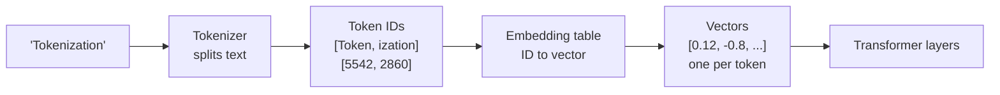
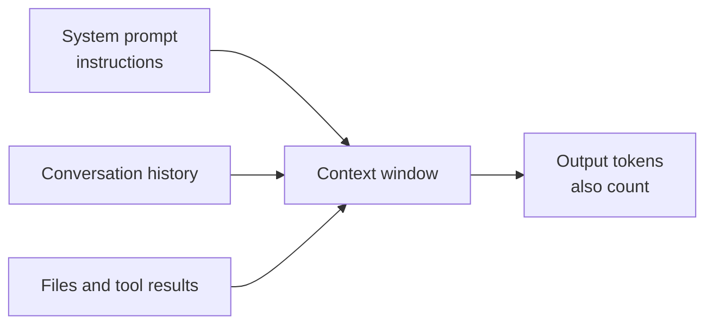

# Tokens, embeddings and context windows

After this you can estimate how many tokens a piece of text costs, explain what an embedding is and how similarity is measured, and say what happens as a context window fills.

Before this: [from ML to transformers](01-from-ml-to-transformers.md).

## The idea

You paste a 3,000-line log file into a chat and the model answers, but the next message fails with "prompt is too long". The limit was not lines or characters. It was tokens, and the model also carried the whole earlier conversation each time.

A model cannot read letters or words directly. Text is first cut into pieces (tokens), each piece is turned into a list of numbers (an embedding), and the transformer works on those numbers. Everything the model sees in one request, input and output together, must fit in its context window.



In the diagram, the IDs are made up for illustration; a real tokenizer assigns its own.

## Key terms

A **token** is a chunk of text from a fixed vocabulary, usually 50,000 to 250,000 entries. Common words are one token, rare words split into several, and a space often belongs to the token after it.

**Tokenization** is the step that converts text to a list of token IDs. Most tokenizers use **byte-pair encoding**: start from single bytes and repeatedly merge the most frequent neighbouring pair in a large sample of text, until the vocabulary is full.

An **embedding** is a vector (a list of numbers, often hundreds to thousands long) that represents a token or a piece of text. Similar meanings end up as vectors that point in similar directions.

**Cosine similarity** is the cosine of the angle between two vectors: $\frac{a \cdot b}{\lvert a \rvert \, \lvert b \rvert}$. It is 1 for the same direction, 0 for unrelated and $-1$ for opposite.

The **context window** is the maximum number of tokens a model can take in one request, counting everything: the system prompt, the conversation so far, files, tool results and the answer being generated.

## How it works

Tokenizers differ between model families, so the same text has different counts in different models. The demo below uses OpenAI's open-source [tiktoken](https://github.com/openai/tiktoken) library with its `o200k_base` vocabulary, because it is easy to install. Anthropic's tokenizer is different; the models overview says 1M tokens is roughly 555k words on the current Claude tokenizer ([Claude models overview](https://platform.claude.com/docs/en/about-claude/models/overview), as of 2026), which is about 1.8 tokens per English word.

```python
import tiktoken

enc = tiktoken.get_encoding("o200k_base")
samples = {
    "English": "The quick brown fox jumps over the lazy dog.",
    "French": "Le renard brun rapide saute par-dessus le chien paresseux.",
    "Python": "def add(a, b):\n    return a + b\n",
    "Rare word": "Floccinaucinihilipilification",
}
for name, text in samples.items():
    ids = enc.encode(text)
    print(f"{name:10} {len(text):3} chars {len(ids):3} tokens")
print([enc.decode([i]) for i in enc.encode(samples["Rare word"])])
```

```text
English     44 chars  10 tokens
French      58 chars  14 tokens
Python      32 chars  12 tokens
Rare word   29 chars   9 tokens
['Fl', 'occ', 'in', 'auc', 'ini', 'hil', 'ip', 'il', 'ification']
```

The English sentence is about 4.4 characters per token. French costs more per character here, the Python snippet is dense because of punctuation and indentation, and the rare word falls apart into nine pieces. Vocabularies are built mostly from English text and code, so other languages, rare names, long numbers and unusual formats usually cost more tokens.

Token counts matter for three reasons. Providers bill per token, with separate rates for input and output. Latency grows with output tokens, because each one needs a forward pass. And the context window is measured in tokens.

Embeddings work the same way for whole texts. An embedding model maps a sentence to a vector so that meaning can be compared with arithmetic. Searching documents by embedding similarity is the basis of retrieval, which a later lesson covers ([RAG embeddings and pgvector](../02-building-with-llms/04-rag-embeddings-and-pgvector.md)).

### The context window as working memory

The model has no memory of earlier requests; each request carries everything it should know. A chat product re-sends the whole history on every turn, so the request grows.



When the input alone is larger than the window, the API returns an error ("prompt is too long", [context windows](https://platform.claude.com/docs/en/build-with-claude/context-windows), as of 2026). Chat apps and agent tools instead drop or summarise older turns, so the model silently loses early details. Bigger windows do not remove the problem: Anthropic's docs note that accuracy and recall degrade as token count grows, which they call context rot. More context is not automatically better; relevant context is.

As of 2026 all four current Claude models list a 1M-token window and 128K tokens of maximum output, while older models have 200K ([context windows](https://platform.claude.com/docs/en/build-with-claude/context-windows)). Long inputs also cost more to process and slow the first token down.

## Worked examples

<div class="example" markdown>

### Example 1: cosine similarity on toy embeddings

We have three words with invented 3-number embeddings (real ones have hundreds or thousands of numbers) and want to know which pair is closest.

1. Compute the dot product of two vectors.
2. Divide by the product of their lengths.
3. Compare the results.

<details class="code" markdown>
<summary>In code</summary>

```python
import math

def cosine(a, b):
    dot = sum(x * y for x, y in zip(a, b))
    return dot / (math.hypot(*a) * math.hypot(*b))

# toy 3-number embeddings, invented for this lesson
vec = {
    "cat":    (0.9, 0.8, 0.1),
    "kitten": (0.8, 0.9, 0.2),
    "car":    (0.1, 0.2, 0.9),
}
print(f"cat vs kitten: {cosine(vec['cat'], vec['kitten']):.2f}")
print(f"cat vs car:    {cosine(vec['cat'], vec['car']):.2f}")
```

```text
cat vs kitten: 0.99
cat vs car:    0.30
```

</details>

Check: by hand, cat and kitten give $0.72+0.72+0.02=1.46$, divided by $1.208 \times 1.221$, which is $0.99$. Cosine ignores vector length, which is why it is the usual choice: it compares direction (meaning), not size.

</div>

<div class="example" markdown>

### Example 2: a growing conversation

Each turn we paste 40,000 tokens of files and the model replies with 3,000. History is re-sent every turn.

<details class="code" markdown>
<summary>In code</summary>

```python
window = 1_000_000
history = 0
for turn in range(1, 6):
    history += 40_000 + 3_000   # pasted files + the model's reply, re-sent every turn
    sent = history
    print(f"turn {turn}: request carries {sent:>7,} tokens ({sent/window:.0%} of window)")
```

```text
turn 1: request carries  43,000 tokens (4% of window)
turn 2: request carries  86,000 tokens (9% of window)
turn 3: request carries 129,000 tokens (13% of window)
turn 4: request carries 172,000 tokens (17% of window)
turn 5: request carries 215,000 tokens (22% of window)
```

</details>

Total input billed over the five turns is the sum of all five requests (645,000 tokens), not 215,000. Long chats cost more per turn than short ones. Providers offer prompt caching to discount repeated prefixes; check their pricing page.

</div>

## Common mistakes

<div class="warning" markdown>

Watch out: counting words or characters instead of tokens. Use the provider's token counter (Anthropic documents a [token counting API](https://platform.claude.com/docs/en/build-with-claude/token-counting)) for real numbers; a library for another model family gives only an estimate.

Watch out: asking a model to count letters or do digit-level work. It sees tokens, not letters, so "how many r's in strawberry" is harder than it looks. Ask it to write code that counts.

Watch out: filling the window to be safe. Dumping a whole repository in can bury the lines that matter and raise cost. Send the relevant files.

</div>

## Working with AI

<div class="ai" markdown>

Words to use: token, tokenizer, embedding, cosine similarity, context window, input tokens, output tokens.

Prompts to try:

- "My prompt averages 12,000 input tokens and the answer 800 output tokens, at 5,000 calls a day. Using these per-million-token prices that I will paste, what is the monthly cost? Show the formula."
- "Our chat history is re-sent every turn. After about 20 turns the model starts ignoring the first instructions. Give three ways to keep the instructions in effect, and say what each costs in tokens."

What to check:

- Token counts quoted from another model family. They differ, so re-measure with the target provider's counter.
- Price arithmetic mixing input and output rates or forgetting the million. Redo it in Python.
- Advice to "just use the biggest window". Test whether quality holds on your own long inputs.

</div>

## Quiz

1\. What is a token, and why do two models give different token counts for the same text?

<details class="solution" markdown>
<summary>Answer</summary>

A token is a chunk of text from the tokenizer's fixed vocabulary. Different models train different vocabularies, so they split the same text differently.

</details>

2\. Two embeddings have a cosine similarity of $-1$. What does that say?

<details class="solution" markdown>
<summary>Answer</summary>

They point in exactly opposite directions. For real text embeddings, values near 1 mean similar, values near 0 mean unrelated.

</details>

3\. A chat adds 150k tokens per turn and re-sends the whole history each time. On a 1M window, which turn is the first to fail?

<details class="solution" markdown>
<summary>Answer</summary>

Turn 6 carries 900k tokens, which fits. Turn 7 would carry 1.05M, which is over the window, so it fails. The fix is to summarise or drop old content, or start a fresh chat with a summary.

</details>

4\. Why is French or a long number more expensive per character than English prose?

<details class="solution" markdown>
<summary>Answer</summary>

Vocabularies contain more whole-word pieces for the languages and formats most common in the training sample, so less common text splits into more tokens.

</details>

## Lab

<div class="lab" markdown>

### Lab: measure your own text

Goal: see how content type changes tokens per character. Time: about 10 minutes. Runs in: any terminal with Python 3.

1. Create a virtual environment and install the library: `python -m venv .venv`, then activate it and run `pip install tiktoken`. The first run downloads the vocabulary, so it needs internet.
2. Save the script below as `count.py` and run it.
3. Add two samples of your own (a line of your code, a sentence in another language) and compare the characters per token.
4. Cleanup: delete the `.venv` folder and `count.py`.

Expected result: ordinary prose gets the most characters per token; JSON and digits get the fewest.

<details class="solution" markdown>
<summary>Solution</summary>

```python
import tiktoken

enc = tiktoken.get_encoding("o200k_base")
samples = {
    "prose": "Tokens are the pieces of text a model reads and writes.",
    "json": '{"user_id": 48213, "active": true, "tags": ["a", "b"]}',
    "number": "3.14159265358979",
    "emoji": "Great job \U0001F44D\U0001F44D\U0001F44D",
}
for name, text in samples.items():
    n = len(enc.encode(text))
    print(f"{name:7} {len(text):3} chars {n:3} tokens {len(text)/n:4.1f} chars/token")
```

```text
prose    55 chars  12 tokens  4.6 chars/token
json     54 chars  23 tokens  2.3 chars/token
number   16 chars   7 tokens  2.3 chars/token
emoji    13 chars   5 tokens  2.6 chars/token
```

</details>

</div>

## Where this shows up

- Token counts drive cost and rate limits in [choosing a model](05-choosing-a-model.md).
- The window is the main design constraint of [prompt and context engineering](../02-building-with-llms/02-prompt-and-context-engineering.md).
