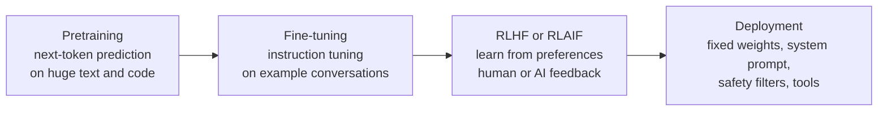

# Training, fine-tuning and RLHF

After this you can name the stages that turn raw text into a chat assistant, say what each stage teaches, and explain why a model hedges, refuses, or knows nothing recent.

Before this: [from ML to transformers](01-from-ml-to-transformers.md) and [tokens, embeddings and context windows](02-tokens-embeddings-and-context-windows.md).

## The idea

A model fresh from the first training stage is not an assistant. Given "What is the capital of France?" it may continue with "What is the capital of Germany?", because quiz lists look like that on the internet. It has learned to continue text, not to answer you.

Turning it into something useful takes more stages. Each starts from the previous stage's parameters and nudges them with different data and a different goal.



In the diagram, the cost falls from left to right: pretraining uses most of the compute, while the later stages use far less data but shape the behaviour you actually see.

## Key terms

**Pretraining** is the first stage: next-token prediction over a very large text and code corpus. It gives the model language, broad knowledge and coding patterns.

**Fine-tuning** continues training on a smaller, curated dataset. **Instruction tuning** is fine-tuning on pairs of an instruction and a good response, so the model follows requests instead of continuing them.

**RLHF** (reinforcement learning from human feedback) trains the model using human preferences. People compare two responses to a prompt and pick the better one. A **reward model** learns to predict those choices, then the language model is trained to produce responses the reward model scores highly. The method is described in the [InstructGPT paper](https://arxiv.org/abs/2203.02155) (Ouyang et al., 2022).

**RLAIF** (reinforcement learning from AI feedback) replaces some or all human comparisons with judgements made by an AI model following written principles. **Constitutional AI**, from Anthropic, is the best-known version: the model critiques and revises its own outputs against a list of principles (a constitution), and AI preferences train the reward signal ([paper](https://arxiv.org/abs/2212.08073), Bai et al., 2022).

A **knowledge cutoff** is the date after which the training data contains little or nothing.

## How it works

Pretraining is the same loop as in the first lesson, repeated over trillions of tokens on thousands of GPUs. It runs for weeks and costs a very large sum, so only a few organisations do it. The data is filtered web pages, books, code and other text; exact mixes are rarely published. The result is a **base model**. It is knowledgeable but unruly, and it reproduces whatever was in the data, including errors and bias.

Instruction tuning uses thousands to hundreds of thousands of written examples. The format is simple:

```json
{"prompt": "Summarise: The meeting moved to Tuesday.", "response": "The meeting is now on Tuesday."}
```

After this stage the model answers in the shape of an assistant. It does not gain much new knowledge; it learns a format and a style.

Preference training goes further, because "good" is hard to write as an example but easy to judge by comparison. For each prompt the model writes several responses and a judge ranks them. The reward model assigns each response a score $r$, and the probability that response A beats B is modelled as

$$P(A \succ B) = \frac{1}{1 + e^{-(r_A - r_B)}}$$

The reward model is trained so these probabilities match the human or AI choices. Then the language model is updated to produce replies with higher reward, with a penalty for drifting too far from where it started. Without the penalty it learns to game the reward model.

Behaviours you notice in practice come from these stages. The model refuses some requests and adds caveats because preference data rewarded careful answers and penalised harmful ones. It is polite, tends to agree with you and gives long answers because raters often preferred those; this bias toward pleasing the rater is called sycophancy. Deployment adds a system prompt and sometimes separate filters that further shape or block output.

Because training stops at a date, the model does not know later events. Anthropic lists a reliable knowledge cutoff of June 2026 for all four current Claude models ([models overview](https://platform.claude.com/docs/en/about-claude/models/overview), as of 2026). Anything newer, such as a library released after that, either is missing or is guessed. A model can also be wrong about its own cutoff, so use the provider's published date.

## Worked examples

<div class="example" markdown>

### Example 1: a reward model preferring one response

Suppose the reward model scores response A at 2.0 and response B at 0.5, and a human chose A.

1. The gap is $2.0 - 0.5 = 1.5$.
2. The model's probability that A wins is $1/(1+e^{-1.5}) = 0.82$.
3. The training loss is $-\ln 0.82 = 0.20$. If the human had chosen B, the loss would be $-\ln 0.18 = 1.70$, so the update would be large.

<details class="code" markdown>
<summary>In code</summary>

```python
import math

def p_prefer(r_a, r_b):
    """Probability the reward model assigns to 'A beats B'."""
    return 1 / (1 + math.exp(-(r_a - r_b)))

print(f"{p_prefer(2.0, 0.5):.2f}")
print(f"loss if humans chose A: {-math.log(p_prefer(2.0, 0.5)):.2f}")
print(f"loss if humans chose B: {-math.log(1 - p_prefer(2.0, 0.5)):.2f}")
```

```text
0.82
loss if humans chose A: 0.20
loss if humans chose B: 1.70
```

</details>

Check: the output matches the hand arithmetic. Confident wrong predictions are punished hard, as in the logistic-regression loss you have seen.

</div>

## Common mistakes

<div class="warning" markdown>

Watch out: assuming fine-tuning is how you teach a model your company's documents. It mostly changes style and format, and facts learned this way are unreliable. To give a model your data, put it in the prompt or retrieve it at request time (RAG embeddings and pgvector<!-- link: ../02-building-with-llms/04-rag-embeddings-and-pgvector.md -->).

Watch out: treating a refusal as a statement about what is true or legal. It reflects trained caution and the provider's policy, and a rephrased request can flip the outcome either way. Do not rely on it as a security control.

Watch out: assuming the model knows the latest version of a tool. Paste the current docs or changelog into the prompt when the version is newer than the cutoff.

</div>

## Working with AI

<div class="ai" markdown>

Words to use: pretraining, instruction tuning, RLHF, reward model, knowledge cutoff, system prompt, sycophancy.

Prompts to try:

- "I use FastAPI 0.115 and Pydantic v2. Your answer uses `@validator`. Check whether that API still exists in v2 and give the current form. If you are not sure, say so."
- "Review this design and argue against it. List the three strongest objections before you say anything positive."

What to check:

- Version-specific code. Compare with the library's current docs, since the model may reflect older versions.
- Agreement that arrives too quickly. If you push back with a wrong claim and the model folds, that is sycophancy; ask for evidence for each side.
- Refusals or hedges on a legitimate request. Add context about who you are and why, or use a different phrasing, but do not treat the first answer as policy.

</div>

## Quiz

1\. Which stage uses the most compute, and which teaches the model to follow instructions?

<details class="solution" markdown>
<summary>Answer</summary>

Pretraining uses the most compute. Instruction tuning (supervised fine-tuning on instruction and response pairs) teaches following instructions.

</details>

2\. A reward model gives A a score of 1.0 and B a score of 1.0. What probability does it give that A beats B?

<details class="solution" markdown>
<summary>Answer</summary>

0.5, since $1/(1+e^{0})=0.5$. Equal scores mean no preference.

</details>

3\. You ask for code using a library released after the model's cutoff, and it confidently produces plausible functions. What is the likely problem and the fix?

<details class="solution" markdown>
<summary>Answer</summary>

The model never saw the library, so it guesses from similar ones and may invent functions. Paste the library's current documentation or examples into the prompt, then run the code.

</details>

4\. What is the difference between RLHF and RLAIF?

<details class="solution" markdown>
<summary>Answer</summary>

RLHF uses preferences from human raters. RLAIF uses preferences from an AI model that follows written principles. The rest of the training loop is the same.

</details>

## Lab

<div class="lab" markdown>

### Lab: fit a reward model on three comparisons

Goal: recover a ranking from pairwise preferences. Time: about 10 minutes. Runs in: any terminal with Python 3.

1. Save the script below as `reward.py` and run it. Humans said A beat B, B beat C and A beat C.
2. Check that the scores rank A above B above C.
3. Add the pair `("C", "A")` to `pairs`, which contradicts the others. Predict what happens to the scores, then run it.
4. Cleanup: delete `reward.py`.

Expected result: ranking A, B, C, with C far below A.

<details class="solution" markdown>
<summary>Solution</summary>

```python
import math

# Humans ranked three replies: A beat B, B beat C, A beat C.
pairs = [("A", "B"), ("B", "C"), ("A", "C")]
reward = {"A": 0.0, "B": 0.0, "C": 0.0}
lr = 0.5
for step in range(200):
    for win, lose in pairs:
        p = 1 / (1 + math.exp(-(reward[win] - reward[lose])))
        grad = 1 - p                      # slope of log p with respect to the gap
        reward[win] += lr * grad
        reward[lose] -= lr * grad
print({k: round(v, 2) for k, v in sorted(reward.items())})
print("ranking:", sorted(reward, key=reward.get, reverse=True))
```

```text
{'A': 4.63, 'B': 0.0, 'C': -4.63}
ranking: ['A', 'B', 'C']
```

With the contradictory pair added, the scores shrink to about 0.17, 0.08 and $-0.25$ because the data disagrees. Noisy or inconsistent raters give a weaker reward signal.

</details>

</div>

## Where this shows up

- The system prompt and tool access added at deployment are what you control in prompt and context engineering<!-- link: ../02-building-with-llms/02-prompt-and-context-engineering.md -->.
- Sycophancy and stale knowledge are two reasons to read [reviewing AI code](../03-ai-assisted-development/03-reviewing-ai-code.md) as a habit.
