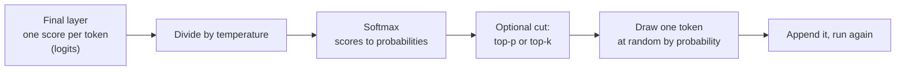

# Sampling and hallucinations

After this you can explain how a model turns scores into one chosen token, say what temperature and top-p change, and use five concrete habits to reduce made-up answers.

Before this: [from ML to transformers](01-from-ml-to-transformers.md) and [training, fine-tuning and RLHF](03-training-fine-tuning-and-rlhf.md).

## The idea

Ask the same question twice and you may get two different answers. Ask for a citation and you may get a real-looking paper that does not exist. Both come from the same last step: the model produces a probability for each possible next token, and something has to choose one.



In the diagram, the temperature and the cut are the settings you can often change. The draw is where randomness enters.

## Key terms

**Logits** are the raw scores the model gives each token in its vocabulary, before they are turned into probabilities. They can be any real number.

**Softmax** turns scores $z_i$ into probabilities that are positive and sum to 1:

$$p_i = \frac{e^{z_i / T}}{\sum_j e^{z_j / T}}$$

**Temperature** $T$ is the number the scores are divided by in that formula. Low $T$ sharpens the distribution toward the top token. High $T$ flattens it. As $T$ approaches 0 the choice becomes **greedy decoding**: always the top token.

**Top-p** (nucleus) sampling keeps the smallest set of top tokens whose probabilities add to at least $p$, then renormalises and samples from them. **Top-k** keeps a fixed number of tokens.

A **hallucination** is output that reads as fluent and confident but is false or unsupported, such as an invented function, quote or citation. Also called confabulation.

## How it works

The picture shows the same four scores at three temperatures. At 0.2 almost all the probability is on "Paris". At 2.0 even "banana" gets a few percent.


Lower temperature means more repeatable and more conservative; higher means more varied. Neither means more correct. A low temperature does not stop a model from confidently choosing a wrong top token. Use low settings for extraction, code and classification, and higher ones for brainstorming.

Even at temperature 0 you may see small differences between runs, because floating-point sums on GPUs can change with batching and hardware. Treat "deterministic" as "mostly repeatable", and never write a test that expects byte-identical output from a hosted model. Some APIs also fix or limit the sampling settings for particular models, so read the parameter docs for the model you call.

Why do models hallucinate? The training objective rewards a plausible next token, not a true one. When the model has seen a fact many times, the plausible continuation is also true. When the topic is rare, recent, or asks for an exact detail (a page number, a function signature, a court case), it still must output something, and the most plausible-looking string is a fabrication. There is no internal flag for "I don't know" that is reliably wired to the output. Models are trained to be better calibrated, but the fluent wrong answer remains the default failure.

Five habits reduce the damage:

1. Ground the answer. Put the source text in the prompt and tell the model to answer only from it.
2. Ask for quotes or citations from that text, then check that each quote appears in the source.
3. Give it tools. Let it run code, search or query a database so facts and arithmetic come from a program.
4. Ask for uncertainty and permission to refuse: "If the documents don't say, answer 'not stated'."
5. Verify. Run the code, open the link, search for the paper, recompute the number.

## Worked examples

<div class="example" markdown>

### Example 1: temperature on four scores

We have scores (logits) for four candidate tokens and compute probabilities at three temperatures, then keep the top-p set.

1. Divide each score by $T$.
2. Apply softmax, subtracting the maximum first to avoid overflow.
3. For top-p 0.9, sort by probability and keep tokens until the running total reaches 0.9, then renormalise.

<details class="code" markdown>
<summary>In code</summary>

```python
import math

def softmax(logits, temperature=1.0):
    scaled = [x / temperature for x in logits]
    m = max(scaled)
    exps = [math.exp(x - m) for x in scaled]
    total = sum(exps)
    return [e / total for e in exps]

def top_p(probs, p):
    order = sorted(range(len(probs)), key=lambda i: -probs[i])
    keep, cum = [], 0.0
    for i in order:
        keep.append(i)
        cum += probs[i]
        if cum >= p:
            break
    total = sum(probs[i] for i in keep)
    return {i: probs[i] / total for i in keep}

tokens = ["Paris", "Lyon", "France", "banana"]
logits = [4.0, 2.5, 2.0, -1.0]
for t in (0.2, 1.0, 2.0):
    probs = softmax(logits, t)
    print(f"T={t}:", {w: round(p, 3) for w, p in zip(tokens, probs)})
kept = top_p(softmax(logits), 0.9)
print("top_p=0.9 keeps:", {tokens[i]: round(p, 3) for i, p in kept.items()})
```

```text
T=0.2: {'Paris': 0.999, 'Lyon': 0.001, 'France': 0.0, 'banana': 0.0}
T=1.0: {'Paris': 0.732, 'Lyon': 0.163, 'France': 0.099, 'banana': 0.005}
T=2.0: {'Paris': 0.52, 'Lyon': 0.246, 'France': 0.191, 'banana': 0.043}
top_p=0.9 keeps: {'Paris': 0.736, 'Lyon': 0.164, 'France': 0.1}
```

</details>

Check: at $T=1$, Paris plus Lyon is 0.895, below 0.9, so France is also kept and "banana" is cut. The probabilities in each row sum to 1 (up to rounding).

</div>

## Common mistakes

<div class="warning" markdown>

Watch out: setting temperature to 0 and trusting the answer. It makes the output repeatable, not correct. A wrong top token is still wrong.

Watch out: asking "are you sure?" as the only check. The model may reverse a correct answer or defend a wrong one. Check against a source or a run instead.

Watch out: trusting a citation because it has authors, a year and a DOI. All of these are easy to generate. Open the link or search the title.

</div>

## Working with AI

<div class="ai" markdown>

Words to use: temperature, top-p, greedy decoding, hallucination, grounding, citation, tool use.

Prompts to try:

- "Answer using only the text between the `<doc>` tags. After each claim, quote the exact sentence you used. If the text does not contain the answer, reply 'not stated'."
- "List the functions you used from the `requests` library in this code. For each, say how confident you are that it exists in version 2.32 and what I should check in the docs."

What to check:

- Quotes that do not appear in your source. Search for them with Ctrl+F.
- Package names, functions and flags. Run `pip show`, `--help`, or import the module.
- Numbers computed in the model's head. Have it write the code, then run it.
- Confident claims about recent events or small projects. Look at the primary source.

</div>

## Quiz

1\. What does lowering the temperature do to the probability of the most likely token, and does it make the answer more accurate?

<details class="solution" markdown>
<summary>Answer</summary>

It raises the top token's probability, so output is more repeatable. It does not make a wrong top token right, so accuracy does not improve by itself.

</details>

2\. Logits are 2 and 0 for tokens X and Y at $T=1$. Compute $P(X)$.

<details class="solution" markdown>
<summary>Answer</summary>

$e^2/(e^2+e^0) = 7.39/8.39 = 0.88$.

</details>

3\. A model gives you a paper title, authors, journal and year for a claim, and the paper cannot be found. What happened and what should you do?

<details class="solution" markdown>
<summary>Answer</summary>

It produced a plausible citation pattern, which is a hallucination. Search for the title in a library database or Google Scholar, and ask the model to cite only from sources you supply.

</details>

4\. Name two ways to make a model answer a question about your internal API docs more reliably.

<details class="solution" markdown>
<summary>Answer</summary>

Put the relevant docs in the prompt and tell it to answer only from them (grounding), and require quoted evidence for each claim. Giving it a search tool over the docs also works.

</details>

## Lab

<div class="lab" markdown>

### Lab: sample a thousand times

Goal: see the effect of temperature as counts, not formulas. Time: about 10 minutes. Runs in: any terminal with Python 3.

1. Save the script below as `sample.py` and run it.
2. Compare how often each token appears at $T=0.2$, 1.0 and 2.0.
3. Change a logit so "banana" has score 3.0 and predict the new counts at $T=1$.
4. Cleanup: delete `sample.py`.

Expected result: almost always "Paris" at 0.2, with a visible tail at 2.0.

<details class="solution" markdown>
<summary>Solution</summary>

```python
import math
import random
from collections import Counter

tokens = ["Paris", "Lyon", "France", "banana"]
logits = [4.0, 2.5, 2.0, -1.0]

def softmax(xs, t):
    m = max(x / t for x in xs)
    e = [math.exp(x / t - m) for x in xs]
    return [v / sum(e) for v in e]

random.seed(0)
for t in (0.2, 1.0, 2.0):
    draws = random.choices(tokens, weights=softmax(logits, t), k=1000)
    print(f"T={t}:", dict(Counter(draws).most_common()))
print("greedy:", tokens[logits.index(max(logits))])
```

```text
T=0.2: {'Paris': 998, 'Lyon': 2}
T=1.0: {'Paris': 715, 'Lyon': 176, 'France': 99, 'banana': 10}
T=2.0: {'Paris': 509, 'Lyon': 259, 'France': 189, 'banana': 43}
greedy: Paris
```

With banana at 3.0 it becomes the second most likely token, because its score is above Lyon's 2.5.

</details>

</div>

## Where this shows up

- Grounding and tool use are the subject of tool use<!-- link: ../02-building-with-llms/03-tool-use.md --> and RAG embeddings and pgvector<!-- link: ../02-building-with-llms/04-rag-embeddings-and-pgvector.md -->.
- Checking claims is the daily habit in reviewing AI code<!-- link: ../03-ai-assisted-development/03-reviewing-ai-code.md -->.
