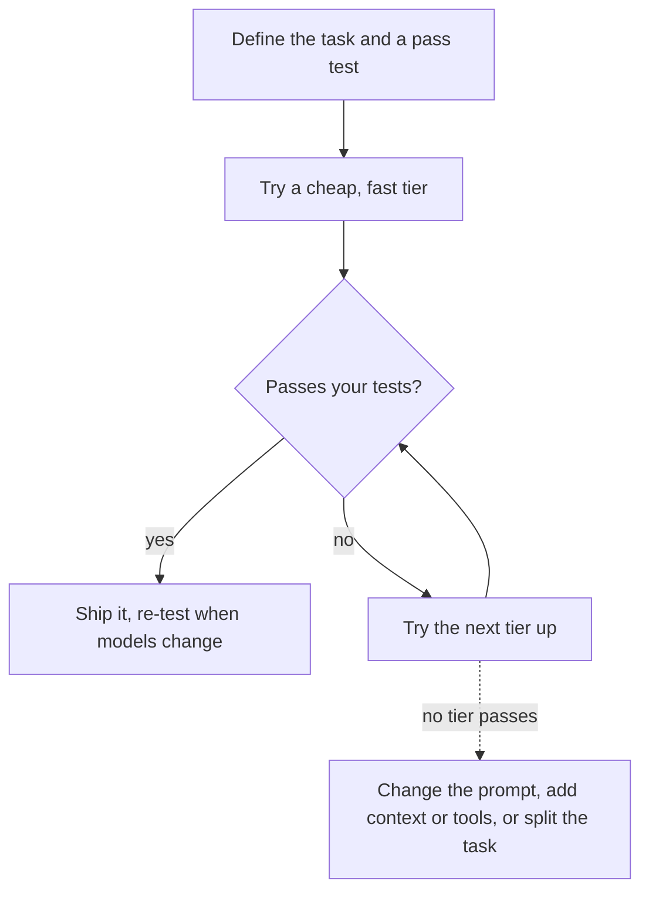

# Choosing a model

After this you can pick a model for a task by weighing capability, cost, latency, context size and hosting, read a benchmark claim critically, and test candidates on your own tasks.

Before this: [tokens, embeddings and context windows](02-tokens-embeddings-and-context-windows.md) and [sampling and hallucinations](04-sampling-and-hallucinations.md).

## The idea

A team builds a feature that tags support emails as billing, bug or sales. They try the largest model first because it gets every example right, then notice the bill: ten thousand emails a day, each one a few thousand tokens. A smaller model gets 97% right at a fraction of the price and answers in under a second. The best model is the cheapest one that passes your tests.

Providers sell the same family in tiers. A bigger tier usually reasons better and costs more and runs slower; a smaller tier is faster and cheaper but misses harder cases. You choose along several axes at once.

| Axis | Larger or more capable model | Smaller or cheaper model |
|---|---|---|
| Capability | Better on hard reasoning, long tasks, subtle code | Fine on classification, extraction, short rewrites |
| Cost | Higher price per token | Lower price per token |
| Latency | Slower to start and to finish | Faster |
| Context size | Check each model | Check each model |
| Control | Hosted by a provider | Open-weight models can run on your own machines |



In the diagram, you start small and move up only when your own tests fail. Escalating with no test means paying for capability you may not need.

## Key terms

A **model tier** is a size and price level within one provider's family, such as small, mid and large.

**Latency** here is the time to the first token plus the time to produce the rest. **Throughput** is how many tokens per second a model generates.

**Open-weight** means the trained parameters are published and you can download and run them, usually under a licence with conditions. It is not the same as open source. Examples of open-weight families include Meta's Llama and Mistral's models. A **hosted** model runs on the provider's servers, and you call it over an API.

A **benchmark** is a fixed set of questions with an automatic score. An **eval** is a test set of your own tasks with your own pass criteria.

## How it works

### Claude tiers as an example

The table below is from Anthropic's models overview (as of 2026; check the [page](https://platform.claude.com/docs/en/about-claude/models/overview) before relying on it). All four list a 1M-token context window, 128K tokens of maximum output and a June 2026 reliable knowledge cutoff, so on this family context size is not what separates the tiers. Prices are US dollars per million tokens.

| Model ID | Described as | Latency | Input / output price |
|---|---|---|---|
| `claude-fable-5-1` | Demanding reasoning and long-horizon agentic work | Slower | \$10 / \$50 |
| `claude-opus-5-5` | Long-running agentic coding and knowledge work | Moderate | \$4 / \$20 |
| `claude-sonnet-5-5` | The best combination of speed and intelligence | Fast | \$2 / \$10 |
| `claude-haiku-5-5` | High-volume, latency-sensitive tasks such as classification, extraction and routing | Fastest | from \$0.10 / from \$0.50 |

Other providers (OpenAI, Google, and others) sell tiers on the same pattern, with different names, limits and prices that change often. Read their pages; do not carry these numbers across.

### Cost is tokens times price

Cost per call is input tokens times the input price plus output tokens times the output price. Output is usually priced higher than input, so a verbose answer costs more than a long prompt of the same size.

```python
# $ per million tokens (input, output), from the Claude models overview, as of 2026
prices = {"haiku-5-5": (0.10, 0.50), "sonnet-5-5": (2, 10), "opus-5-5": (4, 20), "fable-5-1": (10, 50)}
calls, in_tok, out_tok = 10_000, 3_000, 500
for name, (p_in, p_out) in prices.items():
    cost = calls * (in_tok * p_in + out_tok * p_out) / 1e6
    print(f"{name:11} ${cost:>8,.2f}")
```

```text
haiku-5-5   $    5.50
sonnet-5-5  $  110.00
opus-5-5    $  220.00
fable-5-1   $  550.00
```

For these 10,000 calls (3,000 input and 500 output tokens each), the top tier costs 100 times the smallest. Batch processing and prompt caching can discount this; the same page lists a 50% discount for batch requests as of 2026.

### Open-weight versus hosted

Hosted models give you the strongest ones with no hardware to run and fast updates, but your data goes to the provider and the model can change or be retired. Open-weight models let you keep data on your own machines, fix a version and tune them yourself, but you pay for GPUs and operations, and the largest ones need several GPUs. Pick on data rules (privacy law, contracts), cost at your volume and how much operations work you will take on.

### Reading benchmarks

Benchmark scores are a starting list, not a decision. They go wrong in known ways. Test questions may have leaked into training data. Popular benchmarks saturate, so top models cluster near the ceiling. A vendor chooses which results to publish and under what settings. And your task (your codebase, your style, your language) is not in the benchmark. Use a leaderboard to choose two or three candidates, then test them yourself.

## Worked examples

<div class="example" markdown>

### Example 1: a small eval beats an opinion

You are choosing between two models for a quick triage script. Write down a few cases you can grade automatically, run both, and compare.

1. List 20 real inputs and the correct output for each. Include the hard ones you worry about.
2. Write a check per case that does not depend on exact wording (contains "404", valid JSON, passes unit tests).
3. Run each candidate on all cases and count passes. Note cost and time per call.
4. Look at the failures by hand. Some will be bad checks, not bad answers.

Check: a model that fails because your check was too strict still shows you where the check needs work. The lab below makes this concrete.

</div>

## Common mistakes

<div class="warning" markdown>

Watch out: choosing by a leaderboard rank or by the most expensive tier. Neither says anything about your inputs. Run your own cases.

Watch out: hard-coding one model forever. Model IDs are retired on a schedule (Anthropic lists retirement dates on its [overview page](https://platform.claude.com/docs/en/about-claude/models/overview), as of 2026), and new tiers appear. Keep the model name in config and keep your tests so you can re-run them.

Watch out: ignoring output length. Output tokens cost more and add latency, so ask for short answers when you only need a label.

</div>

## Working with AI

<div class="ai" markdown>

Words to use: model tier, latency, input tokens, output tokens, open-weight, benchmark, eval.

Prompts to try:

- "I classify 50,000 support emails a day, about 1,500 input tokens and 20 output tokens each. Here are the per-million-token prices for three models: [paste]. Compute the monthly cost for each in Python and list what I should test before choosing the cheapest."
- "Write 15 test cases with expected outputs for an email classifier with the labels billing, bug and sales. Include 5 ambiguous emails and mark which label is arguable."

What to check:

- Prices and context sizes. An AI's memory of these goes stale; compare with the provider's current page.
- Benchmark claims with no link or date. Find the original source and its test settings.
- Test cases that all look alike. Check that some are hard or messy like real inputs.

</div>

## Quiz

1\. Why is "the best model" the wrong goal?

<details class="solution" markdown>
<summary>Answer</summary>

The best model costs more and is slower. The goal is the cheapest, fastest model that passes your own tests for the task.

</details>

2\. A job uses 2,000 input and 400 output tokens per call, at \$2 per million input and \$10 per million output. What does one call cost, and what do 100,000 calls cost?

<details class="solution" markdown>
<summary>Answer</summary>

One call: $2000 \times 2/10^6 + 400 \times 10/10^6 = 0.004 + 0.004 = \$0.008$. For 100,000 calls: \$800.

</details>

3\. A model scores very high on a public coding benchmark but fails often on your repo. Give two reasons.

<details class="solution" markdown>
<summary>Answer</summary>

The benchmark tasks differ from your code (language, size, conventions), and benchmark data may have appeared in training. Scores also depend on the settings used.

</details>

4\. When might you pick an open-weight model over a hosted one?

<details class="solution" markdown>
<summary>Answer</summary>

When data cannot leave your network, when you need a fixed version you control, or when volume is high enough that running your own GPUs costs less. You take on the operations work.

</details>

## Lab

<div class="lab" markdown>

### Lab: score two models on four tasks

Goal: build the smallest useful eval and see a check fail for the wrong reason. Time: about 15 minutes. Runs in: any terminal with Python 3.

1. Save the script below as `mini_eval.py`. The answers are invented stand-ins for real model output.
2. Run it and note both scores.
3. Read `model-b`'s answers: two of them are acceptable. Find which, and loosen the checks to accept them without accepting wrong answers.
4. Replace the answers with output you collect from two real models (a chat window is enough) for your own four tasks.
5. Cleanup: delete `mini_eval.py`.

Expected result: model-a 4/4, model-b 1/4 at first, and a higher score for model-b after fixing the checks.

<details class="solution" markdown>
<summary>Solution</summary>

```python
# Invented answers from two models to the same 4 tasks. Replace with real ones.
tasks = [
    ("What is 17 * 24?",           lambda a: "408" in a),
    ("Name the HTTP status for 'not found'.", lambda a: "404" in a),
    ("Give one SQL keyword that removes duplicate rows.", lambda a: "DISTINCT" in a.upper()),
    ("Which Python call lists a dict's keys?", lambda a: "keys()" in a),
]
answers = {
    "model-a": ["408", "404 Not Found", "Use DISTINCT", "d.keys()"],
    "model-b": ["418", "404", "GROUP BY", "list(d)"],
}
for model, outs in answers.items():
    passed = sum(check(a) for (_, check), a in zip(tasks, outs))
    print(f"{model}: {passed}/{len(tasks)} passed")
```

```text
model-a: 4/4 passed
model-b: 1/4 passed
```

`GROUP BY` does remove duplicates and `list(d)` does list the keys, so those two checks are too strict. Accept `"GROUP BY" in a.upper()` for task 3 and `"keys()" in a or "list(" in a` for task 4. Model-b's "418" is wrong and still fails, so it ends at 3/4.

</details>

</div>

## Where this shows up

- Calling an LLM API<!-- link: ../02-building-with-llms/01-calling-an-llm-api.md --> is where the model name goes into code.
- Evals<!-- link: ../02-building-with-llms/07-evals.md --> expands the lab into a repeatable test.
