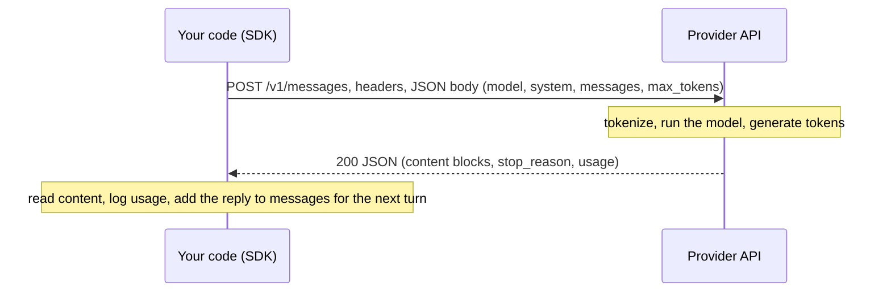

# Calling an LLM API

After this you can send a request to an LLM API from Python, read the response and its token usage, estimate the cost, and handle errors and rate limits without leaking your key.

Before this: [tokens, embeddings and context windows](../01-how-llms-work/02-tokens-embeddings-and-context-windows.md), [HTTP requests and responses](../../07-networking/02-web-protocols/01-http-requests-and-responses.md), [errors and exceptions](../../03-programming-fundamentals/01-python-basics/06-errors-and-exceptions.md) and [secrets and dependency security](../../12-security/01-web-security/06-secrets-and-dependency-security.md).

## The idea

Your app wants to summarize a support ticket. It does not run a model itself. It sends an HTTP request containing the text to a provider's server, the provider runs the model on its GPUs, and a JSON response comes back. The model is stateless: it remembers nothing between calls, so every request carries the whole conversation.



This lesson uses the Anthropic Messages API, because its shape (roles, content blocks, usage) is typical. OpenAI and Google differ in field names, not in the idea.

## Key terms

A **message** is one turn of the conversation: a `role` (`user` or `assistant`) and `content`. The **system prompt** is a separate field with standing instructions that apply to the whole conversation. `max_tokens` is a hard cap on how many tokens the model may generate in one response.

**Usage** is the token count the response reports: `input_tokens` and `output_tokens`. A provider bills per million tokens, with a separate price for input and for output. A **stop reason** says why generation ended: `end_turn` (finished), `max_tokens` (cut off), or `tool_use` (see [tool use](03-tool-use.md)).

**Streaming** sends the response in pieces as they are generated (server-sent events), so a user sees text immediately. A **rate limit** caps requests or tokens per minute; exceeding it returns HTTP 429.

## How it works

Facts as of 2026, from the [API overview](https://platform.claude.com/docs/en/api/overview), [versions](https://platform.claude.com/docs/en/api/versioning) and [models overview](https://platform.claude.com/docs/en/models/overview): the endpoint is `POST https://api.anthropic.com/v1/messages`. Each request needs an `Authorization: Bearer <key>` header (the older `x-api-key` header still works), an `anthropic-version` header (the latest is `2026-10-21`) and `content-type: application/json`. The SDK sets all of these for you. The current model IDs are `claude-fable-5-1`, `claude-opus-5-5`, `claude-sonnet-5-5` and `claude-haiku-5-5`; [choosing a model](../01-how-llms-work/05-choosing-a-model.md) covers which to pick. Since version `2026-10-21`, the sampling parameters `temperature`, `top_p` and `top_k` are removed and a request that sends them returns a 400.

Install the SDK with `pip install anthropic`, and keep the key in an environment variable. The SDK reads `ANTHROPIC_API_KEY` by itself, so the key never appears in your code or your Git history.

```bash
export ANTHROPIC_API_KEY="sk-ant-..."
```

In `app.py`:

```python
import anthropic

client = anthropic.Anthropic()          # reads ANTHROPIC_API_KEY
response = client.messages.create(
    model="claude-sonnet-5-5",
    max_tokens=500,
    system="You summarize support tickets in one sentence.",
    messages=[{"role": "user", "content": "Ticket: I was charged twice for order 1182."}],
)
print(response.content[0].text)
print(response.stop_reason, response.usage.input_tokens, response.usage.output_tokens)
```

This code is checked against the docs but not run against the live API (no key was available). The same request as raw HTTP, with the response shape the docs describe (also unverified live):

```bash
curl https://api.anthropic.com/v1/messages \
  -H "Authorization: Bearer $ANTHROPIC_API_KEY" \
  -H "anthropic-version: 2026-10-21" \
  -H "content-type: application/json" \
  -d '{"model": "claude-sonnet-5-5", "max_tokens": 500,
       "messages": [{"role": "user", "content": "Say hello."}]}'
```

```json
{"id": "msg_...", "type": "message", "role": "assistant", "model": "claude-sonnet-5-5",
 "content": [{"type": "text", "text": "Hello!"}],
 "stop_reason": "end_turn", "usage": {"input_tokens": 10, "output_tokens": 6}}
```

`content` is a list of blocks, not a string, because a reply can hold text and tool calls. Check `block.type == "text"` before reading `.text`. For long outputs, stream so the connection is not idle for minutes:

```python
with client.messages.stream(model="claude-sonnet-5-5", max_tokens=2000,
                            messages=[{"role": "user", "content": "Write a story."}]) as stream:
    for text in stream.text_stream:
        print(text, end="", flush=True)
```

**Errors.** The API returns JSON errors with a status code ([errors](https://platform.claude.com/docs/en/api/errors)): 400 bad request, 401 bad key, 403 no permission, 404 unknown model, 413 request too large, 429 rate limited, 500 server error, 529 overloaded. Retry 429, 500 and 529, with exponential backoff and random jitter so a crowd of clients does not retry in step. Never retry 400, 401 or 403; the same request will fail again. The SDK already retries connection errors, 408, 409, 429 and 5xx twice by default (`max_retries`), honouring `retry-after`.

## Worked examples

<div class="example" markdown>

### Example 1: what a request costs

Cost is tokens times price. A request with 12,000 input tokens (a long prompt with retrieved documents) and 800 output tokens, at the 2026 prices from the [models overview](https://platform.claude.com/docs/en/models/overview):

1. Divide each token count by 1,000,000.
2. Multiply by that model's input and output price per million tokens.
3. Add the two.

<details class="code" markdown>
<summary>In code</summary>

```python
# dollars per million tokens (input, output), as of 2026
PRICES = {
    "claude-haiku-5-5": (0.10, 0.50),
    "claude-sonnet-5-5": (2.00, 10.00),
    "claude-opus-5-5": (4.00, 20.00),
    "claude-fable-5-1": (10.00, 50.00),
}

def cost(model, input_tokens, output_tokens):
    price_in, price_out = PRICES[model]
    return (input_tokens * price_in + output_tokens * price_out) / 1_000_000

for model in PRICES:
    print(f"{model:18} ${cost(model, 12_000, 800):.4f} per request, ${1000 * cost(model, 12_000, 800):,.2f} per 1,000 requests")
```

```text
claude-haiku-5-5   $0.0016 per request, $1.60 per 1,000 requests
claude-sonnet-5-5  $0.0320 per request, $32.00 per 1,000 requests
claude-opus-5-5    $0.0640 per request, $64.00 per 1,000 requests
claude-fable-5-1   $0.1600 per request, $160.00 per 1,000 requests
```

</details>

Check: Sonnet is 12,000 x 2 / 1e6 = \$0.024 for input plus 800 x 10 / 1e6 = \$0.008 for output, which is \$0.032. The price spread between models is 100 times, so model choice and prompt length are your main cost levers. Haiku 5.5's listed price is a "from" price (higher above 100K prompt tokens), and prompt caching and batch requests change the rates; see [pricing](https://platform.claude.com/docs/en/about-claude/pricing).

</div>

<div class="example" markdown>

### Example 2: retry with backoff and jitter

If you write your own retry (the SDK already has one), retry only the retryable statuses and wait a random time up to a doubling cap.

<details class="code" markdown>
<summary>In code</summary>

```python
import random
import time

RETRYABLE = {429, 500, 529}

class ApiError(Exception):
    def __init__(self, status):
        super().__init__(f"HTTP {status}")
        self.status = status

def with_backoff(call, max_attempts=5, base=0.5, cap=30.0):
    for attempt in range(max_attempts):
        try:
            return call()
        except ApiError as e:
            if e.status not in RETRYABLE or attempt == max_attempts - 1:
                raise
            delay = random.uniform(0, min(cap, base * 2 ** attempt))  # full jitter
            print(f"attempt {attempt + 1} failed with {e}, waiting up to {min(cap, base * 2 ** attempt):.1f}s")
            time.sleep(delay / 100)  # shortened so this demo runs fast

results = iter([529, 429, "ok"])
def flaky():
    r = next(results)
    if r == "ok":
        return "ok"
    raise ApiError(r)

print(with_backoff(flaky))
try:
    with_backoff(lambda: (_ for _ in ()).throw(ApiError(400)))
except ApiError as e:
    print("not retried:", e)
```

```text
attempt 1 failed with HTTP 529, waiting up to 0.5s
attempt 2 failed with HTTP 429, waiting up to 1.0s
ok
not retried: HTTP 400
```

</details>

</div>

## Common mistakes

<div class="warning" markdown>

Watch out: putting the key in source code or a front-end bundle. Anyone who finds it spends your money. Keep it in an environment variable on a server, never commit `.env` files, and call the API from your back end, not from the browser.

Watch out: ignoring `stop_reason`. A reply cut off at `max_tokens` looks like a complete answer. Check for `end_turn`, and raise `max_tokens` or stream if it is `max_tokens`.

Watch out: assuming the model remembers. Each request must resend the earlier messages, and the bill grows with the history.

</div>

## Working with AI

<div class="ai" markdown>

Words to use: Messages API, system prompt, `max_tokens`, stop reason, usage, streaming, exponential backoff with jitter, 429.

Prompts to try:

- "Using the `anthropic` Python SDK, write a function that sends a conversation list to `claude-sonnet-5-5`, retries on 429 and 529 only, and logs `usage` for each call. Cite the docs page for each parameter."
- "My request returns 400 after I added `temperature=0.2` to a Claude call with `anthropic-version: 2026-10-21`. Explain why and what to use instead."

What to check:

- Invented parameters or old model IDs. Compare every field and model name with the current [Messages API docs](https://platform.claude.com/docs/en/api/messages/create) and models overview.
- Keys written into code, or a retry loop that retries 400 and 401. Search for `sk-` and read the `except` branches.
- Cost claims with no arithmetic. Recompute from `usage` and the price table, as in Example 1.

</div>

## Quiz

1\. Why does every request include the earlier messages?

<details class="solution" markdown>
<summary>Answer</summary>

The API is stateless. The model only sees what is in the request, so your code stores the history and resends it.

</details>

2\. Predict the cost: 50,000 input tokens and 2,000 output tokens on `claude-opus-5-5` (\$4 and \$20 per million).

<details class="solution" markdown>
<summary>Answer</summary>

Input: 50,000 x 4 / 1e6 = \$0.20. Output: 2,000 x 20 / 1e6 = \$0.04. Total \$0.24.

</details>

3\. Your code retries every failed call five times with no delay, and during an outage the provider rate-limits you harder. What is wrong?

<details class="solution" markdown>
<summary>Answer</summary>

Immediate retries add load and fall into step with other clients. Use exponential backoff with jitter, honour `retry-after`, and retry only 429, 500 and 529.

</details>

4\. A response ends with `stop_reason: "max_tokens"` in the middle of a JSON object. What do you do?

<details class="solution" markdown>
<summary>Answer</summary>

The output was truncated, so do not parse it. Raise `max_tokens` (and stream if it is large), or ask for a shorter output, then retry.

</details>

## Lab

<div class="lab" markdown>

### Lab: call a fake API and watch the SDK retry

Goal: see the real request the SDK builds, and its automatic retry, without a key or any cost. Time: about 15 minutes. Runs in: any terminal with Python 3.10 or later.

1. Create a virtual environment and run `pip install anthropic`.
2. Save the solution script as `fake_api.py`. It starts a local server that answers the first request with 529 and the second with a valid Messages response.
3. Run `python fake_api.py`. Note how many requests the server saw and which headers the SDK sent.
4. Change the client to `anthropic.Anthropic(..., max_retries=0)` and run again. Predict what happens first.
5. Cleanup: delete the script and the virtual environment.

Expected result: two requests, the path `/v1/messages`, the version header, and the text of the fake reply. With `max_retries=0` the first 529 raises `anthropic.OverloadedError`.

<details class="solution" markdown>
<summary>Solution</summary>

```python
import json
import threading
from http.server import BaseHTTPRequestHandler, HTTPServer

import anthropic

calls = []

class Handler(BaseHTTPRequestHandler):
    def do_POST(self):
        body = json.loads(self.rfile.read(int(self.headers["content-length"])))
        calls.append(1)
        if len(calls) == 1:  # first call fails with 529, the SDK should retry
            self.send_response(529)
            self.send_header("content-type", "application/json")
            self.end_headers()
            self.wfile.write(json.dumps({"type": "error", "error": {"type": "overloaded_error", "message": "Overloaded"}}).encode())
            return
        print("path:", self.path)
        print("anthropic-version:", self.headers["anthropic-version"])
        print("headers:", sorted(k.lower() for k in self.headers)[:4], "...")
        print("body keys:", sorted(body))
        reply = {"id": "msg_fake", "type": "message", "role": "assistant", "model": body["model"],
                 "content": [{"type": "text", "text": "Hello from a fake server."}],
                 "stop_reason": "end_turn", "stop_sequence": None,
                 "usage": {"input_tokens": 12, "output_tokens": 7}}
        self.send_response(200)
        self.send_header("content-type", "application/json")
        self.end_headers()
        self.wfile.write(json.dumps(reply).encode())

    def log_message(self, *a):
        pass

server = HTTPServer(("127.0.0.1", 0), Handler)
threading.Thread(target=server.serve_forever, daemon=True).start()

client = anthropic.Anthropic(api_key="test-key", base_url=f"http://127.0.0.1:{server.server_port}")
msg = client.messages.create(
    model="claude-sonnet-5-5",
    max_tokens=200,
    system="Answer in one sentence.",
    messages=[{"role": "user", "content": "Say hello."}],
)
print("requests the server saw:", len(calls))
print(msg.content[0].text, msg.stop_reason, msg.usage.input_tokens, msg.usage.output_tokens)
```

```text
path: /v1/messages
anthropic-version: 2026-10-21
headers: ['accept', 'accept-encoding', 'anthropic-version', 'authorization'] ...
body keys: ['max_tokens', 'messages', 'model', 'system']
requests the server saw: 2
Hello from a fake server. end_turn 12 7
```

This output is from `anthropic` 2.3.0. The SDK sent the key in an `authorization` header, matching the docs.

</details>

</div>

## Where this shows up

- [Prompt and context engineering](02-prompt-and-context-engineering.md) is what goes into `system` and `messages`.
- [Tool use](03-tool-use.md) adds `tools` and the `tool_use` stop reason; [evals](07-evals.md) call the API in a loop and track cost.
- Rate limits and backoff are the same ideas as in [rate limiting and API gateways](../../14-software-and-system-design/02-system-design/07-rate-limiting-and-api-gateways.md).
