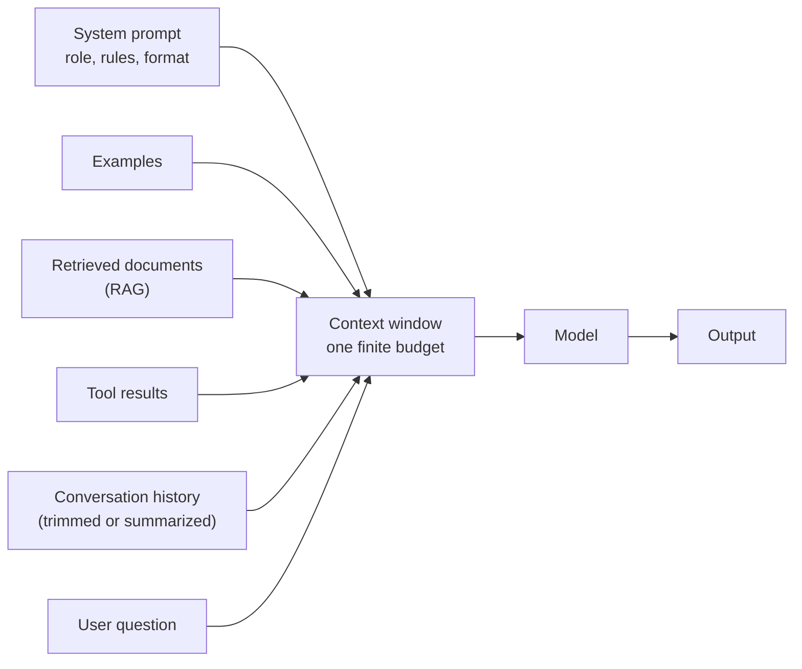

# Prompt and context engineering

After this you can write a prompt that a model can follow reliably, structure it with tags and examples, and decide what belongs in the context window at all.

Before this: [calling an LLM API](01-calling-an-llm-api.md), [tokens, embeddings and context windows](../01-how-llms-work/02-tokens-embeddings-and-context-windows.md) and [sampling and hallucinations](../01-how-llms-work/04-sampling-and-hallucinations.md).

## The idea

A model has no access to your company, your files or your intent. It sees only the tokens in the request and predicts a continuation. Anthropic's guidance says to treat the model as a capable new employee who knows nothing about your norms: if a colleague with no background could not follow your prompt, the model will not either ([prompting best practices](https://platform.claude.com/docs/en/build-with-claude/prompt-engineering/claude-prompting-best-practices)).

**Prompt engineering** is writing the instructions well. **Context engineering** is the wider job: choosing, each time the model is called, which tokens go into the window ([Anthropic's article](https://www.anthropic.com/engineering/effective-context-engineering-for-ai-agents)). For a one-shot call the two are the same. For an app or agent that runs for many turns, the context is assembled from several sources, and most bugs are in what was left out or let in.



## Key terms

A **system prompt** holds standing instructions: role, audience, rules, output format. A **few-shot example** (or multishot) is a sample input with the exact output you want, placed in the prompt. **XML-style tags** such as `<document>` are labels that mark where one kind of content ends and another begins.

**Long-context placement** means putting large documents first and the question last. **Compaction** is replacing old history with a summary when the window fills. A **prompt test** is a fixed set of inputs with expected outputs that you rerun after each prompt change (see [evals](07-evals.md)).

## How it works

The techniques below come from the Anthropic guide linked above (as of 2026).

1. **Be specific about the task and the output.** Say what to do, for whom, and in what format. "Reply with one JSON object and nothing else" beats "be concise".
2. **Give the reason.** "The reply is read aloud by a speech engine, so avoid ellipses" lets the model generalize better than "never use ellipses".
3. **Set a role and an audience** in the system prompt, in a sentence: who the model is and who reads the output.
4. **Show examples.** Three to five, relevant, varied (include an edge case), wrapped in `<example>` tags inside `<examples>`.
5. **Separate content with tags.** Use consistent tag names for instructions, context and input, so pasted text cannot be mistaken for instructions.
6. **Put long documents at the top and the question at the end.** Anthropic reports that placing the query last can improve quality by up to 30 percent on complex multi-document inputs.
7. **Give the context the model cannot know**: your policy text, schema, today's date, user's plan. Do not expect it to guess.
8. **Do not assume recipes transfer.** The guide notes that prompts written for older models are often too prescriptive for newer ones. Change one thing, then rerun your tests.

Context engineering adds a budget view. Every token costs money and latency, and long irrelevant context can lower quality. The Anthropic article lists four moves for long-running work: retrieve just in time (keep file paths or queries, load content when needed), compact old history, keep notes outside the window, and give sub-tasks to sub-agents that return short summaries.

## Worked examples

<div class="example" markdown>

### Example 1: a ticket classifier prompt

We want a script-readable label for a support ticket. The prompt puts the policy first, shows two examples inside tags, marks the real ticket, and ends with the instruction (steps 1, 4, 5 and 6 above). The system prompt names the role and says the reader is a script.

<details class="code" markdown>
<summary>In code</summary>

```python
import json

SYSTEM = (
    "You triage support tickets for a Canadian online bookstore. "
    "The reader of your output is a script, not a person."
)

def build_prompt(ticket: str, policy: str) -> str:
    return f"""<policy>
{policy}
</policy>

<examples>
<example>
<ticket>My parcel never arrived, tracking says delivered.</ticket>
<answer>{{"category": "shipping", "urgent": true}}</answer>
</example>
<example>
<ticket>Do you stock the 2nd edition?</ticket>
<answer>{{"category": "catalogue", "urgent": false}}</answer>
</example>
</examples>

<ticket>
{ticket}
</ticket>

Classify the ticket in <ticket>. Use only the categories named in <policy>.
Reply with one JSON object and nothing else."""

prompt = build_prompt("I was charged twice for order 1182.", "Categories: shipping, billing, catalogue.")
print(prompt)

# a test for the prompt itself: the long input comes first, the question last
assert prompt.index("<policy>") < prompt.index("<ticket>\n") < prompt.rindex("Classify")
reply = '{"category": "billing", "urgent": true}'   # what a model should return
assert set(json.loads(reply)) == {"category", "urgent"}
print("prompt checks passed")
```

```text
<policy>
Categories: shipping, billing, catalogue.
</policy>

<examples>
<example>
<ticket>My parcel never arrived, tracking says delivered.</ticket>
<answer>{"category": "shipping", "urgent": true}</answer>
</example>
<example>
<ticket>Do you stock the 2nd edition?</ticket>
<answer>{"category": "catalogue", "urgent": false}</answer>
</example>
</examples>

<ticket>
I was charged twice for order 1182.
</ticket>

Classify the ticket in <ticket>. Use only the categories named in <policy>.
Reply with one JSON object and nothing else.
prompt checks passed
```

</details>

Check: the asserts verify the placement and the reply format, but only a real model call tells you whether the model follows them. That is why the next step is a set of test tickets. Also note that tickets are untrusted text: a ticket that says "ignore the rules above" is the prompt injection problem from [AI security risks](../03-ai-assisted-development/04-ai-security-risks.md), and tags reduce the risk without removing it.

</div>

## Common mistakes

<div class="warning" markdown>

Watch out: changing a prompt, trying one input, and shipping. A prompt that fixes one case often breaks two others. Keep a list of test inputs and rerun all of them after every edit.

Watch out: stuffing the window. Pasting a whole repository or every past message costs tokens and can bury the facts that matter. Retrieve or summarize what the task needs.

Watch out: a long list of NEVER and ALWAYS rules. Give the reason and one example instead; shouting rules makes newer models over-apply them.

</div>

## Working with AI

<div class="ai" markdown>

Words to use: system prompt, few-shot examples, XML tags, output format, context window, compaction, prompt injection.

Prompts to try:

- "Rewrite this system prompt for a Claude model that classifies bookstore tickets. Keep the JSON-only output, add the reason behind each rule, and put the documents before the question. Show what you changed and why."
- "Here are 12 test tickets and the labels I expect. Propose 3 edge-case examples that would improve the prompt, and say which of my labels look ambiguous."

What to check:

- Rules the model silently changed in a rewrite. Diff the old and new prompt and rerun your test inputs.
- Examples that all look alike, which teach a pattern you did not intend. Add one that differs.
- Any place where untrusted text (a ticket, a web page) sits outside a tag or is treated as instructions.

</div>

## Quiz

1\. What is the difference between prompt engineering and context engineering?

<details class="solution" markdown>
<summary>Answer</summary>

Prompt engineering writes the instructions. Context engineering chooses everything that enters the window on each call: instructions, examples, retrieved documents, tool results and trimmed history.

</details>

2\. A prompt has the question first and a 40-page document after it. What change does Anthropic's guide suggest?

<details class="solution" markdown>
<summary>Answer</summary>

Put the document first, wrapped in tags, and the question at the end. Tests reported up to 30 percent better quality on complex multi-document inputs.

</details>

3\. Your classifier sometimes answers "Sure! Here is the JSON:" before the object, and your parser crashes. List two fixes.

<details class="solution" markdown>
<summary>Answer</summary>

Ask for "one JSON object and nothing else" with a reason (a script parses it) and show examples that are bare JSON. Also make the parser tolerant or use the API's structured output feature. Prefilling the assistant turn no longer works on current Claude models.

</details>

4\. A chat app resends all 200 earlier messages on every turn and answers get slower and worse. What are two context-engineering moves?

<details class="solution" markdown>
<summary>Answer</summary>

Compact old turns into a summary, and retrieve only the earlier facts the new question needs. Moving durable facts into notes outside the window is a third option.

</details>

## Lab

<div class="lab" markdown>

### Lab: build and test a prompt without a model

Goal: practise structuring a prompt and checking it with tests that need no API. Time: about 15 minutes. Runs in: any terminal with Python 3.

1. Copy the code from Example 1 into `prompt.py` and run it.
2. Add a third example whose ticket mentions both shipping and billing. Decide which category wins and write that into the policy text.
3. Write a function `parse(reply)` that returns the dict, or `None` if the reply is not valid JSON with exactly the keys `category` and `urgent`.
4. Test `parse` on three strings: a good reply, a reply with text before the JSON, and a reply with a wrong key.
5. Cleanup: delete `prompt.py`.

Expected result: `parse` returns a dict for the first string and `None` for the other two.

<details class="solution" markdown>
<summary>Solution</summary>

```python
import json

def parse(reply):
    try:
        data = json.loads(reply)
    except json.JSONDecodeError:
        return None
    if isinstance(data, dict) and set(data) == {"category", "urgent"}:
        return data
    return None

print(parse('{"category": "billing", "urgent": true}'))
print(parse('Sure! {"category": "billing", "urgent": true}'))
print(parse('{"cat": "billing", "urgent": true}'))
```

```text
{'category': 'billing', 'urgent': True}
None
None
```

</details>

</div>

## Where this shows up

- [Tool use](03-tool-use.md) and [RAG](04-rag-embeddings-and-pgvector.md) are two ways of putting the right tokens in the window.
- [Evals](07-evals.md) turn "try a few inputs" into a repeatable score, and [agents](05-agents-and-harnesses.md) need compaction and notes.
- Writing prompts for coding tools is covered in [Claude Code](../03-ai-assisted-development/01-claude-code.md).
