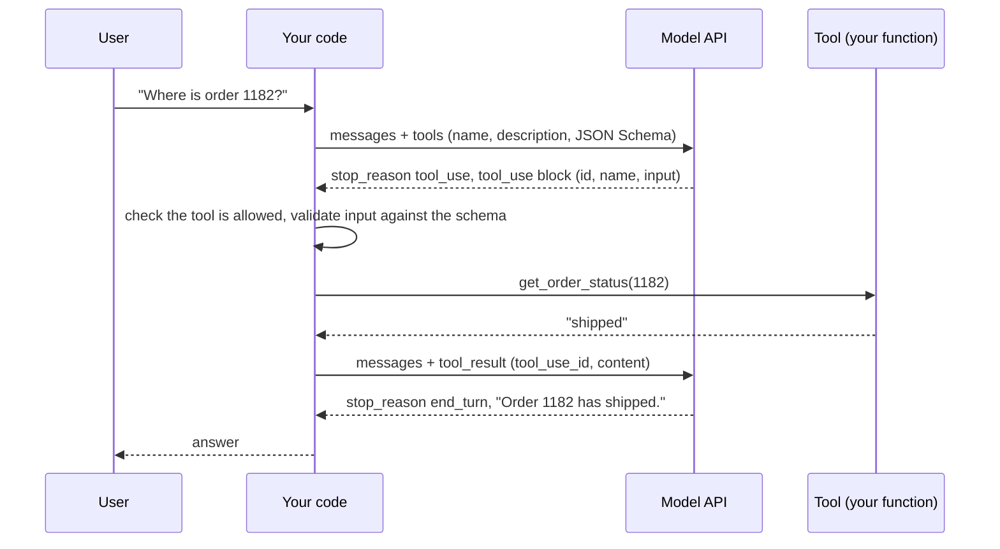

# Tool use

After this you can define a tool for an LLM, run the tool-use loop in your own code, and validate what the model asks for before you act on it.

Before this: [calling an LLM API](01-calling-an-llm-api.md), [prompt and context engineering](02-prompt-and-context-engineering.md) and [validation and error handling](../../09-back-end/01-servers-and-apis/05-validation-and-error-handling.md).

## The idea

A model alone cannot look up order 1182 in your database. It can only produce text. **Tool use** (also called function calling) closes the gap: you describe functions to the model, and when it needs one, it replies with a structured request to call it. Your code runs the function and sends back the result. The model never executes anything itself; it asks, and you decide.



## Key terms

A **tool definition** has a `name`, a `description` and an `input_schema` written in **JSON Schema**, a standard vocabulary for describing the shape of JSON (types, required fields, ranges). A **tool_use block** is the model's request: an `id`, the tool `name`, and an `input` object. A **tool_result block** is your reply, carrying the same id in `tool_use_id`, plus `content` and an optional `is_error` flag.

The **tool-use loop** repeats: call the model, and while `stop_reason` is `tool_use`, run the tools and call again. **Parallel tool calls** are several `tool_use` blocks in one response. **Client tools** run in your code. **Server tools** (such as web search) run on the provider's side.

## How it works

Facts as of 2026 from the [tool use docs](https://platform.claude.com/docs/en/agents-and-tools/tool-use/overview).

1. Send `tools` along with `messages`. The description matters most: say what the tool does, when to use it, and what it does not do. The model chooses a tool from the text.
2. If the response has `stop_reason: "tool_use"`, append the whole assistant response to `messages`.
3. For each `tool_use` block, run the tool and build a `tool_result` with the matching `tool_use_id`.
4. Send all the results for that turn in one `user` message. Splitting them across messages teaches the model to stop calling tools in parallel.
5. Call the API again. Stop when `stop_reason` is `end_turn`, or after a turn limit you set.

Newer Claude models (Opus 5.5, Sonnet 5.5, Fable 5.1) no longer accept `tool_choice` set to `any` or a named `tool`; use the default `auto` and say in the prompt which tool to use. Adding `strict: true` to a tool definition makes the model's arguments match the schema exactly. The Python SDK also has a beta tool runner that implements the loop for you; writing the loop once by hand shows what it does.

The most important rule is on your side: the model's output is untrusted input. It can pick a tool you did not offer, send a string where you need an integer, or be steered by text inside a document it read. So the handler allows only named tools, validates every argument, and limits what each tool can do.

## Worked examples

<div class="example" markdown>

### Example 1: the loop with a fake model

We replace the API with a function that asks for three tool calls: a valid one, one with a string instead of an integer, and one for a tool we never defined. This runs with no key. The real calls follow the same shape.

1. `run_tool` rejects names not in `HANDLERS`.
2. `validate` (the `jsonschema` package, `pip install jsonschema`) checks the arguments against the schema.
3. Failures return `is_error: true` with a message, so the model can correct itself.
4. The loop is capped at 5 turns, and all results go back in one message.

<details class="code" markdown>
<summary>In code</summary>

```python
import json
from jsonschema import ValidationError, validate

TOOLS = [{
    "name": "get_order_status",
    "description": "Look up the status of one order by its numeric id. Read-only.",
    "input_schema": {
        "type": "object",
        "properties": {"order_id": {"type": "integer", "minimum": 1}},
        "required": ["order_id"],
        "additionalProperties": False,
    },
}]
SCHEMAS = {t["name"]: t["input_schema"] for t in TOOLS}
ORDERS = {1182: "shipped", 1183: "processing"}
HANDLERS = {"get_order_status": lambda a: ORDERS.get(a["order_id"], "unknown order")}

def fake_model(messages):
    """Stands in for the API. Asks for two tool calls, then answers from the results."""
    last = messages[-1]["content"]
    if isinstance(last, str):
        return {"stop_reason": "tool_use", "content": [
            {"type": "tool_use", "id": "toolu_1", "name": "get_order_status", "input": {"order_id": 1182}},
            {"type": "tool_use", "id": "toolu_2", "name": "get_order_status", "input": {"order_id": "1183"}},  # wrong type
            {"type": "tool_use", "id": "toolu_3", "name": "delete_order", "input": {"order_id": 1}},          # not offered
        ]}
    texts = [f'{b["tool_use_id"]}: {b["content"]}' for b in last]
    return {"stop_reason": "end_turn", "content": [{"type": "text", "text": " | ".join(texts)}]}

def run_tool(block):
    name, args = block["name"], block["input"]
    if name not in HANDLERS:                       # allowlist: only tools we defined
        return {"is_error": True, "content": f"Unknown tool {name}"}
    try:
        validate(args, SCHEMAS[name])              # never trust model-made arguments
    except ValidationError as e:
        return {"is_error": True, "content": f"Invalid arguments: {e.message}"}
    return {"is_error": False, "content": str(HANDLERS[name](args))}

messages = [{"role": "user", "content": "Where are orders 1182 and 1183?"}]
for turn in range(5):                              # hard cap on loop turns
    reply = fake_model(messages)
    messages.append({"role": "assistant", "content": reply["content"]})
    if reply["stop_reason"] != "tool_use":
        print("final:", reply["content"][0]["text"])
        break
    results = []
    for block in reply["content"]:
        if block["type"] == "tool_use":
            out = run_tool(block)
            results.append({"type": "tool_result", "tool_use_id": block["id"], **out})
    messages.append({"role": "user", "content": results})   # all results in ONE user message
```

```text
final: toolu_1: shipped | toolu_2: Invalid arguments: '1183' is not of type 'integer' | toolu_3: Unknown tool delete_order
```

</details>

Check: only the first call ran. The two bad calls came back as errors instead of crashing or doing something. With the real API, the code is the same except that `fake_model` becomes `client.messages.create(model=..., tools=TOOLS, messages=messages, max_tokens=...)` and the blocks are SDK objects with attributes (`block.name`, `block.input`) instead of dicts. That swap is unverified here because no key was available.

</div>

## Common mistakes

<div class="warning" markdown>

Watch out: giving the model a tool that can do anything, such as `run_sql(query)` or `run_shell(cmd)` with write access. A wrong guess or an injected instruction becomes a deleted table. Give narrow tools (`get_order_status(order_id)`), use a read-only database role, and require human approval for anything that writes, spends or sends.

Watch out: trusting the arguments because the schema was in the prompt. The model usually follows it, not always. Validate on every call, and check permissions in your code (does this user own order 1182?), not in the prompt.

Watch out: vague descriptions. "Gets data" gives the model nothing to choose with. State what the tool returns, when to use it, and its limits.

</div>

## Working with AI

<div class="ai" markdown>

Words to use: tool definition, JSON Schema, `tool_use`, `tool_result`, tool-use loop, parallel tool calls, allowlist, least privilege.

Prompts to try:

- "Write a Python tool-use loop for the `anthropic` SDK with one tool, `get_order_status`. Validate `tool_use.input` with `jsonschema`, return `is_error: true` on failure, cap the loop at 5 turns, and send all `tool_result` blocks in one user message."
- "Review this tool list for least privilege. For each tool say what the worst call could do, and which ones should need user approval."

What to check:

- Invented SDK names or `tool_choice` settings that current models reject (`any`, a named tool). Compare with the [tool use docs](https://platform.claude.com/docs/en/agents-and-tools/tool-use/overview).
- A loop with no turn cap, or one that drops `tool_result` blocks when a tool fails.
- Tools that build SQL or shell commands from model text. Look for string concatenation; the fix is parameterized queries as in [injection and input validation](../../12-security/01-web-security/03-injection-and-input-validation.md).

</div>

## Quiz

1\. Who executes the function when a model "calls a tool"?

<details class="solution" markdown>
<summary>Answer</summary>

Your code does (for client tools). The model returns a structured request; you run the function and send back a `tool_result`.

</details>

2\. Predict what the loop in Example 1 sends back for `toolu_3`.

<details class="solution" markdown>
<summary>Answer</summary>

A `tool_result` with `tool_use_id: "toolu_3"`, `is_error: true` and the content `Unknown tool delete_order`, because that name is not in `HANDLERS`.

</details>

3\. The model sends `{"order_id": "1183"}` and your code passes it straight to a SQL string. What are two problems?

<details class="solution" markdown>
<summary>Answer</summary>

The type is wrong for your schema (a string, not an integer), and building SQL from model text allows injection. Validate against the schema and use a parameterized query.

</details>

4\. A response contains two `tool_use` blocks. How do you reply?

<details class="solution" markdown>
<summary>Answer</summary>

Run both, then send one `user` message that contains two `tool_result` blocks, each with its own `tool_use_id`.

</details>

## Lab

<div class="lab" markdown>

### Lab: add a second tool and a permission check

Goal: extend the loop with a tool that needs approval. Time: about 15 minutes. Runs in: any terminal with Python 3 and `pip install jsonschema`.

1. Save the Example 1 code as `tools.py` and run it.
2. Add a tool `cancel_order(order_id)` with a schema, a handler that removes the order from `ORDERS`, and a set `NEEDS_APPROVAL = {"cancel_order"}`.
3. In `run_tool`, if the tool needs approval, ask with `input()` and return `is_error: true` with "denied by user" on anything other than `y`.
4. Change `fake_model` so one call is `cancel_order` for 1183. Run, answer `n`, and confirm 1183 is still in `ORDERS`.
5. Cleanup: delete `tools.py`.

Expected result: the cancel call returns "denied by user" and `ORDERS` is unchanged.

<details class="solution" markdown>
<summary>Solution</summary>

The changes to the code above:

```python
NEEDS_APPROVAL = {"cancel_order"}
HANDLERS["cancel_order"] = lambda a: "cancelled" if ORDERS.pop(a["order_id"], None) else "unknown order"
SCHEMAS["cancel_order"] = SCHEMAS["get_order_status"]

# in run_tool, after validate(...) succeeds:
if name in NEEDS_APPROVAL and input(f"Allow {name}({args})? [y/N] ").strip().lower() != "y":
    return {"is_error": True, "content": "denied by user"}
```

The approval check sits in your code, after validation and before the handler. A prompt that says "ask before cancelling" is not a control, because the model can ignore it.

</details>

</div>

## Where this shows up

- [RAG](04-rag-embeddings-and-pgvector.md) can be a tool the model calls (`search_docs`), and [agents](05-agents-and-harnesses.md) are this loop with more tools and more turns.
- [MCP](06-mcp.md) standardizes how tools are described and shared between apps.
- Tool arguments are one of the main [AI security risks](../03-ai-assisted-development/04-ai-security-risks.md).
