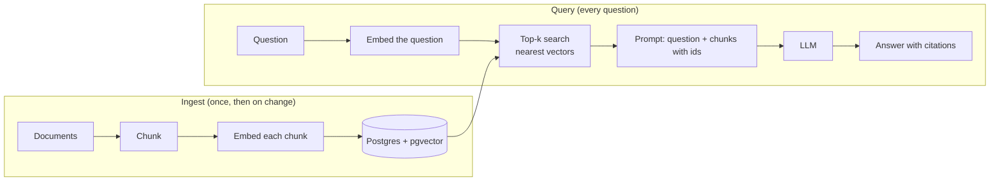

# RAG embeddings and pgvector

After this you can explain how retrieval-augmented generation works, chunk and embed documents, store and search vectors in Postgres with pgvector, and measure whether retrieval works.

Before this: [tokens, embeddings and context windows](../01-how-llms-work/02-tokens-embeddings-and-context-windows.md), [prompt and context engineering](02-prompt-and-context-engineering.md), [indexes](../../10-databases-sql-and-postgres/04-postgres-in-depth/01-indexes.md) and [JSONB and full-text search](../../10-databases-sql-and-postgres/04-postgres-in-depth/07-jsonb-and-full-text-search.md).

## The idea

A model does not know your return policy, and pasting all 400 pages of your docs into every request is slow and costly. **Retrieval-augmented generation** (RAG) fetches only the few passages relevant to the question and puts them in the prompt. The model answers from those passages and can point to them as sources.



In the diagram, the left box runs ahead of time, and the right box runs on every question. The two embed steps must use the same embedding model.

## Key terms

A **chunk** is a passage of a document, small enough to embed and to fit several in a prompt. An **embedding** is a list of numbers (a vector) that represents the meaning of a text, so texts with similar meaning have nearby vectors; the previous chapter explained how they are made. An **embedding model** is the model that produces them.

**Cosine distance** between two vectors is 1 minus the cosine of the angle between them: 0 for the same direction, 1 for unrelated, 2 for opposite. **Top-k** means the k nearest chunks. **pgvector** is a Postgres extension that adds a `vector` column type, distance operators and approximate nearest-neighbour indexes. **HNSW** is such an index (a layered graph of vectors): fast, approximate, and trades some recall for speed.

**Hybrid search** combines vector search (matches meaning) with full-text search (matches exact words such as product codes), and merges the two ranked lists. A **citation** is the id of the chunk a claim came from.

## How it works

**Chunking.** Split by structure first (headings, paragraphs), then cap the size, with a little overlap so a sentence cut at a boundary survives in one chunk. Typical sizes run from a few hundred to about a thousand tokens; the right size depends on your documents, so test it. Store the source and position with each chunk.

**Embedding.** Anthropic does not offer an embedding model; its docs point to Voyage AI, with models such as `voyage-4` returning 1024 dimensions by default ([embeddings docs](https://platform.claude.com/docs/en/build-with-claude/embeddings), as of 2026). Pass `input_type="document"` when embedding chunks and `"query"` for questions. Other providers and open-weight models also work. Never mix vectors from different models in one column.

**Storing and searching in Postgres.** These statements follow the [pgvector README](https://github.com/pgvector/pgvector) (version 0.8.7 when checked, 2026). They are not run here: the PGlite build used for this book's SQL checks does not include pgvector.

```sql
CREATE EXTENSION vector;

CREATE TABLE chunks (
    id        bigserial PRIMARY KEY,
    source    text NOT NULL,
    body      text NOT NULL,
    embedding vector(1024) NOT NULL
);

CREATE INDEX ON chunks USING hnsw (embedding vector_cosine_ops);
```

`vector(1024)` fixes the dimension; it must equal the model's output size. The operator `<=>` is cosine distance (`<->` is Euclidean, `<#>` negative inner product). The query vector arrives as a parameter, written as text like `'[0.12, -0.03, ...]'`:

```sql
SELECT id, source, body, embedding <=> $1 AS distance
FROM chunks
ORDER BY embedding <=> $1
LIMIT 5;
```

The `ORDER BY ... LIMIT` form lets Postgres use the HNSW index, and the operator must match the index's operator class (`vector_cosine_ops` with `<=>`). `SET hnsw.ef_search = 100;` raises recall at some cost in speed (default 40). pgvector indexes up to 2,000 dimensions for `vector`.

**Hybrid search.** Run the keyword search from the full-text lesson and the vector search, then merge with reciprocal rank fusion (RRF): each list gives a chunk the score $1/(60 + \text{rank})$, and the scores add. A chunk ranked well by both wins.

**Prompting.** Put each chunk in a tagged block with its id (see the previous lesson), the question last, and ask the model to answer only from the sources, cite ids, and say "not found" when the sources do not contain the answer.

## Worked examples

<div class="example" markdown>

### Example 1: chunk, embed, retrieve, evaluate

This runs locally. The "embedding" is a stand-in (word counts), so the numbers differ from a real model, but the pipeline is the real one: chunk, vectorize, rank by cosine, build a cited source block, then score retrieval with hit@1 (the share of test questions whose correct chunk came back first).

<details class="code" markdown>
<summary>In code</summary>

```python
import math
import re
from collections import Counter

DOC = """Refunds. You can return a book within 30 days of delivery for a full refund.
Opened shrink-wrapped items are not refundable.

Shipping. Orders ship within 2 business days. Delivery inside Ontario takes 3 to 5 days.

Gift cards. Gift cards never expire and cannot be exchanged for cash."""

def chunk(text, max_words=25, overlap=5):
    """Split on blank lines first, then cut long pieces into overlapping word windows."""
    chunks = []
    for para in text.split("\n\n"):
        words = para.split()
        step = max_words - overlap
        for i in range(0, max(len(words) - overlap, 1), step):
            chunks.append(" ".join(words[i:i + max_words]))
    return chunks

def embed(text):
    """Stand-in for an embedding model: word counts. A real model returns ~1000 floats."""
    return Counter(re.findall(r"[a-z]+", text.lower()))

def cosine(a, b):
    dot = sum(a[w] * b[w] for w in a)
    na = math.sqrt(sum(v * v for v in a.values()))
    nb = math.sqrt(sum(v * v for v in b.values()))
    return dot / (na * nb)

chunks = chunk(DOC)
vectors = [embed(c) for c in chunks]

def retrieve(question, k=1):
    q = embed(question)
    scored = sorted(((cosine(q, v), i) for i, v in enumerate(vectors)), reverse=True)
    return [(i, round(s, 2)) for s, i in scored[:k]]

question = "Can I get a refund on a book I returned?"
(best, score), = retrieve(question)
print(f"chunk {best} scored {score}")
print(f'<source id="{best}">{chunks[best]}</source>')

# evaluating retrieval: for each test question, did the right chunk come back first?
tests = [(question, 0), ("How long does delivery take in Ontario?", 1), ("Do gift cards expire?", 2)]
hits = sum(retrieve(q)[0][0] == want for q, want in tests)
print(f"hit@1 = {hits}/{len(tests)}")
```

```text
chunk 0 scored 0.39
<source id="0">Refunds. You can return a book within 30 days of delivery for a full refund. Opened shrink-wrapped items are not refundable.</source>
hit@1 = 3/3
```

</details>

Check: pgvector's `<=>` returns `1 - similarity`, so the distance for the best chunk here would be 0.61. Three questions is far too few to trust; a real retrieval test set has dozens of questions, written by people, including ones whose answer is not in the documents.

</div>

<div class="example" markdown>

### Example 2: merging two ranked lists with RRF

Keyword search ranked chunks 7, 3, 9; vector search ranked 3, 5, 7. RRF with constant 60 gives chunk 3 the top score, since both lists rank it high. This query runs on the shop database as pure SQL; in production the two CTEs are the full-text query and the `<=>` query.

<!-- db: shop -->
```sql
WITH keyword(id, rnk) AS (VALUES (7, 1), (3, 2), (9, 3)),
     semantic(id, rnk) AS (VALUES (3, 1), (5, 2), (7, 3))
SELECT id, round(sum(1.0 / (60 + rnk)), 4) AS rrf_score
FROM (SELECT * FROM keyword UNION ALL SELECT * FROM semantic) AS ranked
GROUP BY id
ORDER BY rrf_score DESC, id;
```

Check: chunk 3 scores $1/62 + 1/61 = 0.0325$, chunk 7 scores $1/61 + 1/63 = 0.0323$, and chunks 5 and 9 trail with a single appearance.

</div>

## Common mistakes

<div class="warning" markdown>

Watch out: blaming the model for a retrieval failure. If the right chunk is not in the top k, no prompt fixes the answer. Log the retrieved chunks and measure retrieval apart from generation.

Watch out: changing the embedding model without re-embedding. Vectors from different models, or different dimensions, are not comparable, and a dimension mismatch is an error. Store the model name with the data.

Watch out: ignoring who may see what. If chunks come from documents with different access rights, filter by permission in the SQL `WHERE` clause (or with row-level security) before the prompt is built.

</div>

## Working with AI

<div class="ai" markdown>

Words to use: chunking, overlap, embedding model, cosine distance, top-k, HNSW, hybrid search, reciprocal rank fusion, hit rate.

Prompts to try:

- "Write the Postgres schema and queries for RAG with pgvector. Embeddings are 1024-dimensional, I use cosine distance, I want an HNSW index and a `tsvector` column for hybrid search with reciprocal rank fusion. Cite the pgvector README for each operator and operator class."
- "My RAG app answers 'not found' for questions whose answer is in the docs. Here are the question, the retrieved chunks and the full chunk list. Decide whether this is a chunking, embedding, ranking or prompt problem and say what to measure."

What to check:

- Wrong operator or operator class (`<->` with `vector_cosine_ops`), which silently skips the index. Run `EXPLAIN` and confirm an index scan.
- Answers with no citation or a citation to a chunk that was not retrieved. Check each cited id against the retrieved set.
- Claims about recall or speed with no test set. Ask for the measurement method and run it on your data.

</div>

## Quiz

1\. Why does RAG often beat pasting the whole document set into the prompt?

<details class="solution" markdown>
<summary>Answer</summary>

It sends only relevant passages, which lowers cost and latency, avoids the window limit, can lift quality by removing noise, and gives you sources to cite and permissions to filter on.

</details>

2\. Which query uses the HNSW index created with `vector_cosine_ops`: `ORDER BY embedding <-> $1 LIMIT 5` or `ORDER BY embedding <=> $1 LIMIT 5`?

<details class="solution" markdown>
<summary>Answer</summary>

The second one. The operator must match the index's operator class, and `<=>` is cosine distance. `<->` is Euclidean distance and would not use that index.

</details>

3\. A user searches for the part number `XK-4471` and vector search returns unrelated chunks. What do you add?

<details class="solution" markdown>
<summary>Answer</summary>

Full-text (keyword) search merged with the vector results, that is, hybrid search. Embeddings capture meaning, and exact identifiers are better matched by words.

</details>

4\. Retrieval gets 18 of 20 test questions right at k = 5, but the final answers are right for only 11. Where do you look?

<details class="solution" markdown>
<summary>Answer</summary>

Generation, not retrieval: the prompt, how chunks are presented, chunk order, or the model ignoring the sources. Inspect the 7 failures with their retrieved chunks.

</details>

## Lab

<div class="lab" markdown>

### Lab: measure retrieval on your own notes

Goal: build a tiny retriever and score it. Time: about 20 minutes. Runs in: any terminal with Python 3.

1. Save Example 1 as `rag.py` and run it.
2. Replace `DOC` with 6 to 10 paragraphs from a note or README you know well.
3. Write 6 questions and the chunk number that should answer each. Include one whose answer is not in the text.
4. Print hit@1 and hit@3 (is the right chunk in the top 3?). Find a question that fails and say why (the stand-in only matches shared words, so a paraphrase fails).
5. Cleanup: delete `rag.py`.

Expected result: a hit rate below 100 percent, with the failures being paraphrases or the question with no answer. A real embedding model would fix many paraphrases and still need a rule for "not found".

<details class="solution" markdown>
<summary>Solution</summary>

Add this after `retrieve` is defined. It uses `retrieve` with k = 3:

```python
def hit_at(k, tests):
    return sum(want in [i for i, _ in retrieve(q, k)] for q, want in tests) / len(tests)

print("hit@1", hit_at(1, tests), "hit@3", hit_at(3, tests))
```

For the unanswerable question, no chunk is correct, so score it separately: retrieval should return a low top score, and your prompt should tell the model to say "not found" when the sources lack the answer.

</details>

</div>

## Where this shows up

- [Agents and harnesses](05-agents-and-harnesses.md) often use retrieval as a tool, and [MCP](06-mcp.md) servers can expose document search.
- [Evals](07-evals.md) also cover scoring the final answers, beyond the retrieval step.
- Choosing an index for a normal table is the same trade-off as in [indexes](../../10-databases-sql-and-postgres/04-postgres-in-depth/01-indexes.md): speed against exactness.
