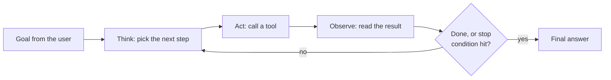
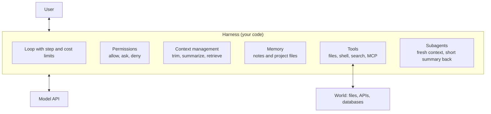

# Agents and harnesses

After this you can say what makes a system an agent, name the parts of the harness around it, and decide when a fixed workflow is the better design.

Before this: [tool use](03-tool-use.md), [prompt and context engineering](02-prompt-and-context-engineering.md) and [RAG embeddings and pgvector](04-rag-embeddings-and-pgvector.md).

## The idea

Ask a model "fix the failing test" and it cannot, because it cannot see your code or run anything. Give it tools to read files, edit them and run the tests, and put it in a loop: it reads the failure, edits, runs the tests again, and repeats until they pass. That loop is an **agent**.

Anthropic's article [Building effective agents](https://www.anthropic.com/engineering/building-effective-agents) draws the line this way. In a **workflow**, "LLMs and tools are orchestrated through predefined code paths". In an **agent**, the LLM dynamically directs its own process and tool use. Your code decides the steps in the first case, and the model decides in the second.



## Key terms

An **agent** is an LLM that repeatedly chooses actions (tool calls), sees the results, and continues until it decides it is done. The loop in the diagram is the tool-use loop from the previous lesson, with a goal and many turns.

A **harness** (also called an agent harness) is all the code around the model that makes the loop usable and safe: the tools, permissions, context management, memory, and the loop itself with its limits. The model supplies judgment; the harness supplies everything else.

A **subagent** is a second agent, started by the first, with its own fresh context window. It does a sub-task (for example, searching a codebase) and returns a short summary, so the main context does not fill with raw search output. **Memory** is information kept outside the context window, such as a notes file the agent reads at the start of each session.

## How it works

Claude Code is a coding agent with exactly this structure, and its [overview](https://code.claude.com/docs/en/overview) names the parts (as of 2026): tools to read files, edit them and run commands; a `CLAUDE.md` file it reads at the start of every session; hooks that run your shell commands before or after actions; MCP servers for external tools; and subagents that work on different parts of a task in parallel. The next chapter covers Claude Code in detail<!-- link: ../03-ai-assisted-development/01-claude-code.md -->.



In the diagram, the model only sees text and can only produce requests. Everything that touches the world passes through the harness, which is where you enforce rules. Four parts decide whether an agent is useful and safe:

1. **Tools.** Few, clear, narrow tools beat many overlapping ones. Tool results are tokens, so a tool that returns a whole file fills the window.
2. **Permissions.** Reading is cheap to allow. Writing, running commands, spending money and sending messages need a rule: allow, ask the user, or deny. Run commands in a sandbox where possible.
3. **Context management.** Long runs fill the window. Harnesses trim old tool results, summarize history (compaction), and keep notes in files. See context engineering in the earlier lesson.
4. **Limits.** A maximum number of steps, a token or cost budget, and a stop condition. Without them a confused agent loops forever and bills you.

Agents have a price. The Anthropic article warns of higher cost and latency, and "the potential for compounding errors": a wrong step early leads to more wrong steps. Its advice is to find the simplest solution and add complexity only when needed. For many tasks a single call with good retrieval and examples is enough. Next in complexity are fixed workflows: prompt chaining, routing, parallelization, orchestrator-workers and evaluator-optimizer, all with steps you control. Use an agent when you cannot predict the number of steps, the task is worth the cost, and mistakes can be caught and undone (tests, review, version control).

## Worked examples

<div class="example" markdown>

### Example 1: a harness around a fake model

A scripted function stands in for the model so this runs offline. The harness has the pieces from the diagram: a tool table, a permission rule (writes need approval), a step budget, and a history that records each observation.

1. The loop asks the model for the next action.
2. If the action is `done`, print the answer and stop.
3. If the tool is in `NEEDS_APPROVAL`, ask first; a refusal becomes the observation.
4. Otherwise run the tool, record the result, and loop. After 10 steps the loop ends regardless.

<details class="code" markdown>
<summary>In code</summary>

```python
FILES = {"app.py": "def add(a, b):\n    return a - b\n"}

def read_file(path):
    return FILES[path]

def write_file(path, text):
    FILES[path] = text
    return "written"

TOOLS = {"read_file": read_file, "write_file": write_file}
NEEDS_APPROVAL = {"write_file"}        # permission rule: writes need a yes

SCRIPT = iter([                        # what a fake model "decides", one step at a time
    ("read_file", {"path": "app.py"}),
    ("write_file", {"path": "app.py", "text": "def add(a, b):\n    return a + b\n"}),
    ("done", {"summary": "Fixed add: it subtracted."}),
])

def fake_model(history):
    return next(SCRIPT)

def approve(name, args):
    print(f"  approval asked for {name}({list(args)}), user says yes")
    return True

history = [("user", "Fix the bug in app.py")]
for step in range(1, 11):              # step budget: the loop always ends
    name, args = fake_model(history)
    if name == "done":
        print("answer:", args["summary"])
        break
    print(f"step {step}: {name}")
    if name in NEEDS_APPROVAL and not approve(name, args):
        result = "denied by user"
    else:
        result = TOOLS[name](**args)
    history.append(("tool", f"{name} -> {result[:40]!r}"))   # observe
print(FILES["app.py"])
```

```text
step 1: read_file
step 2: write_file
  approval asked for write_file(['path', 'text']), user says yes
answer: Fixed add: it subtracted.
def add(a, b):
    return a + b
```

</details>

Check: the file changed only after the approval line. Replace `approve` with a function that returns `False` and confirm the file stays unchanged. A real harness replaces `fake_model` with the API call and sends `history` as messages.

</div>

## Common mistakes

<div class="warning" markdown>

Watch out: reaching for an agent when a workflow fits. If you can write the steps down ("extract, then classify, then store"), write them as code. It is cheaper, faster and easier to test.

Watch out: no limits or no checks. An agent needs a step cap, a cost cap, and a way to verify its own work, such as running the tests. "Done" from the model is a claim, not a result.

Watch out: broad permissions by default. An agent that can run any shell command with your credentials can delete files or leak secrets after one bad step or one injected instruction in a web page it read. Start with read-only access and add rights one at a time.

</div>

## Working with AI

<div class="ai" markdown>

Words to use: agent, workflow, harness, tool-use loop, permissions, sandbox, context window, compaction, subagent, step budget.

Prompts to try:

- "I want to automate triage of incoming bug reports: read the report, find the related code, label it, and comment. Should this be a workflow or an agent? List the steps, which are fixed, and what could go wrong at each."
- "Design the harness for a code-review agent: list its tools, which need approval, how you cap steps and cost, and how it keeps its context small on a large pull request."

What to check:

- Designs that skip limits or permissions. Ask where the step cap, the cost cap and the approval gates are.
- Claims that an agent "will" handle edge cases. Ask for the test cases that would show it.
- Frameworks added for a loop you could write in 30 lines. Read what the framework hides before adopting it.

</div>

## Quiz

1\. What is the difference between a workflow and an agent?

<details class="solution" markdown>
<summary>Answer</summary>

In a workflow, your code defines the steps and the LLM fills them in. In an agent, the LLM decides the next step and which tool to call, in a loop.

</details>

2\. In Example 1, what happens if `approve` returns `False`?

<details class="solution" markdown>
<summary>Answer</summary>

`write_file` never runs, the observation is "denied by user", and the file keeps the bug. The model sees the refusal on its next step and can choose another action.

</details>

3\. A coding agent searches a repository and its context fills with 200 file listings. Name two harness fixes.

<details class="solution" markdown>
<summary>Answer</summary>

Delegate the search to a subagent that returns a short summary, and trim or summarize old tool results (compaction). Limiting what each tool returns also helps.

</details>

4\. A team wants an agent to reformat 500 files by one fixed rule. Is an agent the right design?

<details class="solution" markdown>
<summary>Answer</summary>

No. The task is predictable, so a script (or a formatter) is cheaper and exact. If part of it needs judgment, use a workflow that calls the model only for that part.

</details>

## Lab

<div class="lab" markdown>

### Lab: add a budget and a deny rule

Goal: make the harness safer. Time: about 15 minutes. Runs in: any terminal with Python 3.

1. Save Example 1 as `agent.py` and run it.
2. Add a `cost` counter that adds 1 per tool call, and stop the loop with a message when `cost > 2`.
3. Add a tool `run_shell` to `TOOLS` and put it in a new set `DENIED`. Make the loop refuse any tool in `DENIED` without asking.
4. Change `SCRIPT` so the model asks for `run_shell` as step 2 and confirm the refusal appears in the history.
5. Cleanup: delete `agent.py`.

Expected result: the shell call never runs, and the loop stops at the cost limit when the script is long enough.

<details class="solution" markdown>
<summary>Solution</summary>

Inside the loop, before running a tool:

```python
DENIED = {"run_shell"}
TOOLS["run_shell"] = lambda cmd: "never runs"
cost = 0

# in the loop, after the "done" check:
cost += 1
if cost > 2:
    print("stopped: budget used")
    break
if name in DENIED:
    history.append(("tool", f"{name} -> refused by policy"))
    continue
```

A deny list is the simplest permission rule. Real harnesses use allow, ask and deny rules per tool and per argument, such as "allow `git status`, ask for `git push`, deny `rm -rf`".

</details>

</div>

## Where this shows up

- [MCP](06-mcp.md) is how a harness gets tools from other programs, and [evals](07-evals.md) are how you know an agent change helped.
- The next chapter uses these ideas in practice: [Claude Code](../03-ai-assisted-development/01-claude-code.md) and [the plan, build, test, review workflow](../03-ai-assisted-development/02-plan-build-test-review-workflow.md).
- The risks of giving a model actions are covered in [AI security risks](../03-ai-assisted-development/04-ai-security-risks.md).
