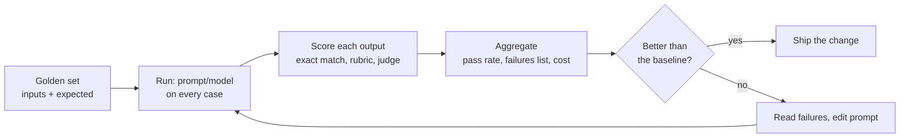

# Evals

After this you can build a small golden set, score a model's outputs with code or a rubric, use an LLM as a judge without being fooled by its biases, and catch prompt regressions before they ship.

Before this: [prompt and context engineering](02-prompt-and-context-engineering.md), [RAG embeddings and pgvector](04-rag-embeddings-and-pgvector.md), [agents and harnesses](05-agents-and-harnesses.md) and [unit testing](../../04-developer-tools-and-workflow/03-code-quality/01-unit-testing.md).

## The idea

You change one sentence in a prompt. Three test tickets look better, so you ship. A week later billing tickets are misrouted, because the new wording broke a case you did not try. Model output is not deterministic and not exact, so you cannot eyeball it. You need what unit tests give ordinary code: a fixed set of cases, a score, and a number that tells you whether a change helped.

An **eval** is a repeatable test of model behaviour: a set of inputs with expectations, a way to score outputs, and a report. Anthropic's guide ([Define success criteria and build evaluations](https://platform.claude.com/docs/en/test-and-evaluate/develop-tests), as of 2026) says to make criteria specific and measurable, mirror the real task including edge cases, automate grading where possible, and prefer many automatically graded cases over a few hand-graded ones.



## Key terms

A **golden set** is the fixed list of test cases with the answers (or properties) you expect. A **baseline** is the score of the current prompt and model; a change must beat it or at least not drop below it. A **regression** is a case that used to pass and now fails.

**Exact-match scoring** compares the output with an expected value in code (after trimming and lowercasing, or after parsing JSON). A **rubric** lists criteria, such as "cites a source" and "under 80 words", each scored pass or fail or on a small scale. **LLM-as-judge** has a second model apply the rubric to an output.

**Position bias** is a judge's tendency to prefer the answer shown first. **Verbosity bias** is the tendency to prefer longer answers. **Self-preference** is favouring text that resembles its own. Zheng et al. ([2023](https://arxiv.org/abs/2306.05685)) identified these; they also found strong judges agree with human raters over 80 percent of the time, about as often as humans agree with each other.

## How it works

1. **Collect cases.** Start with 20 to 50 real inputs: common ones, edge cases, past failures, and a few where the right answer is "I can't tell". Write the expected output or the properties it must have. Keep the set under version control.
2. **Choose the cheapest scorer that works.** Use code when the answer is checkable: a label, a number, valid JSON, a citation id that exists in the retrieved chunks. Use a rubric for qualities code cannot see (tone, completeness). Use a judge for those rubrics at scale, and a human for a sample.
3. **Make a judge reliable.** Give it a narrow rubric and ask for a short reason and a score. Prefer a different model from the one being tested (the Anthropic guide recommends this). For comparisons, run both orders and count only consistent wins. Check the judge against 20 or so human-labelled cases before trusting it.
4. **Run and record.** Store scores per case, the prompt version, the model ID and the cost. Print the failures as well as the average.
5. **Gate changes.** Run the eval on every prompt or model change, as you would run tests in CI. A retrieval change gets its own check (hit rate, as in the RAG lesson), separate from answer quality.

An eval also measures cost and latency, and model upgrades are a common reason to rerun it: a newer model may follow a prompt differently.

## Worked examples

<div class="example" markdown>

### Example 1: a tiny eval harness with a stub model

The stub model stands in for an API call so this runs without a key. Prompt version `v1` misses refund tickets and `v2` handles them. The scorer parses JSON and compares one field, so a reply with text around the JSON counts as a failure, which is the format check from the prompting lesson. The final `assert` is the regression gate.

<details class="code" markdown>
<summary>In code</summary>

```python
import json

GOLDEN = [
    {"ticket": "I was charged twice.", "category": "billing"},
    {"ticket": "Parcel never arrived.", "category": "shipping"},
    {"ticket": "Do you stock the 2nd edition?", "category": "catalogue"},
    {"ticket": "Refund my order and fix the site.", "category": "billing"},
]

def stub_model(prompt_version, ticket):
    """Fake model. v2 is a 'better prompt' that also handles refunds."""
    t = ticket.lower()
    if "charged" in t or ("refund" in t and prompt_version == "v2"):
        return '{"category": "billing"}'
    if "parcel" in t:
        return '{"category": "shipping"}'
    return "I think this is about the catalogue."   # breaks the JSON format

def score(output, expected):
    try:
        return json.loads(output)["category"] == expected   # exact match on one field
    except (json.JSONDecodeError, KeyError):
        return False                                        # bad format counts as a failure

def run_eval(version):
    results = [(c["ticket"], score(stub_model(version, c["ticket"]), c["category"])) for c in GOLDEN]
    return sum(ok for _, ok in results) / len(results), [t for t, ok in results if not ok]

baseline, _ = run_eval("v1")
candidate, failures = run_eval("v2")
print(f"v1 {baseline:.0%}  v2 {candidate:.0%}")
print("still failing:", failures)
assert candidate >= baseline, "regression: the new prompt scores lower"
```

```text
v1 50%  v2 75%
still failing: ['Do you stock the 2nd edition?']
```

</details>

Check: v2 passes 3 of 4 cases, up from 2 of 4. The remaining failure is the catalogue ticket, where the stub replies in prose instead of JSON, so the report points at a format problem, not a wrong label. With a real model, replace `stub_model` with an API call, keep the same loop, and also record `usage` so the report shows cost per run.

</div>

<div class="example" markdown>

### Example 2: running a judge in both orders

To compare two answers, ask the judge twice with the order swapped and accept only a consistent winner. The stub below always prefers whatever it sees first, so it is exposed immediately.

<details class="code" markdown>
<summary>In code</summary>

```python
def biased_judge(first, second):
    """A stub judge that always prefers whatever it sees first (position bias)."""
    return "first"

def compare(answer_a, answer_b, judge):
    """Ask twice with the order swapped. Only a consistent winner counts."""
    one = "A" if judge(answer_a, answer_b) == "first" else "B"
    two = "B" if judge(answer_b, answer_a) == "first" else "A"
    return one if one == two else "tie (judge is order-sensitive)"

print(compare("short answer", "a much longer, wordier answer", biased_judge))
```

```text
tie (judge is order-sensitive)
```

</details>

A real judge call would send a prompt such as: "Here is a rubric and an answer. Score each criterion 0 or 1 and give one sentence of reasoning. Reply as JSON." That call is not run here (no API key).

</div>

## Common mistakes

<div class="warning" markdown>

Watch out: tuning the prompt on the same cases you score it on. The score goes up and tells you nothing about new inputs. Keep a held-out set that you look at only to confirm a change.

Watch out: trusting a judge you never checked. Compare its scores with human labels on a sample, use a rubric with concrete criteria, and be suspicious when longer answers always score higher.

Watch out: a set that is too clean. Real inputs have typos, empty fields, other languages and requests the system should refuse. Add the failures you see in production to the golden set.

</div>

## Working with AI

<div class="ai" markdown>

Words to use: golden set, baseline, regression, exact match, rubric, LLM-as-judge, position bias, held-out set.

Prompts to try:

- "Here is my support-ticket classifier prompt and 10 sample tickets. Propose 20 more test cases, including 5 edge cases where the right answer is ambiguous, in a JSON list of ticket and expected category. Mark the ones you are unsure about."
- "Write a rubric of five pass or fail criteria for judging a customer-service reply, with one concrete example of a pass and a fail for each."

What to check:

- Test cases the AI wrote with wrong expected answers. Review every label yourself; a bad golden set is worse than none.
- Rubrics with vague words ("good", "helpful") and no examples, which a judge will score inconsistently.
- Scores reported as one average. Ask for the failing cases and per-category results.

</div>

## Quiz

1\. What is a regression in an eval?

<details class="solution" markdown>
<summary>Answer</summary>

A case that passed with the old prompt or model and fails with the new one. The overall score can rise while regressions hide in it, so list them.

</details>

2\. A prompt scores 96 percent on the 25 cases you used while editing it. Why is that weak evidence?

<details class="solution" markdown>
<summary>Answer</summary>

You tuned it on those cases, so it may be fitted to them. Check a held-out set the prompt never saw, and note that 25 cases is a small sample.

</details>

3\. Your judge prefers answer A in 90 percent of comparisons, but when you swap the order it prefers whichever is first. What is wrong and what do you do?

<details class="solution" markdown>
<summary>Answer</summary>

Position bias. Run each comparison in both orders and count only consistent winners, or score each answer alone against a rubric.

</details>

4\. When should you use exact match instead of an LLM judge?

<details class="solution" markdown>
<summary>Answer</summary>

When the answer is checkable in code: a label, a number, valid JSON, a cited id that exists. It is free, fast and deterministic. Use a judge only for qualities code cannot measure.

</details>

## Lab

<div class="lab" markdown>

### Lab: gate a prompt change

Goal: extend the harness with a per-case report and a regression check. Time: about 15 minutes. Runs in: any terminal with Python 3.

1. Save Example 1 as `evals.py` and run it.
2. Add two more cases to `GOLDEN`, one where the ticket is in French and one that is empty text.
3. Print each case as `PASS` or `FAIL` with the ticket, for v1 and v2.
4. Store the v1 results and fail the run if any case that passed in v1 fails in v2 (a per-case regression, which a lower average alone would miss).
5. Cleanup: delete `evals.py`.

Expected result: a per-case table, and an assertion error only if v2 breaks a case that v1 passed.

<details class="solution" markdown>
<summary>Solution</summary>

```python
def per_case(version):
    return {c["ticket"]: score(stub_model(version, c["ticket"]), c["category"]) for c in GOLDEN}

v1, v2 = per_case("v1"), per_case("v2")
for ticket in v2:
    print("PASS" if v2[ticket] else "FAIL", "|", ticket)
broken = [t for t in v1 if v1[t] and not v2[t]]
assert not broken, f"regressions: {broken}"
```

This catches the case where v2 raises the average but breaks something v1 handled. In a real project this script runs in CI on every pull request that touches a prompt, with the stub replaced by the API call and a cap on cost.

</details>

</div>

## Where this shows up

- The next chapter uses the same habit when reviewing AI-written code: tests first, [then judgment](../03-ai-assisted-development/03-reviewing-ai-code.md).
- Model choice is partly an eval question: run your golden set on two models and compare score, cost and latency, as in [choosing a model](../01-how-llms-work/05-choosing-a-model.md).
- Tracking prompt changes alongside code relies on the same [unit testing](../../04-developer-tools-and-workflow/03-code-quality/01-unit-testing.md) discipline.
