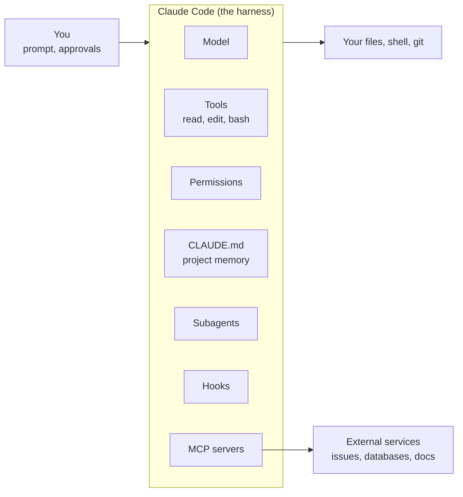
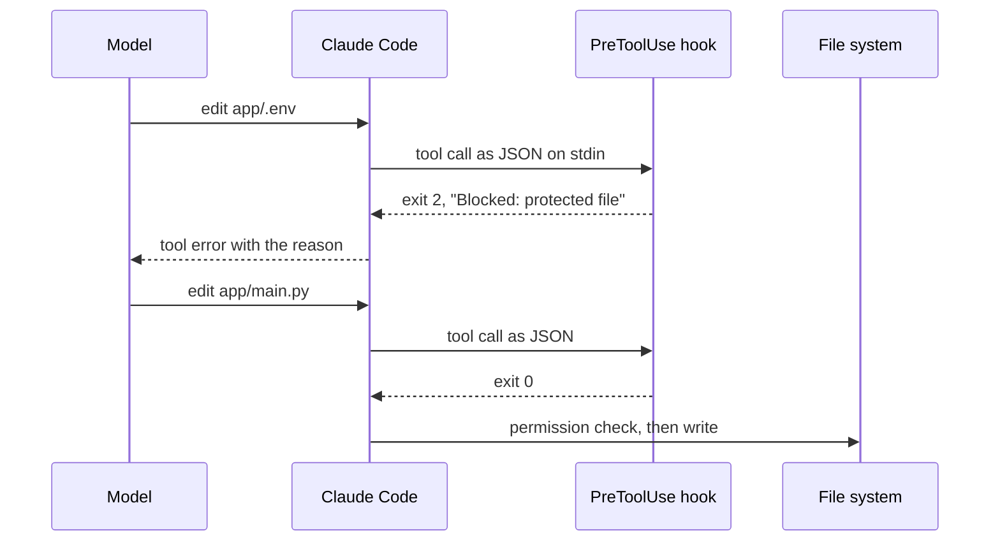

# Claude Code

After this you can describe what an agentic coding tool is made of, install and start Claude Code, and set up the files that control it: permissions, `CLAUDE.md`, hooks, subagents and MCP servers.

Before this: [Learning tech with AI](../../00-start-here/learning-tech-with-ai.md), [Git basics](../../04-developer-tools-and-workflow/01-editor-and-git/02-git-basics.md), and [agents and harnesses](../02-building-with-llms/05-agents-and-harnesses.md).

## The idea

A chat assistant answers a question and stops. You copy its code into a file, run it, and paste the error back. An **agentic coding tool** does that loop itself: it reads your files, edits them, runs commands such as the tests, reads the output and tries again, while you watch and approve.

The model alone cannot touch your disk. What touches it is the program around the model, called the **harness**: it offers the model a set of tools (read a file, edit a file, run a shell command), asks you before risky ones, and feeds the results back. Claude Code is such a harness. Anthropic describes it as "an agentic coding tool that reads your codebase, edits files, runs commands, and integrates with your development tools", available in the terminal, in VS Code and JetBrains, as a desktop app and on the web ([overview, as of 2026](https://code.claude.com/docs/en/overview)).



In the diagram, everything inside the box is configuration you control. The model proposes; the harness decides what runs.

## Key terms

**Permission mode** is the setting that decides which actions run without asking you. **Plan mode** lets the agent read and propose but not edit until you approve a plan. **`CLAUDE.md`** is a Markdown file of project instructions that is loaded at the start of every session. A **slash command** is a command typed inside a session that starts with `/`. A **subagent** is a helper that works in its own fresh context window and returns only a summary. A **hook** is a shell command that the harness runs at a fixed point, such as before every edit. **MCP** (Model Context Protocol) is an open standard for connecting an AI tool to outside data and services; each connection is an **MCP server**.

## How it works

Install on Windows from PowerShell with `irm https://claude.ai/install.ps1 | iex`; on macOS, Linux and WSL use `curl -fsSL https://claude.ai/install.sh | bash`. The docs recommend Git for Windows on native Windows so the tool can use Bash. Then open a new terminal, run `claude --version`, `cd` into a project and run `claude`. It asks you to log in the first time. Copy install commands from the [overview page](https://code.claude.com/docs/en/overview), because they change.

**Permission modes** ([permission modes page](https://code.claude.com/docs/en/permission-modes), as of 2026). Press Shift+Tab to cycle through them.

| Mode | What runs without asking |
|---|---|
| `default` (shown as Manual) | Reads only; it asks before edits, shell commands and network access |
| `acceptEdits` | Reads and file edits inside the working directories |
| `plan` | Reads; edits stay blocked until you approve a plan |
| `auto` | Everything, with a separate classifier model reviewing actions |
| `dontAsk` | Pre-approved tools only; anything else is denied |
| `bypassPermissions` | Everything; the docs intend it only for isolated containers and VMs |

The starting mode depends on version and plan; check the status bar.

**`CLAUDE.md`** is advice, not enforcement. The [memory docs](https://code.claude.com/docs/en/memory) say Claude treats it as context, and that "the more specific and concise your instructions, the more consistently Claude follows them". They target under 200 lines per file, and the [best-practices page](https://code.claude.com/docs/en/best-practices) gives a test for each line: would removing it cause mistakes? If not, cut it. Run `/init` to generate a starter file. This book's repository has one: it points to the style guide and lesson template, lists the folder layout and build commands, and states the Git rules (work on `main`, short messages). It leaves out whatever the agent can read from the code.

**Slash commands** include `/clear` (reset), `/compact` (summarize), `/rewind` (restore an earlier state; it does not track shell changes, so it is not a replacement for Git), `/permissions`, `/hooks`, `/mcp`, `/context` and `/plan` ([commands reference](https://code.claude.com/docs/en/commands)).

**Settings** are JSON. User settings live in `~/.claude/settings.json`, shared project settings in `.claude/settings.json` (commit it), personal project settings in `.claude/settings.local.json`, and a company can add managed settings that override all of them ([settings docs](https://code.claude.com/docs/en/settings)). Permission rules go under `permissions` as `allow`, `ask` and `deny` lists, such as `"deny": ["Read(./.env)"]`.

**Hooks** are the enforcement that `CLAUDE.md` is not. A hook on the `PreToolUse` event runs before a tool call, receives the call as JSON on stdin, and blocks it by exiting with code 2 and writing the reason to stderr ([hooks guide](https://code.claude.com/docs/en/hooks-guide)).



**Subagents** are Markdown files with YAML frontmatter in `.claude/agents/` (project) or `~/.claude/agents/` (all projects). Required fields are `name` and `description`; `tools` limits what the helper can use ([subagents docs](https://code.claude.com/docs/en/sub-agents)). They keep noisy work, such as searching a codebase, out of your main context.

**MCP servers** are added with `claude mcp add --transport http <name> <url>` for a remote server, or `claude mcp add <name> -- <command>` for a local one ([MCP docs](https://code.claude.com/docs/en/mcp)). The docs warn to verify that you trust each server, because servers that fetch outside content expose you to prompt injection. See [MCP](../02-building-with-llms/06-mcp.md) and [AI security risks](04-ai-security-risks.md).

**Scoping a task.** Name the files, the behaviour and the check: "In `pricing.py`, make `apply_discount` reject negative percentages. Add a failing test first, then fix it, then run `pytest`."  

## Worked examples

<div class="example" markdown>

### Example 1: a hook that protects `.env`

We want edits to `.env` files refused every time, even when the model forgets a rule. The script reads the tool call from stdin and exits 2 for a protected path.

1. Save the script as `.claude/hooks/protect.py`.
2. Register it in `.claude/settings.json` under `PreToolUse` with the matcher `Edit|Write`.
3. Test the script by hand with a fake tool call, before involving the agent.

```python
import json
import sys

PROTECTED = (".env", "secrets/")

event = json.load(sys.stdin)
path = event.get("tool_input", {}).get("file_path", "")
if any(p in path for p in PROTECTED):
    print(f"Blocked: {path} is protected", file=sys.stderr)
    sys.exit(2)
sys.exit(0)
```

```json
{
  "hooks": {
    "PreToolUse": [
      {
        "matcher": "Edit|Write",
        "hooks": [
          { "type": "command", "command": "python \"$CLAUDE_PROJECT_DIR\"/.claude/hooks/protect.py" }
        ]
      }
    ]
  }
}
```

Check by feeding it two calls (in Git Bash or WSL):

```bash
echo '{"tool_input":{"file_path":"app/.env"}}' | python protect.py; echo "exit=$?"
echo '{"tool_input":{"file_path":"app/main.py"}}' | python protect.py; echo "exit=$?"
```

```text
Blocked: app/.env is protected
exit=2
exit=0
```

The script blocks `.env` and passes `main.py`. Watch out: a substring match is crude. It also blocks `my.envelope.txt`, because that name contains `.env`. Narrow the match if that matters.

</div>

## Common mistakes

<div class="warning" markdown>

Watch out: a long `CLAUDE.md`. Rules get lost in the noise and the agent follows fewer of them. Prune it like code.

Watch out: using `CLAUDE.md` for a rule that must never be broken. It is advice. Use a hook or a `deny` permission rule.

Watch out: `bypassPermissions` on your own laptop. It is meant for disposable containers and VMs.

</div>

## Working with AI

<div class="ai" markdown>

Words to use: permission mode, plan mode, `CLAUDE.md`, hook, subagent, MCP server, context window, `deny` rule.

Prompts to try:

- "Read `src/billing/` and explain how invoices are created. Do not edit anything. List the files you read."
- "Write a PreToolUse hook that blocks Edit and Write on any path under `migrations/`. Show the script and the `.claude/settings.json` entry, then show how I test the script with fake JSON on stdin."

What to check:

- Settings keys, flags or slash commands that do not exist. Compare with the [docs](https://code.claude.com/docs/en/overview) or `claude --help`.
- A hook or permission rule that is broader than you meant. Test it with one allowed and one blocked input.
- A generated `CLAUDE.md` full of facts visible in the code. Delete every line whose removal would change nothing.

</div>

## Quiz

1\. What is the difference between a chat assistant and an agentic coding tool, and what is the harness?

<details class="solution" markdown>
<summary>Answer</summary>

A chat assistant returns text; you apply it. An agentic tool also reads files, edits them and runs commands, then reads the results and continues. The harness is the program around the model that provides the tools, asks permission and feeds results back.

</details>

2\. Your `CLAUDE.md` says "never edit `.env`", and one day the agent edits it. Why, and what do you add?

<details class="solution" markdown>
<summary>Answer</summary>

`CLAUDE.md` is context the model may weigh against other things, not enforcement. Add a `PreToolUse` hook that exits 2 for those paths, or a `deny` rule such as `Read(./.env)`.

</details>

3\. A hook script exits with code 1 on a protected path. Does the harness block the call?

<details class="solution" markdown>
<summary>Answer</summary>

Not reliably. The docs say exit 2 blocks; with other non-zero codes the action proceeds on most events. Use `sys.exit(2)`.

</details>

4\. Name two reasons to use a subagent for "find every place we call the payments API".

<details class="solution" markdown>
<summary>Answer</summary>

It reads many files in its own context window, so your main conversation stays small, and it returns only a summary. You can also limit it to read-only tools.

</details>

## Lab

<div class="lab" markdown>

### Lab: a CLAUDE.md and a hook

Goal: write project instructions and a blocking hook for a toy project, and test the hook without the agent. Time: about 15 minutes. Needs Python; Claude Code is optional.

1. Make a folder `toy` with a `.claude/hooks` subfolder. Save the Example 1 script there as `protect.py`.
2. Write a `CLAUDE.md` of at most 10 lines: the test command, one style rule, one rule about files not to touch. Each line must pass "would removing this cause a mistake?".
3. Feed the script a path ending in `secrets/key.txt` and a path ending in `README.md`. Predict both exit codes first.
4. Optional, with Claude Code installed: add the `settings.json` entry from Example 1, start `claude` in the folder and ask it to add a line to `.env`. Run `/hooks` to confirm the hook is listed.
5. Cleanup: delete the `toy` folder.

Expected: exit 2 with a `Blocked:` message for `secrets/key.txt`, exit 0 for `README.md`.

<details class="solution" markdown>
<summary>Solution</summary>

```bash
echo '{"tool_input":{"file_path":"toy/secrets/key.txt"}}' | python protect.py; echo "exit=$?"
echo '{"tool_input":{"file_path":"toy/README.md"}}' | python protect.py; echo "exit=$?"
```

A sample `CLAUDE.md`:

```markdown
# Toy project
- Run tests with `pytest -q`.
- Use type hints on every function.
- Never edit `.env` or anything under `secrets/`.
```

</details>

</div>

## Where this shows up

- Next, [the plan, build, test, review workflow](02-plan-build-test-review-workflow.md) shows how to use these controls in a loop.
- Hooks and `CLAUDE.md` mirror ideas from [linters and pre-commit hooks](../../04-developer-tools-and-workflow/03-code-quality/03-linters-formatters-and-type-checkers.md).
