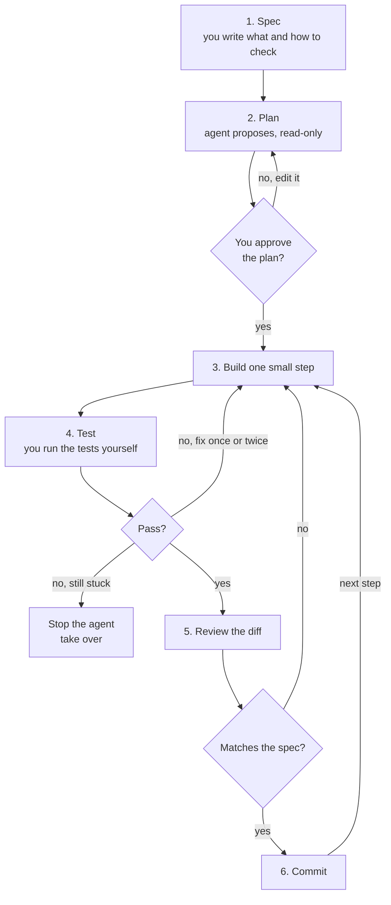

# The plan, build, test, review workflow

After this you can run an AI coding agent through a loop with human checkpoints: spec, plan, small steps, tests you run yourself, a commit per step and a review of each diff.

Before this: [Claude Code](01-claude-code.md), [Unit testing](../../04-developer-tools-and-workflow/03-code-quality/01-unit-testing.md), and [Branches, merging and conflicts](../../04-developer-tools-and-workflow/01-editor-and-git/03-branches-merging-and-conflicts.md).

## The idea

You ask an agent for "user login with Google" and walk away. Ten minutes later there are 40 changed files, a new dependency and a passing build. You cannot tell whether it did what you meant, because the change is too big to read and nothing separates the parts.

The fix is the one every team already uses for human work: small steps, each with an agreed target, a check and a record. MIT's Missing Semester course on agentic coding gives the same advice: treat the agent like an intern who needs guidance and correction, write or audit the tests first, and review the output for correctness and security bugs ([Agentic Coding, 2026](https://missing.csail.mit.edu/2026/agentic-coding/)). The Claude Code docs recommend explore, plan, implement, commit ([best practices](https://code.claude.com/docs/en/best-practices)).



In the diagram, the diamonds are the human checkpoints. The agent never decides on its own that a step is done.

## Key terms

A **spec** is a written statement of what to build, what is out of scope, and how you will know it works. A **plan** is the agent's proposed list of files to change and steps to take, produced before any edit. The **contract** is the set of tests that define correct behaviour; the agent's job is to make them pass without changing them. A **diff** is the exact set of line changes between two versions, which is what you review. A **git worktree** is a second working directory with its own branch that shares one repository.

## How it works

**1. Write the spec.** A few lines: the behaviour, two or three edge cases, what must not change, and the check. For a large feature, the docs suggest having the agent interview you and write the spec to a file, then building in a fresh session.

**2. Ask for a plan first.** Use plan mode (Shift+Tab, or `claude --permission-mode plan`). Read it as a design review: unexpected files, a new dependency, a skipped edge case? Edit it before approving. If you could describe the diff in one sentence, skip this step.

**3. Build in small steps.** One step is a change you can review in a few minutes: one function, one endpoint, one migration. Small steps keep the agent's context clean and make a wrong turn cheap.

**4. Make tests the contract, and run them yourself.** Ask for a failing test first ([test-driven development](../../04-developer-tools-and-workflow/03-code-quality/01-unit-testing.md)), review the test, then let the agent make it pass. The agent will report "all tests pass", but run the suite in your own terminal. Watch for the agent editing or deleting a test to get green; check the diff of the test files first.

**5. Review the diff, then commit.** Read the diff with the checklist in [Reviewing AI code](03-reviewing-ai-code.md), then commit with a short message, one commit per step. Commits give you restore points; Claude Code's own `/rewind` does not track changes made by shell commands, so it does not replace Git ([docs](https://code.claude.com/docs/en/best-practices)).

**6. Know when to stop.** Interrupt with Esc when the agent heads the wrong way. If you have corrected the same problem twice, the context is full of failed attempts: run `/clear` and restate the task with what you learned. Take over by hand when the agent is in a debugging spiral, when the code is security-critical, or when explaining the change would take longer than writing it. Verifying can be harder than writing, so for critical code consider writing it yourself (Missing Semester).

**7. Parallel agents.** To run two agents at once without them overwriting each other, give each its own git worktree: `claude --worktree feature-auth` creates one under `.claude/worktrees/` on a new branch ([worktrees docs](https://code.claude.com/docs/en/worktrees)). Give parallel agents tasks that touch different files.

## Worked examples

<div class="example" markdown>

### Example 1: one step, from spec to commit

We add a rule to `apply_discount(price, percent)`: reject a percent below 0 or above 100.

1. Spec, in the prompt: "In `pricing.py`, `apply_discount` must raise `ValueError` for a percent below 0 or above 100. Out of scope: rounding. Write the failing tests first and show them, then wait."
2. Read the tests the agent shows. Check the edges: 0 and 100 are valid, -1 and 101 are not.
3. Approve. The agent writes the fix and runs `pytest`.
4. Run `pytest` yourself, then `git diff`. Confirm only `pricing.py` and `test_pricing.py` changed and no existing test was edited.
5. Commit: `git add pricing.py test_pricing.py`, then `git commit -m "reject out-of-range discounts"`.

Check by looking at the history and the diff statistics. Real output from running this example in a throwaway repository:

```bash
git log --oneline
git diff --stat HEAD~1
```

```text
4d22f7a reject out-of-range discounts
fe865ca add apply_discount
 __pycache__/pricing.cpython-314.pyc                   | Bin 0 -> 566 bytes
 __pycache__/test_pricing.cpython-314-pytest-9.1.1.pyc | Bin 0 -> 2487 bytes
 pricing.py                                            |   2 ++
 test_pricing.py                                       |  11 +++++++++++
 4 files changed, 13 insertions(+)
```

The review caught something: `git add .` (used when producing this output) also staged two compiled `__pycache__` files that are not part of the spec. Remove them from the commit and add `__pycache__/` to `.gitignore`. If the stat had shown ten files, the step was too big, and you would reset and ask again with a narrower prompt.

</div>

<div class="example" markdown>

### Example 2: two agents, two worktrees

Git creates a worktree with `git worktree add`, and lists them with `git worktree list`. Real output from a throwaway repository:

```bash
git worktree add ../wt-feature -b feature-a
git worktree list
```

```text
.../ex/wt          3fe5eaa [main]
.../ex/wt-feature  3fe5eaa [feature-a]
```

Each directory has its own files and branch. Merging later is the ordinary Git merge from the branches lesson.

</div>

## Common mistakes

<div class="warning" markdown>

Watch out: letting the agent write both the code and the tests, then trusting the green result. If the tests are wrong, passing proves nothing. Read the tests first.

Watch out: continuing a long, tangled session. After two failed corrections, start fresh.

</div>

## Working with AI

<div class="ai" markdown>

Words to use: spec, plan mode, failing test, regression, diff, scope creep, worktree, restore point.

Prompts to try:

- "Here is the spec: [paste]. Do not edit any files. List the files you would change, the new tests you would add, and any edge cases my spec misses."
- "Write only the failing tests for this spec, using pytest. Do not write the implementation. After I approve the tests, we will do that."

What to check:

- A plan or diff that touches files outside the spec, or adds a dependency you did not ask for.
- Tests that were changed or deleted in the same diff as the fix. Run `git diff -- 'test*'`.
- A claim of "all tests pass" with no output shown. Run the tests yourself.
- A fix that suppresses the error instead of addressing the cause, such as catching and ignoring an exception.

</div>

## Quiz

1\. Why write or review the tests before the agent writes the implementation?

<details class="solution" markdown>
<summary>Answer</summary>

The tests state what correct means, independent of the code. If the agent writes both, a wrong understanding appears in both and the tests pass anyway.

</details>

2\. After the agent's second failed attempt at the same bug, what do you do?

<details class="solution" markdown>
<summary>Answer</summary>

Stop correcting. The context now holds failed attempts. Run `/clear`, write a more specific prompt with the error text and what you learned, or debug it yourself.

</details>

3\. The diff for "add a discount check" shows 12 files and a new library. What do you do?

<details class="solution" markdown>
<summary>Answer</summary>

Do not commit. The step is out of scope and too big to review. Reset to your last commit, and ask again with a narrower prompt and the instruction not to add dependencies.

</details>

4\. Two agents must work at the same time on the same repository. How do you keep them from overwriting each other?

<details class="solution" markdown>
<summary>Answer</summary>

Give each its own git worktree on its own branch, and give them tasks that touch different files. Merge the branches afterwards.

</details>

## Lab

<div class="lab" markdown>

### Lab: one reviewed step

Goal: practise the loop on a small change, with or without an agent. Time: about 20 minutes. Needs Git and Python.

1. Create a folder with a `git init`, a file `pricing.py` containing `def apply_discount(price, percent): return price * (1 - percent / 100)`, and commit it.
2. Write a spec for the range check from Example 1, in three lines.
3. Write the failing tests first (`test_pricing.py`, four cases) and run them. They must fail.
4. Make them pass by hand, or ask an agent in plan mode and review its plan first. Run the tests yourself.
5. Read `git diff`, then commit. Create a worktree with `git worktree add ../pricing-b -b try-b` and list it.
6. Cleanup: `git worktree remove ../pricing-b`.

Expected: two of the four tests fail first (the two out-of-range cases; the edge cases already pass), then all four pass, and the history has two small commits. Check `git diff --stat` for files that do not belong, such as `__pycache__`.

<details class="solution" markdown>
<summary>Solution</summary>

```python
def apply_discount(price, percent):
    if not 0 <= percent <= 100:
        raise ValueError("percent must be between 0 and 100")
    return price * (1 - percent / 100)
```

```python
import pytest
from pricing import apply_discount

@pytest.mark.parametrize("percent", [-1, 101])
def test_rejects_out_of_range(percent):
    with pytest.raises(ValueError):
        apply_discount(100, percent)

@pytest.mark.parametrize("percent, expected", [(0, 100), (100, 0)])
def test_accepts_edges(percent, expected):
    assert apply_discount(100, percent) == expected
```

</details>

</div>

## Where this shows up

- The review step uses the checklist in [Reviewing AI code](03-reviewing-ai-code.md).
- The same loop is how teams use [pull requests and code review](../../04-developer-tools-and-workflow/01-editor-and-git/04-github-pull-requests-and-code-review.md).
- Checking agent output at scale is the subject of evals<!-- link: ../02-building-with-llms/07-evals.md -->.
