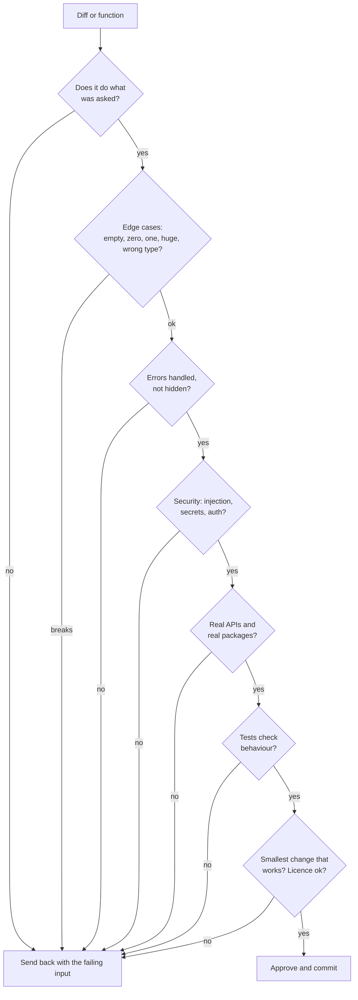

# Reviewing AI code

After this you can review AI-written code with a checklist, find bugs by running it instead of only reading it, and write a test that would have caught each one.

Before this: [The plan, build, test, review workflow](02-plan-build-test-review-workflow.md), [GitHub, pull requests and code review](../../04-developer-tools-and-workflow/01-editor-and-git/04-github-pull-requests-and-code-review.md), [Reading code and debugging](../../03-programming-fundamentals/02-thinking-like-a-programmer/04-reading-code-and-debugging.md), and [SQL from code and SQL injection](../../10-databases-sql-and-postgres/05-databases-in-apps/01-sql-from-code-and-sql-injection.md).

## The idea

AI code usually looks right. It is well formatted, named sensibly, and runs on the example in your prompt. That is the danger: a human reviewer relaxes when code looks tidy, and the failures sit in what the prompt did not mention. The Stack Overflow 2025 survey found 66% of respondents name "AI solutions that are almost right, but not quite" as a top frustration ([source](https://survey.stackoverflow.co/2025/ai)).

So you review with a fixed order of questions, and you run the code on inputs you chose. Reading finds some bugs; running finds the ones you would otherwise argue yourself out of.



## Key terms

A **review** is a deliberate read of a change to decide whether it should be merged. An **edge case** is an input at the boundary of what the code handles: empty, zero, one, the maximum, a duplicate. A **hallucinated API** (or package) is a function, option or library name that the model made up because it looked plausible. A **vacuous test** is a test that passes whether or not the code is correct. **Over-engineering** is extra layers, options or abstraction beyond the task.

## How it works

The checklist, in the order of the diagram:

| Question | How to check |
|---|---|
| Does it do what was asked? | Re-read your spec; run the code on the spec's own example |
| Edge cases | Try empty, zero, one, a tie, a negative, a very large input |
| Error handling | Look for bare `except:`, swallowed errors, and silent defaults |
| Security | Search for string-built SQL or shell commands, hard-coded secrets, missing auth checks. See [injection and input validation](../../12-security/01-web-security/03-injection-and-input-validation.md) |
| Invented APIs and packages | Import it, call it, check the docs for your version; look the package up in the registry |
| Tests that test nothing | Break the code on purpose and see whether a test fails |
| Over-engineering | Ask what each new class, flag or file is for; delete what the spec did not need |
| Licence | For a large pasted block, ask where it came from; check the project's licence rules |

Claude Code has built-in help for a second look: `/code-review` reviews the current diff and `/security-review` checks the changes on your branch for risks such as injection and auth issues ([commands reference, as of 2026](https://code.claude.com/docs/en/commands)). The best-practices page advises a reviewer in a fresh context, because the session that wrote the code is biased toward it. These are second opinions from the same kind of model, so they supplement your review and do not replace it.

## Worked examples

<div class="example" markdown>

### Example 1: a function that looks fine

You asked: "Write `top_customers(db, min_total, n)`: the names of the n customers with the highest total spend, counting only customers whose total is at least `min_total`." The agent returned this and a passing test.

```python
def top_customers(db, min_total, n=3):
    rows = db.execute(
        f"SELECT customer, SUM(total) FROM orders "
        f"GROUP BY customer HAVING SUM(total) > {min_total}"
    ).fetchall()
    rows.sort(key=lambda r: r[1])
    return [r[0] for r in rows[:n]]
```

The test was:

```python
def test_runs():
    assert len(top_customers(make_db(), 100)) <= 3
```

The sample database (built with the same helper in the lab) has totals ana 800, ben 120, cy 900, dee 105. We apply the checklist and run each suspicion.

1. Asked for? "Highest" spend, but `sort` is ascending and the slice takes the first `n`. "At least" means `>=`, but the code uses `>`.
2. Security: `min_total` is pasted into the SQL with an f-string.
3. Tests: `len(...) <= 3` passes for any list of 3 or fewer items, including an empty one.

Run it:

```text
top 2 over 100: ['dee', 'ben']
at least 120: ['ana', 'cy']
user input '0 OR 1=1': ['dee', 'ben', 'ana', 'cy']
```

The first line returns the two lowest spenders, not `['cy', 'ana']`. The second leaves out ben, whose total is exactly 120. The third shows the injection: the text `0 OR 1=1` became part of the query and the threshold stopped filtering anything. The same hole would let a real attacker read other tables.

The fix moves sorting and limiting into SQL, binds both values as parameters, and converts the threshold to a number:

```python
def top_customers(db, min_total, n=3):
    min_total = float(min_total)
    rows = db.execute(
        "SELECT customer FROM orders GROUP BY customer "
        "HAVING SUM(total) >= ? ORDER BY SUM(total) DESC, customer LIMIT ?",
        (min_total, n),
    ).fetchall()
    return [r[0] for r in rows]
```

```text
top 2 over 100: ['cy', 'ana']
at least 120: ['cy', 'ana', 'ben']
bad input: could not convert string to float: '0 OR 1=1'
```

Tests that check the behaviour, run against the original and then the fix with `pytest -q`:

```python
def test_highest_first():
    assert top_customers(make_db(), 100, n=2) == ["cy", "ana"]

def test_threshold_is_inclusive():
    assert "ben" in top_customers(make_db(), 120)
```

```text
FAILED test_top.py::test_highest_first - AssertionError: assert ['dee', 'ben'] == ['cy', 'ana']
FAILED test_top.py::test_threshold_is_inclusive - AssertionError: assert 'ben' in ['ana', 'cy']
2 failed, 1 passed in 0.09s
```

The vacuous `test_runs` passed against the buggy code; the two real tests fail on it. After the fix all three pass (`3 passed`). That is the check: a good test fails on the broken version. Unit-test design is in [unit testing](../../04-developer-tools-and-workflow/03-code-quality/01-unit-testing.md).

<details class="code" markdown>
<summary>In code: the sample database</summary>

```python
import sqlite3

def make_db():
    db = sqlite3.connect(":memory:")
    db.execute("CREATE TABLE orders (customer TEXT, total REAL)")
    db.executemany("INSERT INTO orders VALUES (?, ?)", [
        ("ana", 500), ("ana", 300), ("ben", 120),
        ("cy", 900), ("dee", 100), ("dee", 5),
    ])
    return db
```

</details>

</div>

## Common mistakes

<div class="warning" markdown>

Watch out: reviewing only the happy path from the prompt. Pick your own inputs, especially empty and boundary ones.

Watch out: accepting a green test run. Ask what the test would do if the code were wrong.

Watch out: asking the same session "is this correct?" and believing "yes". It tends to defend its own output. Run the code or use a fresh session.

</div>

## Working with AI

<div class="ai" markdown>

Words to use: edge case, parameterized query, SQL injection, vacuous test, regression test, hallucinated API, error swallowing, scope creep.

Prompts to try:

- "Review this function for bugs against this spec: [spec]. For each bug give a concrete failing input and the expected and actual output. Do not rewrite the function yet."
- "Write pytest tests for this function that would fail on the version below but pass on a correct one. Include the empty, tie and boundary cases."

What to check:

- A claimed bug with no failing input. Run the input yourself; some reported bugs are not real.
- A fix that changes the spec's meaning, such as swapping `>=` for `>` to make a test pass.
- New imports or package names. Import them and confirm in the registry that they exist.
- Added try/except blocks that hide errors instead of handling them.

</div>

## Quiz

1\. Why is a passing test not enough to approve AI code?

<details class="solution" markdown>
<summary>Answer</summary>

The test may be vacuous or may encode the same misunderstanding as the code. Check that it fails when the code is wrong, and run your own edge cases.

</details>

2\. Predict: `top_customers(db, "0 OR 1=1")` on the original function with min_total 1000 intended. What happens?

<details class="solution" markdown>
<summary>Answer</summary>

The threshold text becomes SQL, so `HAVING SUM(total) > 0 OR 1=1` is true for every group. All customers are returned regardless of the threshold. Parameters keep input as data.

</details>

3\. The agent says it fixed a bug and shows no output. Name the first thing you do.

<details class="solution" markdown>
<summary>Answer</summary>

Reproduce the original failure, run the fix on the same input, and run the test suite yourself.

</details>

4\. Code imports `fastjson_utils` and calls `fastjson_utils.safe_parse()`. How do you decide whether to keep it?

<details class="solution" markdown>
<summary>Answer</summary>

Check the registry for the package, who maintains it, its release history and its docs for `safe_parse`. If it does not exist or you cannot verify it, use the standard library `json` module.

</details>

## Lab

<div class="lab" markdown>

### Lab: review and fix

Goal: find three bugs by running the code, and write tests that expose them. Time: about 20 minutes. Needs Python 3 and `pytest` (`python -m pip install pytest`, ideally in a virtual environment).

1. Save the original `top_customers` as `top.py` along with `make_db` from the "In code" box in Example 1.
2. Write `test_top.py` with the vacuous test, then run `pytest -q`. It passes.
3. Add the two behaviour tests. Run again and read the failures.
4. Rewrite the function with parameters and `ORDER BY ... DESC`, and make all tests pass.
5. Add a fourth test for a tie (two customers with the same total) and decide what order you want.
6. Cleanup: delete the folder.

Expected: first run `1 passed`; second `2 failed, 1 passed`; after the fix `3 passed`.

<details class="solution" markdown>
<summary>Solution</summary>

The fixed function is in Example 1. For ties, `ORDER BY SUM(total) DESC, customer` sorts equal totals by name, so the result is stable. A tie test: insert `("eve", 900)` and assert that `["cy", "eve"]` come before `"ana"`.

</details>

</div>

## Where this shows up

- The review runs in step 5 of [the workflow](02-plan-build-test-review-workflow.md).
- The security row is expanded in [AI security risks](04-ai-security-risks.md) and in [the OWASP top 10](../../12-security/01-web-security/02-owasp-top-10.md).
- Measuring model output systematically is covered in [evals](../02-building-with-llms/07-evals.md).
