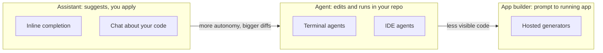

# AI coding tools landscape

After this you can sort an AI coding tool into assistant, agent or app builder, and evaluate one for your work using questions that stay true when the products change.

Before this: [Claude Code](01-claude-code.md), [AI security risks](04-ai-security-risks.md), and [VS Code and IDEs](../../04-developer-tools-and-workflow/01-editor-and-git/01-vs-code-and-ides.md).

## The idea

New tools appear every few months and existing ones change names, prices and features. A list of "the best tools" would be out of date before you finished reading it. What lasts is a way to place a tool on a map and a short list of questions to ask it.

The map has one axis that matters most: how much the tool does before you look. An assistant suggests, and you apply. An agent acts in your project and reports. An app builder produces a whole running application from a description. Many products offer more than one mode, so classify by the mode you are using, not by the logo.

In the diagram, moving right means less of your attention per line of code, so the review habits from [Reviewing AI code](03-reviewing-ai-code.md) matter more.

## Key terms

An **assistant** completes or answers inside your editor and waits for you to accept. An **agent** plans, edits files and runs commands in a loop, as in [Claude Code](01-claude-code.md). An **app builder** generates and often hosts a complete application from a prompt. A **data-use policy** states whether the vendor stores your prompts and code, and whether it trains models on them.

## How it works

The table lists well-known examples with their official pages (as of 2026). It is not a ranking, and each product may offer several modes.

| Tool | Where it runs | Typical mode | Official page |
|---|---|---|---|
| Claude Code | Terminal, IDEs, desktop, web | Agent | [code.claude.com](https://code.claude.com/docs/en/overview) |
| GitHub Copilot | IDEs, GitHub, terminal | Assistant, with agent features | [github.com/features/copilot](https://github.com/features/copilot) |
| Cursor | Its own editor | Assistant and agent | [cursor.com](https://cursor.com) |
| Codex CLI | Terminal | Agent | [github.com/openai/codex](https://github.com/openai/codex) |
| Gemini CLI | Terminal | Agent | [github.com/google-gemini/gemini-cli](https://github.com/google-gemini/gemini-cli) |
| Windsurf | Its own editor | Assistant and agent | [windsurf.com](https://windsurf.com) |
| v0, Lovable, Bolt | Browser | App builder | [v0.app](https://v0.app), [lovable.dev](https://lovable.dev), [bolt.new](https://bolt.new) |

To evaluate a tool for your work, test it on your own task and ask these questions.

1. **Fit.** Does it work in your editor and language, and with your repo layout and build?
2. **Control.** Can you see and approve each edit and command? Can you restrict permissions and run it in a sandbox?
3. **Context.** How does it find the relevant files, and can you give it project instructions as with `CLAUDE.md`? Claude Code can read an `AGENTS.md` file ([memory docs](https://code.claude.com/docs/en/memory)); check whether your tool does.
4. **Verification.** Can it run your tests and show the output?
5. **Data.** What leaves your machine? Is code stored? Is it used for training? Is there a plan that turns that off? Does your employer allow it ([PIPEDA](../../12-security/02-cryptography/06-privacy-and-pipeda.md))?
6. **Cost.** Is it a flat subscription, usage-based billing, or both? What happens at the limit? Prices change often, so read the current pricing page and set a spending cap if one exists.
7. **Lock-in.** Is your configuration in plain files you can move, or only in the vendor's UI?

For the Claude Code side, data handling is described in its [security docs](https://code.claude.com/docs/en/security) and the vendor's privacy policy. Check the same pages for any other tool.

## Worked examples

### Example 1: choosing for three jobs

Three situations, three different answers.

1. Writing a function inside a file you know well: an inline assistant is enough. You read each suggestion as it appears.
2. Renaming a concept across 40 files with tests: an agent that runs the tests. You review one diff per step with [the workflow](02-plan-build-test-review-workflow.md).
3. A throwaway landing page for a meeting tomorrow: an app builder, with the understanding that you would not ship its code without review.

Check each choice with questions 2 and 5 above: who sees the code, and how much can the tool do without asking. If you cannot answer, the tool is not ready for that job.

## Common mistakes

Watch out: picking a tool from a ranking or a social media thread. Try two on the same small task from your own repository.

Watch out: ignoring the data policy because the tool is "only a plugin". A plugin that reads your repo sends it somewhere.

Watch out: app-builder code treated as finished. It still needs the review checklist, a dependency audit and a security pass.

## Working with AI

Words to use: assistant, agent, app builder, context window, data-use policy, sandbox, `AGENTS.md`.

Prompts to try:

- "I am comparing two coding agents for a Django 5 project with pytest. List the questions I should test on a real task. Do not rank the tools and do not state prices."
- "Draft a one-page evaluation sheet with scoring rows for control, verification, data policy and cost, for a team of four."

What to check:

- Feature, pricing or policy claims. Confirm each on the vendor's own current page.
- Comparisons that read like rankings with no test behind them. Run your own task.
- Any statement about what a tool does with your data. Read the policy yourself.

## Quiz

1\. Classify these as assistant, agent or app builder by how you would use them: tab-completion in an editor, a terminal tool that runs your tests and edits files, a website that turns a paragraph into a hosted app.

Answer

Assistant, agent, app builder.

2\. Why does review matter more as you move from assistant to app builder?

Answer

Each step does more before you look, so diffs are bigger and more of the code is code you did not read as it was written.

3\. A vendor's pricing page says "unlimited". What do you check before relying on it?

Answer

The fair-use or rate limits in the terms, what happens when you hit them, and whether heavy agent use is billed separately.

4\. Your employer has no AI policy. What do you do before using an agent on work code?

Answer

Ask your manager or security team, and do not paste code, secrets or customer data until you get an answer. Check the tool's data-use terms in the meantime.

## Lab

### Lab: a two-tool bake-off

Goal: compare two tools on one task with the seven questions. Time: about 20 minutes plus the task. Needs a small project of yours.

1. Pick a 30-minute task in your own repository, such as adding a test file for one module.
2. Pick two tools from the table (free tiers are fine; do not give either secrets or real data).
3. Write the seven questions as rows, then fill in the answers from each tool's docs before you start.
4. Do the task once with each, in a separate Git branch. Count the corrections you had to make.
5. Score each row from 1 to 3 and note one surprise.
6. Cleanup: delete the branches you do not keep.

Expected: a filled table, and a reason for your choice that cites a row, not a feeling.

Solution

There is no single answer. A good result names a deciding row, for example "Tool B showed the test output and let me deny network access; Tool A did neither."

## Where this shows up

- Back to the basics: [Learning tech with AI](../../00-start-here/learning-tech-with-ai.md).
- Teams standardize tools and rules in [how software teams work](../../16-the-workplace/01-how-software-teams-work.md).
