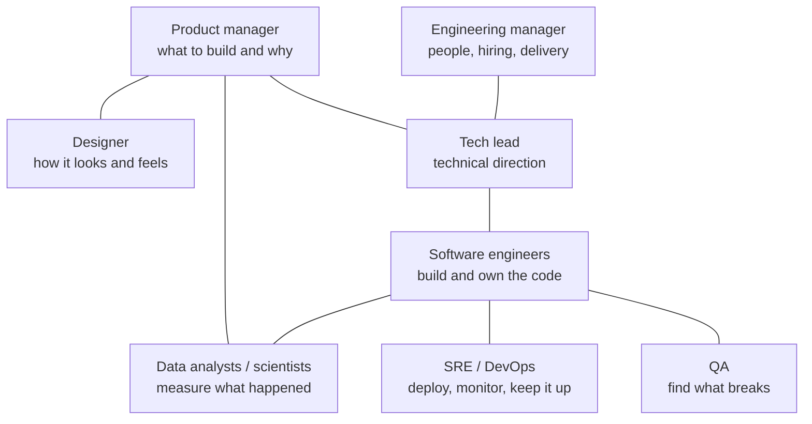
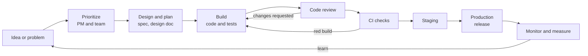

# How software teams work

After this you can name the roles on a software team, trace a feature from idea to production, and ask for help in a way that gets you an answer quickly.

Before this: [GitHub, pull requests and code review](../04-developer-tools-and-workflow/01-editor-and-git/04-github-pull-requests-and-code-review.md).

## The idea

On your first day you will be given a small bug. You fix it in an hour, open a pull request, and then wait two days. The code was never the slow part. Someone has to agree the bug matters, someone has to review the change, a test environment has to pass, and a release has to go out. Most of a job is the system around the code.

A software team is a group of people who each own part of that system. Titles differ between companies, but the same jobs exist almost everywhere, even when one person does two of them.



## Key terms

A **software engineer** (SWE) designs, writes, tests and maintains code. A **tech lead** is an engineer who guides technical decisions for a team and still writes code. An **engineering manager** (EM) is responsible for the people on the team: hiring, feedback, careers, and whether the team delivers.

A **product manager** (PM) decides what the team builds and in what order, based on users and business goals. A **designer** works on the user experience and interface. **QA** (quality assurance) tests the product and its edge cases; on many teams engineers write the automated tests and QA is a smaller or absent role.

**SRE** (site reliability engineering) and **DevOps** are the work of deploying software and keeping it running; see [incidents and on-call](../13-devops-and-cloud/04-operations/02-incidents-and-on-call.md). **Data** roles (analysts, data scientists, data engineers) turn usage data into decisions.

**Production** is the live system real users depend on. A **stakeholder** is anyone outside the team who cares about the result, such as sales or support.

## How it works

Work usually moves through the same stages, with feedback loops back to earlier ones.



Four meetings tend to matter. A short daily stand-up shares blockers. Planning decides what to do next. A demo or review shows finished work to others. A retrospective looks at how the team worked and changes one thing. One-on-ones with your manager are the place to ask about growth and raise problems early. Most other meetings are worth declining if you have no role in them; ask what decision the meeting is for.

## Worked examples

<div class="example" markdown>

### Example 1: who is involved in "add a dark mode toggle"

1. The PM writes the problem (users ask for it, support tickets mention eyestrain) and puts it in the backlog.
2. The designer produces both colour palettes and checks contrast.
3. The tech lead decides how colours are stored (CSS variables or a theme object) and flags the risk: every component with a hard-coded colour will break.
4. You build it behind a feature flag and write tests for the toggle state.
5. QA or a teammate tries it on a phone and in a browser with the setting already on.
6. SRE or the release process ships it. The data person checks whether usage rose.

Check: for any task you are given, write the name of the person who decides it is done. If you cannot, ask in your first message.

</div>

## Asking for help well

Stuck for more than about 30 minutes without progress? Ask. A good question lets the other person answer without a meeting:

```text
Goal: show an order's tax on the invoice page.
Problem: total is 0.00 when the province is ON.
Tried: logged the rate (0.13 comes back), checked tax_for() unit tests (pass).
Suspect: the rate is read before the address loads. I have not confirmed this.
Ask: does the address load asynchronously, or am I misreading it?
```

It states the goal, the symptom, what you tried, your best guess and one specific question. Put it in a team channel when others could learn from the answer.

## Common mistakes

<div class="warning" markdown>

Watch out: waiting silently. Being stuck for two days looks like no progress to the team; a question after 30 minutes costs one person five minutes.

Watch out: asking the wrong role. Priorities go to the PM, technical direction to the tech lead, workload and career to your EM. Asking an engineer "should we build this?" gets an opinion, not a decision.

</div>

## Working with AI

<div class="ai" markdown>

Words to use: stakeholder, acceptance criteria, blocker, staging, production, feature flag.

Prompts to try:

- "I am a new engineer and my task is 'add CSV export to the reports page'. List the questions I should ask the PM, the designer and the tech lead before starting."
- "Rewrite this help request so it states the goal, the symptom, what I tried, my guess and one question: (paste your draft)."

What to check:

- Generic process advice that does not fit your team. Compare it with how your team actually works and ask a teammate.
- Invented company facts. An AI does not know your team's norms; do not paste its guesses into a message as fact.
- Private code or customer data pasted into a tool your employer has not approved. Check the policy first.

</div>

## Quiz

1\. Who decides what the team builds next, and who is responsible for the team's people?

<details class="solution" markdown>
<summary>Answer</summary>

The product manager prioritizes what to build; the engineering manager is responsible for the people (feedback, growth, hiring). The tech lead guides technical decisions.

</details>

2\. Put these in order: staging, code review, production, build, CI checks.

<details class="solution" markdown>
<summary>Answer</summary>

Build, code review, CI checks, staging, production. Review and CI can run at the same time on many teams; the order shows where problems are caught before users see them.

</details>

3\. You have been stuck on a bug for a day and have told nobody. What is wrong, and what do you send?

<details class="solution" markdown>
<summary>Answer</summary>

You waited too long and nobody can help or plan around it. Send the five-line request: goal, symptom, what you tried, your guess, one specific question.

</details>

4\. A teammate asks you to build a feature that the PM has not approved. What do you do?

<details class="solution" markdown>
<summary>Answer</summary>

Say you will happily do it once it is prioritized, and ask the PM (or ask your teammate to). Building unprioritized work costs time from agreed work and may be thrown away.

</details>

## Lab

<div class="lab" markdown>

### Lab: write a ticket

Goal: write a clear ticket for a small change, as a PM and an engineer would both want it. Time: about 15 minutes. Runs in: any text editor.

1. Pick a small change in a project you know (for example "show an error when the email field is empty").
2. Write four parts: the problem, who is affected, what done looks like (two or three checks), and what is out of scope.
3. Add the name of the person who decides it is done.
4. Read it as a new teammate with no context. Is any word unclear?

<details class="solution" markdown>
<summary>Solution</summary>

```text
Title: Show an error when the sign-up email is empty

Problem: Submitting the sign-up form with an empty email shows a blank page
and logs a 500 error. Users think the site is broken.

Done when:
- An empty email shows "Enter your email address" under the field.
- The form is not sent to the server.
- A test covers the empty case.

Out of scope: validating email format, changing the form layout.

Decides it is done: PM (Priya). Reviewer: any backend engineer.
```

The title names the behaviour, the checks can be verified by someone else, and the scope line prevents a small fix from growing.

</details>

</div>

## Where this shows up

- [Agile, Scrum and Kanban](02-agile-scrum-and-kanban.md) describes how teams organize this flow.
- [Tickets, estimates and planning](03-tickets-estimates-and-planning.md) goes further on writing the work down.
