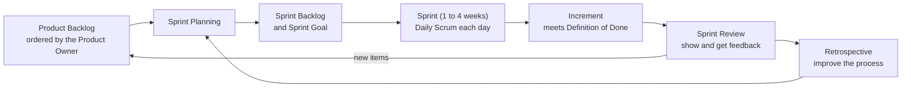

# Agile, Scrum and Kanban

After this you can describe the Agile values, the Scrum roles, events and artifacts, and how a Kanban board limits work in progress, and say what real teams do with them.

Before this: [How software teams work](01-how-software-teams-work.md).

## The idea

Imagine a team that spends six months building to a 200-page specification and ships it, and users say it is not what they need. Agile methods exist to avoid that: build a small piece, show it, learn, adjust. The two frameworks you will meet most are Scrum, which works in fixed-length cycles, and Kanban, which works as a continuous flow with limits.

In 2001 a group of developers wrote the [Agile Manifesto](https://agilemanifesto.org/). It states four values, each of the form "X over Y". The right-hand items still have value; the left-hand ones are valued more.

| More valued | Over |
|---|---|
| Individuals and interactions | Processes and tools |
| Working software | Comprehensive documentation |
| Customer collaboration | Contract negotiation |
| Responding to change | Following a plan |

## Key terms

**Agile** is a family of approaches built on short feedback cycles and working software. **Scrum** is a lightweight framework that organizes work into fixed-length cycles. It is defined in the [Scrum Guide](https://scrumguides.org/scrum-guide.html) (2020 edition, as of 2026).

A **Sprint** is a fixed period of one month or less during which the team builds a usable piece of the product. The Scrum Guide gives three accountabilities: the **Product Owner** decides what the Product Backlog contains and its order, the **Scrum Master** helps the team follow Scrum and removes obstacles, and the **Developers** build the **Increment**, a usable piece of work.

The five events are the Sprint itself, **Sprint Planning** (choose what to do), the **Daily Scrum** (15 minutes, plan the next day of work), the **Sprint Review** (show the Increment and get feedback) and the **Sprint Retrospective** (improve how the team works). The three artifacts are the **Product Backlog** (ordered list of everything wanted), the **Sprint Backlog** (the chosen items plus a plan) and the Increment. Each has a commitment: Product Goal, Sprint Goal and **Definition of Done**, the shared checklist that makes work count as finished.

**Kanban** is a method that shows work on a board and limits how much is in progress. A **WIP limit** (work in progress limit) is the maximum number of items allowed in one column.

## How it works

One Scrum cycle:



Kanban has no sprints. Items move left to right across a board, and a column refuses new work when it is full:

```text
 To do        | In progress (WIP 3) | In review (WIP 2) | Done
--------------+---------------------+-------------------+-----------
 [Search bug] | [Export CSV]        | [Login fix]       | [Typo fix]
 [Dark mode]  | [Rate limit]        | [Retry logic]     | [Add logs]
 [Docs]       | [Cache TTL]         |                   |
```

Here "In review" is full. Someone who finishes work has to review a pull request before starting something new, which is the point: finishing beats starting. A queue that keeps growing in one column shows where the bottleneck is.

## Worked examples

<div class="example" markdown>

### Example 1: why a WIP limit shortens delivery

One developer has 6 tasks that each take 2 days. Doing them one at a time, the first is finished on day 2, the second on day 4, and so on to day 12, an average of 7 days to finish. If the developer starts all six and switches between them, every task is only partly done until about day 12, so all six arrive near the end and nothing can be reviewed or shown earlier. We can check:

```python
tasks, days_each = 6, 2
sequential = [days_each * (i + 1) for i in range(tasks)]
print("sequential finish days:", sequential, "average", sum(sequential) / tasks)
print("all at once, all finish near day", tasks * days_each)
```

```text
sequential finish days: [2, 4, 6, 8, 10, 12] average 7.0
all at once, all finish near day 12
```

The total work is the same, but limiting work in progress delivers the first result on day 2 and keeps feedback flowing. Real tasks also wait on reviews and other people, which a WIP limit makes visible.

</div>

## What teams actually do

Most teams use a blend, sometimes called Scrumban: two-week sprints, a board with WIP limits, and a retrospective that only sometimes changes anything. Many skip parts of Scrum (no Scrum Master, a stand-up that runs 30 minutes). The Scrum Guide itself says Scrum is a framework, not a full method, so teams fill in the rest. Learn the vocabulary, then follow what your team does.

## Common mistakes

<div class="warning" markdown>

Watch out: confusing a story point with a number of hours, or a sprint with a deadline for everything. A sprint is a timebox for a goal, and the team can end it with unfinished items that return to the backlog.

Watch out: treating the stand-up as a status report to the manager. The Daily Scrum is for the Developers to plan the next day of work.

</div>

## Working with AI

<div class="ai" markdown>

Words to use: Sprint Goal, Definition of Done, Product Backlog, WIP limit, retrospective, Increment.

Prompts to try:

- "Our team has 5 engineers and 2-week sprints, but sprint reviews are skipped and items roll over. Using the 2020 Scrum Guide's wording, suggest three small changes."
- "Write a Definition of Done checklist for a web API team that uses code review and CI."

What to check:

- Terms from older Scrum versions or from other frameworks. Compare the vocabulary with the [current guide](https://scrumguides.org/scrum-guide.html).
- A claim that Agile means no planning or no documentation. The Manifesto says working software is valued more than documentation, not that documentation is skipped.
- Process advice that adds meetings. Check what each new meeting would decide.

</div>

## Quiz

1\. Name the three Scrum accountabilities and one thing each is responsible for.

<details class="solution" markdown>
<summary>Answer</summary>

Product Owner: the Product Backlog and its order. Scrum Master: helping the team follow Scrum and removing obstacles. Developers: building a usable Increment each Sprint.

</details>

2\. A Kanban column has a WIP limit of 2 and holds 2 items. A developer finishes a task. What happens?

<details class="solution" markdown>
<summary>Answer</summary>

They cannot pull a new item into that column. They help move an item out of it (for example by reviewing), so the flow continues.

</details>

3\. Your Sprint Review is a 5-minute email with no demo. Which Scrum event goal is lost?

<details class="solution" markdown>
<summary>Answer</summary>

Feedback on the Increment from stakeholders. Without a live look at the working software, the team learns about wrong assumptions later and at higher cost.

</details>

4\. Which side of "Working software over comprehensive documentation" does the Manifesto say still has value?

<details class="solution" markdown>
<summary>Answer</summary>

The right-hand side, documentation. It says the left side is valued more, not that the right side is worthless.

</details>

## Lab

<div class="lab" markdown>

### Lab: draw a board and set limits

Goal: set up a Kanban board and choose WIP limits for a team. Time: about 10 minutes. Runs in: a text editor or paper.

1. List 8 tasks a team of 3 might have: bugs, a feature, a docs update, a dependency upgrade.
2. Draw columns: To do, In progress, In review, Done.
3. Choose WIP limits for In progress and In review, and justify each in one sentence.
4. Place the tasks so no limit is broken, then move two tasks to Done and say what each person picks next.

<details class="solution" markdown>
<summary>Solution</summary>

A reasonable choice for 3 people is In progress 3 (one each) and In review 2. The review limit is lower than the number of authors so work cannot pile up unreviewed. The rule for what to pick next: first help review, then pull from To do.

```text
To do        | In progress (3) | In review (2) | Done
Docs         | Export CSV      | Login fix     | Typo fix
Upgrade lib  | Rate limit      | Retry logic   | Add logs
Dark mode    | Cache TTL       |               |
Search bug   |                 |               |
```

</details>

</div>

## Where this shows up

- [Tickets, estimates and planning](03-tickets-estimates-and-planning.md) covers what goes on the cards and how to size them.
- [Incidents and on-call](../13-devops-and-cloud/04-operations/02-incidents-and-on-call.md) shows work that interrupts any plan.
