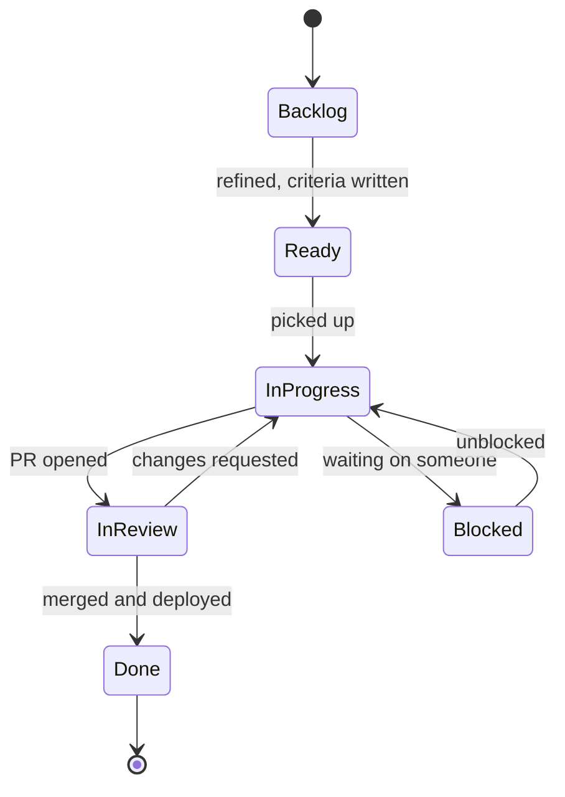

# Tickets, estimates and planning

After this you can write a ticket someone else can finish without asking you, give an estimate as a range, and break a large task into pieces.

Before this: [Agile, Scrum and Kanban](02-agile-scrum-and-kanban.md).

## The idea

A ticket that says "fix the search" can mean twenty different jobs. Two engineers read it differently, one spends three days on the wrong thing, and the PM is surprised. A ticket is a small written agreement about what will change and how everyone will know it worked. The estimate is a guess about how long that will take, and the guess is wrong more often than people expect.

## Key terms

A **ticket** (also called an issue or story) is one tracked unit of work in a tool such as Jira or Linear. Both are issue trackers: Jira is the older, more configurable one, and Linear is a newer, faster one. The ideas below are the same in either.

**Acceptance criteria** are the checks that must be true for the ticket to count as done. **Scope** is what the ticket covers; **out of scope** names what it deliberately does not.

An **estimate** is a prediction of effort. A **story point** is a unit of relative size, usually on a scale like 1, 2, 3, 5, 8, that compares tickets with each other, not with the clock. A **range estimate** gives a low and a high value, such as "2 to 5 days".

A **spike** is a short, time-boxed investigation to learn enough to estimate or choose an approach.

## How it works

A good ticket has four parts.

1. Problem: what is wrong or missing, and for whom. Not the solution yet.
2. Acceptance criteria: two to five checks written so a stranger can test them.
3. Scope: what is included and what is out.
4. Context: links to the design, the error, the logs, the person to ask.

Tickets move through states. The names vary, but the shape does not:



Why estimates are wrong: you estimate the work you can see, and the work you cannot see (review waits, a flaky test, an unclear requirement, an unfamiliar library) often takes longer than the coding. Most estimates are optimistic, because the best case is the easiest to picture. Story points hide this by comparing tickets with each other. They tell the team how much it can take on in a sprint from past experience, and they are not a promise in hours.

Two habits help. Break work into pieces of about a day or two, since small pieces are easier to estimate and show progress. Give a range with a reason: "2 to 5 days; the low case if the API already returns the field, the high if we must change it."

## Worked examples

<div class="example" markdown>

### Example 1: turning a range into a plan

We estimate a task three ways: best case 2 days, likely 3, worst case 8. A common planning formula (the three-point or PERT estimate) weights the likely value:

$$\text{expected} = \frac{\text{best} + 4 \times \text{likely} + \text{worst}}{6}$$

1. Substitute: $(2 + 4 \times 3 + 8) / 6$.
2. That is $22 / 6 \approx 3.7$ days, higher than the likely 3 because the worst case is far from the best.
3. Tell the PM "3 to 4 days, up to 8 if the API needs changes", not "3 days".

```python
best, likely, worst = 2, 3, 8
expected = (best + 4 * likely + worst) / 6
print(f"expected {expected:.1f} days, range {best} to {worst}")
```

```text
expected 3.7 days, range 2 to 8
```

Check: the expected value lies between best and worst, and moves toward worst when worst grows.

</div>

<div class="example" markdown>

### Example 2: splitting a large ticket

"Add user profiles" splits into: create the profile table and migration (1 day), read-only profile page (2 days), edit form with validation (2 days), avatar upload (spike first, then 2 days). Each piece can be reviewed and shipped alone, and the avatar piece can be dropped if time runs out.

</div>

## Common mistakes

<div class="warning" markdown>

Watch out: writing the solution as the ticket ("add an index on orders.user_id"). If the real problem is a slow page, say that and list the target time; the index may not be the fix.

Watch out: quoting a single number under pressure. A single number is heard as a promise. Give the range and what would move it.

Watch out: a ticket with no way to test it. If you cannot write the acceptance criteria, you do not know the work yet; schedule a spike.

</div>

## Working with AI

<div class="ai" markdown>

Words to use: acceptance criteria, scope, out of scope, spike, story point, range estimate.

Prompts to try:

- "Turn this vague ticket into a problem statement, 4 acceptance criteria I can test, and an out-of-scope list: 'users complain checkout is slow'. Ask me questions if anything is missing."
- "Split this feature into pieces of at most two days each that can be merged independently: (paste description)."

What to check:

- Acceptance criteria that cannot be tested ("fast", "user friendly"). Replace them with a number or an observable behaviour.
- Estimates from an AI. It cannot know your codebase or your team; use its list of pieces and risks, then give the numbers yourself.
- Invented technical details (table names, endpoints). Check each against the real code.

</div>

## Quiz

1\. What is the difference between a story point and an hour?

<details class="solution" markdown>
<summary>Answer</summary>

A story point is a relative size compared with other tickets; an hour is clock time. Points average out over a team and past sprints, and different people take different hours for the same point count.

</details>

2\. Evaluate $(1 + 4 \times 2 + 9)/6$ for a task. What do you report?

<details class="solution" markdown>
<summary>Answer</summary>

$(1 + 8 + 9)/6 = 3$ days expected. Report "2 to 3 days, up to 9 if the risk happens" and say what the risk is.

</details>

3\. A ticket says "make the dashboard better". What is wrong, and how do you fix it?

<details class="solution" markdown>
<summary>Answer</summary>

There is no problem statement, no criteria and no scope. Ask who is affected and what fails, then write testable criteria such as "the dashboard loads in under 2 seconds for 10,000 rows".

</details>

4\. Why split a five-day task into pieces of one or two days?

<details class="solution" markdown>
<summary>Answer</summary>

Small pieces are easier to estimate and review, show progress, can be merged on their own, and expose a problem early instead of on day five.

</details>

## Lab

<div class="lab" markdown>

### Lab: write a ticket and an estimate

Goal: turn a vague request into a ticket with a range estimate. Time: about 15 minutes. Runs in: a text editor.

1. Take the request "the CSV export is broken for some users".
2. Write a ticket with problem, acceptance criteria (three), out of scope, and context.
3. List the unknowns that make it hard to estimate and write the first spike.
4. Give a best, likely and worst estimate and the reason for the worst case.

<details class="solution" markdown>
<summary>Solution</summary>

```text
Title: CSV export fails when a name contains a comma or quote

Problem: Support reports that exports open with shifted columns for
customers with commas in their names. Affects reports used by finance.

Done when:
- Names with commas, quotes and newlines export correctly (test cases added).
- The file opens with correct columns in Excel and Google Sheets.
- Existing exports without special characters are unchanged.

Out of scope: new columns, changing the file name format.

Context: export code in reports/export.py, example ticket SUP-412.

Spike (2 hours): reproduce with the customer data and find where the file is written.
Estimate: best 0.5 day (quoting is missing), likely 1 day, worst 3 days
(the export streams rows by hand and a second code path exists).
```

The worst case names its cause, so the PM knows what the high end depends on.

</details>

</div>

## Where this shows up

- [Code review etiquette](04-code-review-etiquette.md) is the next step after a ticket becomes a pull request.
- [Documentation and READMEs](../04-developer-tools-and-workflow/03-code-quality/04-documentation-and-readmes.md) covers the writing that sits next to tickets.
