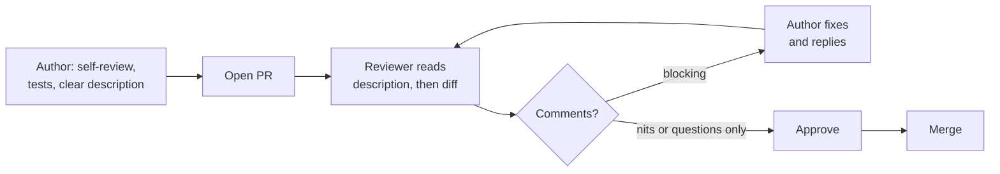

# Code review etiquette

After this you can open a pull request that is easy to review, review someone else's pull request kindly and usefully, and review AI-written code with the right suspicion.

Before this: [Tickets, estimates and planning](03-tickets-estimates-and-planning.md) and [GitHub, pull requests and code review](../04-developer-tools-and-workflow/01-editor-and-git/04-github-pull-requests-and-code-review.md), which covers the mechanics (opening a PR, comments, approvals).

## The idea

Code review is a conversation between two people about a change. The author wants the change merged; the reviewer wants the codebase to stay healthy and understandable. Reviews go badly when either side treats them as a judgment of the person, and they go well when both treat them as a shared check of the code. The mechanics are in the earlier lesson; this one is about the human side.



## Key terms

A **pull request** (PR) is a proposed change on a branch, open for discussion and review. A **blocking** comment must be resolved before merge; a **non-blocking** comment is a suggestion the author may take or leave. A **nit** is a small style or taste point, labelled `nit:` so nobody mistakes it for a blocker.

**LGTM** means "looks good to me". **Self-review** is reading your own diff in the PR view before asking anyone else.

## How it works

As the author:

1. Keep the PR small: one purpose, ideally a few hundred changed lines at most. Large PRs get skimmed, and a skimmed review misses bugs.
2. Read your own diff first. You will find debug prints, a stray file and a commented-out block.
3. Write a description with the why, what, how you tested it, and what to look at.
4. Add or update tests, and make sure the checks pass before you ask.
5. Reply to every comment, and say what you changed or why you did not.

As the reviewer:

1. Read the description first, then the tests, then the code.
2. Ask questions instead of giving orders: "What happens if the list is empty?" is easier to hear than "Handle empty lists".
3. Label comments: `blocking:`, `question:`, `nit:`, or `suggestion:`. The author should never have to guess.
4. Comment on the code, not the person: "this function does two things", not "you wrote a messy function".
5. Say what is good when something is. Reply within a working day if you can; a PR waiting for days breaks the author's flow.

## Reviewing AI-written code

An AI tool, or a teammate using one, can produce a large diff that looks tidy and compiles. The reviewer still owns the merge. Check that the change does what the ticket asks (the code may solve a nearby problem), that tests would fail if the code were wrong, that every imported package and called function exists, and that nothing sensitive was added. Authors using AI should read every line before opening the PR and say in the description which parts were generated. A later lesson goes deeper on [reviewing AI code](../15-ai-and-llms/03-ai-assisted-development/03-reviewing-ai-code.md).

## Worked examples

<div class="example" markdown>

### Example 1: rewriting a comment

A reviewer writes:

```text
This is wrong. Why would you query inside a loop? Fix it.
```

The comment names a real problem but gives the author no help and attacks them. A better version:

```text
blocking: this runs one query per order (the N+1 pattern), so a page with
500 orders sends 500 queries. Could we fetch all items with one
`WHERE order_id IN (...)` query before the loop? Happy to pair on it.
```

Check: does the rewrite say what is wrong, why it matters, and a way forward, with a label that tells the author whether they can merge?

</div>

<div class="example" markdown>

### Example 2: a short PR description

```text
Why: finance sees shifted columns in the CSV export (SUP-412).
What: quote fields with commas, quotes and newlines using csv.writer.
Testing: added test_export_special_characters, opened the file in Excel.
Review focus: export.py lines 40-70. The quoting logic was copied from the report module.
Not in this PR: new columns.
```

</div>

## Common mistakes

<div class="warning" markdown>

Watch out: a "drive-by" rewrite inside a bug fix. It makes the diff unreadable. Put cleanup in a separate PR.

Watch out: approving to be nice. An approval says you read the change and would be comfortable owning it.

Watch out: arguing taste in review. If a linter or a style guide can settle it, let the tool decide (see [linters and formatters](../04-developer-tools-and-workflow/03-code-quality/03-linters-formatters-and-type-checkers.md)).

</div>

## Working with AI

<div class="ai" markdown>

Words to use: blocking comment, nit, diff, self-review, regression, test coverage.

Prompts to try:

- "Here is my diff. Act as a reviewer: list possible bugs, missing edge cases and missing tests. Do not rewrite the code. Label each item blocking or nit."
- "Rewrite this review comment so it is specific, kind and labelled, without changing the technical point: (paste comment)."

What to check:

- Review points that refer to code not in the diff. Open the file and check each line number and name.
- Praise or approval from an AI treated as a real review. It does not replace a teammate who knows the system.
- Generated tests that only repeat the implementation. Break the code on purpose and see if a test fails.

</div>

## Quiz

1\. What does the prefix `nit:` tell the author?

<details class="solution" markdown>
<summary>Answer</summary>

The comment is a small taste or style point that does not block the merge.

</details>

2\. Which is better, "Handle the empty list" or "What happens if the list is empty?" and why?

<details class="solution" markdown>
<summary>Answer</summary>

The question. It is easier to hear and invites an answer ("it cannot be empty because...") when the reviewer is missing context.

</details>

3\. A PR changes 2,400 lines across 35 files and is described as "updates". What do you ask the author?

<details class="solution" markdown>
<summary>Answer</summary>

Ask for a description with why and what, and to split the PR into smaller, single-purpose PRs. A review at that size will miss bugs.

</details>

4\. A teammate's PR was mostly generated by an AI and the tests pass. What do you still check?

<details class="solution" markdown>
<summary>Answer</summary>

That it solves the ticket, that the tests would fail on wrong code, that the packages and functions exist, and that no secrets or unrelated changes are included.

</details>

## Lab

<div class="lab" markdown>

### Lab: write a pull request description

Goal: write a description a reviewer can use in two minutes. Time: about 15 minutes. Runs in: any text editor.

1. Take a recent change you made (or the CSV quoting fix from the examples).
2. Write why, what, how tested, review focus, and what is not in this PR.
3. Read your own diff and list three things you would fix before asking for review.
4. Write two review comments on a classmate's or your own code: one blocking, one nit, both labelled and phrased as questions where you can.

<details class="solution" markdown>
<summary>Solution</summary>

```text
Why: users can sign up with an empty email and get a blank page (TKT-88).
What: validate the email on the server and show a message under the field.
Testing: added test_signup_empty_email, tried the form in Chrome and Firefox.
Review focus: validators.py (new) and the error branch in signup_view.
Not in this PR: email format checks, form redesign.

Self-review finds: a leftover print(), an unused import, a TODO without a ticket.

blocking: signup_view returns 200 on an empty email. Should it be 400 so clients can tell it failed?
nit: rename ok to is_valid, which says what it checks.
```

</details>

</div>

## Where this shows up

- [Design docs and writing](05-design-docs-and-writing.md) moves the discussion earlier, before the code exists.
- Teams automate part of review with CI checks and linters; see [linters and formatters](../04-developer-tools-and-workflow/03-code-quality/03-linters-formatters-and-type-checkers.md).
