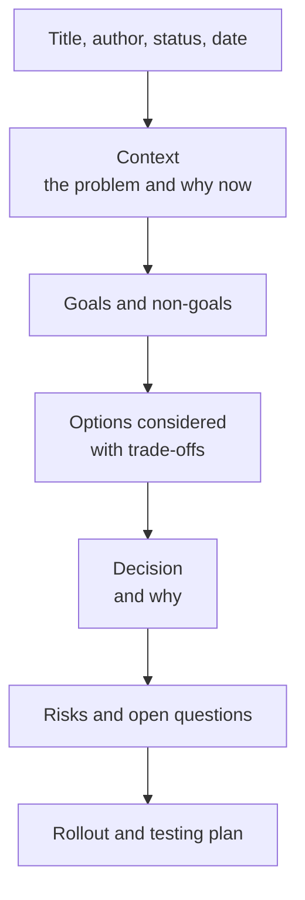

# Design docs and writing

After this you can decide when a change needs a design doc, write one with the standard sections, and write so busy people can read it.

Before this: [Code review etiquette](04-code-review-etiquette.md).

## The idea

Two weeks into building a notification system, a reviewer asks, "why not use the queue we already have?" Nobody wrote down the options, so the team either rebuilds or defends a choice it never made on purpose. A **design doc** is a short document, written before the code, that states the problem, the options and the choice, so people can disagree while it is still cheap to change.

A design doc is not a specification of every line. It exists so that other engineers can find what you missed, and so that someone who joins in a year can see why the system looks as it does.



## Key terms

A **design doc** (or RFC, "request for comments") is a written proposal that others review before implementation. A **goal** is a result the design must achieve; a **non-goal** is something it deliberately does not try to do. A **trade-off** is what you give up to get something else, such as simplicity for speed.

An **ADR** (architecture decision record) is a very short document that records one decision: the context, the decision and the consequences. A design doc is long and explores; an ADR is short and keeps the final answer in the repository next to the code, often under `docs/adr/`.

## How it works

Write one when a change is hard to undo (a new database, a public API), touches several teams, takes more than a couple of weeks, or when you are unsure and want review. Skip it for a bug fix or a small feature where a PR description is enough.

A common template, one to three pages:

1. Context: what is wrong or missing, who is affected, and any numbers (current load, error rate).
2. Goals and non-goals: three or four of each. Non-goals prevent scope growth.
3. Options: two or three real alternatives, including "do nothing", each with pros and cons.
4. Decision: the chosen option and the reasons, tied back to the goals.
5. Risks and open questions: what could go wrong, what you do not know yet, how you would find out.
6. Rollout and testing: how it ships safely and how you will know it worked.

Writing for busy readers is mostly ordering. Put the conclusion first ("I propose we add a Redis cache to the product page"), then the reasons. Use short paragraphs, a table for comparisons, and one diagram where a picture explains the flow. Define a term the first time you use it. Name the decision you need from the reader and a date. Cut anything that does not help someone decide.

## Worked examples

<div class="example" markdown>

### Example 1: an options table

We need to send email receipts reliably. The doc compares three options:

| Option | Reliability | Effort | Main risk |
|---|---|---|---|
| Send inside the request | Low (a mail outage fails checkout) | 1 day | Slow, fragile checkout |
| Background job queue (the one we have) | High (retries) | 3 days | Queue backlog delays mail |
| Third-party email API only | Medium | 2 days | Vendor lock-in and cost |

1. The decision section picks the queue, because the goals were "checkout never fails because of mail" and "reuse existing infrastructure".
2. It names the risk (backlog) and the check (alert if the queue is older than 5 minutes).

Check: could a reader who has not met the team tell which goal each option meets or misses? If not, add the missing column.

</div>

## An ADR in five lines

```text
# ADR 007: Use a job queue for email receipts
Status: accepted (2026-03-02)
Context: Sending mail inside checkout makes checkout fail when mail is down.
Decision: Enqueue receipts and send them from a worker with retries.
Consequences: Receipts can arrive minutes late. We need a queue-age alert.
```

## Common mistakes

<div class="warning" markdown>

Watch out: writing the doc after the code is done. It then justifies the choice instead of testing it, and reviewers rightly feel it is too late to object.

Watch out: only one option. A doc with one option and no alternatives is an announcement. Include the option that you rejected and why.

Watch out: a 20-page doc nobody reads. If it is long, add a five-line summary at the top and move detail into appendices.

</div>

## Working with AI

<div class="ai" markdown>

Words to use: design doc, goals and non-goals, trade-off, ADR, rollout plan, open question.

Prompts to try:

- "Here are my notes on adding a cache to our product API (read-heavy, 200 requests per second, Postgres). Draft a design doc with context, goals, non-goals, three options, and a risk list. Mark anything you assumed."
- "Review this design doc as a sceptical senior engineer. List the five hardest questions a reviewer would ask."

What to check:

- Numbers, limits and product behaviours stated as facts. Verify each against the vendor's docs or your own measurements.
- Options that sound plausible but do not fit your stack (a tool you do not run). Ask a teammate which options are realistic.
- Filler. Delete any paragraph that does not help a reader choose.

</div>

## Quiz

1\. When does a change need a design doc, and when is a PR description enough?

<details class="solution" markdown>
<summary>Answer</summary>

A doc fits changes that are hard to undo, cross teams, take weeks, or are uncertain. A small bug fix or a feature with an obvious approach needs only a PR description.

</details>

2\. What is the purpose of a non-goals section?

<details class="solution" markdown>
<summary>Answer</summary>

It states what the design will not do, so reviewers do not ask for it and the scope stays fixed.

</details>

3\. A doc has a context section and a decision section but no options. What is missing and why does it matter?

<details class="solution" markdown>
<summary>Answer</summary>

The alternatives and their trade-offs. Without them nobody can tell if the decision was reasoned, and reviewers cannot suggest a better option.

</details>

4\. How is an ADR different from a design doc?

<details class="solution" markdown>
<summary>Answer</summary>

An ADR is a short record of one decision (context, decision, consequences) kept with the code. A design doc is a longer proposal that explores options before the decision.

</details>

## Lab

<div class="lab" markdown>

### Lab: outline a design doc

Goal: write the outline of a design doc for a real small problem. Time: about 20 minutes. Runs in: any text editor.

1. Pick a problem: "users want to reset their password by email".
2. Write context in three sentences, then three goals and two non-goals.
3. List two real options and one pro and one con for each.
4. State the decision, two risks and one open question.
5. Write a four-line ADR for the decision.

<details class="solution" markdown>
<summary>Solution</summary>

```text
Title: Password reset by email (draft, 2026-03-02)

Context: Users who forget a password email support. About 40 requests a
week (from the support tracker) take an agent 10 minutes each.
Goals: self-service reset, link expires in 30 minutes, no account
enumeration. Non-goals: SMS reset, changing the login page.

Options:
A. Signed token in the email link. Pro: no storage. Con: cannot revoke one link.
B. Random token stored hashed in the database. Pro: single use, revocable.
   Con: one new table.
Decision: B, because revoking links is a goal.
Risks: email delays, token leaks in logs. Open question: which provider sends mail?

ADR 012: Store hashed single-use reset tokens. Status: proposed.
```

The numbers in the context are made up for the exercise; in a real doc, take them from data.

</details>

</div>

## Where this shows up

- [Software design lessons](../14-software-and-system-design/01-software-design/01-clean-code.md) give the vocabulary for options and trade-offs.
- [Working in a legacy codebase](06-working-in-a-legacy-codebase.md) often means reading old design docs and ADRs to learn why code looks the way it does.
