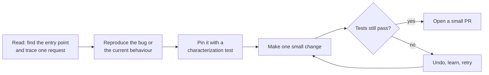

# Working in a legacy codebase

After this you can enter an unfamiliar codebase, find where to start, pin down its current behaviour with a test, and make a small safe change.

Before this: [Design docs and writing](05-design-docs-and-writing.md).

## The idea

Your first assignment is a bug in a ten-year-old service. There are 200 files, little documentation, and the person who wrote the file you need left in 2021. This is normal. Most professional work is changing code someone else wrote, and the skill is changing it without breaking what already works.

**Legacy code** is code that is already running in production and that you did not write, often without tests. It matters because it earns money today. The goal is not to understand all of it. The goal is to understand enough to change one thing safely.



## Key terms

An **entry point** is where execution starts for a feature: a `main` function, a route handler, a scheduled job or a message consumer. A **characterization test** records what the code does now, whether or not that is correct, so you will notice if your change alters it. It is also called a golden-master or snapshot test.

A **refactor** changes the structure of code without changing its behaviour (see [coupling, cohesion and refactoring](../14-software-and-system-design/01-software-design/06-coupling-cohesion-and-refactoring.md)). The **boy-scout rule** says to leave the code slightly cleaner than you found it: rename one unclear variable, delete one dead branch, in the area you are already changing.

## How it works

1. Find the entry point of the thing you are changing. Search for the URL path, the error message text, a table name or a log line. Search is your main tool.
2. Trace one real request from the entry point to where it ends (the database write, the response). Take notes in your own words. A debugger or log lines beat reading in your head.
3. Reproduce the current behaviour with a script or a test. If you cannot reproduce it, you cannot know you fixed it.
4. Write a characterization test around the code you will touch.
5. Change one thing. Run the tests. Commit. Repeat.
6. Open a small PR that separates the behaviour change from any cleanup.

Ask the people who know. Git history shows who wrote a file and why: `git log --follow -p path/to/file` and `git blame path/to/file`. A teammate who has worked there two years can save you a day. Prepare the question first (see the help-request format in [How software teams work](01-how-software-teams-work.md)).

## Worked examples

<div class="example" markdown>

### Example 1: pin the behaviour before changing it

An old function computes shipping costs. You must add a new surcharge. First record what it does today.

```python
def shipping(weight, country):
    if country == "CA":
        c = 8 if weight < 2 else 8 + (weight - 2) * 1.5
    else:
        c = 20 + weight * 2
    if weight > 30:
        c = c + 15
    return round(c, 2)

# Characterization tests: record what the code does today, right or wrong.
assert shipping(1, "CA") == 8
assert shipping(4, "CA") == 11.0
assert shipping(2, "US") == 24
assert shipping(31, "CA") == 8 + 29 * 1.5 + 15
print("all characterization tests pass")
print(shipping(31, "CA"))
```

```text
all characterization tests pass
66.5
```

1. Call the function with inputs from each branch (CA light, CA heavy, other country, over 30).
2. Write the value it returns as the expected value, even if you suspect a bug. You are recording, not judging.
3. Now add the surcharge. If the tests fail unexpectedly, your change altered something you did not mean to.

Check: change the `15` to `16` and see the last test fail. A test that cannot fail is not protecting you.

</div>

## Using AI to read unfamiliar code

Ask an AI tool to explain a function, summarise a module, or find where a value is set. It is quick for orientation and often wrong in the details: it may describe what the code looks like it should do. Treat its explanation as a map to check, and verify with a debugger, a log line, a search, or a test. Do not paste proprietary code into a tool your employer has not approved.

## Common mistakes

<div class="warning" markdown>

Watch out: the big rewrite. "Let's rewrite it cleanly" usually takes longer than expected and drops behaviours nobody remembered. Improve it in small steps instead.

Watch out: removing code that "is never used". Check callers across repositories, scheduled jobs and logs before deleting; search is not proof.

Watch out: mixing a fix with a reformat. A diff of 800 changed lines hides the 8 that matter.

</div>

## Working with AI

<div class="ai" markdown>

Words to use: entry point, call graph, characterization test, refactor, dead code, blast radius.

Prompts to try:

- "Here is the route handler and the function it calls (pasted). Explain step by step what happens for a POST with an empty body, and list what I should verify by running the code."
- "Write characterization tests in pytest for this function. Record the current outputs for inputs covering each branch, and do not fix any bug you notice. List suspected bugs separately."

What to check:

- A claim about code it has not seen. Check that each function it names exists in the repository with `git grep`.
- Generated tests that assert the behaviour you wish the code had. Run them against the unchanged code first; they should pass.
- Refactors that change behaviour in edge cases (rounding, null handling, ordering). Compare outputs before and after with the same inputs.

</div>

## Quiz

1\. What is a characterization test, and why write it before a change?

<details class="solution" markdown>
<summary>Answer</summary>

A test that records the current behaviour of the code, right or wrong. It tells you if your change accidentally alters anything else.

</details>

2\. In Example 1, what does `shipping(31, "CA")` return, and why?

<details class="solution" markdown>
<summary>Answer</summary>

66.5. The weight is over 2, so the cost is $8 + 29 \times 1.5 = 51.5$, and the over-30 branch adds 15.

</details>

3\. You find a function that looks unused. What do you do before deleting it?

<details class="solution" markdown>
<summary>Answer</summary>

Search the whole codebase and other repositories for callers, check scheduled jobs and dynamic calls (by name in config), and ask the owner. Remove it in a separate PR so it is easy to revert.

</details>

4\. An AI tool says a function "validates the email format". How do you confirm it?

<details class="solution" markdown>
<summary>Answer</summary>

Read the function and call it with valid and invalid emails, or step through with a debugger. The explanation is a hypothesis until a run of the code agrees.

</details>

## Lab

<div class="lab" markdown>

### Lab: first change in an unfamiliar repo

Goal: make one small, tested change in a repository you did not write. Time: about 20 minutes. Runs in: any terminal.

1. Clone an open source project you use, in a language you know.
2. Pick a feature, search the code for its error message or name, and find the entry point.
3. Write three lines of notes on the path from the entry point to the end of the request.
4. Run `git log --follow -p` on one file and note who changes it and why.
5. Write a characterization test for one small function, run it, then change a comment or a variable name and run it again.

<details class="solution" markdown>
<summary>Solution</summary>

Sample notes for a web project:

```text
Entry point: routes/orders.py, create_order().
Path: validates input -> calls pricing.total() -> saves via db.insert_order() -> returns 201.
History: pricing.py changed 6 times; 4 commits mention rounding.
Test: test_total_rounds_half_up pins today's rounding, before I touch it.
```

Success is a green test before and after your rename, and a notes file that another person could follow.

</details>

</div>

## Where this shows up

- [Incidents and on-call](../13-devops-and-cloud/04-operations/02-incidents-and-on-call.md) is when you work in old code under time pressure.
- [Open source and licences](07-open-source-and-licences.md) is where you read a codebase you do not own.
