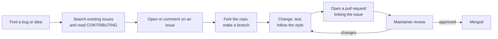

# Open source and licences

After this you can make a first contribution to an open source project, describe the main licences in plain words, and check what licences your dependencies carry.

Before this: [Working in a legacy codebase](06-working-in-a-legacy-codebase.md).

## The idea

Almost every project you build today sits on open source: your language runtime, your web framework, hundreds of packages. Each package comes with a licence, which is the legal permission to use it and the conditions attached. Using code without reading its licence is like using a stranger's car without asking what they expect in return.

Contributing is the other side. You find a bug in a library, report it or fix it, and the fix helps every user. It is also public proof of your work, which matters for the [resume](08-resume-and-portfolio.md).



## Key terms

**Open source** software has source code released under a licence that lets others use, study, change and share it, within conditions. A **licence** is the document that sets those conditions. A **maintainer** is a person who reviews and merges changes to a project. A **fork** is your own copy of a repository where you can push changes; a **CONTRIBUTING file** states how the project wants issues and pull requests.

Licences fall in two families. A **permissive** licence lets you use the code almost any way, including in closed products, if you keep the copyright notice. A **copyleft** licence requires that if you distribute a work built on the code, you release your work under the same terms.

An **SPDX identifier** is a short standard name for a licence, such as `MIT` or `Apache-2.0`, listed at [spdx.org/licenses](https://spdx.org/licenses/). For choosing a licence for your own project, [choosealicense.com](https://choosealicense.com/) compares them.

## The main licences in plain words

| Licence | Family | What it asks |
|---|---|---|
| MIT | Permissive | Keep the copyright and licence text. Very short. |
| Apache-2.0 | Permissive | Keep notices, state changes, and it includes an explicit patent grant. |
| GPL-3.0 | Strong copyleft | If you distribute a program that includes it, release that program's source under GPL. |
| AGPL-3.0 | Network copyleft | Like GPL, and also if users interact with it over a network, you must offer them the source. |

The GPL's duty is triggered by distributing the software (giving copies to others). A company running GPL code only on its own servers does not distribute it, which is why the AGPL was written: it also covers use over a network. Details differ with how the code is combined and what the licence text says, so read the actual terms.

Companies care because a licence can bind their product. A company selling a downloadable app does not want a GPL dependency forcing them to publish its source, and many ban AGPL on servers. A project with no licence is not free to use: by default, copyright applies and you have no permission.

This is general information, not legal advice. For a real product decision, ask your company's legal team.

## How it works

Check dependencies before you adopt them:

1. Look at the licence in the package's repository or registry page.
2. List the licences of everything you install. Transitive dependencies (packages your packages need) count too.
3. Compare with your company's policy. Many keep an approved list (for example MIT, Apache-2.0, BSD) and require review for GPL or AGPL.

```python
from importlib.metadata import distributions

for d in distributions():
    name = d.metadata["Name"]
    lic = d.metadata.get("License-Expression") or d.metadata.get("License") or "unknown"
    print(f"{name:20} {lic.splitlines()[0][:30]}")
```

```text
Jinja2               unknown
Markdown             BSD-3-Clause
MarkupSafe           BSD-3-Clause
```

Your list will differ. Note that Jinja2 shows `unknown` here only because that package records its licence in a different metadata field, so "unknown" means "look it up", not "no licence".

## Worked examples

<div class="example" markdown>

### Example 1: a first contribution

1. Pick a project you use and open its issues with the label `good first issue` (many projects use this label).
2. Read `CONTRIBUTING.md` and the code of conduct. They state the branch name, test command and sign-off rules.
3. Comment on the issue: "I would like to work on this. My plan is...". Wait for a maintainer to confirm.
4. Fork, create a branch, make the smallest change that fixes it, and run the project's tests.
5. Open a pull request that references the issue, using the description format from [code review etiquette](04-code-review-etiquette.md).

Check: the project's CI passes on your PR, and a maintainer reply is addressed within a few days.

</div>

## Common mistakes

<div class="warning" markdown>

Watch out: assuming public on GitHub means free to use. Without a licence file, you do not have permission to copy the code.

Watch out: copying a snippet from Stack Overflow or an AI answer into company code without thought. An answer can reproduce code from a copyleft project; check the origin and your company's rules.

Watch out: opening a big, unrequested pull request. Ask in an issue first; a maintainer may not want the change.

</div>

## Working with AI

<div class="ai" markdown>

Words to use: permissive, copyleft, SPDX identifier, transitive dependency, fork, CONTRIBUTING file.

Prompts to try:

- "Explain the difference between GPL-3.0 and Apache-2.0 for a company that ships a closed-source mobile app. Mark what you are unsure of and what a lawyer should confirm."
- "Here is the output of my licence listing for a Python project. Group the packages by licence family and flag any copyleft or unknown ones."

What to check:

- Confident legal conclusions. An AI is not a lawyer; confirm anything that affects a product against the licence text and with legal.
- Licence names that do not match SPDX identifiers. Look them up at spdx.org.
- Code suggestions that match a known project verbatim. Search for a distinctive line to find the source and its licence.

</div>

## Quiz

1\. What is the difference between permissive and copyleft licences?

<details class="solution" markdown>
<summary>Answer</summary>

Permissive licences allow use in closed products with attribution. Copyleft licences require distributed works built on the code to be released under the same terms.

</details>

2\. Why was the AGPL created when the GPL existed?

<details class="solution" markdown>
<summary>Answer</summary>

The GPL's source duty is triggered by distributing copies, so software run only on a server never triggered it. The AGPL extends the duty to users who interact with the software over a network.

</details>

3\. You find a useful repository with no LICENSE file. May you use it in your product?

<details class="solution" markdown>
<summary>Answer</summary>

Not safely. Without a licence, default copyright applies and you have no permission. Ask the owner to add a licence or choose another library.

</details>

4\. Your dependency listing shows `unknown` for one package. What do you do?

<details class="solution" markdown>
<summary>Answer</summary>

Open the package's repository or registry page and read its LICENSE file. `unknown` often means the metadata is stored elsewhere, not that there is no licence.

</details>

## Lab

<div class="lab" markdown>

### Lab: audit and contribute

Goal: audit the licences of a project and prepare one contribution. Time: about 20 minutes. Runs in: any terminal with Python 3.

1. Create a virtual environment, install two or three packages you use, and run the listing snippet.
2. Look up the licence of any package that shows `unknown` and write its SPDX identifier.
3. Group all packages into permissive, copyleft and unknown.
4. Choose one project from the list and find one `good first issue` or documentation fix. Write the comment you would post on the issue.

<details class="solution" markdown>
<summary>Solution</summary>

A model result:

```text
Permissive: Markdown (BSD-3-Clause), MarkupSafe (BSD-3-Clause), Jinja2 (BSD-3-Clause, found in LICENSE.txt).
Copyleft: none. Unknown: none after lookup.

Comment: "Hi, I would like to fix the typo in the install section of README.md.
I read CONTRIBUTING.md and will open a PR from a fork. Is that fine?"
```

</details>

</div>

## Where this shows up

- [Resume and portfolio](08-resume-and-portfolio.md) shows how to present open source work.
- [Package managers and dependencies](../04-developer-tools-and-workflow/02-project-plumbing/01-package-managers-and-dependencies.md) covers how those packages get installed.
