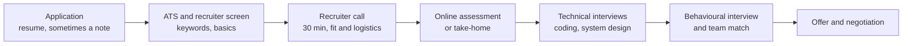

# Resume and portfolio

After this you can write a one-page resume with impact bullets, set up a GitHub profile that supports it, and tailor both to a job posting.

Before this: [Open source and licences](07-open-source-and-licences.md).

## The idea

A recruiter may spend under a minute on your resume, and often a program has already sorted it before a human sees it. The resume has one job: get you the first conversation. It does not need to describe everything you have done; it needs to make the three or four most relevant things easy to see.

The resume is the first step of a longer pipeline. Knowing the stages tells you what each one checks.



## Key terms

An **ATS** (applicant tracking system) is software employers use to collect, store and search applications. It reads your resume as text, so unusual layouts can scramble it. A **co-op** is a paid work term built into a university program (common in Ontario); an **internship** is a temporary job, usually in the summer.

An **impact bullet** is one line that says what you did, how, and the result, ideally with a number. A **portfolio** is a small set of projects, usually on GitHub, that shows your work.

## How it works

Resume rules for a new graduate:

1. One page. Single column, a standard font, no text in images or tables, saved as PDF unless the posting says otherwise.
2. Order: contact line, education, experience (co-ops and internships first), projects, skills. Lead with whichever is strongest.
3. Each bullet: a strong verb, what you built or changed, the technology, and a result. "Cut report generation from 40 s to 6 s by adding a database index and caching" beats "Responsible for improving performance".
4. Numbers must be true and checkable. If you did not measure, say what you did and describe the scope honestly ("used by 12 teammates"). Never invent a figure; interviewers will ask how you measured.
5. Canadian norms: no photo, date of birth, marital status or full home address (city and province are enough). Include a LinkedIn and GitHub link. Work authorization can be a short line if it helps.
6. Tailor for each application: copy the posting's exact terms for skills you really have (for example "PostgreSQL" if the posting says that and you used it), and reorder bullets so the most relevant come first.

```text
Jordan Lee | Toronto, ON | jordan@example.com | github.com/jordanlee | linkedin.com/in/jordanlee

EDUCATION
BSc Computer Science, Example University, expected April 2027

EXPERIENCE
Software Engineering Intern, Acme Retail (May to Aug 2025)
- Cut order-report time from 40 s to 6 s by adding an index and a Redis cache (Python, PostgreSQL).
- Wrote 35 unit tests for the refund module, raising its coverage from 20% to 78%.

PROJECTS
Budget tracker (React, FastAPI, PostgreSQL), github.com/jordanlee/budget
- Built a REST API with 12 endpoints and CI on GitHub Actions; used by 8 friends for 3 months.
```

Fictional example; every figure is made up for illustration.

A portfolio shows range with two or three projects: for example a web app with a database, a tool that handles messy data, and a project with tests and CI. Each repository needs a README (what it is, how to run it, a screenshot), a clear commit history, no committed secrets, and a licence file. Pin your best three repositories on your GitHub profile. Contributions to open source count for more than another to-do app.

## Worked examples

<div class="example" markdown>

### Example 1: rewriting a bullet

Original: "Worked on the backend of a web app using Python."

1. What did you do? "Added an endpoint to export orders as CSV."
2. How? "Flask, SQLAlchemy, streaming rows to avoid loading all in memory."
3. Result? "Handled exports of 200,000 rows without timeouts." Use a number you measured.

Rewrite: "Built a streaming CSV export endpoint (Flask, SQLAlchemy) that handles 200,000-row exports without timeouts."

Check: could an interviewer ask three follow-up questions about it and could you answer each? If not, shorten the claim.

</div>

## Common mistakes

<div class="warning" markdown>

Watch out: listing every technology you touched once. A skills section of 40 items lowers trust; list what you could discuss in an interview.

Watch out: duties instead of results ("Responsible for testing"). Say what changed because of you.

Watch out: an AI-polished resume full of generic phrases. Recruiters see many; specific numbers and tool names stand out.

</div>

## Working with AI

<div class="ai" markdown>

Words to use: impact bullet, ATS, tailor, keywords, portfolio, README.

Prompts to try:

- "Here is a job posting and my resume bullets (pasted). Suggest which two bullets to move up, and which terms from the posting I can honestly use. Do not invent any experience."
- "Rewrite this bullet to start with a strong verb and include the technology and result. If a number is missing, ask me for it instead of making one up."

What to check:

- Invented numbers or technologies. Read each claim and ask whether you could defend it in an interview.
- Buzzword padding. Remove words that carry no fact.
- Private employer details pasted into a public tool. Remove anything confidential first.

</div>

## Quiz

1\. What are the four parts of a good impact bullet?

<details class="solution" markdown>
<summary>Answer</summary>

A strong verb, what you built or changed, the technology used, and the result (with a number if you have one).

</details>

2\. Which items are not usual on a Canadian resume: photo, GitHub link, date of birth, city and province?

<details class="solution" markdown>
<summary>Answer</summary>

Photo and date of birth. A GitHub link and city and province are normal.

</details>

3\. A bullet says "improved performance by 300%" but you never measured it. What do you do?

<details class="solution" markdown>
<summary>Answer</summary>

Remove the number or measure it. Describe the change honestly, for example "added an index to the orders table to speed up the report".

</details>

4\. Why does a two-column resume with icons sometimes fail an ATS?

<details class="solution" markdown>
<summary>Answer</summary>

The ATS reads the file as text in order. Columns, tables and images can scramble the order or hide text.

</details>

## Lab

<div class="lab" markdown>

### Lab: write three impact bullets

Goal: turn your own work into three strong bullets and a tailored skills line. Time: about 20 minutes. Runs in: any text editor.

1. List three things you built or changed (class project, co-op, personal).
2. For each, answer: what, how, result (a number you can defend).
3. Write each as one bullet under about 25 words.
4. Pick one real job posting and write a one-line skills section using only terms you have used.
5. Check your GitHub: does each pinned repository have a README, a licence and no secrets?

<details class="solution" markdown>
<summary>Solution</summary>

```text
- Built a REST API (FastAPI, PostgreSQL) with 12 endpoints and 40 tests, run in CI on every push.
- Reduced page load from 3.1 s to 1.2 s by replacing an N+1 query with one join (Django).
- Wrote a Python script that cleans 50,000 rows of survey data, replacing 2 hours of manual work.

Skills: Python, TypeScript, SQL (PostgreSQL), Git, Docker, GitHub Actions
```

Each figure here is an example. Use measurements you actually have.

</details>

</div>

## Where this shows up

- [Technical interviews](09-technical-interviews.md) test the skills the resume claims.
- [Behavioural interviews](10-behavioural-interviews.md) turn your bullets into stories.
