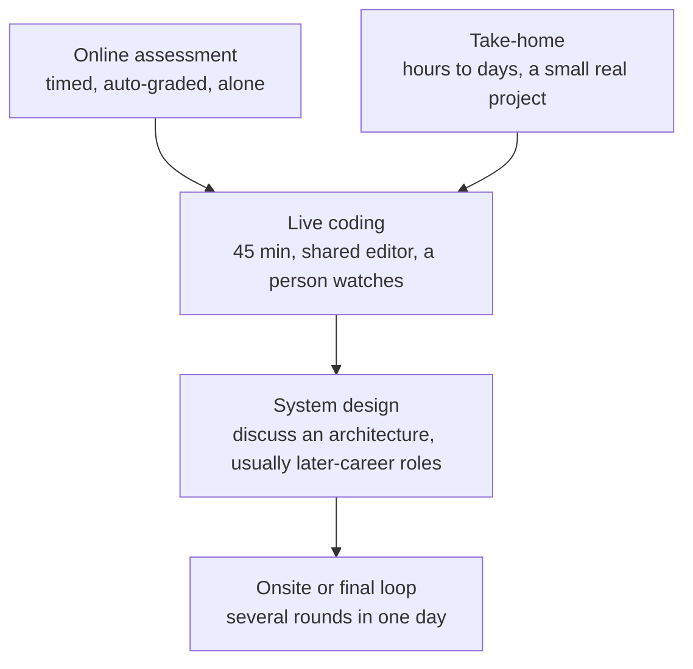

# Technical interviews

After this you can name the common technical interview formats, talk through a problem while solving it, test your code before you say you are done, and handle being stuck.

Before this: [Resume and portfolio](08-resume-and-portfolio.md) and [How to approach a problem](../06-data-structures-and-algorithms/04-leetcode-patterns/01-how-to-approach-a-problem.md).

## The idea

A technical interview measures more than whether you reach the right answer. The interviewer is trying to learn how you think, whether you explain your thinking well, and whether they would want to work through a hard problem with you. Two candidates reach the same solution; the one who explained the trade-offs, tested the code and recovered calmly from a mistake gets the better report.

The pipeline from the [resume lesson](08-resume-and-portfolio.md) has several technical steps, each with its own format.



## Key terms

An **online assessment** (OA) is a timed test, often on a platform such as HackerRank or CodeSignal, graded automatically on hidden tests. **Live coding** is solving a problem in a shared editor while an interviewer watches and talks. A **take-home** is a small project you complete on your own time. **System design** is discussing how to build a larger system (see [scalability basics](../14-software-and-system-design/02-system-design/01-scalability-basics.md)); new-graduate loops often include little or none.

**Thinking aloud** is saying your reasoning as you go. A **dry run** is tracing your code by hand on a small input before running it.

## How it works

Use the same method every time, which is the one from [how to approach a problem](../06-data-structures-and-algorithms/04-leetcode-patterns/01-how-to-approach-a-problem.md):

1. Restate the problem and ask clarifying questions: input size, duplicates, empty input, sorted or not, what to return when there is no answer.
2. Work a small example by hand, out loud.
3. Say a simple solution first, even a slow one, and its complexity. Then improve it, and say why the improvement is better.
4. Agree the approach with the interviewer before writing code.
5. Write code in small readable steps, with clear names. Say what each part does.
6. Test: dry run an example, then edge cases (empty, one element, duplicates, negatives, large input).
7. State the final time and space complexity, and what you would change with more time.

```python
def two_sum(nums, target):
    seen = {}
    for i, x in enumerate(nums):
        if target - x in seen:
            return [seen[target - x], i]
        seen[x] = i
    return []
```

When stuck, do not go silent. Say what you know ("I have an O(n^2) approach; I am looking for a way to avoid the inner loop"), try a smaller example, think about which data structure gives fast lookup, or ask a question ("Can I assume the numbers are non-negative?"). A hint taken well and used is not a failure; ignoring it is.

Practise like the interview: timed, aloud, without autocomplete or an AI tool, on a plain editor, then review what you missed. A small number of well-understood patterns beats a large pile of memorized problems.

## AI use in interviews

Policies differ between companies and between stages, and they change. Some forbid any assistant in live rounds and online assessments, some allow it in take-homes if disclosed, and some now test how you work with an AI tool. Read the instructions for each stage; if they are unclear, ask the recruiter in writing. Using an undisclosed tool where it is banned can end your candidacy. In the job itself, you will use these tools, so being able to explain and check what the code does is the skill interviewers want to see.

## Worked examples

<div class="example" markdown>

### Example 1: testing before saying done

For the two-sum code above, we choose five tests, including edges, and run them.

1. The normal case: `[2, 7, 11, 15]`, target 9, answer `[0, 1]`.
2. Duplicates: `[3, 3]`, target 6, answer `[0, 1]`. This checks that a value is not matched with itself.
3. Empty input and one element: both return `[]`.
4. A negative: `[-1, 4]`, target 3.

```python
tests = [
    ([2, 7, 11, 15], 9, [0, 1]),
    ([3, 3], 6, [0, 1]),
    ([], 5, []),
    ([1], 2, []),
    ([-1, 4], 3, [0, 1]),
]
for nums, target, want in tests:
    got = two_sum(nums, target)
    print("ok  " if got == want else "FAIL", nums, target, got)
```

```text
ok   [2, 7, 11, 15] 9 [0, 1]
ok   [3, 3] 6 [0, 1]
ok   [] 5 []
ok   [1] 2 []
ok   [-1, 4] 3 [0, 1]
```

Check: say the complexity out loud. One pass over $n$ items with constant-time dictionary lookups gives $O(n)$ time and $O(n)$ space.

</div>

## Common mistakes

<div class="warning" markdown>

Watch out: coding before you understand. Spend the first few minutes on questions and an example; fixing a wrong approach after 20 minutes of code is costly.

Watch out: silence. The interviewer cannot give credit for thoughts they cannot hear.

Watch out: saying "done" without running a test. Interviewers expect you to find your own bugs.

</div>

## Working with AI

<div class="ai" markdown>

Words to use: time complexity, edge case, dry run, constraints, brute force, trade-off.

Prompts to try:

- "Act as an interviewer. Give me one medium array problem, wait for my clarifying questions, give only hints when I ask, and at the end list what I did well and what to improve."
- "Here is my solution to this problem (pasted). Do not give the answer. Ask me three questions that would expose a bug or a missed edge case."

What to check:

- A solution you cannot explain line by line. If you cannot explain it, you cannot defend it in a real interview.
- Complexity claims. Re-derive the loops yourself.
- Problems stated differently from how the real interview will ask. Practise reading unclear statements and asking questions.

</div>

## Quiz

1\. What are the first two things you do when given a coding problem?

<details class="solution" markdown>
<summary>Answer</summary>

Restate the problem and ask clarifying questions about inputs and edge cases, then work a small example by hand.

</details>

2\. What does `two_sum([3, 3], 6)` return and why does it matter as a test?

<details class="solution" markdown>
<summary>Answer</summary>

`[0, 1]`. It checks that duplicates are handled and an element is not paired with itself, because the first 3 is stored only after the check.

</details>

3\. You have been silent for two minutes and have no idea. What do you say?

<details class="solution" markdown>
<summary>Answer</summary>

Say what you do know (a brute force, the constraints), try a small example aloud, and ask a clarifying question or for a hint. Staying silent gives the interviewer nothing to assess.

</details>

4\. The online assessment says "no external help". May you use an AI assistant?

<details class="solution" markdown>
<summary>Answer</summary>

No. Follow the stated rules; if unsure, ask the recruiter in writing before the assessment.

</details>

## Lab

<div class="lab" markdown>

### Lab: a mock interview with a transcript

Goal: practise the seven-step method on one problem and write down your own narration. Time: about 25 minutes. Runs in: any editor and a timer.

1. Choose an easy array or string problem you have not solved before.
2. Set a 25-minute timer. Speak aloud (record it if you can) through steps 1 to 4.
3. Write the code with no autocomplete or AI help.
4. Write at least five tests including edge cases, then run them.
5. Listen back. Count the silences over 20 seconds and write two things to change.

<details class="solution" markdown>
<summary>Solution</summary>

A model opening for "find two numbers that add to a target":

```text
Restate: return the indexes of two different elements that sum to target.
Questions: can the list be empty? Can there be several answers? Negatives?
Example: [2, 7, 11, 15], 9 -> [0, 1].
Brute force: two nested loops, O(n^2). Better: store seen values in a dict,
look up target - x, O(n) time and O(n) space. Shall I code that?
```

The code and tests are those in Example 1. Review: did you ask questions before coding, and did you test before saying done?

</details>

</div>

## Where this shows up

- [Behavioural interviews](10-behavioural-interviews.md) are the other half of most loops.
- The pattern lessons in [two pointers and sliding window](../06-data-structures-and-algorithms/04-leetcode-patterns/02-two-pointers-and-sliding-window.md) and [hashing and prefix sums](../06-data-structures-and-algorithms/04-leetcode-patterns/03-hashing-and-prefix-sums.md) cover the patterns that come up most.
