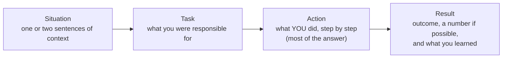

# Behavioural interviews

After this you can prepare a bank of stories, answer a behavioural question in the STAR structure, ask good questions back, and respond to an offer.

Before this: [Technical interviews](09-technical-interviews.md).

## The idea

"Tell me about a time you disagreed with a teammate." The interviewer is not looking for a perfect story. They want evidence, from your actual past, of how you work: how you handle conflict, mistakes, deadlines and unclear tasks. Past behaviour is the best predictor they can get in an hour. The weak answer is a general claim ("I'm a team player"); the strong answer is one specific event.

A **behavioural question** asks about a past situation, often starting "Tell me about a time...". The standard structure for answering is **STAR**.



## Key terms

**STAR** stands for Situation, Task, Action, Result. A **story bank** is a set of six to eight prepared stories, each flexible enough to answer several questions. **Behavioural interview** and **cultural interview** are loose terms for the round that tests communication, teamwork and judgment rather than code.

## How it works

Build a story bank before you apply. Cover these themes, using work, co-op, class projects or volunteering:

1. A project you are proud of, and your part in it.
2. A conflict or disagreement and how it ended.
3. A mistake or failure and what you changed.
4. A time you learned something fast.
5. A time you led or helped others.
6. A time with unclear requirements or a tight deadline.
7. Optionally: feedback you received, or a time you disagreed with a decision and still helped deliver it.

For each, write five lines: Situation, Task, Action (three steps), Result (with a number), Lesson. Practise saying it in about two minutes. Say "I" for what you did and "we" for the team; the interviewer needs to hear your part.

Common questions: tell me about yourself; why this company; a hard bug; a disagreement; a mistake; a deadline; how you handle feedback. For "tell me about yourself", give a 60-second summary: where you are now, one or two relevant highlights, and why this role.

Ask good questions back. They show what you value and help you decide whether to accept. Examples: "What does a successful first six months look like?" "How are code reviews and on-call handled?" "How does the team decide what to build next?" "What is the hardest part of this job?" Avoid questions the website answers, and avoid asking about pay or vacation in the first interview unless the recruiter raises it.

### The offer

When an offer arrives, thank them, ask for the details in writing, and ask for a few days. Compare total compensation: base salary, bonus, equity, benefits, vacation, and learning or mentoring. It is normal to ask politely whether the offer is flexible, and to give a reason, such as a competing offer or your research. Base any salary number on public information you can cite, such as the posted range or published salary data from a named source with its date, not on a hunch. Be honest: do not invent a competing offer. Review the contract terms, including the probation period, and ask the company, a lawyer or a mentor if anything is unclear. Ontario's Employment Standards Act sets minimum rules; see [Your guide to the Employment Standards Act](https://www.ontario.ca/document/your-guide-employment-standards-act-0) for current details.

## Worked examples

<div class="example" markdown>

### Example 1: a STAR answer to "tell me about a mistake"

Question: Tell me about a time you made a mistake at work.

- Situation: During my co-op I deployed a change to a reporting job on a Friday afternoon.
- Task: I owned that job and its output for the finance team.
- Action: The job skipped a nightly file because of a path typo. I noticed Saturday morning from the alert, rolled back, re-ran the job and told my manager and finance what was missing and when it would arrive. Then I added a test for the path and a Friday rule to the team checklist.
- Result: The reports were two hours late, with no wrong numbers. The test caught a similar typo a month later. I now run the change in staging before any deploy and avoid late Friday deploys.

Check: does the answer show ownership, a concrete fix and something that changed after? A mistake story needs all three.

</div>

## Common mistakes

<div class="warning" markdown>

Watch out: a story where everything went well and you learned nothing. Choose a real example and show what you would do differently.

Watch out: blaming others. Describe a disagreement by what each person wanted and how you resolved it.

Watch out: rambling past three minutes. Aim for two. Stop after the result and let them ask follow-ups.

Watch out: inventing or inflating details. Interviewers probe with follow-up questions, and the lie costs more than a modest story.

</div>

## Working with AI

<div class="ai" markdown>

Words to use: STAR, story bank, situation, result, follow-up question, total compensation.

Prompts to try:

- "Here is my draft STAR story about a conflict on a group project. Ask me three follow-up questions an interviewer would ask, and tell me where my own part is unclear."
- "Given this list of six stories (titles only), tell me which common behavioural questions each can answer and which themes I have no story for."

What to check:

- Embellished facts. The AI may add details that did not happen; keep only what is true.
- A polished, generic voice. Say it out loud in your own words; an answer that sounds read will not hold up under follow-ups.
- Salary figures. Confirm against a named, dated public source before using one.

</div>

## Quiz

1\. What does each letter of STAR stand for, and which part should be longest?

<details class="solution" markdown>
<summary>Answer</summary>

Situation, Task, Action, Result. Action should be the longest because it shows what you did.

</details>

2\. Why prepare six to eight stories and not one per possible question?

<details class="solution" markdown>
<summary>Answer</summary>

One story can answer several questions with a different emphasis (a project can show leadership and a deadline), so a small bank covers most questions.

</details>

3\. You are asked "Do you have any questions for us?" Give two good ones and one to avoid.

<details class="solution" markdown>
<summary>Answer</summary>

Good: "What does success look like in the first six months?" and "How does the team handle code review?" Avoid asking about something on the careers page, or about vacation first.

</details>

4\. An offer comes in on a call. What do you say?

<details class="solution" markdown>
<summary>Answer</summary>

Thank them, say you are excited, and ask for the details in writing and a few days to review. Do not accept or counter on the spot.

</details>

## Lab

<div class="lab" markdown>

### Lab: write and rehearse a STAR answer

Goal: produce one tight STAR story and a list of questions to ask. Time: about 20 minutes. Runs in: any text editor and a timer.

1. Pick one real event (a conflict, a mistake, or a deadline).
2. Write Situation, Task, Action and Result in five to seven lines. Include a number or a concrete outcome in the Result.
3. Say it aloud with a timer; cut it to two minutes.
4. List which two other questions the same story could answer.
5. Write three questions to ask the interviewer.

<details class="solution" markdown>
<summary>Solution</summary>

```text
Situation: In our capstone, two teammates disagreed about using Django or Flask.
Task: As the person who set up the repo, I needed us to decide within the week.
Action: I wrote a one-page comparison (setup time, features we needed, who knew what),
asked each person to rank the criteria, and we picked Django because three of the
five criteria favoured it. I offered to pair with the Flask fan on the first model.
Result: We finished the backend a week early and both teammates later said the
comparison made the choice feel fair.

Also answers: leadership, disagreement with a decision, making a technical choice.
Questions: How do you decide on technology? What is a recent project that went well?
What do new hires struggle with in the first three months?
```

The figures and names are an example; use your own event.

</details>

</div>

## Where this shows up

- Your story bank draws on [code review etiquette](04-code-review-etiquette.md), [working in a legacy codebase](06-working-in-a-legacy-codebase.md) and your [resume](08-resume-and-portfolio.md) bullets.
- [Incidents and on-call](../13-devops-and-cloud/04-operations/02-incidents-and-on-call.md) is a good source of "tell me about a hard bug" stories.
